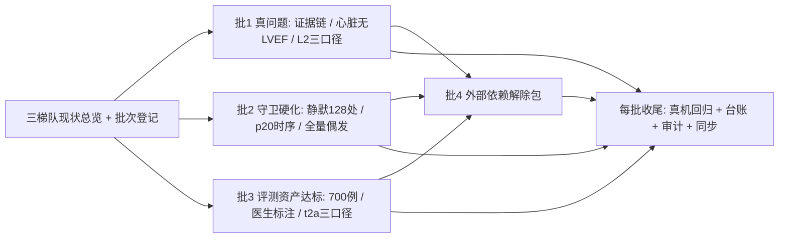

## 产品概述
把项目「第一/第二/第三梯队」的开发现状一次性讲清楚，并给出一份能直接照着做的完整开发计划：全量条目一次排清、按 3~4 批推进、每批都有可验证的完成判据；卡在外部输入上的条目写清「前置条件 + 建议方案 + 现在就能先做的准备」。全部用大白话写，不堆术语。

## 核心内容
- **现状总览（三梯队逐条）**：每条讲清「现在什么状态 / 卡在哪 / 谁需要做什么」。
  - 第一梯队（性能提升）：实测已达标项（判读耗时、校验降载、检索口径）与仍卡着的项（两项口径待拍板、一项外部数据、一项待医生勾选），以及一项遗留代码债（后端仍有 128 处「出错不吭声」的地方）。
  - 第二梯队（能力补全）：全部交付完毕，只需写清「由哪些自动检查守着、防止以后改坏」。
  - 第三梯队（研究与验证）：已交付的分割评测与影像量化；评测资产链已打通但数量没达标（样本 148/700、医生标注 0/50）；甲状腺恶性判别只有公开集的「下界」证据，缺真正独立的验证数据；以及本批新发现的三个真问题。
- **分批开发计划（全量一次给全，分 4 批执行）**：
  - 第 1 批（价值与风险最高，都是能跑真机验证的）：①查清「系统记录的知识引用」是否就等于「模型生成结论时真正看到的那段知识」——这关系到所有「结论可溯源」的说法是否成立；②心脏检查在没填心功能数值时一律转人工的问题，改成「能给可行动提示、能引导补测」；③把忠实度指标的三套口径一次算清，给出让决策者拍板用的一页纸。
  - 第 2 批（守卫硬化，防以后改坏）：把后端剩余 128 处「出错不吭声」按重要链路分批收敛并同步下调门槛；修掉一个真机走查里偶发的判据（分割结果刚到就数覆盖层导致误判）；定位并修掉「全量跑测试偶发失败、单独跑必过」的用例。
  - 第 3 批（评测资产达标）：把评测样本从 148 往 700 推（持续真机判读积累 + 去重口径复核）；列出医生标注达到 50 例所需的配合清单；把甲状腺判别按「开发集/公开集/独立集」三口径分列并预置独立集冻结流程，独立数据一到即可套用。
  - 第 4 批（外部依赖解除包）：需要拍板的口径、需要医生花时间勾选的词表、需要外部数据的协议与最小可执行路径、以及暂时拿不到真实样本时的替代方案——都写成人话的一页纸，让决策与配合成本一眼可见。
- **每批统一收尾**：真机回归取真实数字、台账回写、审计检查、提交、服务器同步与临时文件清理。

## 交付效果
一份「现状总览 + 分批计划」文档（含每批的目标、动作、验收判据与依赖），配套一份可跟踪的批次清单；执行过程中每批都留下可复跑的证据与截图，且不出现「看起来全覆盖、实际没验」的条目。


## 技术栈与选型
沿用现有栈，不引新依赖：

- 文档与台账：Markdown（`21-远期路线图`、`progress.md`、`session-handoff.md`、16 号附录）+ `feature_list.json`（**唯一事实源**，数字与状态只在此与 16 号附录落地）
- 守卫与探针：Python 3.12 + `ast`（静默棘轮）、本地 ESLint 规则（前端静默）、Node + Playwright（真机走查）、PIL（截图像素判定）、pytest / vitest
- 真机执行：`[skill:remote-gpu-server-devtest]`（服务器 10.20.28.21：主服务 18000、判官 8006、分类 8003、Langfuse 30100）
- 台账回写与审计：`[skill:uai-harness-maintenance]`
- 定位与核实：`[subagent:code-explorer]`

## 实现思路与关键决策

### 决策 1：计划的落点是「既有路线图 + 台账」，不新起文档
21 号路线图本就是 feature_list 的**路线视图**，新起文档会立刻产生两处数字、两套状态（本仓库已明确禁止）。做法：在 21 号新增两节——「三梯队现状总览」与「分批开发计划」，并在 `feature_list.json` 为 4 个批次各建可跟踪条目（含 `dependencies` / `evidence`），批次状态以 feature_list 为准。

### 决策 2：批 1 的三个问题按「能否被证伪」设计，而不是按猜测修
**① 证据链（最高优先）**：已定位落库链路——`app/services/diagnosis_pipeline.py:1014-1020` 把 `fusion_result.final_response.evidence_chunk_ids` 写成 `knowledge_ids`，再由 `app/api/v1/diagnosis.py:468/486` 入库；而专科侧只取 **top-3/top-5**（`app/agents/specialist/cardiac.py:204/240` 为 `chunks[:5]`、`chunks[:3]`）。**假说**：落库的是「被引用的少数块」，不等于「喂进 prompt 的全部检索块」——所以 L2 判官看到的上下文比生成时少，faithfulness 天然偏低。核实方式：新探针 `scripts/audit/p30_evidence_chain.py` 对同一次判读同时取「prompt 实际上下文」与「落库 knowledge_ids」，断言计数/顺序/覆盖率三件事，并带**反证腿**（把落库改成只记 top-1 时必须判红）。结论只有三种，必须落到其中一种：只记部分 / 顺序不同 / 未落库；然后按结论修（要么补齐"生成上下文"记录，要么在报告与台账里如实标注"引用 top-N"）。

**② 心脏腿「无 LVEF」**：`app/agents/specialist/cardiac.py:188-213` 在抽不到严重程度时直接走可读降级 + 转人工。两条改进路径分开做、医学口径分开标：
- 可行动化（低风险，本批做）：降级文案从"已转人工"升级为"未检测到心功能数值；请补测 LVEF 或补充测量后重判"，前端在心脏会话给出可点击的引导；
- 数值来源（**需 00 号拍板**，本批只做可行性核实）：工作区已有测量与标注持久化（A.40/A.41，`app/api/v1/annotations.py` 与前端测量面板），核实能否把医生录入的测量值作为 LVEF 的**输入通道**而不是只在文本里等模型抽；核实结论先写进台账，不擅自改医学判定逻辑。

**③ L2 三口径**：`scripts/langfuse/judge_eval_set.py` 已有 `--answer-mode raw|reasoning`，本批增加第三种「剔除派生字段」（把系统算出的分级/总分/置信度从被判答案里去掉），三口径同一样本集对照，产出给 00 号的一页纸（含与①的交叉引用：若证据链是"只记 top-N"，则口径结论必须一并说明）。`scripts/langfuse/eval_gate.py` 已支持 `--judge-mode gate`，切换条件写成明确判据而不是"感觉可以了"。

### 决策 3：批 2 的收敛按「链路重要性」分批，且每批同步下调棘轮
静默存量基线在 `tests/unit/quality/silent_catch_baseline.json`（**只许下调**；7 个主路径文件零容忍）。批 2 按链路分批：可观测/日志（`app/observability/*`）→ 检索与融合（`app/rag/*`、`app/fusion/*`）→ 安全与脱敏（`app/security/*`）→ 基础设施（`app/integration`、`app/services/*`、`edge/*`、`safety_gateway/*`）；每批只加留痕（logger.warning）或写明 `silent-ok` 理由，**不改降级返回值与控制流**。p20 的 G5.4 位于 `scripts/audit/p20_frontend_boundary.mjs:303-333`：已有"等分割到达（至多 90s）"的 G5.4a，但到达后立刻逐帧数覆盖层，需按 A.58 的 T1-3 同款做法补"到达后再等一次渲染 + 逐帧重试一次"。

### 决策 4：批 3/4 写清「谁要做什么、怎么算做完」
批 3 的达标路径尽量拆成"不需要外部配合就能推进"的部分先做（持续判读采集走既有 `p27_grade_extraction.py --rounds`，采集与门禁脚本已就绪）；`answer_relevancy` 若要补，**先抄官方 prompt 再实现**（`scripts/prompts/` 现有 faithfulness 一份，不许自造）。批 4 全部写成"前置条件 / 建议方案 / 现在就能先做的准备"三段式，并同步进 `progress.md` 的 Blockers 表（带责任方）。

## 实现注意（执行细节，防回归）

- **台账纪律**：每批收尾必须回写 `feature_list.json`（含 `head_commit`）/ `progress.md` / `session-handoff.md` / 16 号附录（只追加 A.62.x，不改历史）/ 21 号；跑 `validate-harness.mjs`（现状 100/100）。
- **棘轮与阈值**：静默基线只许下调；19 号指标阈值（faithfulness ≥0.95 / 相关性 ≥0.90）与 t2a 门控（AUC ≥0.80 且 CI 下界 ≥0.70）**不得为了让门禁变绿而下调**；医学口径类改动必须标注"需 00 号拍板"。
- **真机姿势**：本机经 SSH 隧道（`ssh -N -L 8000:127.0.0.1:18000`）跑 p26/p28/p20；服务器侧一律"本地写脚本 → `scp` → `sed -i 's/\r$//'` → `bash /tmp/x.sh`"，长任务 `nohup … &` 轮询日志，`CUDA_VISIBLE_DEVICES=0` + `unset LD_LIBRARY_PATH`；改后端必按 PID kill 重启主服务（禁 `pkill -f`）。
- **前端产物**：若本批触及前端（心脏引导），必须 `VITE_BASE=/ui/` **清空式**重建并核对 `health/ui/js` 全 200（A.55 白屏事故的口径）。
- **性能**：批 2 的静默收敛是纯加日志，注意**限流**（循环内失败不得刷屏，参考前端 `utils/errorReport.ts` 的按 scope 去重）；判官与探针调用注意 GPU 串行，别与真机回归抢显存。
- **不做**：不动 `ZERO_TOLERANCE` 的 7 个主路径文件语义；不重训 t2a 探针；不改前端 lint 预算（`--max-warnings 1`）；不提前动 NMPA 材料。

## 架构与依赖



## 目录结构（改动清单）

```
e:/Ultrasound Diagnosis Decision Support AI System/
├── docs-for-guiding generating docs/超声诊疗决策支持系统/21-远期路线图-20261009.md   # [MODIFY] 新增「三梯队现状总览」与「分批开发计划（批1~4，含验收判据与依赖）」两节；刷新阶段一/三条目状态；外部依赖项按「前置条件/建议方案/现在就能做的准备」三段式重写
├── feature_list.json                                    # [MODIFY] 为 4 个批次新增可跟踪条目（含 dependencies/evidence）；同步 t2a-independent-val / unit-full-suite-sec-flaky / faithfulness-gate 的状态与说明；收尾更新 head_commit
├── progress.md                                          # [MODIFY] 头部 Last Updated 指向 A.62；Blockers 表补责任方；证据索引补新探针与报告
├── session-handoff.md                                   # [MODIFY] Last Updated 换成 A.62 交接；补各批复跑入口与踩坑
├── docs-for-guiding generating docs/超声诊疗决策支持系统/16-开发进展汇报-20260928.md  # [MODIFY] 追加附录 A.62（分批执行的真实数字与证据；只追加）
├── scripts/audit/p30_evidence_chain.py                  # [NEW] 证据链核实探针：同一次判读取「prompt 实际上下文」vs「落库 knowledge_ids」，断言计数/顺序/覆盖率 + 反证腿（只记 top-1 必须判红）；退出码 0/1/2 可门禁
├── scripts/audit/p31_cardiac_lvef_channel.py            # [NEW] 心脏腿「无 LVEF」现状与可行动性探针（真机跑心脏会话：降级文案是否可行动、测量通道可行性取证）
├── app/agents/specialist/cardiac.py                     # [MODIFY] 降级分支文案升级为可行动提示（保留 needs_review 与 trace 留痕；医学判定逻辑不动）
├── app/agents/specialist/readable.py                    # [MODIFY] 对应降级文案与严重程度中文标签（如需要）
├── frontend/src/components/workspace/*                  # [MODIFY] 心脏会话的补测引导提示（只读提示，不新增设计体系；按需最小改动）
├── scripts/langfuse/judge_eval_set.py                   # [MODIFY] 增加第三种口径（剔除派生字段）与批量对照输出，供 00 号拍板
├── scripts/langfuse/eval_gate.py                        # [MODIFY] 把 --judge-mode gate 的启用判据写成显式条件（口径拍板 + 证据链结论落地）
├── scripts/audit/p20_frontend_boundary.mjs              # [MODIFY] G5.4 到达后再等一次渲染 + 逐帧重试一次（消除 hitFrames=[] 偶发）
├── tests/unit/quality/silent_catch_baseline.json        # [MODIFY] 批 2 逐批下调（只许下调）
├── tests/unit/quality/test_eval_gate_layers.py          # [MODIFY] 补第三口径与 gateway 判据的用例
├── tests/unit/agt/test_cardiac_specialist.py            # [MODIFY] 补「无 LVEF 时文案可行动」用例
└── （批 2 触及的 app/ 与 safety_gateway/ 文件）           # [MODIFY] 仅加留痕或 silent-ok 理由，不改降级语义
```

## 关键代码结构（仅接口级）

```python
# scripts/audit/p30_evidence_chain.py —— 三个结论必须落到其一，避免"看起来查过"
# 退出码：0 = 落库与生成上下文一致；1 = 不一致（已判定属于哪种）；2 = 缺输入/服务不可达
# reports/p30_evidence_chain.json：
# {
#   "request_id": "req_...", "organ": "thyroid",
#   "prompt_context": {"n": 0, "chunk_ids": []},      # 生成时喂进 prompt 的检索块
#   "stored_evidence": {"n": 0, "chunk_ids": []},     # diagnosis_results.knowledge_ids
#   "verdict": "same | subset_topn | reordered | not_stored",
#   "coverage": 0.0,                                  # stored ⊆ prompt 的比例
#   "reverse_check": {"before": "PASS", "after_top1_injection": "FAIL"}  # 反证腿必红
# }
```


## Agent Extensions

### SubAgent
- **code-explorer**
  - Purpose: 批 1 的关键定位——把「生成上下文 vs 落库引用」的完整链路（检索器 → 专科 `_post_process` 截断 → fusion 合并 → `diagnosis_pipeline` 落库 → API 出参）逐点定位到文件:行号；核实心脏会话可用的测量/标注数据通道（后端与前端各在哪、字段是什么）；批量列出批 2 要收敛的静默 `except` 位置与所属链路。
  - Expected outcome: 三份可直接照着改的清单（证据链链路清单 / 测量通道清单 / 静默收敛分批清单），每项带文件:行号与语义判断，避免边改边猜。

### Skill
- **remote-gpu-server-devtest**
  - Purpose: 所有真机动作——跑证据链探针与心脏腿探针（需主服务与 8006 判官）、跑评测集采集与三口径判官、跑 `p27/p29` 回归、按 PID kill 重启主服务、`git archive` 同步 HEAD、前端产物清空式重建与部署、临时文件清理。
  - Expected outcome: 每批都有可复跑的退出码与报告落盘（`reports/p30_evidence_chain.json`、`reports/langfuse_eval_judge*.json`、`reports/t2a_aul_holdout.json` 等），服务器与仓库 HEAD 一致。

- **uai-harness-maintenance**
  - Purpose: 每批收尾的台账回写与口径仲裁——把真实数字写进 16 号附录 A.62、刷新 `feature_list.json`（批次条目 + `head_commit`）、`progress.md`（Blockers 责任方）、`session-handoff.md`（复跑入口与踩坑）、21 号路线图（现状总览与分批计划），并跑 harness 审计。
  - Expected outcome: 五份文件口径一致、证据指针齐全、审计保持满分；外部依赖项都以「前置条件 / 建议方案 / 现在就能做的准备」三段式写清。
