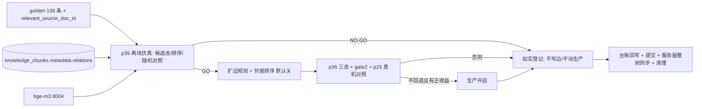

## 产品概述

把「知识图谱检索增强」这条线继续做完：上一轮（A.64）已量化出它今天不生效的根因——*边只连同一文档的相邻块，而命中的是一篇一块的对话语料*，并登记了唯一前置条件：**邻居排序**（跨文档同章节边的候选池每个种子 125.6 条，而检索器一次只取 5 条，不排序就是往上下文里灌噪声）。本轮以「先量再做」推进：先把「排序到底能不能救活它」离线量化清楚，达到预注册判据才实现，达不到就如实登记并停止，不动生产。

## 核心内容

- **离线量化（不写库、不改生产）**：对 136 条 golden 查询，构造「跨文档同章节」候选池，按与查询/种子的语义相似度排序取前 5，度量：候选池里本来有没有正确文档（收益上限）、排序后前 5 命中率相对随机前 5 的倍数、以及把排序邻居追加到检索结果后整体命中率与 MRR 是否变化。
- **预注册判据**：三条判据必须在动手前写死（上限是否够、排序是否显著优于随机、追加后指标是否不回退）；三条不全过即判定 NO-GO，只交量化报告与前提条件，**不写边、不建临时版本、不动生产**。
- **条件实现（仅 GO 时）**：给知识库回填脚本加一条可选的「跨文档同章节」建边规则（支持演练模式、每块邻居数上限、幂等）；给检索器的图谱扩展加「邻居按相似度取前 k」（默认关闭，保持现状），复用项目已有的嵌入服务，批量计算 + 候选上限 + 固定事件名留痕。
- **真机对照与切生产决策**：在同一套评测口径下跑「关 / 开（不排序）/ 开（排序）」三态，检索指标一律不得回退；只有同时满足「有正收益 + 不回退 + 服务路径口径一致」才考虑在生产配置里开启，否则保持关闭并把结论与前提写进台账。
- **统一收尾**：真机数字 + 可复跑命令 + 防止以后改坏的自动检查；台账只追加，服务器整树同步，临时文件只清本次会话自己建的。

## 交付效果

- 一份「图谱邻居排序收益」量化报告（含上限、随机对照、追加前后指标），并给出明确的 GO / NO-GO 结论。
- 若 GO：扩边规则与邻居排序落地（默认关闭，需显式开启）、配套单测（正反腿：相似邻居胜出 / 嵌入不可用时降级且留痕 / 上限生效 / 来源标记不变）、三态真机指标对照表。
- 若 NO-GO：不产生任何生产改动，只登记量化证据与前置条件（所需语料或更强排序器），避免下一轮重做同样探索。
- 两种结局都产出：复跑入口、报告路径、台账条目（附录只追加）、改坏即判红的守卫。


## 技术栈与选型

沿用现有栈，不引新依赖：

- 后端：Python 3.12 + FastAPI，PostgreSQL(pgvector)/Qdrant；知识块边存于 `knowledge_chunks.metadata.relations`（JSONB，GIN 索引）
- 检索链路：`app/rag/retriever.py`（图谱邻居扩展）→ `app/rag/service.py`（重排与分数过滤，A.63 已对图谱来源豁免阈值）
- 排序资源：复用 `Retriever` 已持有的 `embedding_service`（bge-m3，服务 8004）；脚本侧复用 `scripts/t1_eval_retrieval.py:31 embed_texts(texts, bge_url, batch_size=64)`
- 评测口径：`scripts/gate2_bge_top10.py`（136 golden 的 hit@1/Top10/MRR）、`scripts/audit/p15_retrieval_parity.py`（服务腿 vs eval 腿）、`scripts/audit/p36_graph_expansion_ab.py`（图谱开/关两态）
- 真机执行：服务器 student03@10.20.28.21（见 `[skill:remote-gpu-server-devtest]`）；台账回写见 `[skill:uai-harness-maintenance]`

## 实现思路与关键决策

### 决策 1：先做离线仿真，而不是先改代码或先建临时版本

现状（已核实，带 path:line）：

- `app/rag/retriever.py::_expand_graph_neighbors`（`:247-306`）：门控 `settings.graph_query_enabled`（`app/config/settings.py:391`，默认 **False**）；取融合 top-3 作种子（`graph_seed_limit=3`，`:129`）；对每个种子取 `query_neighbors(seed_id, max_depth=1)`（`:280`），邻居**按返回顺序**取前 `graph_neighbor_limit=5`（`:277/:291`），`score=0.0`、来源标 `GRAPH`（`:300-307`）—— **没有任何相关性排序**。
- 边的写入侧只连同文档相邻块：`app/knowledge/builder.py::_attach_relations`（`:285-314`，调用点 `:423-425`）；存量库用 `scripts/kb_backfill_relations.py`（`--kb-version` / `--dry-run`，只 `UPDATE metadata`，已含 `relations` 则跳过 → 幂等）。
- A.64 量化（可复跑）：`scripts/audit/p38_kb_structure_health.py` → 1257 块 / 1057 文档、**单块文档 936（88.5%）**、token 中位 146、带边块 321（25.5%）；`p38 --coverage` → 跨文档同章节边适用面 **136/136**，但**候选池 51262 条 = 每种子 125.6**，判定 `SUPERNODE_RISK`。

**决策**：把「排序是否有救」做成**纯离线仿真**（只读 DB + 嵌入服务，不写任何边、不改 kb 版本、不改生产配置）。理由：写边或建临时 kb 版本都动数据，而仿真已足够证伪——若仿真显示排序后收益不存在，就完全不必动数据；若存在，再进入实现与真机对照。这是 A.63/A.64 两轮"直觉改动被数据否掉"的直接对策。

仿真口径（`scripts/audit/p39_graph_neighbor_ranking_sim.py`，新建）：

1. 对 136 条 golden 查询取融合 top-10（与 p36/p15 同一检索口径：无增强、无重排、无 BM25 回退）；
2. 候选池 = 与种子同 `(organ, section_path)` 但不在 top-k 的块（跨文档）——即 A.64 量化出的那 125.6 条/种子；
3. 排序 = 查询文本嵌入与候选内容嵌入的余弦（批量），取前 5；
4. 三个度量：
   - **上限**：候选池里本来就含正确文档（golden 的 `relevant_source_doc_id`）的查询比例；
   - **排序 vs 随机**：同一候选池里，排序取 5 与随机取 5 的正确文档命中率之比（同池对照，排除"池子里本来就没答案"的干扰）；
   - **追加前后**：把排序邻居接到 top-10 之后，重算 hit@1/hit@5/hit@10/MRR，与不追加对照。

**预注册判据（写进脚本 docstring 与报告，不达标即 NO-GO，不事后找理由）**：
① 候选池含正确文档的查询比例 ≥ 20%；② 排序前 5 的命中率 ≥ 随机前 5 的 1.5 倍；③ 追加后 hit@10 与 MRR **不回退**（容差 0）。三条全过 → GO。

### 决策 2：实现时"扩边"与"排序"必须成对落地，且都默认关闭

只加排序不解决问题（现状边只有 400 条、适用面 0/136，没有候选）；只扩边不排序就是 A.64 已判定的灌噪声。做法：

- **扩边规则**（`scripts/kb_backfill_relations.py`，新增可选参数）：`--cross-doc-section`（按 `organ + section_path` 把同一章节的块互指，**跨文档**）；必须支持 `--dry-run` 先看样例与规模；每个块的邻居**设上限**（防超级节点，默认取一个保守值并在报告里写明）；严格幂等（已含 `relations` 的块跳过）；
- **排序**（`app/rag/retriever.py`）：在 `_expand_graph_neighbors` 内插入"邻居排序"步骤——对候选做批量嵌入、按与查询的余弦取前 `graph_neighbor_limit`；新增开关 `graph_neighbor_ranking_enabled`（`app/config/settings.py`，**默认 False**，即不开启时行为与现状逐字节一致）；嵌入不可用时**降级为原顺序**并留痕（不得静默、不得抛断主链路）；
- **性能边界（必须写清并测）**：候选数按种子设上限、嵌入按批（复用 64/批的既有约定）、每查询最多一次批量嵌入；若单次检索增加超过预先设定的预算则直接降级为不排序并留痕（避免把检索拖慢）；
- **不动的东西**：`GRAPH` 来源标记、A.63 的阈值豁免、`min_score_filter_applied` 与两种空成因留痕、`graph_query_enabled` 默认值（不因本轮而改）。

### 决策 3：切生产要有预注册判据，且必须走"三态对照"

三态 = 关 / 开（不排序）/ 开（排序），同一 golden 集同一口径：`scripts/audit/p36_graph_expansion_ab.py`（扩展为三腿并报告 rescue/dilution）+ `scripts/gate2_bge_top10.py` + `scripts/audit/p15_retrieval_parity.py`。

切生产条件（写死在报告里）：检索指标（hit@1/hit@10/MRR 与服务腿一致性）**全部不回退** 且 排序腿相对不排序腿**有正收益**（rescue>0 且无稀释）。不满足 → 保持 `graph_query_enabled=False`、`graph_neighbor_ranking_enabled=False`，把边界条件与所需语料写进台账（结论合法交付）。

### 决策 4：一把尺子（A.64.1 的教训）

新探针不得自写命中率/MRR/相似度度量，一律复用既有实现（`p36` 的命中口径、`p29` 的秩和口径如需），并加守卫（`tests/unit/quality/test_graph_metric_single_source.py`，新建）：断言新探针 import 既有口径函数、且文件内不出现自写的度量函数定义。理由：上一轮刚发生过"四条链四套 AUC 实现"导致数字不可比。

## 实现注意（执行细节，防回归）

- **先量再做 + 预注册判据**：仿真报告必须包含判据原文与逐条结论；NO-GO 也要落盘（避免下一轮重做）。
- **零静默与 ruff 棘轮**：新写的 `except` 必须有留痕/raise/失败变量；`pytestmark` 写在 import 之后（否则 E402/I001 顶基线，A.63 踩过）。
- **不越权**：候选池上限、批量嵌入大小、降级阈值都要在报告里写明数值与理由，不用"感觉够快"这类表述。
- **真机铁律**：本地写脚本 → `scp` → `sed -i 's/\r$//'` → `bash /tmp/x.sh`（**任何远端命令都落脚本再 scp**，PowerShell 内联会把 `$HOME` 撕成 `\C:\Users\...`）；改后端按 **PID kill** 重启主服务；`CUDA_VISIBLE_DEVICES=0` + `unset LD_LIBRARY_PATH`；临时文件只删本次会话自己建的（共享服务器有并行工作线）。
- **台账纪律**：16 号附录**只追加 A.65.x**；`feature_list.json` 新增条目并更新 `head_commit`；`progress.md` / `session-handoff.md` / 21 号（批 7）同步；**跨文件改动一次 `git add` 到位**再提交（A.63 踩过"测试已提交、实现未提交"）。
- **阈值纪律**：本轮**不调** faithfulness ≥0.95 / 相关性 ≥0.90 / t2a 门控 0.80 与 0.70 任何阈值。
- **不做**：文本嵌入换代评估（用户未选）、任何模型训练、前端改动、NMPA 材料、TNSCUI（CC BY-ND）。

## 架构与依赖



## 目录结构（改动清单）

```
e:/Ultrasound Diagnosis Decision Support AI System/
├── scripts/audit/p39_graph_neighbor_ranking_sim.py   # [NEW] 离线仿真：候选池构造（同 organ+section_path、跨文档）→ 批量嵌入排序取前 5 → 三条预注册判据（上限 ≥20% / 排序 ≥ 随机 1.5 倍 / 追加后 hit@10 与 MRR 不回退）→ 报告 reports/graph_ranking_sim.json 与 GO/NO-GO 结论；只读 DB
├── scripts/audit/p36_graph_expansion_ab.py           # [MODIFY] 由两腿扩展为三腿（关 / 开不排序 / 开排序），报告增加 rescue 与 dilution 分列；保留原判定字段兼容
├── app/rag/retriever.py                              # [MODIFY] _expand_graph_neighbors 增加「邻居按相似度取前 k」步骤（批量嵌入、候选上限、嵌入不可用降级为原顺序 + 固定事件名留痕）；不开启时行为与现状一致
├── app/config/settings.py                            # [MODIFY] 新增 graph_neighbor_ranking_enabled: bool = False（默认关）+ 注释说明与 graph_query_enabled 的关系
├── scripts/kb_backfill_relations.py                  # [MODIFY] 新增 --cross-doc-section（跨文档同章节建边，含每块邻居上限），与既有 --dry-run/幂等语义一致；默认不启用
├── tests/unit/rag/test_retriever_graph_expansion.py  # [MODIFY] 保持原 4 例全绿；新增排序腿（相似邻居胜出 / 嵌入不可用降级且有留痕 / 上限生效 / GRAPH 来源标记不变）
├── tests/unit/quality/test_graph_metric_single_source.py  # [NEW] 守卫：新探针必须复用既有命中/MRR 口径，禁止自写度量（一把尺子）
├── docs-for-guiding generating docs/超声诊疗决策支持系统/16-开发进展汇报-20260928.md  # [MODIFY] 追加附录 A.65.x（只追加：仿真判据与数字、三态对照、切/不切生产结论、踩坑）
├── docs-for-guiding generating docs/超声诊疗决策支持系统/21-远期路线图-20261009.md    # [MODIFY] 新增「批 7」节与出口判据
├── feature_list.json                                 # [MODIFY] 新增本条条目（含 dependencies/evidence）并更新 head_commit
├── progress.md / session-handoff.md                  # [MODIFY] Last Updated、Blockers（GO/NO-GO 结论与前置）、证据索引、复跑入口与踩坑
└── reports/graph_ranking_sim.json                    # [NEW] 仿真报告（上限 / 排序 vs 随机 / 追加前后指标 / 判据逐条结论）
```

## 关键数据结构（仅契约级）

```text
# reports/graph_ranking_sim.json
{
  "golden": {"n": 136, "source": "kb_qa_golden_v1.json"},
  "candidate_rule": {"group": "organ+section_path", "cross_doc": true, "cap_per_seed": 0},
  "ceiling": {"queries_with_gold_in_pool": 0, "ratio": 0.0},
  "ranking_vs_random": {"ranked_top5_hit": 0.0, "random_top5_hit": 0.0, "ratio": 0.0},
  "augmented_metrics": {"baseline": {"hit10": 0.0, "mrr": 0.0},
                        "with_ranked_neighbors": {"hit10": 0.0, "mrr": 0.0}},
  "preregistered": {"ceiling_min": 0.20, "rank_ratio_min": 1.5, "no_regression": true},
  "verdict": "GO | NO_GO", "reasons": []
}
```


## Agent Extensions

### SubAgent
- **code-explorer**
  - Purpose: 补齐「邻居排序」落地所需的三处精确接线点：`Retriever` 内复用 `embedding_service` 的批量嵌入签名与异常面、`app/rag/reranker.py` 是否值得复用（与自算余弦的取舍）、既有命中率/MRR 实现（`p36` / `gate2_bge_top10.py` / `p15`）的确切函数与口径，避免新探针再写一把新尺子。
  - Expected outcome: 一份带 `文件:行号` 的接线清单（批量嵌入入口 / 可复用度量函数 / 需保持不变的既有留痕与来源标记），直接照着改，不猜。

### Skill
- **remote-gpu-server-devtest**
  - Purpose: 全部真机动作——在服务器上跑离线仿真（需 DB + bge-m3 8004）、按 PID 重启主服务以切换 `graph_query_enabled` 与排序开关、跑三态对照（p36 三腿 / gate2 / p15）、按需在演练模式下评估扩边规模、收尾只清本次会话自己建的 `/tmp` 文件。
  - Expected outcome: 每步都有可复跑命令与落盘报告（`reports/graph_ranking_sim.json`、`reports/graph_expansion_ab.json`、`reports/gate2_bge_top10.json`），退出码可判读；服务器代码与仓库 HEAD 一致、health/ui 200。
- **uai-harness-maintenance**
  - Purpose: 本轮收尾的台账回写与口径仲裁——把仿真判据与结果、三态对照数字、切/不切生产结论写进 16 号附录（只追加 A.65.x），刷新 `feature_list.json`（新条目 + `head_commit`）、`progress.md`（Blockers 与证据索引）、`session-handoff.md`（复跑入口与踩坑）、21 号（批 7），并跑 harness 审计（本机脚本缺失时以其等价检查替代并如实标注）。
  - Expected outcome: 五份文件口径一致、证据指针齐全、GO/NO-GO 结论与前提一眼可见；不出现"看起来做过、实际没验"的条目。
