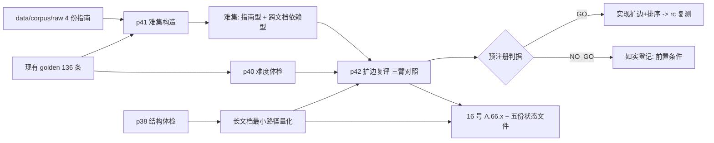

## 产品概述

把「知识图谱检索增强到底有没有用」这件事从"测不出来"推进到"能判定"：先修好测量仪器（当前评测集只考对话语料、命中率已到天花板 0.9853，无法判断图谱扩边的收益），再造两类更难、更贴近图谱价值的查询集，在同一套协议下给出最终裁决；同时把"长文档入库"这条唯一真实路径的家底摸清（现有指南 PDF 能不能入库、能扩多少），并把两项外部依赖整理成带数据的推进包。

## 核心内容

- **评测集难度体检**：把现有 136 条查询按"命中位次"（top-1 / top-3 / top-10 / 未命中）和器官分层统计，找出系统真正的薄弱面，并明确"当前评测集已饱和"这一结论的量化依据。
- **构造两类难查询集**（自造，仅用于对照裁决，不并入正式指标）：
- 指南型：问题答案只存在于指南文档块中，用于检验"检索能不能找到指南知识"；
- 跨文档依赖型：问题必须靠"同一章节下另一篇文档"才能答全，用于直接检验图谱扩边的价值。
- 两条硬性要求：问题由规则化流程生成并校验（禁止用块内原句直接充当问题），gold 归属唯一且可追溯。
- **在难集上复评扩边与排序**：沿用已跑通的三臂对照（现状不扩边 / 任取 / 按相似度重排），用跑之前就写死的判据输出结论，落到"做 / 不做"两种，不允许中间态。
- **长文档路径家底清单**：现有指南 PDF 的入库情况、尚未入库的部分、以及若要让图谱有意义所需的最小动作与判据；能入库就做临时版本复测，不能就写清缺什么。
- **外部推进包**：两项指标口径的替代监控方案（不切换门控时用什么盯趋势）+ 按器官与难度缺口排序的采集清单，让外部配合有据可依。

## 交付效果

- 一份难度分层报告：能一眼看出"评测集强在哪、弱在哪、缺哪一类题"。
- 两类难查询集及其构造与校验脚本：可复跑、可追溯，报告里明确标注"自造、不并入正式指标"。
- 图谱扩边的最终裁决：带真实数字的"做/不做"，以及若不做则写清真正的阻塞条件。
- 长文档入库的最小路径清单（含资产现状、可做部分、判据）。
- 台账更新：结论、证据路径、复跑入口齐全；服务器与代码状态一致；不出现"看起来全覆盖、实际没验"的条目。

## 技术栈与选型

沿用现有栈，不引新依赖：

- 评测与探针：Python 3.12 + 现有脚本体系（`scripts/audit/*`、`scripts/t1_eval_retrieval.py`、`scripts/gate2_bge_top10.py`）
- 检索与数据：PostgreSQL(pgvector) + Qdrant + bge-m3 嵌入服务（8004/8005）；KG 边存于 `knowledge_chunks.metadata.relations`
- 生成与判官：vLLM 主服务（18000，Qwen2.5-1.5B）、判官服务（8006，Qwen3-8B，调用必须带 `/no_think`）
- 语料与入库：`data/corpus/raw/*.pdf`（4 份指南）+ `scripts/build_pdf_corpus.py`（pymupdf4llm）
- 守卫：pytest（`tests/unit/quality/*`、`tests/unit/rag/*`）+ 零静默/rff 棘轮
- 真机执行：`[skill:remote-gpu-server-devtest]`（服务器 student03@10.20.28.21）

## 实现思路与关键决策

### 决策 1：先修"测量仪器"，再谈结论（本批主线）

**问题**（A.65 留下的局限，根因已查实）：136 条 golden 的 query 全部取自对话语料
（`scripts/t1b_build_qa_golden.py:7-9` 数据源 `data/kb_sources/dialogue_docs.jsonl`，query 取
`患者提问：{title}`，`:29 _QUESTION_RE`），gold = 该对话文档。实测 hit@5 已达 **0.9853**，
天花板仅剩 1.47pp → **它没在考"能不能找到指南知识"，也没在考"跨文档邻居是否有用"**。

**做法三步**：

1. **难度体检**（新 `scripts/audit/p40_golden_difficulty_profile.py`）：对 136 条 golden 按
"gold 在 top-1 / top-3 / top-10 / 未命中"与 `dept` 分层统计；复用
`scripts/gate2_bge_top10.py:56 doc_level_hit_at_k` 与 `scripts/t1_eval_retrieval.py` 的口径，
产出 `reports/golden_difficulty_profile.json`。**输出是"薄弱面清单"**，不是一堆数字。
2. **造难集**（新 `scripts/audit/p41_build_hard_query_set.py`）：两类

- **指南型**：从 `data/corpus/raw/*.pdf` 对应 KB 块（`pdf_*`）中按小节标题抽取候选主题，
用生成服务产出问句，gold = 该指南文档；
- **跨文档依赖型**：对"同一 `(organ, section_path)` 下存在 ≥2 个文档"的组，构造只能靠
另一文档回答的问句（即图谱扩边的对症题）。
**规则化校验（硬性）**：问句与源块的字符级重叠率上限、gold 唯一性、去重、长度区间；
校验不过的条目直接丢弃并计数。报告字段固定标注 `synthetic: true` 与用途
`expansion_ablation_only`。

3. **复评裁决**：新 `scripts/audit/p42_reeval_expansion_on_hard_set.py`，沿用 p39 的三臂协议
（baseline 不扩边 / 任取 5 / 按 query 余弦重排取 5）+ **预注册判据**（跑之前写死）：

- P0 扩边必须真带来召回增益（池子召回提升 ≥ 阈值）；
- P1 排序后不退化；P2 排序显著优于任取；P0 用真正的难集（gold 不在 top-10 的题占多数）才有区分度。
输出 `GO` / `NO_GO_NO_RECALL_GAIN` / `NO_GO` 三态之一。只有 `GO` 才进入实现阶段。

### 决策 2：判据必须能区分"没有坏处"与"有好处"

A.65 首跑只写 P1/P2 → 给出**虚假 GO**（池子召回明明零增益）。本批延续其修正：
`P0_min_pool_gain` 与"难集必须包含足够比例的 gold 不在 top-10 的题"一起作为**前置校验**，
不达标直接判 `NO_GO_*` 并写明"测量仪器仍不成立"，避免用饱和数据得出任何结论。

### 决策 3：长文档路径先量化、再决定是否动数据

- 量化项：4 份 PDF（`cardiac_echo_measurement_2016` / `cardiac_tte_standardization_2024` /
`cardiac_valve_consensus_2021` / `liver_cancer_guideline_2024`）在 KB 中的块数与来源分布、
未入库部分、以及"若把长文档按小节切成多块入库，图谱边覆盖会提升多少"（复用
`scripts/audit/p38_kb_structure_health.py` 的结构体检口径）。
- **只做临时版本复测**（新 kb 版本或独立表），跑 `p36`（两态）+ `gate2` + `p15`（不得回退）
- p42（难集）→ 按预注册判据决定是否切生产；**不达标就不写生产库、不发开关变更**。

### 决策 4：外部依赖项只做"有数据的准备"

③④ 有外部依赖，因此本批只产出：口径一页纸的**增补**（不切门控时的替代监控指标与频率）+
**按缺口排序的采集清单**（来自 WP1 的难度分层与器官分布，说明"先补哪一层、补多少才有意义"）。
不改任何阈值与门控。

## 实现注意（执行细节，防回归）

- **探针铁律**：构造 `Retriever` 必须传真实 `app.config.database.AsyncSessionLocal`；
`Retriever(session_factory=None)` 会走 `app/rag/retriever.py:624 _placeholder_chunk`
（`content="[placeholder]"`、`source_doc_id=chunk_id`）→ 按来源/内容的统计**静默全 0**。
复用 `scripts/audit/p39_graph_neighbor_ranking_sim.py::count_placeholder_chunks`，
占位块占多数即**响亮失败（退出码 2，不产出报告）**。
- **判官调用必须带 `/no_think`**（A.63 实测：漏了会让 `<think>` 吃光 token，35/40 假"未测到"）；
输出上限留余量（≥512）。
- **一把尺子**：AUC/hit@k/余弦一律复用 `t1_eval_retrieval` 与 `gate2_bge_top10` 的函数，
探针里禁止自写（有守卫范式可照抄）；每次口径变动都要有守卫钉住。
- **自造难集的性质必须随报告走**（`synthetic: true` + 用途标注），且**不写入**正式指标与门限。
- **性能**：难集复评需批量嵌入（候选上限 40/查询、批 64），单次全量应在分钟级；
生成问句走 LLM 时串行 + 限流，避免与真机回归抢 GPU。
- **真机姿势**：本地写脚本 → `scp` → `sed -i 's/\r$//'` → `bash /tmp/x.sh`；
**任何远端命令都落脚本再 scp**（PowerShell 内联 ssh 会把 `$HOME` 撕碎）；
`CUDA_VISIBLE_DEVICES=0` + `unset LD_LIBRARY_PATH`；改后端按 **PID** 重启主服务（禁 `pkill -f`）。
- **清理纪律**：只删本次会话自己建的 `/tmp` 文件（共享服务器上有并行工作线，
`_srv_bayi*` / `_srv_act113*` / `_probe_multicolor_hsv.py` 等不属于本轮，不许动）。
- **台账**：16 号**只追加 A.66.x**；跨文件改动**一次 `git add` 到位**再提交（A.63 踩过
"测试已提交、实现未提交"）；整树同步用 `git archive` 并做哈希核对。
- **不做**：不调检索/评测阈值与门控口径；不训练模型；不动前端；不碰 TNSCUI（CC BY-ND）；
不写生产边、不发生产开关变更（除非难集上达到预注册判据）。

## 架构设计



组件职责：

- **p40 难度体检**：只读统计，回答"评测集弱在哪"。
- **p41 难集构造**：LLM 生成 + 规则校验，输出带 `synthetic` 标记的查询集与校验报告。
- **p42 复评**：唯一裁决者；复用 p39 的三臂协议与三态判据，新增"难集成立性"前置校验。
- **长文档量化**：复用 p38 口径，产出资产现状与最小路径；必要时在临时版本上做入库复测。
- **台账**：五份状态文件 + 16 号附录只追加，口径与证据指针齐全。

## 目录结构（改动清单）

```
e:/Ultrasound Diagnosis Decision Support AI System/
├── scripts/audit/p40_golden_difficulty_profile.py   # [NEW] 难度分层体检（只读）：命中位次/器官分层 + 薄弱面清单；报告 reports/golden_difficulty_profile.json；复用 gate2 的 doc_level_hit_at_k
├── scripts/audit/p41_build_hard_query_set.py        # [NEW] 难集构造（指南型 + 跨文档依赖型）：LLM 生成 + 规则校验（重叠率/gold 唯一/去重/长度），输出 tests/reports/hard_query_set_*.json（标注 synthetic 与用途）+ 校验统计
├── scripts/audit/p42_reeval_expansion_on_hard_set.py # [NEW] 难集上复评扩边+排序：三臂对照 + 前置校验（难集成立性）+ 三态预注册判据（P0 增益/P1 不退化/P2 排序有效）；退出码 0/1/2
├── scripts/audit/p39_graph_neighbor_ranking_sim.py   # [MODIFY] 仅在需要时抽出可复用的"候选池构造/三臂统计"函数供 p42 import（保持 p39 行为与输出不变）
├── tests/unit/quality/test_hard_query_set_rules.py    # [NEW] 守卫：难集校验规则（重叠率上限/gold 唯一/长度区间）+ synthetic 标注必须存在 + 判据三态（含真实数字锚点）
├── tests/unit/quality/test_golden_difficulty_profile.py # [NEW] 守卫：分层口径（top-1/3/10/未命中之和守恒）+ 复用单一尺子（禁止自写 hit@k）
├── tests/reports/hard_query_set_guideline.json         # [NEW] 指南型难集（自造，标注 synthetic）
├── tests/reports/hard_query_set_crossdoc.json          # [NEW] 跨文档依赖型难集（自造，标注 synthetic）
├── docs-for-guiding generating docs/超声诊疗决策支持系统/16-开发进展汇报-20260928.md # [MODIFY] 追加附录 A.66.x（分层结果、难集构造与校验、复评裁决、长文档路径、踩坑；只追加）
├── docs-for-guiding generating docs/超声诊疗决策支持系统/21-远期路线图-20261009.md     # [MODIFY] 新增「批 8（A.66）」出口判据与结果；刷新计数行
├── docs-for-guiding generating docs/超声诊疗决策支持系统/14-外部数据源与许可合规清单.md # [MODIFY] 指南 PDF 语料条目补入库现状（若本轮量化有新事实）
├── feature_list.json                                  # [MODIFY] 新增 a66-* 条目（含 dependencies/evidence）+ 收尾更新 head_commit
├── progress.md / session-handoff.md                   # [MODIFY] Last Updated、Blockers（图谱前置条件按新证据更新）、证据索引、复跑入口与踩坑
└── data/corpus/raw/*.pdf                              # [NOTE] 只读使用；如需入库走临时 kb 版本，不改生产库
```

## 关键代码结构（仅接口级）

```text
# tests/reports/hard_query_set_crossdoc.json（自造难集；不入正式指标）
{
  "synthetic": true,             # 必填：自造标记
  "usage": "expansion_ablation_only",
  "builder": "p41_build_hard_query_set.py",
  "rule_checks": {"max_char_overlap": 0.6, "length_range": [8, 60]},
  "queries": [
    {"query_id": "hard-xd-0001", "query_text": "...",
     "gold_source_doc_id": "...", "requires_cross_doc": true,
     "overlap_ratio": 0.31, "checked": true}
  ]
}

# reports/p42_reeval.json（裁决；三态之一）
{
  "hard_set_ready": {"n": 0, "gold_not_in_top10_ratio": 0.0},   # 前置校验：难集是否成立
  "hit_at_5": {"baseline": 0.0, "random_5": 0.0, "sorted_5": 0.0},
  "pool_recall": {"before": 0.0, "after": 0.0},
  "verdict": {"code": "GO | NO_GO_NO_RECALL_GAIN | NO_GO", "why": "..."}
}
```

## Agent Extensions

### Skill

- **remote-gpu-server-devtest**
- Purpose: 全部真机动作——跑难度体检（p40）、跑难集构造（p41，需生成服务）、在难集上复评扩边（p42，需嵌入服务）、长文档临时版本入库与 `p36`/`gate2`/`p15` 复测、按 PID 重启主服务、整树同步与临时文件清理。
- Expected outcome: 每步都有可复跑的退出码与报告落盘（`reports/golden_difficulty_profile.json`、`tests/reports/hard_query_set_*.json`、`reports/p42_reeval.json`），且服务器代码与仓库 HEAD 一致。

- **uai-harness-maintenance**
- Purpose: 收尾台账回写与口径仲裁——16 号附录只追加 A.66.x、刷新 `feature_list.json`（`a66-*` 条目 + `head_commit`）、`progress.md`（Blockers 按新证据更新）、`session-handoff.md`（复跑入口与踩坑）、21 号（批 8）、14 号（指南语料入库现状），并跑质量守卫替代审计。
- Expected outcome: 五份文件口径一致、证据指针齐全、守卫全绿；"自造难集不入正式指标"这一性质在各处一致可见。

### SubAgent

- **code-explorer**
- Purpose: 定位难集构造与复评所需的复用点——生成服务调用封装（`/no_think` 约定）、KB 块按 `(organ, section_path)` 分组的取数 SQL、以及 p36/p38/p39 中可直接 import 的三臂统计与候选池函数边界。
- Expected outcome: 一份带 `文件:行号` 的接线清单，确保 p40/p41/p42 只复用既有口径、不改动既有探针行为。