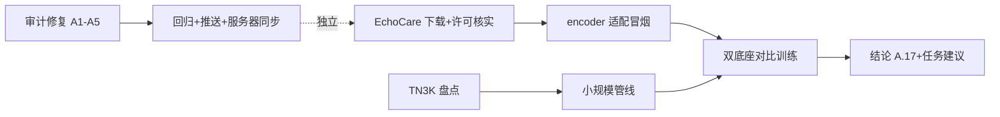

## 产品概述

三条并行工作线，将系统从“功能可用”推向“接线完备 + 底座升级 + 甲状腺任务启动”：

1. **接线审计修复**：修复 `wiring-audit-report.md` 中除前端脱钩项（P0-1、P2-6 随前端重设计跳过）外的全部问题——4 处 P0、8 处 P1、6 处 P2 卫生项，恢复“登录后核心闭环”与安全告警链路的真实可用性。
2. **超声底座升级**：接入 EchoCare（CAIR-HKISI，450 万张超声图像自监督预训练，MONAI Swin UNETR V2 encoder，纯视觉无文本塔）作为 BiomedCLIP 之外的视觉底座候选；I2T 检索（Gate 2）仍走 BiomedCLIP+US-365K 双塔路线（EchoCare 无文本塔帮不上），另测 Gate 2 的“或”分支 bge-m3 Top10≥88%。
3. **甲状腺开发训练冒烟**（用户已确认不纠结商用许可，NC 许可的研究开发用途本身合规，仅注册/商用部署需后续项目方决策）：以“先跑通再定”为原则——TN3K 6986 张小规模数据管线跑通，EchoCare 与 BiomedCLIP 双底座在甲状腺数据上对比冒烟，再定正式任务形态。

## 核心功能

- 后端补 JWT→nav token 交换端点（P0-2，不动前端，前端重设计后天然可用）
- 同意撤回事件去重投递 + 补 `withdrawn_at` 字段，消除死信系统性污染（P0-3）
- edge 设备管理 register/heartbeat/health/ota 契约对齐，消除系统性假隔离（P0-4）
- AlertEscalationManager 随 app lifespan 启停，critical webhook 真实投递（P0-5）
- 脱敏规则频道名统一、审计链周期校验启动、obs 指标生产者接线、retry_skip_self_rag 读取方、容器主机名/redis db 明确、阈值更新流闭环（P1 系列）
- DI 死代码与死 app.state 清理、游离白名单副本删除、孤儿 settings 治理 + validator 补校验、DLQ 出口、SAD 文档修正（P2 系列）
- EchoCare 权重经 hf-mirror 落服务器，encoder 加载适配（`pop('mask_token')` 后 strict 加载）
- TN3K 盘点（标签形态/良恶性覆盖/mask 可用性）→ 冒烟管线 → 双底座对比 → 正式任务建议

## 技术栈

- 后端：FastAPI + SQLAlchemy(async) + Redis + PostgreSQL/PGVector + structlog + pytest（现有栈，全部复用）
- 训练：PyTorch + MONAI（EchoCare SwinTransformer encoder）+ open_clip（BiomedCLIP）+ sklearn LR 探针（复用 T2a/T2b 管线模式）
- 服务器：student03@10.20.28.21（fish shell：本地写脚本→scp→bash 执行；GPU 48GB，训练窗口须停判官 vLLM 事后恢复；hf-mirror.com 可达）

## 实现方案

### 工作线 A：接线审计修复（纯后端/配置/文档，无前端改动）

- **P0-2**：在 `app/api/v1/` 新增认证交换端点（POST，JWT 鉴权后调 `AuthTokenManager` 签发 nav token 返回给调用方）——复用 `AuthTokenManager._tokens` 签发逻辑（nav.py:330-363），不改 WS 握手协议，前端重设计完成后即可用
- **P0-3**：删除 `app/api/v1/consent.py:91-96` 的重复 xadd（合规路径 `consent_repository.py:151-164` 已是唯一生产者）；保留/对齐 `withdrawn_at` 全字段契约
- **P0-5**：`app/main.py` lifespan 中调用 `AlertEscalationManager.start()`，shutdown 调 `stop()`（防泄漏协程）；单测验证 webhook flush 循环被驱动
- **P0-4**：以“后端补齐”为主——`app/api/v1/device.py` 新增 heartbeat/health/ota 三端点（心跳语义对齐 nav.py:572 的 WS 心跳），register 放宽认证为设备头（X-Device-Id/X-Device-Token 查库校验，与 edge/device_auth.py:30-31 对齐）或按 `DeviceRegisterRequest` 补齐 edge 侧字段；以最小改动消除 422/401/403 与假隔离
- **P1-1**：`safety_gateway/main.py:35` 订阅频道改为复用 `ultrasound:desens:rules:update`（单一事实源常量）
- **P1-2**：lifespan 中启动 `start_periodic_verification`（audit_service.py:200-231），shutdown 停止
- **P1-3**：在诊断管线/检索路径的对应点位补 setter 调用（assessment_latency、hallucination_rate、retrieval_empty_rate）；CacheMonitor record_* 与 prometheus sync 接线启动
- **P1-4/5**：按审计建议删除 `app/dependencies.py` 无人消费的 9 个工厂与死 `app.state` 赋值（保留 getattr 兜底并加注释），修正 `consent_consumer` 失败分支赋 None
- **P1-6**：`diagnosis_worker.py` 消费 `retry_skip_self_rag:{id}`（BLPop 前查或 pipeline 入参读取），使 retry 语义真实生效
- **P1-7**：`docker-compose.dev.yml` api 容器补 `SAFETY_GATEWAY_HOST`/`VLLM_HOST`/`LLAMA_CPP_HOST` 环境变量；api/gateway 的 redis db 用 settings 显式声明消除隐患
- **P1-8**：给阈值更新流补生产者入口（管理端点或 CLI xadd）或显式移除 gateway 订阅并注释——以“接线闭环”为验收
- **P2**：DLQ 补运维出口（dump 脚本）、无订阅频道删发布或补订阅（P2-2 需按产品语义，缺省先注释标记）、SchedulingAgentHandler 改为显式禁用+日志、删除 `app/config/settings.py:19-22` 游离白名单、孤儿 settings 接线或删除、validator 补接线开关校验、SAD ADR-4 描述修正
- 每项配单测（P0 项必须），回归 `tests/unit/sg`、`tests/unit/sec`、`tests/unit/llm`；已知存量失败 test_softhsm_active_within_90_days 不在本范围

### 工作线 B：EchoCare 接入

- 下载：`hf-mirror.com/CAIR-HKISI/EchoCare`（model.safetensors）→ 服务器 `~/uai/models/echocare/`；执行前先核实 GitHub LICENSE 文件（HF 页未标注）
- 适配：按官方 README 用 MONAI `SwinTransformer(use_v2=True, spatial_dims=2)` 加载，`state_dict.pop('mask_token')` 后 `strict=True`；封装特征提取冒烟（输出 5 级特征金字塔）
- 对比：写底座评估脚本，EchoCare vs BiomedCLIP 视觉特征在（a）CACTUS 已有 T2b 探针任务复测、（b）甲状腺冒烟集上对比

### 工作线 C：甲状腺训练冒烟

- 盘点：TN3K 目录结构/标注形态/良恶性标签覆盖/mask 质量抽样 → 确定冒烟任务（缺分类标签则用 mask 面积/位置做代理任务或先跑特征质量对比）
- 管线：小规模（100~300 张）数据加载/预处理/划分脚本，落 `scripts/thyroid_*.py` 命名惯例
- 冒烟训练：双底座 T2a 式（visual 特征 + LR 探针）小样本训练，产出可比指标（AUC/准确率）；GPU 窗口管理复用 `t2b_cactus_run.sh` 模式（停判官→训练→恢复）
- 结论：16 号文档追加 A.17（底座调研+对比数据+正式任务建议+数据够不够的结论）

## 执行顺序与依赖

审计修复（A，纯代码不占 GPU）→ EchoCare 下载/接入（B）→ 甲状腺冒烟（C，需 GPU 窗口）。A 完成后 commit+push（`GIT_LFS_SKIP_PUSH=1`）+ git archive 同步服务器 + 重启主服务核验。

## 架构图

## Agent Extensions

### SubAgent

- **code-explorer**
- Purpose: 审计修复涉及 20+ 文件的接线点定位（dependencies.py 工厂的真实调用方、obs setter 生产点位、consent 投递链、device 契约两侧字段清单），用 medium/very thorough 级探索快速建立修改清单
- Expected outcome: 每个审计项的精确修改文件+行级位置清单，避免漏改