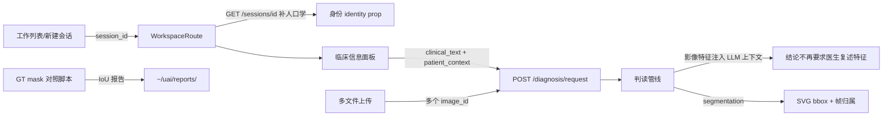

## 背景

A.36 医生信息需求逐项核实（16 号附录 A.36，feature_list 48 条）发现 6 项缺口。用户要求“进行完整的完备的设计”并按 A.36.1 制度先出设计、经确认再动代码。本次一并交付两份已点名未交付的文档（Langfuse 评测管理计划、zero-silence-guard 正式研究设计）。

## 修复目标（6 项缺陷，按 A.36.2 编号）

### P0-① 患者身份错显（ui-workspace-identity-hardcoded）

WorkspacePage 常驻条写死「张\*\* · 女 · 52 岁 · 门诊」。**后端勘察结论已确认**：`GET /sessions/{id}` 的 SessionResponse 只有 patient_id 没有人口学，但列表端点已有现成的 `_mask_name/_age_from` 服务端脱敏逻辑（app/api/v1/session.py:103-105）。修法：GET /sessions/{id} 响应补 `patient_name_masked/gender/age`（复用列表端脱敏函数，JOIN patients）→ WorkspaceRoute 的 getSession 调用顺路拿到 → 作为 `identity` prop 传入 WorkspacePage 替换写死字符串；工作列表跳转链路天然覆盖。

### P1-② 临床信息录入闭环（clinical-info-input）

**后端勘察结论已确认：入参层零改动**——`DiagnosisRequest` 已有 `clinical_text`、`patient_context: PatientContext`（age/gender/relevant_history/结构化 patient_conditions，后者供安全网关禁忌判定，schemas.py:155-165）。缺口纯在前端：工作区新增临床信息录入面板（症状/病史/化验，textarea + 结构化条件勾选）→ `diagnosisService.startDiagnosis` 传 `clinical_text + patient_context` → 判读后验证结论文本引用了该信息（走查断言）。

### P1-③ 影像真正进入判读（diagnosis-multimodal-input）

真实 CAMUS 帧走查中 LLM 结论输出「请提供具体的影像特征」——影像内容未进判读上下文。需先勘察 `app/services/diagnosis_pipeline.py` 的 image_ids 消费路径（它调用 segmentation 与 LLM 的方式），再实现：分割量化特征（bbox/面积/回声统计）与影像引用注入判读上下文；验收判据=结论文本不再要求医生复述影像特征。

### P1-④ 多图/多帧分期第一期（multi-frame-diagnosis-gap）

上传 input 支持 multiple → 逐文件上传得多个 image_id → 判读 `image_ids` 数组真传多帧（API 已是数组）→ Cornerstone StackViewport 多帧滚动 + 帧指示器「n/N」→ 分割/报告归属当前帧。多帧 DICOM NumberOfFrames 解析与 cine 关键帧为二期三期，本设计只做分期①并在守卫登记后续。

### P1-⑤ 分割准确性 GT 对照 + organ 错派防护（seg-accuracy-unverified-gt）

服务器 `~/uai/data/camus/` 有 nii 体数据 + Masks GT。新脚本：cardiac 会话跑 N 帧 → 分割结果与 GT mask 叠加计算 IoU → 报告落 `~/uai/reports/`；organ 错派防护：后端按 target_organ 分派模型，图像模态/部位与 organ 明显不符时拒绝并返回结构化原因（前端已能显示「未做分割：<原因>」）。

### P2-⑥ 测量工具（measurement-tools）

cornerstone.ts 注册 LengthTool/EllipticalROITool（cornerstoneTools 现成），工具切换按钮挂影像区角部；PixelSpacing 已在 DICOM 中，长度换算现成；测量结果显示覆盖在 SVG 层。

### 文档交付（2 份）

`docs/…/19-Langfuse评测管理计划-20261009.md`（双引擎评测集 ≥700 例的采集/管理/指标门控路线）；`docs/…/20-zero-silence-guard研究设计-20261009.md`（从“事故驱动的 ongoing 清查”升级为系统性机制：静默失败面分类学、三层守卫、浏览器侧降级可见性）。

## 不回退基线

A.35 全部修复（影像显示链）、13/13 走查判据、渲染守卫 stdlib-only、门禁 PASS=24。临床假设登记制度（A.36.1）：每项实现前在 feature_list assumption 字段显式登记。

## Tech Stack

- 前端：React 19 + TypeScript + Vite 6.4.4（已从 8 降级，不得回退）+ Cornerstone3D 5.11.3 + 自绘组件（工作区风格，antd 仅遗留页）
- 后端：FastAPI + SQLAlchemy async + PostgreSQL + Redis
- 测试：vitest（35 files 346+）、pytest（quality 71+ / sec 1365+）、Playwright 走查脚本
- 部署：C 盘构建（E 盘 ENOSPC）→ tar → scp → 服务器 git archive 同步

## Architecture

### 数据流（新增部分）



### 关键设计决策

1. **身份修复走后端响应扩展**（而非前端另发请求）：GET /sessions/{id} 补三个脱敏字段，复用 session.py 现有 `_mask_name/_age_from`，列表/详情脱敏口径天然一致；PatientContext.age/gender 由前端从同一响应填充进判读入参。
2. **临床信息面板放工作区常驻条下方的可折叠条**（不放结论区——结论区一级只给三样的口径不破坏；判读发起前必填 symptom 至少一项，空则判读按钮给出明确提示）。
3. **多模态接入采用“先勘察后实现”**：diagnosis_pipeline.py 的 image_ids 消费路径是未知项（可能已有 base64/特征路径），设计分两步——勘察报告确认现状 → 按现状选择“特征注入”或“多模态模型直读”。
4. **GT 对照做成独立脚本**（不进门禁常规，进 make target）：`scripts/seg_gt_iou.py`，输出 JSON 报告，避免 GPU 依赖拖慢门禁。
5. **守卫同步扩展**：渲染守卫新增“身份不得写死”、“临床面板存在”两类静态断言；走查脚本新增“身份随会话切换”断言。

## Implementation Notes

- 全部 UI 新增遵循既有“默认沉默”契约：不满足条件不渲染（临床面板仅 active 会话时展开）。
- server 端脱敏沿用姓+**范式，前端不得猜姓名。
- E 盘 ENOSPC：构建产物一律 outDir 到 C:\Windows\Temp\uai_dist\*。
- 每步完成即跑对应测试，最终统一门禁 + 走查 + 录像。

## Directory Structure

```
frontend/src/
├── components/workspace/
│   ├── WorkspacePage.tsx              # [MODIFY] 身份 prop 化，删写死字符串
│   ├── ClinicalInfoPanel.tsx          # [NEW] 临床信息折叠面板
│   └── WorkspaceImageRegion.tsx       # [MODIFY] 帧指示器 + 测量工具按钮
├── components/dicom/cornerstone.ts    # [MODIFY] 多帧 setStack + Length/Ellipse 注册
├── services/
│   ├── sessionService.ts              # [MODIFY] SessionInfo 补人口学字段类型
│   └── diagnosisService.ts            # [MODIFY] clinical_text/patient_context 入参
├── app/routes.tsx                     # [MODIFY] 身份/临床信息接线
└── pages/__tests__/                   # [NEW] WorkspaceIdentity.test.tsx 等
app/
├── api/v1/session.py                  # [MODIFY] GET /{id} 响应补人口学
├── services/diagnosis_pipeline.py     # [MODIFY] 影像特征进 LLM 上下文（先勘察）
└── api/v1/imaging.py 或 diagnosis.py  # [MODIFY] organ-模态错派防护
scripts/
├── seg_gt_iou.py                      # [NEW] GT 对照 IoU
└── camus_frame_to_dicom.py            # [NEW] 真实帧批量转 DICOM（抽自本次一次性命令）
tests/unit/quality/test_frontend_render_guard.py  # [MODIFY] +2 断言
docs/…/19-Langfuse评测管理计划-20261009.md         # [NEW]
docs/…/20-zero-silence-guard研究设计-20261009.md   # [NEW]
```

## Verification

- 单元：vitest 全绿、pytest quality/sec 全绿
- 契约对账：22+ 路径零断链
- 真机：门禁 PASS≥24；doctor_flow_walkthrough 扩至 15+（身份切换、临床信息引用、多帧滚动）；GT IoU 报告产出

## 设计原则

延续工作区既有语言：暗室主题、900 硬骨架不动、默认沉默、语义色只有 stop/attention 两级。

### 新增 UI 块

1. **临床信息折叠条**（常驻条下方，高 32，展开 160）：三个 textarea（主诉/病史/化验摘要）+ 结构化条件勾选（妊娠/造影剂过敏/抗凝治疗，映射 SG patient_conditions）；折叠态显示「已填/未填」徽标；判读发起后锁定不可改。
2. **身份显示**：常驻条左侧 identity 由「写死文案」变「数据驱动」——脱敏姓名·性别·年龄·来源（门诊/住院），数据缺失显示「患者信息不可用」（不猜、不占位假人）。
3. **帧指示器**（多图/多帧）：影像区右下角「3/7 ‹ ›」胶囊，键盘←→可翻帧，帧切换时 SVG 标注层随之切换或显示「该帧无分割」。
4. **测量工具**：影像区左上角工具胶囊组（窗宽窗位/平移缩放/长度/椭圆），激活态高亮 attention，测量结果随线段显示 mm 值。
5. **GT 对照报告**（非 UI）：脚本输出 JSON + markdown 摘要（逐帧 IoU、均值、不合格帧清单）。

## Agent Extensions

### SubAgent

- **code-explorer**
- Purpose：勘察 diagnosis_pipeline.py 的 image_ids 消费路径与 LLM 上下文构建方式（多模态缺口 ③ 的现状确认）、PatientContext 在安全网关的消费点
- Expected outcome：一份“影像信息在判读管线中的真实流向”报告，决定特征注入 vs 多模态直读的实现选型