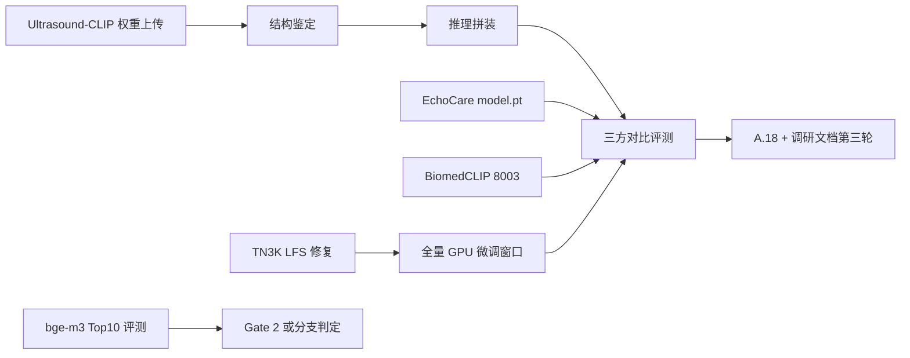

## 产品概述

四线并行收口底座选型与 Gate 2 验证：①Ultrasound-CLIP 官方权重（用户上传中，2.2GB）上机鉴定、拼装推理、与 EchoCare/BiomedCLIP 三方同评测集对比“到底哪个更好”；②TN3K test 集 LFS 指针修复（定位源 repo 拉 184MB rar，补齐 614 张官方测试集）；③TN3K 全量 GPU 微调窗口（2878 张，停判官→训→恢复）；④bge-m3 Top10≥88% 评测（Gate 2 或分支）。调研增量（UniMed-CLIP=MBZUAI 且权重已放 HF 等）落盘到调研文档第三轮章节。

## 核心功能

- Ultrasound-CLIP checkpoint 结构鉴定（torch.load/keys/backbone 识别）+ 推理拼装（对照论文 6 组件：EnhancedCLIP/graph_encoder/semantic_loss 等）+ TN3K 分类与 US-365K I2T 检索双评测
- TN3K test 修复：hf-mirror API 搜源 repo → 按 LFS oid sha256:407fe2b4… 匹配 → 拉 TN3K.rar（184MB）→ 解包替换 614+614 指针文件 → sha256 校验
- 全量微调：TN3K 2878 张分层、EchoCare/BiomedCLIP 双底座（冻结全量特征+LR 探针为底线，GPU 窗口内可加 backbone 微调），官方 fold0 划分评估 AUC/Acc
- Gate 2 或分支：bge-m3 纯文本检索 Top10 命中率评测脚本（golden set 口径）与 ≥88% 判定
- 调研文档追加第三轮章节（UniMed-CLIP 溯源修正、EchoCare 溯源补充、对比结论）

## 核心功能验收

- 三方/四方对比表（同评测集同划分）：AUC/Top10/I2T@10 一表可比，产出“到底哪个更好”的结论
- TN3K test-image 614 张全部可读（PIL 打开无异常），label4test 614 行对齐
- 微调产物落 reports/，对比冒烟（0.744/0.702）有提升幅度记录
- bge-m3 Top10 数字落盘，Gate 2 或分支 PASS/FAIL 明确

## Tech Stack

- 服务器：student03@10.20.28.21（fish：本地写脚本→scp→bash；GPU RTX 5880 48GB，嵌入+双 vLLM 常驻 ~45.4GB；pip 清华源；hf-mirror 可达）
- 推理/训练：torch + MONAI（EchoCare）+ open_clip（BiomedCLIP/t2a 管线复用）+ sklearn LR 探针
- 评测：golden set（data/golden/kb_qa_golden_v1.json）+ bge-m3（8004）+ pgvector 检索
- 仓库：worktree e:\uai-feature（feature 分支 bb0dfdd），文档落 16 号 A.18；调研增量落主工作区 docs/emb_model_research_20261002.md（用户指定文档，main 分支，仅追加章节低风险）

## Implementation Approach

1. **Ultrasound-CLIP 鉴定优先**：用户上传后先定位文件（~/uai/models/ 或指定路径），`torch.load` 看顶层结构——2.2GB 大概率含 backbone；若 keys 与 open_clip ViT-B/16 对齐则直接挂 BiomedCLIP 同款预处理；6 组件按论文公式拼装（graph_encoder 需要 UDAF tag_vocab——项目 vocab_v2 可直接充当）。若拼装受阻，退路：仅用其 image encoder 做特征探针对比（仍可回答“哪个好”）。
2. **TN3K LFS 修复**：`hf-mirror.com/api/datasets?search=TN3K` 枚举 → 逐候选查文件列表匹配 tn3k-trainval-fold0.json/TN3K.rar → resolve 下载 → sha256 对 LFS oid 校验 → unrar/7z 解包（无 unrar 则 python rarfile+unrar 或 7z）→ 覆盖 test-image/test-mask 指针 → PIL 全量可读性验收。
3. **GPU 微调窗口**：复用 t2b_cactus_run.sh 模式（pkill 判官单独发→训练→恢复）；先跑“全量冻结特征+LR”（GPU 提特征 2878 张 <2 分钟，零风险底线），窗口富余再做 BiomedCLIP visual tower 短微调（对照 t2a_v2 配方）；EchoCare 全量微调次优先（无官方微调配方，风险高）。
4. **bge-m3 Top10**：golden set 问题 → bge-m3(8004) 文本嵌入 → pgvector top10 → 命中=golden 标注证据 chunk 在列；脚本落 scripts/gate2_bge_top10.py，结果落 reports/。

## Implementation Notes

- 判官启停严格复用 t2b_cactus_run.sh 已验证序列（pkill 单独发、EngineCore 连杀、恢复后 /health 探活）
- Ultrasound-CLIP 推理若需外接 tag_vocab/UDAF 词条：直接复用 app/knowledge/data/vocab_v2_final.json（同源体系，用户文档已指出此协同）
- 所有探针 /tmp 用完即清；大文件下载带 -c 断点续传与 sha256 校验
- main 分支的 docs 文档仅追加不改动既有章节，避免与前端窗口冲突

## Architecture Design



## Directory Structure

```
e:\uai-feature\                          # worktree（feature 分支）
├── scripts/
│   ├── ulc_inspect.py                   # [NEW] Ultrasound-CLIP checkpoint 结构鉴定
│   ├── ulc_probe_eval.py                # [NEW] Ultrasound-CLIP TN3K 特征探针评测（拼装推理）
│   ├── gate2_bge_top10.py               # [NEW] bge-m3 Top10 命中率评测（Gate 2 或分支）
│   ├── tn3k_lfs_fix.sh                  # [NEW] 源 repo 定位+rar 下载+解包+替换+校验
│   ├── thyroid_full_eval.py             # [NEW] 全量特征提取+LR（GPU 窗口内）
│   └── thyroid_smoke_train.py           # [MODIFY] 支持全量/官方 fold 划分参数
├── docs-for-guiding generating docs/超声诊疗决策支持系统/
│   └── 16-开发进展汇报-20260928.md      # [MODIFY] 追加 A.18
e:\Ultrasound Diagnosis Decision Support AI System\docs\
└── emb_model_research_20261002.md       # [MODIFY] 追加第三轮章节（主工作区，用户指定文档）
服务器：
~/uai/models/ultrasound_clip/            # [NEW] 官方权重落位
~/uai/data/tn3k_dataset/test-image|mask  # [MODIFY] 指针→真文件
reports/ulc_compare_report.json          # [NEW] 三方对比
reports/gate2_bge_top10.json             # [NEW] Gate 2 或分支结果
```

## Agent Extensions

### SubAgent

- **code-explorer**
- Purpose: 定位现有检索评测脚本（T1 检索命中率评测器、golden set 加载方式、bge-m3 客户端调用姿势）与 t2a 微调配方（finetune 脚本/超参），避免重造评测轮子
- Expected outcome: gate2_bge_top10.py 与 thyroid_full_eval.py 的可复用组件清单（文件:行级）

### Skill

- **autoglm-websearch**（如可用则用于补充检索；否则以既有 web_search 结果为准，不阻塞计划）