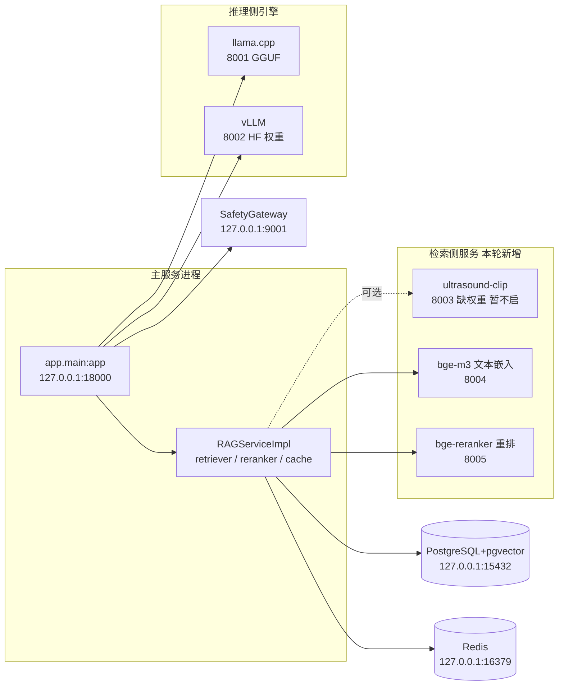

## 产品概述

在已接通并跑通控制面的学校 GPU 服务器上，把**推理侧与检索侧服务真正立起来**：新增仓内的嵌入/重排 HTTP 薄服务、部署 llama.cpp 与 vLLM 双推理引擎，使诊断链路从"提交→按设计 fail-closed"推进到"能产出真实结论"；同时补齐覆盖率双门禁与现场项登记。

## 核心功能

- **汇报进展**：给出服务器当前真实状态（服务可用性、迁移链、端到端冒烟结果、门禁数据）与遗留项清单，不含糊、不夸大。
- **嵌入/重排服务落地**：新增仓内薄服务，按既有客户端契约暴露 8004（bge-m3 文本嵌入）与 8005（bge-reranker 重排）端点，仅绑回环；8003 因权重缺失（项目自有产物）先不启并登记。
- **llama.cpp 引擎落地**：用已下载的 GGUF 起 8001，验证引擎健康与一次成功推理。
- **vLLM 引擎落地**：下载 HF 格式权重并起 8002，供双引擎一致性口径测试使用；若装不起来，如实记录失败形态与替代路径。
- **"可跑"验证**：全服务起齐后跑通 1 例真实诊断到终态 completed，确认检索命中、重排生效、脱敏状态与 ai_diagnosis_failed=False（仍不产出验收数值）。
- **门禁与收尾**：补齐覆盖率双门禁（整体 82 / 核心 86）、更新豁免与现场清单、脚本入库并推送。

## 边界

- 服务器为共享机：只动本人账号家目录、配额与专属容器守护进程；不改系统配置、不碰他人资源。
- 真实患者数据不得上机；只用公开可商用或自造数据。
- 服务端口只绑 127.0.0.1 + 非默认端口，绝不对外暴露。
- 凭据不落脚本/命令/日志/对话。
- 本轮为"可跑"阶段：**不产出任何精度/时延/一致性数值**；验收数值需另起一轮并标注样本量。


## 技术栈

沿用现状，不引入新架构：

- **运行环境**：Ubuntu 24.04.5 / Python 3.12.3；无 sudo，用户级 venv（`~/uai/venv`）；torch 2.14.0+cu130、transformers 5.17.0、FastAPI + uvicorn 均已就位。
- **服务形态**：全部为**宿主机 venv 进程 + 仅绑 127.0.0.1 的高位端口**（Docker 侧拉不到 `nvidia/cuda` 基础镜像，无法承载 GPU 推理）。
- **模型来源**：`hf-mirror.com`（`HF_HUB_DISABLE_XET=1`；`--exclude` 逐个重复写；排除 `onnx/`）。
- **测试与门禁**：pytest（`--dist=loadfile`）+ coverage + ruff 棘轮；仓库既有约定 `git commit --no-verify` + `git -c lfs.locksverify=false push`。

## 实施方案

分六个阶段，前一阶段的产物是后一阶段的输入：

**阶段 1｜覆盖率双门禁（零外部依赖，先收）**
按 `Makefile:cov` 的同口径执行：`pytest tests/unit tests/integration/int --cov=app`；然后 `coverage report --fail-under=82`，再 `coverage report --include='app/security/*,app/services/*,app/fusion/*,app/agents/*' --fail-under=86`。上一轮只验过整体 82（82.22%），**核心 86 从未跑过**。不达标时优先补"可离线覆盖"的分支，**禁止为凑数写无意义断言**；确属真机/外部依赖的缺口，按 `docs/合规/覆盖率豁免清单.json` 现行规则登记（该清单有 6 条 `entries` + `excluded_by_design`，并由 `tests/unit/quality/test_coverage_exemptions.py` 校验棘轮）。

**阶段 2｜嵌入/重排薄服务（新增 `scripts/start_embedding_services.py`）**
先用 [subagent:code-explorer] 把三个客户端（`app/embedding/bge_m3.py`、`app/embedding/ultrasound_clip.py`、`app/rag/reranker.py`）的**精确契约**取出来（端点路径、请求/响应体、health 探测路径、超时与状态码语义），再据契约实现服务端——**不猜端点**。服务端用 FastAPI + transformers 加载 `~/uai/models/{bge-m3,bge-reranker-base}`，只绑 `127.0.0.1:8004/8005`，模型一次加载常驻、批内合并推理以控制显存与延迟，GPU 线程前置 `env CUDA_VISIBLE_DEVICES=0`。8003（Ultrasound-CLIP）因权重是项目自有产物、公开源没有，**本轮不启**并登记为现场项。
验收：主服务日志 `rag_health_partial_failure` 的 `embedding/reranker` 由 False 转 True（`vector_index=True` 已是现状）。

**阶段 3｜llama.cpp 引擎（8001）**
`llama-cpp-python` 优先探第三方 CUDA wheel 源是否可达；不可达则退 CPU wheel 先跑通（compact 档下引擎契约不变，仅性能不同）。复用 `scripts/llama_cpp_server.py` 起 HTTP（回环 8001）并指向已下好的本地 GGUF（避免运行时再去 HF 拉取）。验收：引擎 health 通过 + 一次成功推理（不出数值）。

**阶段 4｜vLLM 引擎（8002，最大风险点）**
`scripts/server_download_models.sh --with-vllm` 下 HF 格式权重（约 3GB，≠ GGUF）；再装 vLLM。风险已知：py3.12 + torch 2.14/cu130 组合、无 `nvidia/cuda` 基础镜像、依赖易冲突且耗时长。**策略**：先用 `--dry-run`/`pip download` 探依赖可解性再实装，失败则**如实记录失败形态与出错信息**并给出替代路径（如降级单引擎、或以 llama.cpp 兼作第二引擎做契约层验证），**不得掩盖**。验收：8002 health 通过 + 一次成功推理。

**阶段 5｜"可跑"验证（不出验收数值）**
全服务起齐后跑 1 例真实诊断（沿用 `scripts/server_link_smoke.sh` + `server_smoke_probe.py` 的鉴权与自造文本路径，合规红线内），目标是走到 `completed`，并核对：RAG 命中（非 placeholder）、reranker 生效、`ai_diagnosis_failed=False`、`desensitization_status` 正常、监控与延迟埋点有记录。**只报状态枚举，不报任何数值。**

**阶段 6｜收尾**
脚本与坑回写 [skill:remote-gpu-server-devtest]（新轮次的环境事实、失败形态、可复现命令）；更新豁免/现场清单；提交推送；输出"全量口径测试（双引擎一致性 ≥100 例/器官、分级一致率 ≥95%）"的**启动前置清单**（哪几个服务必须在线、哪些开关怎么置、样本量与标注要求）。

## 实现要点

- **远端 shell 是 fish**：内联命令里 `$` 必须放进单引号；一律**本地落盘 `.sh` → `scp` → `ssh "sed -i 's/\r$//' ~/x.sh && bash ~/x.sh"`**；`. .env` 这类 bash 语法**不能内联**（实测 `Unsupported use of '='`）；PowerShell 对 `<`、连续逗号、未闭合引号极敏感——**复杂命令一律落脚本文件**。
- **GPU**：所有 CUDA 命令前置 `env CUDA_VISIBLE_DEVICES=0`（用户 fish 配置设的是不存在的卡 2，会静默屏蔽 GPU）。
- **端口与暴露面**：8001/8002/8004/8005 只绑回环；健康检查走 `curl 127.0.0.1:<port>`；不新增任何对外监听。
- **显存与并发**：单卡 48GB，需同时容纳 bge-m3 + reranker + llama.cpp/vLLM；服务端限制批大小与最大长度，按需 `torch.cuda.empty_cache()`；启动顺序按"嵌入/重排 → llama.cpp → vLLM"逐级放量，避免 OOM 影响共享机上他人任务。
- **日志与可观测**：新服务沿用 structlog 风格的结构化事件名（如 `embed_service_started`/`rerank_request_failed`），错误带 `error_type`；不打印请求原文（含临床文本），避免 PII 入日志。
- **失败安全**：新服务不可用时不得让主服务启动失败——主服务侧本来就是"部分可用 + 健康降级"（`rag_health_partial_failure`），保持既有语义。
- **凭据与数据**：`.env` 保持 600；口令不进 argv/仓库；测试文本为自造内容。
- **提交粒度**：阶段 1/2/3/4/5 各自跑完即提交推送，保持可回退；未完成或失败的部分在提交说明里如实标注。

## 架构（服务拓扑）



## 目录结构（改动清单）

```
project-root/
├── scripts/
│   ├── start_embedding_services.py      # [NEW] 嵌入/重排薄服务：FastAPI + transformers，加载 ~/uai/models/{bge-m3,bge-reranker-base}，
│   │                                     #        端点严格照客户端契约，仅绑 127.0.0.1:8004/8005；模型常驻、批内合并、
│   │                                     #        结构化日志、异常不外泄原文；8003 走配置开关默认关（缺权重）
│   ├── server_start_embedding.sh        # [NEW] 服务器侧启动脚本：前置 CUDA_VISIBLE_DEVICES=0、日志重定向到 ~/uai/logs/、
│   │                                     #        启动后 curl 健康检查、失败时打印最后若干行日志
│   ├── server_start_llama_cpp.sh        # [NEW] 起 llama.cpp（8001，回环，指向本地 GGUF）并探活
│   ├── server_start_vllm.sh             # [NEW] 起 vLLM（8002，回环，指向本地 HF 目录）并探活；失败时打印失败形态
│   ├── server_download_models.sh        # [MODIFY] 复用已实现的 --with-vllm 开关（HF 格式权重）；保证 Xet/exclude 三坑修正不回退
│   └── server_check_services.sh         # [NEW] 一屏汇总：主服务/SG/8001/8002/8004/8005 的 HTTP 码与关键状态字段（仅状态，无数值）
├── docs/合规/
│   └── 覆盖率豁免清单.json               # [MODIFY] 按清单自身规则登记本轮现场项（OOM 保护、Ultrasound-CLIP 权重来源），
│                                         #          不伪造 percent；同步 docs/合规/覆盖率豁免清单.md 的对应段落
├── tests/
│   └── unit/quality/（必要时）           # [MODIFY] 若核心 86 缺口来自可离线覆盖的分支，补有意义的行为断言；
│                                         #          禁止为凑覆盖率写无断言的"过场测试"
└── .codebuddy/skills/remote-gpu-server-devtest/
    └── SKILL.md                          # [MODIFY] 追加本轮环境事实：嵌入/重排薄服务端点与启动方式、llama.cpp/vLLM 安装实测（含失败形态）、
                                          #          端口与显存编排、把新踩的坑写进"坑清单"并更新进度/遗留表
```

## 关键接口约定（由 [subagent:code-explorer] 先取回，再据它实现）

嵌入/重排服务端的端点路径、请求体字段名、响应体结构、健康检查路径与超时语义**必须与三个现有客户端完全一致**（`app/embedding/bge_m3.py`、`app/embedding/ultrasound_clip.py`、`app/rag/reranker.py`）；`app/knowledge/builder.py` 也依赖 bge-m3 服务且在不可用时**直接抛错、不静默降级**，因此该服务是知识库构建路径的硬前置。上述签名未逐字确认前不写死代码，先出契约清单再实现。


### Skill
- **remote-gpu-server-devtest**
  - 用途：承载本轮所有服务器侧操作（fish 引号与"先落盘再 scp"协议、显式镜像源、仅绑回环、凭据不回显、`CUDA_VISIBLE_DEVICES=0`、hf-mirror 三坑），并持续回写新踩的坑。
  - 预期产出：每轮服务器操作可复现、无引号/BOM 类失败；SKILL.md 的进度表、坑清单与真机状态保持一致，后续会话能据此直接续做。

### SubAgent
- **code-explorer**
  - 用途：① 取回三个嵌入/重排客户端的精确契约（端点、请求/响应体、health 路径、超时语义）；② 取回双引擎一致性测试与启动脚本对"引擎在线/环境变量/模型路径"的前置约定。
  - 预期产出：带 `path:行号` 的契约清单与前置清单，作为薄服务端实现与口径测试启动的**直接输入**（避免猜端点导致服务端写完才发现对不上）。
