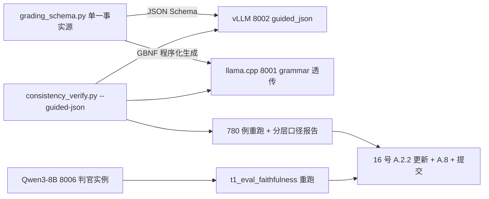

## 任务定位

接手另一窗口的 P0-2 与 P0-3（其 P0-1/P0-4 已完成但未提交，本计划全程避开其工作树文件）：

1. **P0-2 约束解码**：把 A2 轮已验证的 prompt 级结构化输出（一致率 23.33%→80.51%）固化为 **schema 级引擎约束**——vLLM 0.30 guided_json、llama.cpp GBNF grammar。消除提取失败类，重跑 780 例并按分层口径（常规+高风险 340 例 vs 边界模糊 440 例）重算门控（16 号 A.2.2 / 10 号 v1.3 的口径决策落地）。
2. **P0-3 判官升级**：Qwen3-8B 替代 Qwen2.5-7B 作 faithfulness 判官（RAGAS 口径不变），重跑 100 例对比 56.3% 基线，验证判官过严假设。

## 完成判据

- 双引擎在 schema 约束下输出 100% 可解析（提取失败 = 0）
- 分层口径报告：常规+高风险档一致率（目标 ≥95%，若达标即首个通过的一致性门控）、边界档单独呈现
- faithfulness：Qwen3-8B 判官结果 vs 7B 判官 56.3% 基线的对照报告
- 报告归档 tests/reports/、文档回写、git 提交

## Tech Stack

- 全部复用现有栈：真机 vLLM 0.30.0（原生 guided_json/structured_outputs）、llama-cpp-python 0.3.35（grammar/GBNF 支持）、bge-m3/bge-reranker 服务、PostgreSQL、pytest + ruff 棘轮
- 判官：Qwen3-8B GGUF（Q4_K_M ≈5GB，hf-mirror 可得）经 llama.cpp 起独立 8006 实例（GPU 余量 ~14GB 足够；不与 8001/8002 互斥，不影响另一窗口）
- 评测脚本保持纯 stdlib 风格（与 consistency_verify.py / t1_eval_faithfulness.py 一致）

## Implementation Approach

### 1. 分级 JSON Schema 设计（单一事实源）

按器官定义评分 schema（TI-RADS TR1-TR5 / LI-RADS / LVEF 分级 + confidence + findings 摘要字段），落为 `scripts/grading_schema.py`：同时导出 ①JSON Schema（vLLM guided_json 用）②由 schema 程序化生成的 GBNF 文法（llama.cpp 用，避免手写两份漂移）。schema 字段与 A2 轮抽取器已验证的正则口径严格对齐（TR 码/分级行/括号变体），保证新旧结果可比。

### 2. 引擎接线（最小侵入）

- **vLLM**：consistency_verify 的 vLLM 路径加 `--guided-json` → 请求体注入 `structured_outputs`/`guided_json`（vLLM 0.30 OpenAI 兼容层支持）
- **llama.cpp**：`scripts/llama_cpp_server.py` 包装层透传 grammar——请求体接受 `grammar` 字段转发给 llama-cpp-python 的 create_completion（0.3.35 原生支持）；consistency_verify 的 llama.cpp 路径发送 schema 生成的 GBNF
- 守卫测试：schema→GBNF 生成的确定性测试、两种请求体形状断言

### 3. 分层口径统计

consistency_verify.py 汇总段增加按用例 tier（常规/边界/高风险，用例 json 已带分层）分组的一致率——常规+高风险档 vs 边界档分开呈现，直接落地 16 号 A.2.2 的口径决策。

### 4. 判官部署

Qwen3-8B GGUF（Q4_K_M）下载至 `~/uai/models/qwen3-8b-judge/`，llama.cpp 起 **8006 独立实例**（n_ctx 4096 足够判官短输出，显存 ~5-6GB），thinking 模式关闭（Qwen3 支持 /no_think 或启动参数）。t1_eval_faithfulness 经既有 `--judge-url/--judge-model` 参数直接切换，脚本零改动或仅小改。

### 5. 评测执行

- 780 例一致性：串行约束下约 1-1.5 小时/轮（吞吐 1 例/26s），后台跑
- faithfulness 100 例：约 13 分钟
- 全程走 remote-gpu-server-devtest 标准姿势（PYTHONPATH、落盘脚本、吞吐串行约束）

## Performance & Reliability

- 约束解码对吞吐影响可忽略（grammar 编译一次复用）
- GBNF 由 schema 程序化生成（单一事实源），杜绝双份漂移
- 显存核对：新增 8006 判官 ~6GB 后总占用 ~40/48GB，留 8GB 余量
- 评测失败重试：consistency_verify 已有 per-case error 记录，报告含失败分析段

## Architecture Design



## Directory Structure Summary

```
scripts/
├── grading_schema.py              # [NEW] 分级 JSON Schema 单一事实源 + GBNF 程序化生成
├── llama_cpp_server.py            # [MODIFY] 透传 grammar 参数
├── consistency_verify.py          # [MODIFY] --guided-json 双引擎路径 + 分层口径统计
└── server_start_judge.sh          # [NEW] Qwen3-8B 8006 判官实例启动（幂等+探活）
tests/unit/
└── scripts/                       # [NEW] schema/GBNF 生成与请求体形状守卫
tests/reports/
├── consistency_780_guided_report.json   # [NEW] 约束解码重测报告（分层口径）
└── t1_faithfulness_qwen3_judge_report.json  # [NEW] Qwen3-8B 判官对照报告
docs-for-guiding generating docs/超声诊疗决策支持系统/
└── 16-开发进展汇报-20260928.md    # [MODIFY] A.2.2 落地结果 + A.8 判官升级
```

### Skill

- **remote-gpu-server-devtest**
- Purpose：全部真机操作的标准姿势——Qwen3-8B 下载、8006 判官实例启动、约束解码部署、780 例评测执行、显存核对、规避已知坑（PYTHONPATH/EngineCore/pkill/吞吐串行）
- Expected outcome：P0-2/P0-3 在真机顺利完成，报告正确落盘归档，不干扰另一窗口