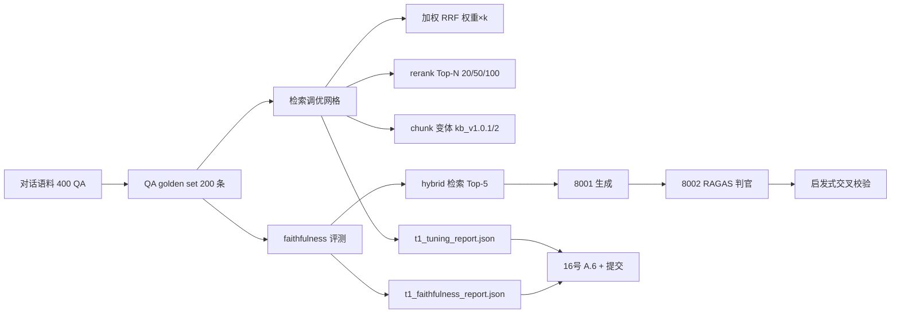

## 任务定位

完成任务 `t1-rag-metrics-loop` 的剩余部分。Recall@K/MRR/nDCG 检索评测脚本与基线（hybrid R@10 = 98% ≥85% Gate 1 已达标）在前几轮已完成，本计划聚焦三个缺口：**faithfulness 生成评测（空缺）、第一轮调优（chunk/混合权重/rerank top-N）、对照过关线的完整报告**。

## 用户确认的口径

1. **faithfulness 评测**：LLM-as-judge（RAGAS 官方口径：答案拆原子断言 → 逐条判是否可从 retrieved context 推断 → score = 支持断言数/总断言数），判官用 8002 vLLM 7B，另有启发式（关键词/数值一致性）作交叉校验；判官 prompt 照抄 RAGAS 官方源码，不自己造
2. **评测集升级**：QA 型 golden set——从中文医疗对话取真实患者问题（如“甲状腺结节3类严重吗”），gold = 其来源 chunk；服务检索调优与忠实度评测两个场景
3. **第一轮调优三项全做**（方法论全部对齐权威源，不造轮子）：

- 加权 RRF：Elastic 官方公式 `fused(d)=Σ weight_i × 1/(rank_i + rank_constant)`，rank 从 1 起，rank_constant 网格含经典值 60，权重网格覆盖“主导信号 0.6~0.8 / 次要 0.2~0.4”区间
- 两阶段 rerank：召回 Top-N（N ∈ {20,50,100}）→ 8005 bge-reranker 精排 → 取 Top-k，测 Recall@10/MRR/nDCG 与延迟
- chunk 策略：主流口径 512~1500 tokens、overlap 10~20%，重建 2-3 个变体（kb_v1.0.1/v1.0.2）对比

4. **过关线对照**：检索侧 Gate 0 ≥90% / Gate 1 检索准确率 ≥85%；生成侧整体幻觉率 ≤5% ↔ faithfulness ≥95%，严重幻觉（结论方向翻转）≤0.5%

## 交付物

- QA 型 golden set 文件 + 构造脚本
- 扩展后的检索评测脚本（加权 RRF / rerank 两阶段 / chunk 变体全网格）
- faithfulness 评测脚本 + 报告
- 调优网格报告（每配置一组指标，含最优配置结论）
- 16 号进展汇报新增小节 + 测试全绿 + git 提交

## Tech Stack

- 全部复用现有栈：Python 3.12（服务器 venv）、bge-m3(8004)/bge-reranker(8005)/llama.cpp(8001)/vLLM 7B(8002) 真机服务、PostgreSQL pgvector、纯 stdlib eval 脚本风格（与 t1_eval_retrieval.py 一致）

## Implementation Approach

1. **QA golden set（对标 BEIR/MS MARCO 查询-文档构造法）**：对话数据自带“问题→回答”天然 QA 对，问题做 query、其来源文档的 chunk 做 gold；取 200 条（肿瘤/外科/内科分层），过滤过短/过泛问题；`scripts/t1b_build_qa_golden.py` 生成 `data/golden/kb_qa_golden_v1.json`
2. **检索调优（eval 侧模拟，不动生产 retriever）**：扩展 `t1_eval_retrieval.py` 加 `--grid` 模式——离线预计算 dense/bm25 各自 Top-100 排名后，加权 RRF 融合公式纯本地重算（Elastic 口径），网格：weights ∈ {(0.5,0.5) 基线, (0.6,0.4), (0.7,0.3), (0.4,0.6)} × rank_constant ∈ {10,60,100}；rerank 两阶段对每个 query 取融合 Top-N（20/50/100）送 8005 精排再取 Top-10，记录指标与耗时；chunk 变体经 `init_knowledge_base.py --chunking-strategy`（2-3 变体，控制在中段尺寸 sweet spot 区间）重建 + `server_populate_vector_index.py` 灌数 + 复评
3. **faithfulness（RAGAS 官方实现照抄）**：从 GitHub 取 RAGAS `_faithfulness.py` 官方 prompt（服务器经 ghproxy 可达）；`scripts/t1_eval_faithfulness.py`——生成腿用生产链路（QA 问题 → hybrid 检索 Top-5 → 8001 生成答案），判官用 8002（/v1/chat/completions，temperature=0）逐断言判定；启发式交叉校验（答案数值/关键词在 context 中的覆盖率）；100 例（±~5% CI，够基线结论）
4. **报告**：`tests/reports/t1_tuning_report.json` + `t1_faithfulness_report.json`；16 号文档新增 A.6 节（调优结论 + faithfulness 基线 vs 门控）

## Performance & Reliability

- 融合网格是纯 CPU 重算（433 chunks × 200 queries × ~12 配置，毫秒级）；重开销在嵌入（每 chunk 变体 ~6s）与 rerank（8005 串行调用，Top-100 × 200 查询需批量化）与 LLM 判官（100 例 × 2 次 LLM 调用，vLLM 并发 4）
- RAG 缓存 1h TTL：调优实验绕过生产缓存（eval 直连服务），生产配置变更后需 flush Redis RAG 缓存
- chunk 变体用独立 kb_version，不覆盖 kb_v1.0.0，随时可回滚

## Architecture



## Key Code Structures

新增/扩展脚本签名（保持 t1_eval_retrieval.py 的纯 stdlib 风格）：

- `t1b_build_qa_golden.py --dialogue-dir --kb-version --sample 200 --output`
- `t1_eval_retrieval.py --golden-set ... --grid-rrf --rerank-topn 20,50,100 --reranker-url`
- `t1_eval_faithfulness.py --golden-set --generator-url --judge-url --judge-model --sample 100 --output`

## Directory Structure Summary

```
scripts/
├── t1b_build_qa_golden.py        # [NEW] QA 型 golden set 构造（BEIR 口径）
├── t1_eval_retrieval.py          # [MODIFY] 加权 RRF 网格 + rerank 两阶段
├── t1_eval_faithfulness.py       # [NEW] RAGAS 口径忠实度评测
└── prompts/ragas_faithfulness.py # [NEW] RAGAS 官方 prompt 原文（注明来源 commit）
tests/reports/
├── t1_qa_golden_retrieval_eval.json   # [NEW] QA 集检索基线
├── t1_tuning_report.json              # [NEW] 三项调优网格结果
└── t1_faithfulness_report.json        # [NEW] 忠实度基线
docs-for-guiding generating docs/超声诊疗决策支持系统/
└── 16-开发进展汇报-20260928.md   # [MODIFY] A.6 节
```

## Agent Extensions

### Skill

- **remote-gpu-server-devtest**
- Purpose: 全部真机操作的标准姿势——服务器接入、落盘脚本绕 fish 引号坑、PYTHONPATH、EngineCore 孤儿进程、RAG 缓存、显存核对、8005 max_length 钳制现状
- Expected outcome: 调优实验与 faithfulness 评测在真机顺利执行，规避已知坑，报告与数据正确落盘归档

### SubAgent

- **code-explorer**
- Purpose: 执行前确认 init_knowledge_base.py 的 chunking 策略可选值与对话数据 QA 字段结构、t1_eval_retrieval.py 现有函数可复用边界
- Expected outcome: 脚本扩展点与 chunk 变体参数完全对齐现有代码契约，避免返工