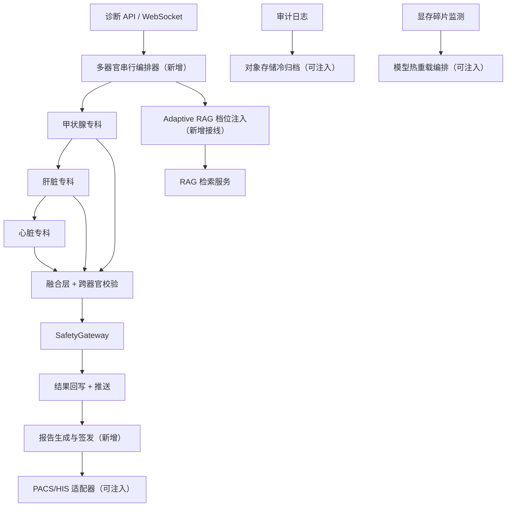

## 产品概述

超声诊断决策支持 AI 系统的"一期收尾"：把一期（Phase 0B）剩余功能与 Gate 1 可编码项全部补齐，使系统在无真机、无现场部署的前提下达到"功能完整、可回归验证"的交付状态。真机与现场类事项（TensorRT 导航真机推理、pynetdicom 真机通信、真实 GPU 上的模型热重载、真实 PACS/MinIO 对接、渗透测试、灾备演练、医学专家标注测试集）不在本次范围内。

## 核心功能

- 多器官联合诊断：一次会话对甲状腺、肝脏、心脏按序推理，单器官失败不阻断其余器官，逐个回写完成状态；超时按单器官 30s、多器官 90s 控制，结果支持"部分完成"。
- 检索强度自适应：按病例复杂度判定"标准/全量"档位，并把档位真正作用到检索参数（精排开关、Top-K、BM25 兜底、LLM 增强）；档位升级建议交由医生确认后回写。
- 模型热重载：显存碎片超阈值时自动触发模型重载，无活跃会话立即执行，有活跃会话则延迟至会话结束（最长 10 分钟）。
- 报告生成与签发：一键生成结构化诊断报告草稿，数字签名后推送 PACS/HIS，草稿生成目标不超过 2 分钟。
- 审计日志冷热分层：热数据留库秒级可查，超期数据归档至对象存储冷层。
- 数据保留策略：按门诊 15 年、住院 30 年、修改日志 30 年、操作日志 5 年自动归档与过期清理。
- 脱敏还原频率监控：单位小时内还原次数超阈值触发安全告警并记入审计。
- FHIR 接口补全：Patient、ImagingStudy、DiagnosticReport、Observation 的增改删查。
- 前端四项：诊断结果渐进式加载（结论先行、证据与幻觉警告随后补齐）、语音交互（录音、转写、指令确认、容错修正）、触摸屏适配（大控件、防误触、暗室模式）、反馈页语音输入。
- CI 流水线：提交即跑代码规范、分轨并行测试、依赖与代码安全扫描、覆盖率门禁。
- 集成验证：前端到后端到边缘端全链路、导航 P99 小于 200ms、安全合规全链路、多器官端到端延迟。

## 视觉与交互效果

沿用现有医疗双主题（常规亮色 + 暗室模式）。暗室模式下低亮度高对比，信息密度高但层次清晰；触摸屏场景使用大尺寸热区与明确焦点态。诊断结果页采用"结论先行、证据渐进"的卡片流，加载过程可见且可中断；语音交互以常驻麦克风按钮加确认弹层呈现，识别失败时给出可编辑的修正文本；报告草稿页以表单加签章区的双栏布局呈现。

## 技术栈选择

全部沿用现有工程栈，不引入替代框架：

- 后端：Python 3.13 + FastAPI + Pydantic v2 + SQLAlchemy(异步) + Alembic + Redis + PostgreSQL/PGVector + Qdrant；`safety_gateway` 保持独立 FastAPI 服务。
- 前端：Vite + React 19 + TypeScript + Ant Design 5（复用现有 theme / tokens / uiStore 设计系统）+ Zustand + ECharts + cornerstone。
- 测试：pytest + pytest-asyncio + pytest-xdist（后端）；新增 vitest + @testing-library/react + jsdom（前端）。
- CI：GitHub Actions + ruff + pip-audit + bandit + coverage。
- 新增第三方依赖仅限：`minio` 或 `boto3`（对象存储冷归档，可注入）、`vitest` 系列（前端测试），其余一律复用。

## 实施方案

### 总体策略

1. **适配器模式统一外部依赖**：PACS/HIS 推送、对象存储冷归档、模型热重载三处均定义 `Protocol` + 真实实现 + 本地假实现，由 `settings` 开关选择，与项目已有的 EDG/TensorRT 处理方式保持一致。这样编排逻辑与错误处理可在本地完整测试，现场只需注入真实适配器。
2. **多器官串行编排独立成模块**：不改动现有单器官管线语义，新增编排器作为其上层，复用 `app/agents/dispatcher.py` 已有的 `dispatch_all()`（当前只有测试调用）与 `app/repositories/session_repository.py` 已有的 `target_organs/organ_statuses` 字段，避免新造数据模型。
3. **检索档位注入用最小改动打通**：`RetrievalProfile.as_retrieval_kwargs()` 已存在但无调用点，将其接入检索请求构造链，并把档位判定结果随诊断结论一并回写，供前端展示与医生确认。
4. **异步单例绑定事件循环**：新增/改动的模块级 asyncio 原语必须绑定当前事件循环（项目已因跨循环复用连接池/锁产生过 3 处死锁），统一用"检测循环变化即重建"的既有写法。
5. **数据库变更走 Alembic**：报告、冷归档元数据等新增表统一走迁移脚本，保持现有 0001–0008 线性链路完整。
6. **配置集中声明**：所有新增配置项在 `app/config/settings.py` 声明并带校验器，杜绝"被引用但未声明"导致的历史故障。

### 关键技术决策与权衡

- **不改单器官管线语义**：多器官以"编排器 + 单器官复用"实现，保证既有 4179 个用例零回归；代价是多一层超时聚合逻辑，需明确超时预算分配（单器官 30s、全局 90s）。
- **外部依赖用假实现验收而非真实对接**：能以确定性测试覆盖编排、重试、降级、幂等；权衡是现场联调仍需一次真实配置。
- **热重载只做编排不做模型加载**：真实权重加载由注入的适配器承担，本地假实现验证"阈值触发—会话检测—立即/延迟执行—指标写入"全链路，避免依赖 GPU。
- **前端测试基建选 vitest**：与 Vite 同源、零额外构建配置，优于 jest。

### 性能与可靠性

- 多器官串行是延迟敏感路径：编排器按器官串行但允许器官内部并发（复用 `dispatch_all`），聚合总耗时写入 `record_multi_organ_latency()`（当前无调用方），超时即标记该器官为"部分完成"并继续，避免单点拖垮整体。
- 报告生成目标 ≤2 分钟：模板填充为纯内存操作，签名走现有 HSM 单例，PACS 推送异步化并带重试与幂等键，失败不阻塞草稿返回。
- 冷归档为批量后台任务：按批次游标迁移，避免一次性全表扫描；冷层不可用时降级为"仅标记待归档"，不阻塞热路径。
- 覆盖率门禁只对核心模块设 90%，避免为凑数字写无意义用例。

## 实现要点（执行注意事项）

- 修改前先确认现状：项目历史上多次出现修复被后续提交回退（`knowledge/__init__.py` 导出、`embedding_retry_max_attempts` 配置、`kb_version` 契约），务必先读目标文件确认行号与当前实现。
- 测试运行统一使用 `python -m pytest tests/unit -q --tb=no -p no:cacheprovider -n 8 --dist=loadfile`，`--dist=loadfile` 必须保留，否则会触发跨用例状态污染导致"幽灵失败"。
- 不要破坏 `tests/conftest.py` 顶部的 SoftHSM 时间戳隔离顺序（必须在导入 `app.*` 之前设置环境变量）。
- 提交信息避免反引号与 `（Windows PowerShell 会转义）；每个批次完成后单独提交并跑对应测试轨道。
- 新代码涉及审计、脱敏、签名时复用既有组件（`observability/logging/storage.py`、`security/desensitization_restore.py`、`security/hsm/`），不要重复造。

## 架构设计

### 系统结构



### 模块划分

- **编排模块**：新增多器官串行编排器，负责超时预算、部分完成、状态回写、延迟指标上报。
- **检索模块**：在检索请求构造处接入档位参数，打通"判定到生效"的链路。
- **报告模块**：模板引擎 + 报告仓储 + 签发路由 + PACS 适配器。
- **归档模块**：对象存储适配器 + 冷热分层任务，接入现有日志存储抽象。
- **推理运维模块**：显存碎片监测接线到热重载编排器。
- **集成验证模块**：新增 e2e 用例覆盖前后端链路、导航链路、安全合规链路、多器官延迟。
- **前端模块**：语音组件与录音 hook、渐进式结果加载、触摸适配 hook、反馈页语音、vitest 基建。
- **基础设施模块**：CI 工作流、边缘端容器编排、覆盖率与性能基准、数据保留与频率监控。

## 目录结构

```
project-root/
├── app/
│   ├── services/
│   │   ├── diagnosis_pipeline.py          # [MODIFY] 接入多器官编排分支与档位注入
│   │   ├── multi_organ_orchestrator.py    # [NEW] 多器官串行编排：超时预算(单器官30s/全局90s)、部分完成、状态回写、延迟指标
│   │   ├── report_service.py              # [NEW] 报告草稿生成：模板填充 → HSM 签名 → PACS 推送编排
│   │   ├── data_retention.py              # [MODIFY] 按门诊15年/住院30年/修改日志30年/操作日志5年策略补全归档与过期清理
│   │   └── cold_archive.py                # [NEW] 冷热分层后台任务：批量游标迁移、失败降级为待归档标记
│   ├── agents/
│   │   ├── routing.py                     # [MODIFY] as_retrieval_kwargs 产出与确认回写
│   │   └── knowledge.py                   # [MODIFY] 检索请求接收 profile 参数（保持向后兼容默认值）
│   ├── rag/
│   │   └── service.py                     # [MODIFY] RetrievalRequest 支持档位参数
│   ├── inference/
│   │   ├── vram_fragmentation.py          # [MODIFY] 命中阈值时调用热重载编排器并写指标
│   │   └── hot_reload.py                  # [NEW] 热重载编排：>40% 触发、无活跃会话立即执行、有会话延迟至会话结束(≤10min)、可注入重载适配器
│   ├── integrations/
│   │   ├── pacs/__init__.py               # [NEW] PACS/HIS 推送 Protocol + 假实现 + HTTP 实现 + 工厂
│   │   └── object_storage/__init__.py     # [NEW] 对象存储 Protocol + 本地假实现 + S3/MinIO 实现 + 工厂
│   ├── observability/
│   │   └── logging/storage.py             # [MODIFY] 冷归档落盘接入对象存储适配器
│   ├── api/v1/
│   │   ├── report.py                      # [NEW] 报告草稿/签发/推送路由
│   │   └── fhir.py                        # [MODIFY] 补全 PUT/DELETE 与 Patient/Observation 创建
│   ├── repositories/
│   │   └── report_repository.py           # [NEW] 报告读写仓储（含签发状态与PACS推送结果）
│   ├── models/
│   │   ├── schemas.py                     # [MODIFY] 报告与多器官结果相关 DTO
│   │   └── database.py                    # [MODIFY] 报告表、冷归档元数据表
│   ├── security/
│   │   ├── desensitization_restore.py     # [MODIFY] 还原调用接入频率计数
│   │   └── restore_rate_monitor.py        # [NEW] 单小时阈值监控(compact>100/full>200)、审计记录、通知数据安全官
│   └── config/settings.py                 # [MODIFY] 新增配置项与校验器（适配器开关、阈值、保留年限、限流）
├── alembic/versions/
│   └── 0009_reports_and_cold_archive.py   # [NEW] 报告表 + 冷归档元数据表（保持线性链路）
├── edge/                                  # 边缘端（已存在，仅纳入编排，不改业务代码）
├── docker-compose.dev.yml                 # [MODIFY] 新增 edge 服务编排
├── .github/workflows/
│   ├── ci.yml                             # [NEW] ruff + pytest 分轨并行(--dist=loadfile) + 覆盖率门禁
│   └── security-scan.yml                  # [NEW] pip-audit + bandit + CSP 检查（每周全量）
├── pyproject.toml                         # [MODIFY] pytest 标记、覆盖率配置与门禁、安全扫描配置
├── scripts/
│   └── bench_suite.py                     # [NEW] 整合 bench_p99 / bench_http_p99 / memory_profile / model_benchmark 的性能基准入口
├── tests/
│   ├── unit/agt/test_multi_organ_orchestrator.py   # [NEW] 串行顺序、超时、部分完成、状态回写
│   ├── unit/agt/test_retrieval_profile_injection.py# [NEW] 档位参数真实进入检索请求
│   ├── unit/inf/test_hot_reload.py                 # [NEW] 阈值触发、立即/延迟执行、超时上限、指标
│   ├── unit/api/test_report_api.py                 # [NEW] 草稿生成、签名、推送、失败降级
│   ├── unit/sec/test_cold_archive.py               # [NEW] 冷热分层与对象存储适配器
│   ├── unit/sec/test_restore_rate_monitor.py       # [NEW] 频率阈值与审计记录
│   ├── unit/data/test_data_retention_policy.py     # [NEW] 各类数据保留年限
│   └── integration/int/
│       ├── test_multi_organ_e2e.py                 # [NEW] 多器官端到端与延迟
│       ├── test_nav_e2e.py                         # [NEW] 边缘端→后端→前端导航链路 P99
│       └── test_security_flow_e2e.py               # [NEW] 三层脱敏+同意+审计+HSM 全链路
└── frontend/
    ├── package.json                       # [MODIFY] 增加 vitest / @testing-library/react / jsdom 脚本
    ├── vitest.config.ts                   # [NEW] 前端测试基建
    ├── src/pages/DiagnosisPage.tsx         # [MODIFY] 渐进式加载：结论先行、证据与幻觉警告随后补齐
    ├── src/services/diagnosisService.ts    # [MODIFY] 渐进式获取与阶段事件
    ├── src/services/voiceService.ts        # [NEW] 语音转写与指令确认调用
    ├── src/components/voice/VoiceControl.tsx       # [NEW] 常驻麦克风按钮
    ├── src/components/voice/VoiceConfirmDialog.tsx # [NEW] 指令确认弹层与可编辑修正文本
    ├── src/hooks/useVoiceRecorder.ts       # [NEW] 录音与容错
    ├── src/hooks/useTouchAdaptation.ts     # [NEW] 触摸屏大控件与防误触
    ├── src/pages/FeedbackPage.tsx          # [MODIFY] 反馈页语音输入
    ├── src/styles/tokens.ts                # [MODIFY] 暗室与触摸尺寸令牌
    └── src/**/__tests__/*.test.tsx         # [NEW] 渐进式加载、语音确认、触摸适配、反馈语音用例
```

## 关键代码结构

外部适配器的统一契约（三处适配器共用同一形态，便于本地假实现与现场真实实现互换）：

```python
class PacsPushAdapter(Protocol):
    async def push_report(self, report_id: str, payload: bytes, *, idempotency_key: str) -> PushResult: ...
    async def health(self) -> bool: ...

# 由 settings 开关选择：local_fake | http；与 EDG/TensorRT 的既有做法一致
def create_pacs_adapter(settings: Settings) -> PacsPushAdapter: ...
```

检索档位注入的关键契约（打通"判定到生效"）：

```python
class RetrievalProfile:
    def as_retrieval_kwargs(self) -> dict[str, Any]:
        """返回 RetrievalRequest 可消费的字段：use_reranking/top_k/use_bm25_fallback/use_llm_enhancement。"""
```

## 设计说明

本次为既有前端的增量式增强，不改变整体设计语言，继续复用项目现有的 Ant Design 5 主题与 `styles/tokens.ts`、`stores/uiStore.ts` 设计系统，保证与已有页面（诊断页、同意页、反馈页）视觉一致。

## 视觉风格

延续"医疗专业 + 暗室友好"的深色科技风：常规模式为低饱和中性底色配高对比文字，暗室模式整体压暗、降低蓝光感并把可交互元素亮度收敛。强调色用于诊断结论与安全标记；告警色仅用于幻觉警告与质控异常。

## 页面与区块

1. 诊断结果页（渐进式加载）：顶部状态条展示推理阶段与总体进度；结论卡片先落地，证据链、幻觉警告、缓存依据标记随后分块补齐（骨架屏占位）；缓存依据用轻量角标标记"来自缓存"，可展开查看来源。
2. 语音交互（覆盖层）：右下常驻麦克风按钮，录音时展示波形与实时转写；识别完成后弹出指令确认层，列出解析出的指令与参数，允许直接编辑文本再确认；识别失败给出重试与手动输入入口。
3. 触摸屏适配：在触摸设备上放大点击热区与字号，按钮间距加大，滑动手势替代悬停，避免误触；暗室模式下同步放大并提高对比度。
4. 反馈页语音输入：在 L2/L3 分级选择下方增加"语音填写"入口，转写文本落入反馈内容框且可编辑。

## 交互与动效

加载采用分段进入的淡入上浮动效，进度条与阶段文案同步更新；语音录音用呼吸式脉冲动效，确认层用轻遮罩滑入；触摸点击提供明确的按压反馈。所有动效时长控制在 150-250ms，避免干扰临床阅读节奏。

## 响应式

以桌面为主（诊断工作站），触摸/小屏设备启用大控件布局；关键操作区在两种形态下位置保持一致，避免医生肌肉记忆被打断。

## Agent 扩展

### SubAgent

- **code-explorer**
- 用途：在大型代码库中精确定位本次改动的落点（多器官编排接入点、检索请求构造点、适配器注入点、配置声明位置），并核对既有实现是否被历史提交回退。
- 预期产出：带绝对路径与符号名的修改目标清单，供实现阶段直接定位。

### Skill

- **Code**
- 用途：贯穿每个批次的"规划—实现—验证—测试"闭环，确保每批次交付都有对应的测试与验证结果。
- 预期产出：每批次完成后测试全绿、可提交的证据。
- **frontend-design**
- 用途：指导前端四项功能（渐进式加载、语音交互、触摸适配、反馈语音）达到生产级视觉与交互质量，并与既有 Ant Design 主题保持一致。
- 预期产出：符合医疗暗室主题与触摸可用规范的前端组件与页面。