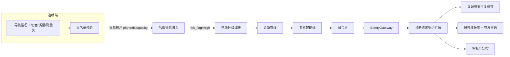

## 产品概述

在已完成的超声诊疗决策支持系统一期主体之上，补齐"医生直接信息需求"全部 12 项缺口、Gate 1 剩余可编码项与二期不依赖硬件的增强项，并清偿上一轮暴露的质量债，使一期收尾后除真机与现场验证外不再有可开发项。

## 核心功能

### 一、医生直接信息需求（M1~M12）

1. 切面标准性评估：导航时给出切面类型、是否标准、存在问题与应有结构可见性；连续非标准帧、关键结构缺失时提示，图像角落显示切面状态。
2. 快速路径高危标记与自动升级：导航标注可带高风险标记与建议动作，命中后自动发起深度诊断，前端以橙色闪烁边框区分并提示"正在启动深度分析"。
3. 自动测量：输出长径、短径、前后径、纵横比、体积，以及到包膜、脏器边缘、皮肤距离，并标明尺寸来源。
4. 鉴别诊断清单：按可能性降序的鉴别病种卡片，含支持与排除依据、分级置信度。
5. 恶性概率：独立于 AI 置信度的恶性概率与低/中/高分级，可展开依据贡献。
6. 图像质量评估：给出总体质量分与模糊、伪影、增益等分项，按阈值给出无提示、警示或严重提示。
7. 转诊与处置建议：按触发条件给出处置动作、目标科室与紧急度，基层与三甲差异化展示，并纳入报告建议段。
8. 报告模板库：按器官自动匹配报告模板，定义必需段落与字段并做完整性校验；一期覆盖甲状腺、肝脏、心脏三套模板，并提供报告查看与签发入口。
9. 后方回声特征：新增后方回声属性（增强、衰减、声影、无、混合）并纳入分级评分规则。
10. 患者解释话术：给出可选的患者向解释、安抚与下一步说明，默认不进入正式报告，可由医生选择展示或打印。
11. 科研量化指标：输出弹性、血流参数、AI 抽取特征与模型置信度分布，默认折叠。
12. 跨模态对照提示：给出与 CT、MRI、病理的对照提示与临床价值，作为依据溯源的子标签。

### 二、Gate 1 剩余可编码项

- 模型与知识库版本兼容性强制校验（启动时校验，结果返回时反映真实兼容状态）
- 需求到设计、代码、测试的可追溯性矩阵自动生成
- 灰度发布流量路由（全量模式按比例放量，精简模式按会话数爬坡）
- 性能基准补齐并发与显存两个维度
- 同意撤回全链路：500 毫秒内生效、在途诊断取消、前端展示拦截

### 三、二期不依赖硬件的增强项

知识库条目时间衰减（含反馈驱动衰减）、AI 修正率按方向与医生维度监控、规则引擎抽象层与一致性验证、图查询在纯向量库上的递归降级、A/B 实验分流与统计判定、模型漂移的分布散度监控、应用层国密算法与可配置切换、知识查询共享缓存接线。

### 四、质量债清偿

- 风格问题分批自动修复并收敛，检查门禁从"仅报告"升级为"阻断"
- 覆盖率提升至核心模块 90%、整体 80%
- 前端静态检查告警收敛至可阻断
- 埋点与契约断点守卫：确保已定义指标均有写入方、关键契约字段非占位值

## 技术栈

- 后端：Python 3.10+ / FastAPI / Pydantic v2 / SQLAlchemy 2.x（async）/ Alembic / Redis / structlog / pytest（xdist + asyncio）
- 边缘端：Python 独立进程（TensorRT 等真机能力以可注入适配器 + 本地假实现交付）
- 安全网关：独立 `safety_gateway` 进程
- 前端：React + TypeScript + Vite + Ant Design（沿用既有 `providers.tsx` darkAlgorithm 与 `styles/tokens.ts` token 层）+ Zustand + vitest + Testing Library
- CI：GitHub Actions（ruff、pytest 六分轨、覆盖率门禁、pip-audit + bandit、npm audit、CSP 检查）

## 实现方案

核心策略：**契约先行、适配器隔离真机、白名单同口径、零迁移优先、门禁棘轮**。

1. **契约先行（降低爆炸半径）**：第一批只做一件事——统一扩展三处共享契约（专科智能体 `AgentResponse`、`DiagnosisResult`、导航标注 `NavigationAnnotation`/`EdgeNavLabel`/`EdgeNavResultMessage`），把 M1~M12 所需的全部字段一次性预留为可选。后续批次只做字段填充与前端消费，避免反复改同一批文件导致既有测试轨道反复变红。
2. **落库零迁移优先**：新字段优先写入 `diagnosis_results.findings`（JSONB），仅当确需索引或聚合查询时才加 alembic 迁移（当前 head `0011`，需迁移则新增 0012+）。理由：本批字段多为展示型与统计型，JSONB 已足够；避免 6 处并行迁移造成的链路冲突。
3. **真机能力适配器化**：切面分类头、图像质量评分头、尺寸换算模型、图查询引擎等强依赖 GPU 或外部系统的部分，统一按既有 EDG / TensorRT / PACS 的处理模式交付 `Protocol` 契约 + 本地确定性假实现，编排逻辑与接口完整可测，真机实现由现场经注入点替换。这样"可离线完成"与"验收口径"不冲突。
4. **白名单三处同口径**：导航标签与字段白名单在边缘端、安全网关、脱敏层各有一份定义，M1/M2/M3/M6/M9 都会触碰。统一在同一批内扩展，并新增一致性测试锁定（三处集合必须互为子集/超集关系明确），避免安全口径漂移。
5. **异步编排的事件循环纪律**：自动升级、在途取消、每日漂移评估都会引入新的异步编排，所有模块级单例必须绑定当前事件循环（历史上已修同类死锁 3 处）。
6. **性能与可靠性**：知识条目引用记录、修正率聚合、漂移统计均走批量写入与聚合查询，避免逐条 I/O 与 N+1；指标写入统一走既有 `metrics_collector`，不再新增旁路。
7. **门禁棘轮**：覆盖率与 ruff 门禁按批次上调，最终整体 80%、核心 90%、ruff 全量阻断。上一轮已建立门禁基线，本轮只单向收紧。
8. **兼容策略（用户已授权）**：允许必要的契约重构；既有测试断言可同步更新，但每次改动后必须使既有轨道保持全绿。

## 实施要点

- 测试命令固定带 `--dist=loadfile`（xdist 逐用例分发会触发跨用例污染）
- PowerShell 提交信息避免反引号与 `
- `tests/conftest.py` 顶部 SoftHSM 时间戳隔离必须在导入 `app.*` 前完成，勿破坏顺序
- 新增配置项必须在 `app/config/settings.py` 声明并配校验器
- 白名单三处口径同步后必须补一致性测试
- 每批完成后跑对应测试轨道并提交，保持 `tests/unit` 全绿
- 禁止回退既有修复（`app/knowledge/__init__.py` 导出、`embedding_retry_max_attempts`、`kb_version` 契约）

## 架构设计



架构约束：不引入新架构模式，仍为既有分层（接入层 → 服务/管线层 → 智能体与融合层 → 安全网关 → 观测层）。新增能力全部挂接在既有链路的既有锚点上。

## 目录结构

以下按批次列出将新建或修改的文件（同批次内按模块归并）。

### 批次 1：公共契约基建

- `app/agents/protocols.py` [MODIFY]：`AgentResponse` 一次性新增可选结构化字段（measurement、differential_diagnoses、malignancy_risk、clinical_actions、patient_explanation、research_metrics、cross_modality_hints、posterior_acoustic），保持既有字段不动。
- `app/models/schemas.py` [MODIFY]：`DiagnosisResult`、`NavigationAnnotation`、`EdgeNavLabel`、`EdgeNavResultMessage` 同步扩展；新增 `PlaneAssessment`、`ImageQuality` 模型。
- `app/models/database.py` [MODIFY]：ORM `DiagnosisResult.findings` 承载说明与必要注释（优先零迁移）。
- `app/services/diagnosis_pipeline.py` [MODIFY]：`_write_result_to_db` 与融合结果转换作为唯一组装点集中扩展。
- `app/api/websocket/nav.py` [MODIFY]：标注转换与下发扩展新字段。
- `edge/protocols.py` [MODIFY]：`NavLabel`、`NavResult` 增 plane_assessment、risk_flag、suggested_action、image_quality。
- `edge/safety.py`、`safety_gateway/degraded_output.py`、`app/fusion/desensitization.py` [MODIFY]：三处白名单同口径扩展。
- `app/knowledge/vocabulary.py` [MODIFY]：UDAF 扩展点（后方回声与测量维度）骨架。
- `frontend/src/types/api.ts`、`types/navigation.ts`、`types/websocket.ts` [MODIFY]：类型同步。
- `tests/unit/**/test_contract_extension.py` [NEW]：契约扩展与白名单一致性回归测试。

### 批次 2：M1 + M2 + M6（导航链路三项）

- `edge/plane_assessment.py` [NEW]：切面评估适配器契约 + 本地假实现。
- `edge/image_quality.py` [NEW]：图像质量评分适配器契约 + 本地假实现。
- `edge/nav_backend.py`、`edge/websocket_server.py` [MODIFY]：产出与上行载荷接入。
- `app/services/navigation_upgrade.py` [NEW]：高危标记触发自动升级编排（复用既有提交与入队能力）。
- `app/agents/monitor.py` [MODIFY]：连续非标准帧与关键结构缺失监控。
- `frontend/src/components/navigation/PlaneStatusBadge.tsx`、`ImageQualityHint.tsx` [NEW]。
- `frontend/src/components/navigation/AnnotationBox.tsx`、`NavigationOverlay.tsx`、`stores/navigationStore.ts`、`websocket/navChannel.ts` [MODIFY]。

### 批次 3：M9 + M5 + M3

- `app/knowledge/vocabulary.py`、`udt_parser.py`、`feature_extractor.py` [MODIFY]：后方回声枚举与测量维度完整落地。
- `app/agents/specialist/thyroid.py`（分级规则纳入后方回声）、`liver.py`、`cardiac.py`、`base.py` [MODIFY]：结构化测量与恶性概率输出。
- `edge/measurement.py` [NEW]：标注框到测量值换算（含像素间距缺失回退）。
- `edge/dicom_scp.py` [MODIFY]：解码保留像素间距。
- `frontend/src/components/diagnosis/MalignancyRiskGauge.tsx`、`MeasurementTable.tsx` [NEW]；`DiagnosisConclusion.tsx` [MODIFY]。

### 批次 4：M4 鉴别诊断清单

- `app/knowledge/`（条目类型与构建）[MODIFY]、`app/agents/specialist/base.py` 与各专科 [MODIFY]。
- `frontend/src/components/diagnosis/DifferentialDiagnosisList.tsx` [NEW]；`DiagnosisPage.tsx` [MODIFY]。

### 批次 5：M8 + M7 报告模板库与处置建议

- `app/templates/report/thyroid_standard.md`、`liver_standard.md`、`cardiac_standard.md` [NEW]；`default.md` [MODIFY]。
- `app/services/report_service.py` [MODIFY]：按器官匹配模板、建议段来源扩展。
- `app/api/v1/report.py` [MODIFY]、`frontend/src/pages/ReportPage.tsx` [NEW]、`frontend/src/components/diagnosis/ClinicalActions.tsx` [NEW]。

### 批次 6：M10 + M11 + M12

- `frontend/src/components/diagnosis/PatientExplanation.tsx`、`ResearchMetrics.tsx` [NEW]；`EvidenceTrace.tsx`、`DiagnosisPage.tsx` [MODIFY]。
- `app/services/report_service.py` [MODIFY]：患者解释段可选输出。

### 批次 7：Gate 1 剩余项

- `app/config/validator.py` [MODIFY]：新增版本兼容性校验并接入启动钩子。
- `app/main.py` [MODIFY]、`app/api/v1/diagnosis.py` [MODIFY]：结果返回真实兼容状态。
- `app/services/rollout_router.py` [NEW]、`app/config/settings.py` 与 `app/config/redis_keys.py` [MODIFY]：灰度路由与会话计数。
- `app/security/consent_withdrawal_consumer.py`、`app/services/diagnosis_pipeline.py` [MODIFY]：500 毫秒埋点与在途取消。
- `frontend/src/pages/DiagnosisPage.tsx`、`DiagnosisConclusion.tsx` [MODIFY]：同意状态拦截接线。
- `tests/integration/int/test_consent_withdrawal_e2e.py` [NEW]、`scripts/generate_traceability.py` [NEW]、`scripts/bench_suite.py` [MODIFY]。

### 批次 8：二期可离线项

- `app/knowledge/decay.py` [NEW]、`alembic/versions/0012_knowledge_decay.py` [NEW]、`app/rag/retriever.py` [MODIFY]。
- `app/services/correction_rate_monitor.py` [NEW]、`app/knowledge/rule_engine.py` [NEW]、`scripts/rule_engine_consistency.py` [NEW]。
- `app/knowledge/graph_query.py` [MODIFY]：纯向量库递归降级实现。
- `app/services/ab_test.py` [NEW]、`app/inference/drift_detector.py` [MODIFY]。
- `app/security/hsm/encryption_service.py`、`app/security/auth.py`、`app/config/validator.py` [MODIFY]：应用层国密与算法白名单。
- `app/rag/cache.py`、`app/api/v1/health.py` [MODIFY]：共享缓存与健康检查接线。

### 批次 9：质量债

- 全仓分批 `ruff check --fix` 触及文件 [MODIFY]；`pyproject.toml`、`.github/workflows/ci.yml`、`ruff.toml` [MODIFY]：门禁上调。
- `tests/unit/**` 覆盖率补测文件 [NEW]；`tests/unit/obs/test_metrics_wiring.py` [NEW]：指标写入方守卫。
- `frontend` lint 配置与告警收敛 [MODIFY]。

### 批次 10：回归与发布

- `docs/合规/可追溯性矩阵.md` [NEW]：生成产物；规格文档状态更新（只读文档不改，仅在允许目录产出报告）。

## 关键代码结构

共享契约扩展（多模块依赖，需精确字段名）：

```python
# 导航标注扩展（既有模型仅增可选字段，字段名以 13-指南 为准）
class PlaneAssessment(BaseModel):
    organ_code: str
    plane_type: str                 # transverse | longitudinal | non_standard
    is_standard: bool
    plane_score: float
    issues: list[str] = []
    required_structures_visible: list[str] = []

class ImageQuality(BaseModel):
    overall_score: float
    blur_score: float
    artifact_score: float
    gain_score: float
    issues: list[str] = []
    diagnostic_impact: str | None = None

class NavigationAnnotation(BaseModel):
    # 既有字段保持不变
    plane_assessment: PlaneAssessment | None = None
    risk_flag: str | None = None            # "high" | None
    suggested_action: str | None = None     # "start_standard_evaluation" | None
    image_quality: ImageQuality | None = None
```

真机能力适配器契约（本地假实现交付，现场注入真机实现）：

```python
class PlaneAssessmentAdapter(Protocol):
    async def assess(self, frame_ref: str, organ_code: str) -> PlaneAssessment | None:
        """返回切面评估；本地假实现返回确定性结果，真机实现由现场注入。"""

class ImageQualityAdapter(Protocol):
    async def assess(self, frame_ref: str) -> ImageQuality | None: ...
```

## 设计定位

本轮为**既有 UI 的功能性扩展**：新增医生直接信息需求的展示位（鉴别诊断、恶性概率、处置建议、患者解释、科研指标、跨模态对照）、导航浮层的两项安全状态提示（切面状态、图像质量）与一个新增的报告页。不改变既有视觉语言，全部沿用项目现有 token 层（`styles/tokens.ts` 与 `uiStore.isDarkRoomMode` 的暗室 token）与 Ant Design 主题，保证暗室模式与触摸屏适配下的一致性。

## 应用类型与框架

桌面端临床工作站 Web 应用（另有暗室模式）。布局为「顶栏 + 左侧导航栏 + 主内容区」，因临床工作站为长时间固定视角作业，不采用底部导航；主内容区按标签页组织，避免竖向滚动过长。前端框架 React + TypeScript + Vite + Ant Design + Zustand。

## 页面规划（5 页）

1. 诊断结果页（扩展）
2. 检查主界面（导航浮层扩展）
3. 报告页（新增）
4. 质量与监控看板（扩展）
5. 设置页（扩展）

## 页面与区块设计

### 1. 诊断结果页

- 顶部结论条：维持既有结论卡，右侧并列显示 AI 置信度（蓝）与恶性概率（红/黄/绿）两条独立概率条，视觉不可混淆。
- 标签页容器：结论 / 鉴别诊断 / 处置建议 / 科研指标 / 依据溯源，默认停在结论，切换带动画。
- 鉴别诊断列表：按可能性降序卡片，每卡含病种、置信度条（绿大于 0.7、黄 0.4 至 0.7、红小于 0.4）、支持与排除依据折叠块。
- 处置建议区：按紧急度着色的动作卡，含目标科室与建议动作；基层与三甲视角下文案与折叠策略不同。
- 依据溯源：在既有推理路径与知识库引用之外新增「跨模态对照」子标签，展示与 CT、MRI、病理的对照提示。
- 患者解释：默认折叠在底部，标注「非正式报告内容」，可一键切换为打印友好视图。

### 2. 检查主界面（导航浮层）

- 图像角落切面状态徽标：绿勾表示标准、黄警表示预警、灰问表示未知，鼠标悬停展开问题清单。
- 高危标注框：橙色闪烁边框叠加「正在启动深度分析」文字，与蓝色实线普通标注框形成明确区分。
- 图像质量提示条：位于图像底部，按分数区间显示无提示、黄色警示或红色严重提示，可展开分项。
- 实时测量层：在标注框旁轻量显示长径与纵横比，点击展开完整测量表。

### 3. 报告页（新增）

- 模板与状态头：显示匹配到的器官模板、模板版本、草稿或已签发或已推送状态。
- 报告正文预览：按模板段落渲染，缺失的必需字段以高亮占位提示。
- 完整性校验面板：列出必需段落的通过情况，未通过项可直接跳转补录。
- 操作区：生成草稿、签发、推送到 PACS 与 HIS，操作后给出签名与推送结果回执。

### 4. 质量与监控看板（扩展）

- 灰度发布面板：展示全量模式放量比例与精简模式会话爬坡进度。
- 修正率面板：按偏高偏低方向与医生维度的偏差分布。
- 漂移面板：输入与输出分布散度趋势及阈值线。
- 告警列表：沿用既有告警升级路径，新增修正率与漂移类事件。

### 5. 设置页（扩展）

- 灰度与实验：灰度开关、放量比例、实验分流开关。
- 安全算法：标准与国密算法切换及当前生效算法展示。
- 知识衰减：时间衰减与反馈衰减阈值展示与调优入口。
- 报告模板：按器官选择默认模板与预览。

## 交互与响应式

- 微动效：标签切换淡入、概率条增长过渡、高危框脉冲呼吸、看板数值滚动。
- 暗室模式：全部新增组件必须读取既有暗室 token，禁止硬编码亮色背景。
- 触摸屏：报告页与结果页按钮最小点击区不小于 44 像素，折叠区支持整行点击。
- 无障碍：概率条与状态徽标均带文字标签，不单靠颜色传意。

## Agent Extensions

### SubAgent

- **code-explorer**
- Purpose: 在批次 1（契约基建）开工前，测绘三处共享契约扩展的完整爆炸半径——列出所有引用 `AgentResponse`、`DiagnosisResult`、`NavigationAnnotation`/`EdgeNavLabel`/`EdgeNavResultMessage`、三处白名单集合、以及前端对应类型的既有测试与调用点；在批次 9（质量债）开工前，测绘覆盖率缺口最大模块（安全模块持久化管理、审计链跨链与周期任务、语音与健康接口、安全网关客户端、日志文件后端、零覆盖的注册表与分词工具等）的现有测试与可复用 fixture。
- Expected outcome: 产出两份带绝对路径与行号的清单——「契约变更受影响文件与测试清单」用于精确同步修改、避免既有测试轨道变红；「覆盖率缺口模块与可复用测试基建清单」用于按模块集中补测并直达核心 90%／整体 80% 目标。