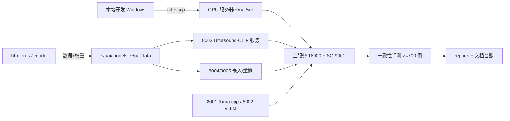

## Product Overview

继续推进超声诊疗决策支持系统的真机验证阶段：补齐缺失的 8003 图像嵌入腿（官方 Ultrasound-CLIP 已开源，推翻此前“无公开源”判断）、批量拉取真实公开数据集并建立许可台账、用真实数据完成双引擎一致性评测（当前仅 6 例且 16.67% 未达标，P0 项）。

## Core Features

- **数据集批量拉取与台账**：经 hf-mirror 批量下载 US-365K 图片本体（已拉取 71,919 条图文对元数据，图片未下载），拉取可商用数据集（CACTUS/CARDIACUDC/AUL）；建立数据源台账（策展目录 CSV 快照、许可证原文存档、AUL 规模核对）
- **8003 图像嵌入服务**：按既有客户端契约实现服务端（`/v1/embeddings`、`/v1/embeddings/image`、`/v1/embeddings/multimodal`、`/v1/model/info`、`/health`，768 维），下载官方 Ultrasound-CLIP 预训练权重接入真机；I2T@10 不达标时退 BiomedCLIP（MIT）或自训
- **真机链路打通**：8003 接入主服务后 RAG 四腿全绿，端到端冒烟跑到 `completed`（含图像向量检索），顺带排查残留的 `dense_search_failed [E2003_VEC_SEARCH_FAILED]`
- **双引擎一致性评测（P0）**：用真实公开数据构造 ≥700 例（常规≥200 + 边界≥400 + 高风险≥100），复用既有一致性验证管线，产出评测报告与失败分析，目标分级一致率 ≥95%

## Visual Effect

本轮为后端/数据/评测工作，无 UI 变更。

## Tech Stack

- 服务端：Python 3.12.3 venv（GPU 服务器）+ FastAPI + transformers + torch 2.14.0+cu130（复用既有模式）
- 模型权重：官方 Ultrasound-CLIP（GitHub `ZJUDataIntelligence/Ultrasound-CLIP`，CVPR 2026，EnhancedCLIP 架构 = base CLIP + CrossAttentionFusion + GraphEncoder）；备选 BiomedCLIP（MIT）
- 数据渠道：hf-mirror.com（huggingface.co 不通，须 `HF_HUB_DISABLE_XET=1`、`--exclude` 逐个写）、Zenodo/GitHub
- 远程执行：SSH 密钥 + scp 落盘脚本 + 显式 bash（远端 fish shell，遵循 [skill:remote-gpu-server-devtest] 全部坑表）

## Implementation Approach

1. **8003 服务端沿用既有模式**：`scripts/start_embedding_services.py` 已实现 8004/8005 薄服务并验证可行，本次按同一文件模式新增 `ultrasound-clip` 服务分支，端点契约严格照 `app/embedding/ultrasound_clip.py` 客户端源码（JSON 文本 / multipart 图像 / multipart 多模态，L2 归一化，维度默认 768 = `settings.embedding_dim`）
2. **权重加载适配**：官方 EnhancedCLIP 含图编码器扩展，`clip_model.py` 用 `AutoModel.from_pretrained` 通用加载，需写适配 wrapper；若官方权重与该封装不兼容（架构差异），按用户确认的降级路径先试 LoRA 微调对齐，仍不行退 BiomedCLIP
3. **评测复用既有链路**：I2T@10 用 `scripts/evaluate_ultrasound_clip.py`（已支持 US-365K jsonl、fail-fast）；双引擎一致性复用 `app/inference/consistency/` + `scripts/consistency_verify.py`，样本从真实公开数据（US-365K/CACTUS/CARDIACUDC/AUL）构造
4. **性能考量**：US-365K 图片下载量大（36.4 万对），服务器磁盘充足（/mnt/ee16 14T）；803 服务只绑 127.0.0.1；一致性评测 ≥700 例走真机双引擎（8001/8002 已就位），预计为主要耗时瓶颈，按器官分批跑并落盘中间结果防中断重跑
5. **台账落文档**：更新 14 号文档待办 B1/B4/B6 与 `docs/合规/覆盖率豁免清单` 现场记录

## Architecture Design



## Directory Structure

```
scripts/
├── start_embedding_services.py        # [MODIFY] 新增 ultrasound-clip 服务分支（8003，照客户端契约）
├── server_start_ultrasound_clip.sh    # [NEW] 真机起 8003 的包装脚本（env CUDA_VISIBLE_DEVICES=0）
├── server_download_us365k_images.sh   # [NEW] 批量下载 US-365K 图片（hf-mirror + 断点续传）
├── server_download_official_clip.sh   # [NEW] 下载官方 Ultrasound-CLIP 权重到 ~/uai/models
└── server_build_eval_cases.py         # [NEW] 从真实数据构造一致性评测用例集（分层抽样）
docs-for-guiding generating docs/超声诊疗决策支持系统/
├── 14-外部数据源与许可合规清单.md      # [MODIFY] 台账：CSV 快照、许可证存档、AUL 规模核对结论
└── 16-开发进展汇报-20260928.md        # [MODIFY] 收尾时更新 P0 状态
tests/unit/emb/
└── test_embedding_services_contract.py # [MODIFY] 补 8003 端点契约守卫
.codebuddy/skills/remote-gpu-server-devtest/SKILL.md  # [MODIFY] 回写本轮新坑与进度
```

## Agent Extensions

### Skill

- **remote-gpu-server-devtest**
- Purpose: 所有 GPU 服务器上的操作（数据/权重下载、起 8003 服务、跑真机冒烟与一致性评测），严格按其坑表执行（fish shell、CUDA_VISIBLE_DEVICES=0、hf-mirror 三坑、日志 NUL 清洗等）
- Expected outcome: 真机上 8003 服务健康、数据与权重落位、评测报告产出，新坑回写 SKILL.md

### SubAgent

- **code-explorer**
- Purpose: 深挖 `app/inference/consistency/` 与 `scripts/consistency_verify.py` 的评测入参格式与用例 schema，以及官方 EnhancedCLIP 与 `clip_model.py` 的加载差异点
- Expected outcome: 评测用例构造与服务端适配的精确实现依据