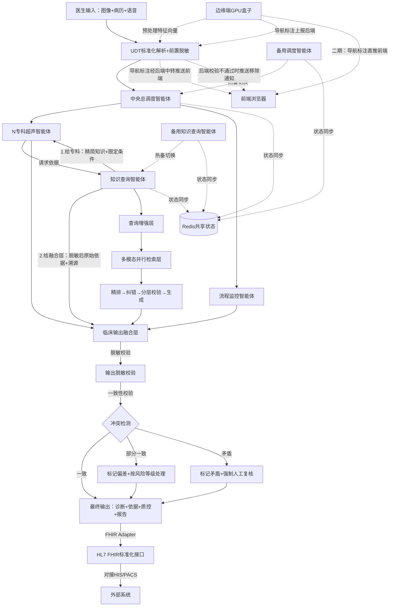

# 系统架构设计

## 1. 系统整体架构

本系统采用**分层模块化设计**，以 Modular RAG 为底层底座，所有功能模块可插拔、可替换。



> **⚠️ 上图为二期目标架构**。虚线节点（备用调度 C1B、备用知识查询智能体 C4B）仅在 `full` Profile 下且二期拆分独立进程后部署。

**一期实际架构**（所有智能体运行于同一进程内，模块接口独立定义）：

```mermaid
graph TD
    A[医生输入：图像+病历+语音] --> B[UDT标准化解析+前置脱敏]
    B --> C1[中央调度智能体]
    C1 --> C2[N专科超声智能体]
    C1 --> C3[流程监控智能体]
    C2 -->|进程内函数调用| C4[知识查询智能体 单实例]
    C4 -->|1.给专科：精简知识+限定条件| C2
    C4 -->|2.给融合层：脱敏后原始依据+溯源| J[临床输出融合层]
    C2 --> J
    C1 --> J
    C3 --> J

    C4 --> D[查询增强层]
    D --> E[多模态并行检索层]
    E --> F[精排→纠错→分层校验→生成]
    F --> J

    J -->|安全校验| SG[SafetyGateway 独立进程<br/>脱敏校验+禁忌校验+同意状态+一致性校验]
    SG -->|通过| K[最终输出]

    SG -.->|融合层不可用时降级输出| K

    EDGE[边缘端GPU盒子] -.->|导航标注上报后端| B
    B -.->|导航标注经后端中转推送前端| FE[前端浏览器]
    B -.->|后端校验不通过时推送移除通知| FE

    K -->|FHIR Adapter| K1[HL7 FHIR标准化接口]
    K1 -->|对接HIS/PACS| EXT[外部系统]

    style C1 fill:#e6f3ff,stroke:#333
    style C2 fill:#e6f3ff,stroke:#333
    style C3 fill:#e6f3ff,stroke:#333
    style C4 fill:#e6f3ff,stroke:#333
    style J fill:#e6f3ff,stroke:#333
    style SG fill:#fff3e6,stroke:#333
```



> **一期实际架构说明**：融合层（J）输出后，所有诊断结果须经过 SafetyGateway 独立进程（SG）安全校验后输出至最终输出（K），此为正常路径（实线箭头）。SafetyGateway 独立进程以 HTTP localhost 与主服务通信，获得进程级隔离能力——主服务崩溃时 SafetyGateway 可独立存活并返回 E4005 错误码。融合层不可用时，SafetyGateway 执行降级输出（虚线箭头），确保安全底线。**一期架构关键特征**：（1）中央调度、流程监控、专科、知识查询、融合层均运行于**同一进程**内，但各自保持**独立模块接口定义（Protocol/ABC）**，通过进程内函数调用通信；**SafetyGateway 与 LLM 推理除外**——SafetyGateway 以**独立操作系统进程**运行（独立 uvicorn 实例，通过 HTTP localhost 通信，延迟基准 P99 < 5ms），获得进程级隔离能力——主服务崩溃时 SafetyGateway 可独立运行，实现安全关键组件与被防护对象的故障隔离；**compact 模式 LLM 推理默认 llama.cpp**（以 HTTP server 独立进程运行，GGUF Q4_K_M 常驻 ~3GB，按需分配推理显存），**full 模式 LLM 推理默认 vLLM**（以 `vllm serve` 独立 HTTP server 进程运行，Docker Compose 独立容器，PagedAttention + Continuous Batching 高并发优势），两者通过 `InferenceEngine` Protocol 接口统一业务逻辑，与 §5.7 推理框架选型最终决策一致；（2）SafetyGateway 为独立操作系统进程（HTTP localhost + 连接池，延迟 P99 < 5ms），主服务崩溃时 SafetyGateway 可独立存活并返回 E4005 错误码，实现安全关键组件的故障隔离；（3）无备用调度、无知识查询读副本、无 gRPC 通信（SafetyGateway 使用 HTTP localhost 而非 gRPC，因其为安全关键组件须最小化依赖）；（4）**一期与二期智能体结构完全一致**——中央调度智能体与流程监控智能体始终为独立模块（不合并），N 专科智能体按器官独立部署，仅通信方式不同（一期进程内调用，二期 gRPC）；（5）一期实际容错能力：进程自动重启 + Redis 缓存降级 + 本地知识缓存兜底 + SafetyGateway 进程级安全隔离。**一期→二期迁移路径验证**：一期开发阶段，选择流程监控智能体作为 gRPC 通信路径的实际验证模块——流程监控智能体以独立 gRPC server 进程运行（而非进程内调用），验证进程内调用到 gRPC 的迁移可行性。验证内容包括：（1）gRPC 异步调用的异常处理与进程内调用的一致性；（2）gRPC 超时控制与重试策略的配置；（3）gRPC 序列化开销对延迟的影响（P99 增量须 < 1ms）；（4）gRPC server 进程崩溃时的故障检测与恢复。此验证作为 Gate 1 的技术验证观察项，验证结果决定二期是否可按原计划将所有智能体迁移至 gRPC 通信。
>
> **LLM 推理独立进程部署架构**：**compact 模式默认 llama.cpp**，以 HTTP server 独立进程运行（监听 `LLAMA_CPP_PORT`，默认 8001），GGUF Q4_K_M 量化模型常驻 ~3GB + 按需分配推理显存，剩余 ~9GB 供检索模型使用。**full 模式默认 vLLM**，以 `vllm serve` 命令启动独立 HTTP server 进程（监听 `VLLM_PORT`，默认 8002），提供 OpenAI 兼容 API，vLLM 原生支持 Continuous Batching + PagedAttention，无需多实例负载均衡即可承载高并发推理。Docker Compose 中 vLLM 为独立容器，配置 `deploy.resources.reservations.devices` 指定 GPU，`depends_on` 确保主服务在 vLLM 健康检查通过后方可接收诊断请求。vLLM 容器健康检查端点为 `GET /health`。**vLLM GPU 显存预分配**：vLLM 启动时预分配 `gpu_memory_utilization`（默认 0.9，**full 模式推荐值**）比例的 GPU 显存用于 KV Cache + CUDA Graphs，预分配后常驻不释放。**compact 模式若备选使用 vLLM**：`gpu_memory_utilization` 必须设为 0.80（非建议值——0.9 在 RTX 3060 12GB 上仅剩 ~1.2GB 供检索模型与 FunASR 使用，系统无法正常工作），启动时校验超限则拒绝启动
>
> **一期 SafetyGateway 防护边界说明**：一期 SafetyGateway 为**独立操作系统进程**，与主服务进程隔离运行。其防护范围覆盖**融合层模块级逻辑故障**和**主服务进程级故障**——融合层代码缺陷导致输出异常时，SafetyGateway 可独立拦截；主服务进程崩溃时，SafetyGateway 可独立存活并返回 E4005 错误码，前端收到 E4005 后提示"系统服务不可用，请转为人工诊断"。一期 SafetyGateway **仍无法防御**以下故障模式：（1）SafetyGateway 自身进程崩溃（由 supervisor 看门狗自动重启 ≤ 5s 兜底）；（2）操作系统级故障（如内核崩溃、硬件故障）；（3）Docker 引擎故障。一期 SafetyGateway 的实际安全价值为：**在主服务进程存活但融合层模块逻辑异常时，提供独立的安全拦截能力；在主服务进程崩溃时，提供独立的 E4005 错误码返回能力**——实现安全关键组件与被防护对象的故障隔离。

**一期与二期安全底线的明确区分**：
- **一期主动安全防线**：SafetyGateway 已为独立操作系统进程，具备进程级隔离能力——主服务进程崩溃时 SafetyGateway 可独立存活并返回 E4005 错误码，前端收到 E4005 后提示"系统服务不可用，请转为人工诊断"；融合层模块逻辑异常时 SafetyGateway 可独立拦截。一期 SafetyGateway 仍无法防御以下故障模式：（1）SafetyGateway 自身进程崩溃（由 supervisor 看门狗自动重启 ≤ 5s 兜底）；（2）操作系统级故障（内核崩溃、硬件故障）；（3）Docker 引擎故障。
- **二期增强安全底线**：SafetyGateway 扩展为集群部署，支持限流、熔断、多实例负载均衡，进一步提升可用性与防护范围。安全底线由 SafetyGateway 集群主动拦截实现，单实例故障不影响安全防线。

> **一期 SafetyGateway 集成测试范围界定**：一期集成测试中 SafetyGateway 降级场景测试须覆盖以下两类场景：（1）**模块级故障**——融合层抛出可捕获异常、输出结构不符合规范、脱敏遗漏，SafetyGateway 独立拦截；（2）**进程级故障**——主服务进程崩溃，SafetyGateway 独立进程存活，可独立返回 E4005 错误码，前端收到 E4005 后提示"系统安全校验不可用，请转为人工诊断"。两类场景均为 Gate 1 集成测试必须通过项。
>
> ⛔ **智能体结构不可修改原则（强制约束）**：一期与二期的智能体结构必须完全一致，具体包括：（a）中央调度智能体与流程监控智能体**始终为独立模块，禁止合并**——两者是同级组件，各自承担不同职责（调度负责任务路由与负载均衡，流程监控负责诊断质量追踪与异常检测），合并将破坏关注点分离原则并阻碍二期独立扩展；（b）N 专科智能体**按器官独立部署**——每个器官拥有独立的专科智能体实例，一期即配齐全部专科智能体（甲状腺、肝脏、心脏），不允许因"器官数量少"而合并或省略专科智能体；（c）仅通信方式可因部署规模不同而调整（一期进程内函数调用，二期 gRPC 独立进程通信），但模块接口定义（Protocol/ABC）一期二期完全相同。**此原则为项目架构红线，任何开发阶段（包括后续 AI 辅助开发）不得以"简化""优化""过度设计"等理由修改。**

> **边缘端职责界定（一期修订）**：一期边缘端 TensorRT 预编译模型承担**图像预处理与轻量导航推理**（去噪、特征向量生成、目标检测/分类推理），导航推理结果**上报后端中转**（**一期强制后端中转模式**，`EDGE_DIRECT_WS_ENABLED=false` 为固定配置，不可修改），后端安全校验通过后推送前端展示。**一期直推模式禁用理由**：二期直推模式存在~50ms安全窗口，窗口期内医生可能看到未校验的导航标注。一期为确保临床安全，强制采用后端中转模式，消除安全窗口。**二期直推模式启用前置条件**（须全部满足）：（1）边缘端导航标注完整性校验已实现（设备私钥签名）；（2）边缘端标签白名单与后端实体校验规则一致性验证通过（移除率<5%）；（3）Gate 1集成测试覆盖直推模式所有安全场景；（4）科室主任审批并记录审计日志。二期可选启用直推模式（`EDGE_DIRECT_WS_ENABLED=true`），导航推理结果直推前端展示，同时异步上报后端执行安全校验，后端校验不通过的标注通过 WebSocket 通知前端移除。二期远期增强为边缘端本地轻量导航模型实现自治导航，详见 [09-二期规划](09-二期规划与远期增强.md) §3。

> **边缘端导航标注完整性校验（二期规划）**：一期边缘端导航标注直推前端基于设备可信假设——边缘端设备经 API Key 认证后，其推送的导航标注被视为可信。但若边缘端被入侵（如 Jetson 设备被篡改），可向医生推送恶意导航标注（如标注不存在的病灶、隐藏真实病灶）。一期安全模型仅覆盖设备认证（API Key），未覆盖标注内容完整性验证。二期安全增强中须考虑导航标注的完整性校验——边缘端对标注内容签名（使用设备私钥），后端验签后转发至前端，确保标注来源可信且内容未被篡改。此方案需边缘端具备密钥安全存储能力（TPM/SE 模块），为二期依赖项。

> **实时导航数据流完整路径（一期修订）**：边缘端运行独立 WebSocket 服务器（端口 `EDGE_NAV_WS_PORT`，默认 9100），前端同时连接后端 WebSocket 与边缘端 WebSocket。边缘端 TensorRT 推理产出导航标注结果后，**同时执行两个动作**：（1）**直推前端**——通过边缘端本地 WebSocket 连接（`ws://{edge_ip}:{EDGE_NAV_WS_PORT}/nav`）直接推送导航标注至前端（消息类型 `navigation_result`，含 `frame_id` + `annotations` + `confidence` + `timestamp`），前端接收后立即渲染，无需等待后端校验；（2）**异步上报后端**——通过后端 WebSocket 连接（`/api/v1/realtime/nav`）上行通道发送同一导航标注至后端，后端执行安全校验（同意状态检查 + 实体校验 + 禁忌校验 + 置信度阈值校验）。校验不通过的标注，后端通过后端前端 WebSocket 连接下行通道推送 `navigation_revocation` 消息（含 `frame_id` + `revoked_annotations` + `reason`），前端收到后立即移除对应标注并显示提示"导航标注经安全校验已移除：[原因]"。**延迟优化**：直推模式下前端渲染延迟 = 边缘端处理 < 30ms + 网络传输 < 20ms + 前端渲染 < 30ms ≈ 80ms，相比原中转方案节省约 20-30ms（省去后端中转的一段网络传输 + 后端处理时间）。**安全窗口**：导航标注从展示到被后端移除的时间窗口 = 后端校验延迟（≤ 30ms）+ 后端→前端网络传输（< 20ms）+ 前端处理（< 10ms）≈ 60ms，此窗口内医生可能看到未校验的标注，但 60ms 远短于超声探头移动速度，临床风险可接受。**导航标注校验硬性超时保障**：后端校验超过 100ms 未返回结果时，前端自动将标注从"待校验"状态切换为"校验超时"状态（虚线边框 + 黄色警告），与当前"校验超时/后端不可达"的视觉规范一致。确保无论后端延迟如何（网络抖动、后端负载高、Docker 重启等），医生始终能区分已校验和未校验标注。**导航标注与诊断结论安全容忍度差异的合理性论证**：导航标注与诊断结论采用不同安全容忍度，基于以下临床安全分析——（1）**信息性质差异**：导航标注仅含坐标+标签+置信度（如"nodule, 0.88, [120,80,200,160]"），为低级感知信息，医生仍需自主判断标注区域是否为真实病灶；诊断结论含分级与病种编码（如"TI-RADS 4b，乳头状癌可能"），为高级决策信息，直接引导临床行动（穿刺 vs 随访）。（2）**临床影响差异**：导航标注错误（如标注不存在的结节）可能增加医生认知负荷，但医生可基于超声实时图像自主判断；诊断结论错误可能直接导致过度诊疗或漏诊，临床后果不可逆。（3）**安全窗口内可采取的缓解措施**：导航标注安全窗口内，低置信度标注（< 器官级阈值）自动隐藏不展示，仅展示高置信度标注；标注以虚线框+半透明渲染，与诊断结论的实线框视觉区分，明确传达"待确认"语义。**低置信度过滤执行位置**：前端执行——边缘端推送所有标注（含置信度），前端根据器官级阈值过滤低置信度标注后渲染，避免边缘端需同步后端配置（二期直推模式下边缘端与后端可能网络隔离，配置同步增加复杂度）。（4）**一期默认采用后端中转模式**（`EDGE_DIRECT_WS_ENABLED=false`），消除 ~60ms 安全窗口——所有导航标注经后端安全校验后再推送前端，与诊断结论的安全校验链路一致。直连模式仅在 Gate 0A 实测证明 20-30ms 延迟增加不可接受时启用，且须附加上述缓解措施。**后端不可达降级**：后端不可达时，前端仍可接收边缘端直推的导航标注，附加"未经安全校验"黄色警告标记，临床价值高于完全中断导航。后端恢复后补做校验并推送移除通知。DICOM 帧通过后端独立的 DICOM 通道 WebSocket 连接（`/api/v1/realtime/dicom`）传输，与导航通道彻底隔离，消除 HOL 阻塞风险。接口定义详见 [03-接口规范](03-接口规范.md) §1.2 与 §1.3。

> **输出安全分级框架**：系统输出按临床影响分为三级，各级采用不同安全容忍度与校验策略，为导航标注与诊断结论的安全容忍度差异提供统一判定框架：

| 安全级别 | 适用输出类型 | 安全校验策略 | 安全容忍度 | 降级策略 |
|---|---|---|---|---|
| A 级（诊断级） | 诊断结论（含分级、病种编码、治疗建议） | 先校验后输出——SafetyGateway 校验通过后方可推送前端 | 零容忍——未经校验的诊断结论绝对不输出 | SafetyGateway 不可用时拒绝所有诊断输出（E4005） |
| B 级（导航级） | 导航标注（坐标+标签+置信度） | 先输出后校验——前端立即渲染，后端异步校验不通过时移除 | 有限容忍——~50ms 安全窗口内可展示未校验标注，但须附加视觉区分（虚线框+半透明渲染） | 后端不可达时标注继续展示（附加"未经安全校验"警告） |
| C 级（原始级） | 原始超声图像、DICOM 帧 | 无 AI 校验——原始数据不经过 AI 处理 | 无 AI 安全风险——原始图像由超声设备直接产出 | 无降级需求 |

> **安全分级判定规则**：新增输出类型时，按以下规则判定安全级别——（1）输出包含分级词汇（TI-RADS、LI-RADS 等）或病种编码 → A 级；（2）输出包含坐标、标签、置信度等感知信息但不含诊断性结论 → B 级；（3）输出为原始设备数据未经 AI 处理 → C 级。**边界模糊时的升级原则**：当输出类型难以明确判定时，按"就高不就低"原则升级安全级别。安全级别变更须由科室主任审定并记录审计日志。**NMPA 注册要求**：安全分级框架须在 NMPA 注册材料中明确声明，各级的安全容忍度与校验策略须与注册审查要求对齐。

> **WebSocket 三连接设计**（⚠️ 二期实现，一期仅实现两连接后端中转模式）：前端同时维护三个 WebSocket 连接——（1）**边缘端导航通道**（`ws://{edge_ip}:{EDGE_NAV_WS_PORT}/nav`）：接收边缘端直推的导航标注，延迟最低；（2）**后端实时通信通道**（`/api/v1/realtime/nav`）：接收后端安全校验结果（`navigation_revocation` 消息）、诊断结果通知（`diagnosis_result` 消息）、安全事件通知（`session_terminated` 消息）与监控告警（`metric_alert` 消息）——该通道承载所有后端→前端的实时推送消息，命名为"实时通信通道"以明确其多业务域职责（而非仅导航）；（3）**后端 DICOM 帧通道**（`/api/v1/realtime/dicom`）：接收 DICOM 二进制帧。三连接彻底消除 HOL 阻塞——大帧传输不会阻塞导航标注推送，导航心跳也不会被帧数据干扰。三个连接共享同一 `session_id`，后端与边缘端通过 `frame_id` / `frame_index` 关联导航标注与 DICOM 帧。**一期采用两连接后端中转模式**（`EDGE_DIRECT_WS_ENABLED=false`）：前端仅维护（1）**后端实时通信通道** + （2）**后端 DICOM 帧通道**，边缘端导航标注经后端中转推送前端，前端仅实现 `DualWebSocketManager`。三连接直推模式推迟至二期实现，与 [08-前端交互与使用指南](08-前端交互与使用指南.md) §4 前端技术选型一致。接口定义详见 [03-接口规范](03-接口规范.md) §1.2 与 §1.3。**⚠️ 二期三连接复杂度评估要求**：二期实现三连接直推模式前，须完成以下专项评估——（1）三连接组合状态空间分析（每个连接 6 种状态 × 3 = 216 种组合状态），识别需处理的合法状态组合与不可能状态组合；（2）降级切换状态机设计（直连模式↔中转模式切换时的连接生命周期管理）；（3）集成测试覆盖率要求——二期 Gate 1 须覆盖三连接的降级切换场景测试（至少覆盖：单连接断开重连、双连接同时断开、直连→中转切换、中转→直连切换 4 种场景）。

> **边缘端 WebSocket 认证规范**：边缘端 WebSocket 连接（`ws://{edge_ip}:{EDGE_NAV_WS_PORT}/nav`）使用 `session_id` + 首条消息认证——前端在建立 WebSocket 连接时通过 URL 参数传递 `session_id`（非敏感凭证，仅用于路由），连接建立后首条消息发送 `{"type": "auth", "device_id": "...", "api_key": "..."}` 进行认证。API Key **禁止**通过 URL query 参数传递，仅可通过 WebSocket 消息体发送。边缘端验证 `session_id` 有效性（向后端 API `GET /api/v1/session/{session_id}` 验证，缓存验证结果 TTL 5 分钟）且请求来源 IP 在白名单内（医院内网 CIDR 段，通过 `EDGE_WS_ALLOWED_CIDRS` 配置）。边缘端 WebSocket 启用 TLS（`wss://`），与后端通信共用 TLS 1.3 证书体系（边缘端作为 TLS 服务端，使用后端签发的设备证书）。**双 WebSocket 通道认证流程**：导航通道使用 device_id + api_key 首条消息认证，后端签发短期会话 Token；DICOM 帧通道复用该 Token 在首条消息中认证，避免重复验证。详见 [03-接口规范](03-接口规范.md) §1.2。**边缘端 WebSocket 不可直连降级方案**：当医院网络拓扑（VLAN 隔离、防火墙规则）阻止前端浏览器直连边缘端 IP 时，通过 `EDGE_DIRECT_WS_ENABLED=false` 配置项切换为后端中转模式——导航标注经后端 WebSocket 通道中转至前端（延迟增加 20-30ms，从 ~80ms 增至 ~100-110ms，仍在导航实时性可接受范围内），但功能不丢失。后端中转模式下前端仅需两个 WebSocket 连接（后端导航通道 + 后端 DICOM 帧通道），边缘端→后端通信走内部网络不受 VLAN 限制。**后端中转模式的额外安全优势**：所有导航标注经后端中转，可统一执行安全校验后再推送前端，消除 ~50ms 安全窗口（导航标注先推前端、后端异步校验不通过再通知移除的窗口期）。**直连模式自动检测**：前端启动时尝试连接边缘端 WebSocket，连接超时 3 秒后自动切换为后端中转模式，并在前端显示"导航标注经后端中转，延迟略增"提示。**一期部署建议**：一期默认采用后端中转模式（`EDGE_DIRECT_WS_ENABLED=false`），降低前端 WebSocket 管理复杂度（两连接 vs 三连接）并消除安全窗口。若 Gate 0A 实测证明 20-30ms 延迟增加在临床场景下不可接受，再切换为直连模式。

> **后端安全校验延迟基准要求**：后端安全校验（**同意状态检查（PostgreSQL 直查）** + 实体校验 + 禁忌校验 + 置信度阈值校验）P99 须 < 30ms，其中同意状态检查 P99 < 10ms。**同意状态检查加入导航校验链路的必要性**：后端中转模式下导航标注经后端中转推送前端，与诊断结论共享同意状态校验机制（SafetyGateway 输出前直查 PostgreSQL）。若后端中转不检查同意状态，患者撤回同意后异步事件传播窗口内导航标注仍可能通过后端中转推送前端，与"边缘端停止 AI 标注"的安全承诺不一致。后端导航校验协程池在实体校验前增加同意状态检查（直查 PostgreSQL），同意状态非 granted 时拒绝推送该会话的导航标注（返回 E1010 但不影响其他会话），确保同意撤回后导航标注立即停止推送。**异步校验模式下**，此延迟不阻塞前端导航标注展示，但影响安全窗口长度——校验延迟越短，未校验标注的暴露窗口越短。校验超时（> 50ms 正常阈值 / > 80ms 极端容忍上限）时导航标注保留展示（附加"校验超时，标注未经安全校验"警告），不阻塞导航功能。一期开发阶段须在模拟生产负载下验证此基准——同意状态检查（PostgreSQL 直查）≤ 10ms + 实体校验（PGVector 近似匹配）≤ 10ms + 禁忌校验（规则引擎查询）≤ 5ms + 置信度阈值校验（配置读取）≤ 2ms + 网络传输 ≤ 3ms = 30ms。若实测超限，优先优化实体校验（增加本地缓存）或将置信度阈值配置同步至边缘端。**实体校验超时降级策略**：实体校验超时（> 10ms）时跳过实体校验但保留禁忌校验 + 置信度阈值校验，导航标注附加 `entity_check_timeout` 标记，前端显示"导航标注未经实体校验"提示。此降级策略确保实体校验超时不阻塞导航功能，同时保留禁忌校验与置信度阈值校验的安全底线。**同意状态检查超时降级策略**：同意状态检查超时（> 10ms）时跳过同意状态检查但保留实体校验 + 禁忌校验 + 置信度阈值校验，导航标注附加 `consent_check_timeout` 标记，前端显示"导航标注未经同意状态校验"提示。此降级策略确保同意状态检查超时不阻塞导航功能，同时保留其他校验的安全底线。**校验超时阈值说明**：采用 50ms（正常阈值）/ 80ms（极端容忍上限）双阈值方案——50ms 为正常阈值（与后端安全校验延迟基准 P99 < 30ms + 20ms 余量对齐），超时后降级为仅转发原始标注（附加"校验超时"标记）；80ms 为极端容忍上限（覆盖 PGVector 实体近似匹配 P99 接近 50ms 的极端场景），超过 80ms 强制超时。80ms 极端容忍上限在端到端 P99 < 200ms 预算内为边界情况（校验超时 80ms + 前端渲染 80ms + 网络传输 40ms = 200ms），正常情况下校验延迟应远低于 50ms 阈值。

> **导航校验请求优先级**：导航校验请求（15fps 实时性要求）优先级高于诊断请求（非实时），后端请求调度须为导航校验预留独立的处理协程池（`NAV_VERIFICATION_WORKERS`，默认 4 个协程；compact 模式建议 6 个，提供更多余量应对 CPU 竞争），确保导航校验请求不被诊断请求排队阻塞。**CPU 优先级保障**：导航校验协程池须使用**独立线程池**（`asyncio.to_thread` 或 `ThreadPoolExecutor`，与诊断推理协程池物理隔离），而非 Python `asyncio` 优先级调度（`asyncio` 原生不支持协程优先级——所有就绪协程按 FIFO 顺序调度，无法实现优先级区分）。独立线程池方案确保诊断推理满载时导航校验仍可在 20ms 内完成，不受 GIL 竞争影响（导航校验为 CPU 轻量操作，GIL 持有时间极短）。**Gate 0A 须验证诊断推理满载时导航校验 P99**——模拟 2 并发诊断推理 + 15fps 导航校验，测量导航校验 P99 是否 < 20ms。异步校验模式下，导航校验请求不再阻塞前端导航标注展示，但仍须优先处理以缩短安全窗口。校验请求排队深度 > 10 时触发 Warning 告警，提示安全窗口可能过长。导航校验协程池与诊断推理协程池隔离，诊断推理满载时导航校验仍可在 20ms 内完成。此优先级机制为快速路径 P99 < 200ms 的必要保障——当后端同时处理诊断请求时，导航校验请求若与诊断请求共享同一处理队列，排队延迟可能导致 P99 突破 200ms。

**边缘端资源管理规格**：

**超声设备↔边缘端通信规范**（与 [03-接口规范](03-接口规范.md) §1.2 边缘端↔后端通信规范互补）：

| 维度 | 规格 | 说明 |
|---|---|---|
| 物理连接 | 超声设备通过千兆以太网连接至边缘端 Jetson Orin NX | 边缘端作为 DICOM SCP（Service Class Provider）接收超声设备推送的 DICOM 图像 |
| 接收协议 | DICOM 3.0 协议，采用 **pynetdicom + python-gdcm 组合方案**：pynetdicom 负责 DICOM 网络通信（SCP 服务实现），python-gdcm 负责像素数据解码（支持 JPEG/JPEG2000/JPEG-LS/RLE 等压缩格式）。DCMTK 作为可选的进程监控辅助工具（通过 `DCMTK_SCP_WRAPPER_ENABLED=true` 配置，默认关闭）。与 [06-开发环境与进度规划](06-开发环境与进度规划.md) §3.1 依赖表对齐。**组合方案设计理由**：两者为互补工具——pynetdicom 在网络通信层更灵活（纯 Python、异步支持、完整 DIMSE 服务），python-gdcm 在像素解码性能上更优（C++ 底层、支持所有主流压缩格式）。协作流程：超声设备 → pynetdicom（网络接收） → python-gdcm（像素解码+元数据剥离） → TensorRT 导航推理。 | 边缘端运行 DICOM SCP 服务，监听端口可通过 `DICOM_SCP_PORT` 配置（默认 10400，≥ 1024 避免特权端口要求；若超声设备仅支持标准端口 104，须通过 Linux capabilities 授权，禁止以 root 用户运行） |
| 帧处理流程 | 接收 DICOM 实例 → 解码像素数据 + 剥离身份标识元数据 → 窗位窗宽调整 + 归一化 → 送入 TensorRT 导航模型 | 元数据剥离规范详见 §1.2 边缘端 DICOM 元数据脱敏边界 |
| 断连处理 | 超声设备断连时，边缘端保持 DICOM SCP 监听状态，不主动关闭；重连后自动恢复接收，帧索引从断连处继续递增 | 断连期间无帧数据，导航标注暂停（前端显示"超声设备连接中断"），诊断请求不受影响（使用已有帧数据） |
| 多设备连接 | 一期边缘端仅支持单台超声设备连接（`DICOM_MAX_CONNECTIONS=1`） | 多设备同时连接需二期增强（设备复用与帧隔离） |
| AE Title 配置 | 边缘端 AE Title = `EDGE_AI_SCP`（可通过 `DICOM_SCP_AETITLE` 配置）；超声设备 AE Title 须在边缘端白名单中配置 | 非白名单 AE Title 的连接请求被拒绝 |

**边缘端 DICOM SCP 安全配置规范**：

| 维度 | 规格 | 说明 |
|---|---|---|
| DICOM TLS | 一期内网部署暂不启用 DICOM TLS（与 [04-安全合规](04-安全合规.md) §1 传输加密要求一致——内网场景 TLS 1.3 已覆盖 HTTP/WebSocket 通道，DICOM SCP 端口仅接收超声设备推送，网络隔离由千兆以太网物理隔离保障）；二期跨网段部署时须启用 DICOM TLS | 内网物理隔离 + AE Title 白名单 + 源 IP 白名单为 DICOM SCP 基础安全防线 |
| AE Title 白名单 | 边缘端 DICOM SCP 仅接受白名单内 AE Title 的关联请求，非白名单连接被拒绝并记录审计日志（含来源 IP、AE Title、时间戳） | 防止未授权设备推送 DICOM 数据 |
| 源 IP 白名单 | 边缘端 DICOM SCP 仅接受白名单内源 IP 的连接请求（通过 `DICOM_SCP_ALLOWED_CIDRS` 配置，如 `192.168.1.0/24`），非白名单 IP 连接被拒绝并记录审计日志。一期为已知安全缺口——DICOM 通道未加密，若内网被入侵（通过其他设备漏洞），未加密的 DICOM 数据可被嗅探。源 IP 白名单为该缺口的一期缓解措施，二期须补齐 DICOM TLS | 一期安全缓解措施，与 [04-安全合规](04-安全合规.md) §1 DICOM 传输安全缺口声明对齐 |
| 端口权限 | DICOM SCP 监听端口默认 10400（可通过 `DICOM_SCP_PORT` 配置，≥ 1024 避免特权端口要求）。若超声设备仅支持标准 DICOM 端口 104（< 1024），须通过 Linux capabilities（`setcap 'cap_net_bind_service=+ep'`）授权，禁止以 root 用户运行 DICOM SCP 服务 | 避免以 root 权限运行医疗设备服务 |
| 连接数限制 | 一期 `DICOM_MAX_CONNECTIONS=1`，仅允许单台超声设备连接 | 防止连接耗尽攻击 |
| 关联拒绝日志 | 非白名单 AE Title 的关联请求被拒绝时，记录 Warning 级别日志（含来源 IP、AE Title、时间戳），不记录 DICOM 数据内容 | 审计追溯 |

| 资源维度 | 规格 | 说明 |
|---|---|---|
| 导航模型显存占用 | ≤ 2GB（TensorRT 预编译后） | Jetson Orin NX 16GB 总显存 |
| 帧缓冲存储 | 内存（非显存），环形缓冲区默认 90 帧（存储预处理后图像，用于导航推理输入，与 DICOM 帧缓存独立——DICOM 帧缓存存储最近 90 帧原始 DICOM 数据，用于后端请求重传，详见 [03-接口规范](03-接口规范.md) §1.2；两者独立维护、容量一致，通过 `frame_id` 关联）。**帧关联机制**：导航标注与 DICOM 帧通过 `frame_id` 关联（不依赖帧缓冲区时序），后端重传请求的帧索引范围不超过最近 90 帧（DICOM 帧缓存容量限制，30fps 下覆盖约 3 秒窗口，覆盖后端短暂不可达后重传丢失帧、医生回看操作、网络抖动导致多帧丢失等场景）。**容量一致设计理由**：导航帧缓冲区 90 帧存储预处理后压缩图像（单帧约 50-100KB，90 帧约 4.5-9MB），用于导航推理的时序上下文；DICOM 帧缓存 90 帧存储原始 DICOM 数据（单帧约 0.5-1MB，90 帧约 45-90MB，在边缘端 8GB RAM 中仅占约 1%），与导航帧缓冲区容量对齐，确保导航标注引用的 DICOM 帧均可重传。超出 DICOM 帧缓存重传范围时返回错误码 E1001（详见 [03-接口规范](03-接口规范.md) §1.2） | 避免占用 GPU 显存 |
| 本地存储容量 | ≥ 32GB eMMC/SSD | 存储模型文件（保留最近 2 版本）+ 日志 + 降级期间导航记录 |
| 存储满处理策略 | 优先清理旧日志（> 7 天）和旧模型版本；模型文件仅保留当前版本 | 存储不足时触发 Warning 告警 |
| OOM 处理 | 释放帧缓冲 → 降级为仅显示原始图像 → 触发 Critical 告警 | 确保导航模型不被 OOM Killer 终止 |
| zstd 压缩 | 可选启用，压缩级别 3，CPU 开销 < 1ms/帧 | 降低 20-30% 传输体积，无损压缩不影响诊断精度，详见 [03-接口规范](03-接口规范.md) §1.2 |
| 最低网络带宽 | 诊断场景 ≥ 100Mbps 稳定带宽；实时导航场景 ≥ 200Mbps 稳定带宽 | 512×512 超声图像单帧约 0.5-2MB，实时导航场景帧率可达 30fps，峰值带宽需求约 15-60MB/s（120-480Mbps）。启用 zstd 压缩后可降至 80-340Mbps。100Mbps 不满足实时导航最低需求（120Mbps），仅适用于非导航诊断场景。实时导航场景须 ≥ 200Mbps 以确保帧传输不丢帧 |

**边缘端导航模型输入规格**：

| 维度 | 规格 | 说明 |
|---|---|---|
| 输入格式 | 预处理后灰度/RGB 图像（非原始 DICOM 帧） | 边缘端先执行 DICOM 解码 + **元数据剥离** + 窗位窗宽调整 + 归一化，再送入 TensorRT 模型 |
| 输入分辨率 | 512 × 512（默认，可通过 `EDGE_MODEL_INPUT_SIZE` 配置） | 平衡推理速度与标注精度。**Gate 0A 须增加微小病灶检出率对比测试**：在 512×512 vs 768×768 vs 原始分辨率下对比微钙化点（通常仅几个像素，为甲状腺结节恶性风险重要指标）的检出率。若 512×512 下微钙化检出率显著低于原始分辨率（差距 > 5%），应评估提高输入分辨率至 768×768（显存增加约 1.25 倍，仍在 Jetson Orin NX 16GB 预算内）或对疑似微钙化区域进行局部高分辨率推理（ROI 裁剪 + 高分辨率推理） |
| 色彩空间 | 灰度（1 通道）或 RGB（3 通道），由模型输入层决定 | 超声图像通常为灰度，RGB 模式需通道复制 |
| 推理帧率 | 逐帧推理（正常模式，导航推理帧率目标 ≥ 15fps，独立于 DICOM 帧显示帧率 30fps）；**主动降频**（GPU 温度达 75°C 时主动降至 10fps，通过提前降频避免温度频繁触及阈值导致的帧率跳变，10fps 仍满足导航实时性——100ms/帧）；隔帧推理（GPU 温度 80-85°C 被动降频模式，7.5fps）；85-90°C 暂停导航推理（Critical 告警）；> 90°C 持续 60s 暂停所有 GPU 推理（详见 [05-可观测性与运维](05-可观测性与运维.md) §2 边缘端 GPU 温度处理策略） | 正常模式下逐帧推理确保导航实时性；DICOM 帧显示帧率（可达 30fps）与导航推理帧率（≥ 15fps）独立——显示帧率由超声设备推送决定，导航推理帧率受模型处理速度约束。**帧率切换平滑策略**：帧率变更时前端须在 3 帧内完成过渡（如 15fps→10fps 时，首帧间隔从 67ms 渐变至 100ms），避免帧率突变导致标注闪烁 |

**导航标注内容规范**：导航标注结果**仅包含坐标和标签**（`bbox` + `label` + `confidence`），不含原始图像像素数据。前端接收导航标注后在本地 cornerstone.js 渲染层叠加标注框，不传输原始超声图像像素。**一期边缘端导航标注轻量级内容校验**：边缘端直推前端前，须在本地执行以下规则校验（无需后端参与，不增加延迟），防御最明显的恶意标注模式（如边缘端被入侵后推送恶意标注）：（1）**坐标范围校验**：标注 bbox 坐标须在图像有效范围内（0-`EDGE_MODEL_INPUT_SIZE`，默认 512），超范围标注丢弃并记录 Warning 日志；（2）**标签白名单校验**：标注 label 须在预定义的器官标签白名单内（白名单随器官模型加载时同步，如甲状腺：`["nodule", "cyst", "calcification"]`），非白名单标签丢弃；（3）**置信度范围校验**：confidence 须在 [0, 1] 范围内，超范围标注丢弃；（4）**标注数量上限**：单帧标注数量不超过 `NAV_ANNOTATION_MAX_PER_FRAME`（默认 20），超限丢弃低置信度标注。校验不通过的标注不推送前端，记录审计日志（含 `frame_id` + 不通过原因）。**边缘端标签白名单校验与后端实体校验的优先级关系**：边缘端标签白名单为轻量级快速校验（无延迟），后端实体校验为深度校验（含 PGVector 近似匹配验证标注实体是否为已知合法实体），两者防御层级不同。当两者判定结果不一致时（如标签在白名单内但后端实体校验不通过），**后端实体校验结果优先**——后端校验不通过时无论边缘端校验结果如何均执行移除，通过 `navigation_revocation` 消息通知前端。此优先级规则确保深度校验的安全底线不被轻量级校验覆盖。**未覆盖场景补充**：边缘端校验通过但后端校验超时的场景，导航标注保留展示并附加"校验超时，标注未经深度校验"提示（与现有"校验超时"视觉规范一致——虚线边框 + 半透明填充 + 黄色警告标记），后端校验结果返回后按正常优先级规则处理。**导航标注后端校验移除率监控**：后端校验移除率（`navigation_revocation` 消息数 / 后端校验总帧数）须纳入实时监控——移除率 > 5% 时触发 Warning 告警，提示边缘端标签白名单与后端实体校验规则不一致，需同步更新边缘端标签白名单配置。移除率 > 15% 时触发 Critical 告警，要求运维立即排查边缘端标签白名单配置是否过期。此监控确保边缘端与后端校验规则的长期一致性，避免标注"闪烁"频繁干扰医生注意力。**⚠️ 监控阈值初始校准说明**：5%/15% 阈值为初始设定值，系统上线初期因边缘端标签白名单与后端实体校验规则的不一致程度未知，可能频繁触发 Warning 告警（告警疲劳）或阈值过于宽松。上线后须在首个运行周内收集基线数据，根据实际移除率分布调整阈值——**强制要求**：Warning 阈值设为基线移除率的 2 倍（取整至 5% 的整数倍），Critical 阈值设为 Warning 阈值的 3 倍。阈值调整须记录审计日志并经运维负责人确认。此校准为 Gate 1 前置条件，未完成校准的系统不得进入灰度发布。此轻量校验为一期安全基线，二期增强为基于设备私钥的标注内容签名验证（详见 §1 边缘端导航标注完整性校验二期规划）。前端渲染 DICOM 图像时，超声设备烧录（burn-in）的患者姓名、ID 等信息可能直接可见——此为超声设备固有行为，系统前置脱敏在标准化层执行（处理 DICOM 元数据中的结构化身份信息），无法去除图像像素中烧录的文本。前端须在 DICOM 渲染层增加身份信息遮罩功能（通过 `SHOW_DICOM_OVERLAY` 配置项控制，默认开启），医生可按需关闭。默认开启理由：医疗系统中默认保护隐私比默认展示更安全，超声设备烧录的患者信息在多人共用工作站场景下存在泄露风险。

**边缘端 DICOM 元数据脱敏边界**（与 [04-安全合规](04-安全合规.md) §1 统一）：边缘端在 DICOM 解码后、预处理前，须立即执行**元数据身份字段剥离**——移除 DICOM Tag 中的患者身份标识字段（PatientID、PatientName、PatientBirthDate、PatientAddress、PatientPhone 等），**保留以下诊断必需字段**：PatientSex（性别为超声诊断重要参考因素，如甲状腺结节恶性风险男女不同，且性别非直接标识符无法从性别反推身份）、PatientAge（DICOM 标签 (0010,1010)，直接存储年龄字符串不含出生日期，与 [04-安全合规](04-安全合规.md) §2 "年龄（整数）不脱敏"规则一致）、帧索引（`frame_index`）、检查类型（`StudyDescription`）、机构代码（`InstitutionCode`）。剥离后的帧数据（仅含像素数据 + 最小元数据 + 诊断必需字段）方可送入后续预处理与推理流程。**边缘端日志禁止记录任何 DICOM 身份标识字段的原始值**——日志中仅记录 `frame_index` 和 `session_id`，不记录 PatientID/PatientName。此规范确保边缘端即使被物理入侵，也无法从日志或内存缓存中获取患者身份信息。

## 2. 1+N 智能体团队协作逻辑

> **一期实现策略**：一期实现甲状腺、肝脏、心脏三个专科智能体，智能体间通信采用**进程内函数调用**（保留模块接口定义 Protocol/ABC），不引入 gRPC 独立进程通信。边缘端↔后端通信走 HTTP/WebSocket。二期更多器官接入时再拆分为独立进程 + gRPC，届时模块接口无需变更，仅替换通信层实现。

> **一期容错能力边界**：一期所有智能体运行于同一进程，实际可用的容错能力为：进程自动重启（compact 进程重启 ≤ 3s + 模型重加载 ≤ 10s）、Redis 缓存降级、本地知识缓存兜底。以下容错能力**一期不可用**，须二期拆分独立进程后方可生效：备用调度热备切换、知识查询智能体读副本提升、主备调度间 gRPC 心跳。一期 full Profile 下仅实现备用调度与知识查询读副本的接口定义与配置项，不部署独立实例。详见 [09-二期规划](09-二期规划与远期增强.md) §20。

| 角色 | 对应智能体 | 职责 |
|---|---|---|
| 科室主任 | 中央总调度智能体 | 任务拆分与分配，不参与具体诊断 |
| 副主任 | 备用调度智能体（仅 full） | 热备状态，主调度故障时自动接管 |
| 专科医生 | N 专科超声智能体 | 每个器官专属诊断，可插拔扩展 |
| 质控护士 | 流程监控智能体 | 检查流程质控，确保规范、无漏项 |
| 图书管理员 | 知识查询智能体 | 为所有角色提供权威指南与知识依据 |

### 2.1 调度容错与降级策略

| 场景 | 处理策略 | 恢复机制 | 适用 Profile |
|---|---|---|---|
| 主调度智能体故障 | 备用调度 5s 内自动接管（**二期生效，一期 full Profile 不可用**——一期备用调度热备切换未实现，主调度故障时降级为专科智能体按预设规则自主运行） | 主调度恢复后从 Redis 同步最新状态 | full |
| 主备调度同时故障 | 专科智能体按预设规则自主运行（按器官路由表直接处理）；实时导航路径降级为仅显示原始图像 | 人工重启调度服务 | full |
| 知识查询智能体超时/故障 | 专科智能体使用本地缓存知识（标记"缓存依据，时效性待验"）；进程自动重启恢复（≤ 30s）。**降级策略细化**：（1）**故障检测**——中央调度对知识查询智能体的调用设置超时 10s，连续 2 次超时判定故障；（2）**本地知识缓存兜底**——专科智能体缓存最近 N 次诊断使用的知识条目（LRU，N ≤ 50 条，内存 ≤ 10MB），知识查询智能体不可用时从缓存获取，输出标记 `evidence_source: "local_cache"`；（3）**进程自动重启**——知识查询智能体进程崩溃后 Docker 自动重启（≤ 3s + 初始化 ≤ 5s，总计 ≤ 8s），重启期间诊断请求排队等待（最长 30s），超时则使用本地缓存兜底；（4）**完全不可用兜底**——本地缓存亦未命中时，专科智能体输出"依据不足"的描述性结论，标记 `evidence_insufficient: true` | 进程自动重启 + 本地知识缓存兜底 | both |
| 流程监控智能体故障 | 专科智能体继续诊断，输出标记"流程质控缺失" | 自动重启 | both |
| compact 单进程崩溃 | 前端提示"系统服务不可用，请转为人工诊断"；边缘端降级为仅显示原始图像；看门狗自动重启进程（进程重启 ≤ 3s + 模型重加载 ≤ 10s，总计 ≤ 13s），重启期间无任何 AI 能力 | 看门狗自动重启 | compact |

> **一期智能体结构原则（强制约束）**：一期与二期智能体结构必须完全一致，具体包括：（a）中央调度智能体与流程监控智能体**始终为独立模块，禁止合并**——两者是同级组件，各自承担不同职责（调度负责任务路由与负载均衡，流程监控负责诊断质量追踪与异常检测），合并将破坏关注点分离原则并阻碍二期独立扩展；（b）N 专科智能体**按器官独立部署**——每个器官拥有独立的专科智能体实例，一期即配齐全部专科智能体（甲状腺、肝脏、心脏），不允许因"器官数量少"而合并或省略专科智能体；（c）仅通信方式可因部署规模不同而调整（一期进程内函数调用，二期 gRPC 独立进程通信），但模块接口定义（Protocol/ABC）一期二期完全相同。**此原则为项目架构红线，任何开发阶段不得以"简化""优化""过度设计"等理由修改**。compact 组合故障见 5.8 节。

**主备调度状态同步**：通过 Redis 共享状态（会话分配表、任务进度表、器官路由表），主调度持有租约（TTL 10s，每 5s 续期），备用检测到租约过期后接管。网络分区恢复后仅保留一个活跃调度实例。

**脑裂防护机制**：

| 防护层 | 机制 | 说明 |
|---|---|---|
| Redis 租约 | 主调度持有租约，备用检测过期后接管 | 基础机制 |
| 直接心跳 | 主备调度间 gRPC 心跳（间隔 2s，3 次失败判定分区）——**一期不实现**（进程内调用无需心跳），二期拆分独立进程时实现 | 不依赖 Redis，直接感知对端存活 |
| 分区期间策略 | 备用检测到租约过期后，先尝试直接心跳主调度；若主调度可达则不接管（仅 Redis 通路故障） | 避免因 Redis 网络分区误触发接管 |
| 分区恢复仲裁 | 以 Redis 中的状态为准，后启动的实例自动降级为备用；若两实例均认为自己是主，比较实例 ID，较小者降级 | 确保分区恢复后仅一个活跃调度 |

**调度层水平扩展**：单调度实例在 20 并发下 QPS 余量 5 倍，无需水平分片。若未来并发 > 50，可按 `session_id` 哈希分片，详见 [09-二期规划](09-二期规划与远期增强.md)。

### 2.2 边缘端降级与设备管理

**两种心跳机制**（明确区分）：

| 机制 | 目的 | 间隔 | 方向 | 说明 |
|---|---|---|---|---|
| 设备注册心跳 | 后端感知边缘端在线状态 | 导航活跃期间 15s（降低冗余开销，导航健康探测已提供快速可达性检测）；无导航会话时 5s | 边缘端 → 后端 | 含设备 ID + 模型版本 + 健康状态 |
| 导航健康探测 | 边缘端快速感知后端不可达 | 1s | 边缘端 → 后端 | 独立于帧流的定时探测（非每帧触发），连续 3 次失败（3s）判定不可达；导航标注的每帧安全校验由后端 WebSocket 中转时同步完成，不额外增加探测请求 |
| WebSocket 连接心跳 | 保持前后端 WebSocket 连接活跃 | 5s（前端 → 后端 ping/pong） | 前端 → 后端 | 独立于设备注册心跳，用于检测前后端连接断开，连续 3 次无 pong 响应（约 15s）判定连接断开 |

> **心跳参数集中定义与语义区分**：系统中存在三类独立的心跳机制，须严格区分：（1）**设备注册心跳**（边缘端 → 后端，5s/15s）——后端感知边缘端设备在线状态，与 WebSocket 连接无关；（2）**导航健康探测**（边缘端 → 后端，1s）——边缘端快速感知后端不可达，仅在导航活跃期间运行；（3）**WebSocket 连接心跳**（前端 → 后端，5s）——检测前后端 WebSocket 连接是否断开，与设备注册心跳独立。导航活跃期间设备注册心跳从 5s 切换为 15s（导航健康探测已提供更快速的可达性检测），但 WebSocket 连接心跳保持 5s 不变（前后端连接稳定性要求与导航状态无关）。

**实时导航边缘端降级策略**：

| 维度 | 一期方案（后端中转模式，`EDGE_DIRECT_WS_ENABLED=false`） | 二期方案（直推模式，`EDGE_DIRECT_WS_ENABLED=true`，规划中） |
|---|---|---|
| 触发条件 | 导航健康探测连续 3 次失败（每次间隔 1s，总计 3s） | 同左 |
| 降级行为 | **导航标注不可用**——边缘端导航标注上报后端通道中断，后端无法中转推送前端。前端显示"导航服务中断"提示。边缘端导航推理继续运行（15fps），但标注仅缓存在边缘端本地（最多 5 秒），不推送前端。**边缘端缓存最近 5 秒导航标注**供后端恢复后补报审计。**⚠️ 一期后端中转模式下无直推路径**——边缘端与前端之间无 WebSocket 连接，导航标注必须经后端中转，后端不可达则导航功能中断 | 边缘端导航标注继续直推前端展示，附加"后端不可达，导航标注未经安全校验"黄色警告标记。前端仍可参考导航标注，临床价值高于完全中断导航。后端恢复后补做校验并推送移除通知。**降级模式下最低认证保障**：边缘端缓存最近验证通过的 session_id 列表（TTL 5 分钟，与正常认证缓存一致），降级期间仅接受已缓存 session_id 的 WebSocket 连接，拒绝新 session_id 连接，防止后端不可达期间未认证客户端接入。**⚠️ 后端不可达超过 5 分钟的导航中断风险**：边缘端 session_id 缓存 TTL 为 5 分钟，后端不可达超过 5 分钟后所有缓存 session_id 过期，边缘端将拒绝所有 WebSocket 连接（包括合法连接），导航功能完全中断。缓解措施：（1）后端不可达时边缘端自动延长已缓存 session_id 的 TTL 至 30 分钟（`DEGRADED_SESSION_CACHE_TTL_SECONDS=1800`），覆盖典型后端故障恢复时间（多数后端故障在 10-15 分钟内恢复）；（2）30 分钟后缓存仍过期则导航功能中断，前端提示"后端长时间不可达，导航服务已中断，请转为人工扫查"；（3）后端恢复后边缘端自动恢复正常 TTL（5 分钟）并重新验证所有活跃 session_id |
| 降级期间缓存标注 | 一期后端中转模式下导航标注不可推送前端，前端不显示任何导航标注。边缘端本地缓存最近 5 秒导航标注仅供后端恢复后审计补报 | 后端不可达时前端仍接收边缘端直推的实时导航标注（附加警告），不显示缓存标注——超声检查中探头位置持续变化，1-3 秒前的标注对当前帧无参考价值且可能误导医生 |
| 降级主动通知 | 边缘端进入降级模式时，尝试向后端发送 best-effort 降级通知（含设备 ID、降级时间戳、降级原因）。完全断连时通知无法送达，后端通过设备注册心跳超时（15s）感知设备降级 | 同左 |
| 恢复感知 | 后端恢复后主动向边缘端推送恢复事件 | 同左 |
| 恢复行为 | 恢复后边缘端自动补报降级期间的导航记录（仅含时间戳与降级标记），供审计回溯。后端恢复中转推送后前端自动恢复导航标注显示 | 恢复后边缘端自动补报降级期间的导航记录（仅含时间戳与降级标记），供审计回溯。后端恢复后补做校验并推送移除通知 |

**边缘端设备认证**（一期简化方案）：

| 维度 | 一期方案 |
|---|---|
| 设备注册 | 部署前由运维工程师在后端配置中心注册设备，生成设备 ID + API Key |
| 传输加密 | 边缘端与后端之间启用 TLS 1.3（单向，验证服务端身份），一期强制启用（含 compact 内网场景——与 [04-安全合规](04-安全合规.md) §1 传输加密要求一致） |
| 设备心跳 | 无导航会话时每 5s 向后端发送心跳（导航活跃期间 15s，与 §2.2 两种心跳机制表一致），后端连续 3 次未收到标记设备离线 |
| 设备注销 | 运维在后端注销设备，吊销 API Key，设备 ID 永久不可重用 |

> 一期为单医院内网部署、1-3 台边缘设备，API Key + TLS 单向认证已满足安全需求。远期增强（mTLS、X.509、HSM）详见 [09-二期规划](09-二期规划与远期增强.md)。

**API Key 安全规范**：API Key 禁止记录到任何日志中；边缘端本地加密存储 API Key（AES-256）；API Key 每 180 天轮换（与 HSM 密钥轮换周期对齐，降低基层运维频率），旧 Key 在新 Key 生效后 48 小时内失效（延长确认窗口以适配基层运维节奏）。

**API Key 加密密钥管理**：边缘端 AES-256 加密 API Key 所用的密钥，一期采用基于设备 ID + 后端签发种子的一次性派生密钥（HKDF）方案——种子在设备注册时由后端签发并安全传输至设备，设备完成密钥派生后**将派生密钥加密存储于本地安全存储**（使用设备唯一硬件标识生成的本地密钥加密，如 Jetson 的 fuses 或磁盘序列号派生密钥），同时从持久存储中擦除后端签发种子，防止种子泄露导致密钥可被重建。设备重启后，使用本地安全存储的加密派生密钥解密即可恢复 API Key 解密能力，无需重新注册。**密钥恢复安全边界**：本地加密密钥与设备硬件绑定，密钥文件被拷贝至其他设备无法解密（因硬件标识不同）。若设备硬件更换导致本地密钥无法解密派生密钥，须执行隔离设备恢复流程（详见下文）重新获取种子并派生新密钥。远期增强方案：选配支持 SE 硬件安全模块或 TPM 的边缘硬件后，可切换为硬件密钥派生方案（TPM sealed storage），密钥与设备硬件绑定，无法提取至其他设备，重启后自动解封。

**API Key 轮换容错机制**：旧 Key 失效前，后端须确认边缘端已成功 ACK 新 Key；未确认则自动延长旧 Key 有效期（最多延长 48 小时，与 Key 失效确认窗口对齐），同时触发运维告警"边缘设备 {device_id} Key 轮换未确认"。延长期间未确认 Key 轮换的设备限制为仅导航数据上传权限（上传的导航数据仅用于后端安全审计与日志记录，不中转至前端），禁止上传 DICOM 帧数据至后端（边缘端设备不发起诊断请求，诊断请求由前端浏览器发起；限制帧数据上传可有效降低潜在泄露风险——帧数据中可能包含患者影像信息），同时禁止该设备的导航标注经后端校验中转至前端（前端不显示该设备的 AI 导航标注，但边缘端本地仍可直推导航标注至前端供操作医生参考，附加"未经安全校验"警告标记）。超过 24 小时仍未确认，自动吊销 API Key 并标记设备为"已隔离"——隔离设备无法建立新连接，已有连接在当前会话结束后断开，触发 Critical 告警要求 24 小时内人工处理。

**设备隔离活跃会话保护**：设备标记为"已隔离"时，若该设备有活跃导航会话（最近 5 分钟内有导航帧推送），延迟隔离至活跃会话结束或 5 分钟（取较早者，覆盖当前超声切面完成所需时间）。延迟期间该设备**立即撤销导航标注中转权限**（受限 API Key 的 `scope=navigation_relay` 权限立即撤销，后端不再中转该设备的导航标注至前端）。**设备隔离时边缘端导航标注阻断机制**：设备被隔离时，后端同时通过导航通道 WebSocket 下行通道向边缘端推送 `device_isolated` 事件，边缘端收到后**立即停止所有 TensorRT 推理输出**（不再生成导航标注）。若边缘端不响应（被入侵场景），后端通过导航通道 WebSocket 向前端推送 `device_isolated` 事件，前端收到后**立即隐藏该设备的所有导航标注**（无论校验状态），确保即使边缘端被入侵，前端也不会展示恶意标注。5 分钟后强制隔离，前端提示"导航服务已中断，请转为人工扫查"。**一期中转模式下安全防线**：一期默认后端中转模式，撤销中转权限即完全阻断恶意标注传播路径——边缘端导航标注须经后端校验中转，撤销中转权限后边缘端无法向前端推送任何标注。`device_isolated` 事件机制为二期直推模式预留安全防线——直推模式下边缘端可直接向前端推送标注，须依赖前端主动隐藏来阻断恶意标注。

**隔离设备受限认证机制**：API Key 被吊销后设备无法通过常规认证通道通信，延迟隔离期间设备的中转权限已被立即撤销（详见"设备隔离活跃会话保护"），不再签发新的受限 API Key。后端同时向边缘端推送 `device_isolated` 事件（边缘端收到后立即停止所有 TensorRT 推理输出），向前端推送 `device_isolated` 事件（前端收到后立即隐藏该设备的所有导航标注），确保隔离设备无法通过任何路径推送导航标注至前端。**设备隔离事件最终一致性保障**：`device_isolated` 事件推送采用"即时推送 + 重连补偿"策略——（1）后端将设备隔离状态写入 PostgreSQL `safety_events` 表（权威数据源），然后向边缘端和前端同时推送事件；（2）若边缘端或前端推送失败（WebSocket 连接断开），后端不阻塞隔离流程（隔离状态已在 PG 持久化）；（3）边缘端在 WebSocket 重连后主动调用 `GET /api/v1/device/{device_id}/status` 查询设备隔离状态，若已隔离则立即停止推理输出；（4）前端在 WebSocket 重连后主动调用 `GET /api/v1/device/{device_id}/status` 查询设备隔离状态，若已隔离则立即隐藏导航标注。此设计确保即使事件推送失败，重连后仍能恢复一致状态。

**OTA 推送与 API Key 轮换隔离**：OTA 模型推送使用独立的一次性推送 Token（`ota_token`，有效期 2 小时，仅限 OTA 接口使用），不依赖常规 API Key 认证。OTA 推送前后端签发 `ota_token`，边缘端使用该 Token 完成 OTA 流程后 Token 自动失效。此设计避免 API Key 轮换窗口内 OTA 推送认证失败。**OTA 超时与重试**：若 OTA 流程在 Token 有效期内未完成（网络抖动、模型文件较大等），边缘端须向后端报告失败，后端重新签发 `ota_token` 并支持断点续传（记录已下载字节数），避免全量重传。OTA 最大重试次数 3 次，每次签发新 Token。

**OTA 推送量化规范**：

| 维度 | 规格 | 说明 |
|---|---|---|
| 单个模型文件最大大小 | ≤ 2GB（TensorRT Engine 预编译后） | Jetson 本地存储 ≥ 32GB，保留最近 2 版本模型（≤ 4GB）+ 日志 + 降级记录，空间充裕 |
| OTA 推送期间导航服务 | 导航模型不受影响（独立 TensorRT Engine），OTA 推送的是新版本模型文件，不覆盖当前运行模型 | 新模型文件下载完成后，边缘端验证完整性（SHA256 校验），验证通过后切换至新模型 |
| 推送失败后旧模型 | OTA 推送失败时旧模型继续运行，新模型文件不生效 | 旧模型 Engine 文件在 OTA 完成并验证新模型正常运行后删除（保留最近 2 版本） |
| 推送带宽限制 | OTA 下载限速 1MB/s（`OTA_DOWNLOAD_RATE_LIMIT=1048576`，即 8Mbps），避免占用全部带宽影响导航数据传输。**导航活跃期间动态限速**：当边缘端有活跃导航会话时，OTA 下载限速降至 `OTA_DOWNLOAD_RATE_LIMIT_NAVIGATION`（默认 512KB/s = 4Mbps），确保导航数据传输带宽不受影响；无导航会话时恢复至 1MB/s。导航会话状态通过边缘端心跳中的 `navigation_active` 字段判定。**维护窗口 OTA 优先模式**：管理员可手动触发 OTA 优先模式（`OTA_PRIORITY_MODE=true`），此模式下导航活跃时限速从 512KB/s 恢复至 1MB/s（导航数据带宽需求远低于 1MB/s，不影响导航数据传输），无导航会话时限速提升至 2MB/s 加速下载。OTA 推送支持断点续传，多次短窗口可累计完成下载。繁忙医院可利用午间/晚间短暂空闲窗口完成 OTA 推送 | 2GB 模型文件在 1MB/s 限速下约 34 分钟下载完成，维护窗口优先模式下约 17 分钟；建议在非检查时段（如夜间维护窗口）执行 OTA 推送，或启用维护窗口 OTA 优先模式 |

**OTA 与 API Key 轮换并发场景处理规则**：
- **OTA 进行中 API Key 轮换触发**：OTA 期间**同时暂停** API Key 轮换确认超时计时与旧 Key 有效期倒计（即 48 小时延长窗口暂停倒计，旧 Key 在 OTA 期间不会因有效期到期而失效），OTA 完成后恢复两项计时。边缘端使用 `ota_token` 完成 OTA 后，新模型加载自检需要用 API Key 与后端通信——此时旧 Key 仍在延长窗口内且未过期，自检使用旧 Key；若旧 Key 在 OTA 开始前已过期（非 OTA 期间过期），自检失败触发设备隔离，须通过恢复流程获取新 Key
- **API Key 轮换未确认期间触发 OTA**：受限 API Key（`scope=navigation_relay`）允许接收 OTA 推送（OTA 使用独立 `ota_token` 认证，不依赖 API Key），但禁止启动新 OTA 流程（新 OTA 须在设备恢复正常状态后发起）

**隔离设备恢复流程**：API Key 被吊销的隔离设备无法通过原有认证通道恢复，须执行以下流程：

**现场恢复**：（1）运维通过管理 API（`POST /api/v1/device/{device_id}/recovery`）重新签发一次性恢复 Token（有效期 2 小时）；（2）恢复 Token 通过安全渠道（如加密邮件、短信）发送给现场人员；（3）现场人员在边缘端设备上输入恢复 Token，设备使用恢复 Token 向后端认证并获取新 API Key；（4）新 API Key 生效后设备恢复正常连接。

**远程恢复**（适用于基层医院缺乏 IT 人员的场景）：（1）运维通过管理 API（`POST /api/v1/device/{device_id}/remote-recovery`）远程签发新 API Key；（2）新 API Key 通过安全渠道（加密邮件至医院管理员）传递；（3）管理员在边缘端 Web 管理界面（`https://localhost:8443/admin/key-update`，**必须 HTTPS**）输入新 Key，无需物理接触设备；（4）新 Key 生效后设备恢复正常连接。远程恢复的新 API Key 须在签发后 24 小时内被边缘端确认接收，否则自动失效并重新隔离。**远程恢复前提条件**：边缘端 Web 管理界面仅限 localhost 绑定（`EDGE_MGMT_HTTPS_REQUIRED=true` 时仅允许 localhost HTTPS），远程恢复须通过远程桌面访问（VNC/RDP）操作。边缘端须配置远程桌面服务（VNC 或 RDP），且远程桌面服务须在边缘端启动时自动运行（Docker Compose 中配置 `restart: always`）。远程桌面访问须使用独立密码认证（非设备 API Key），密码由医院管理员保管。

> **基层运维适配说明**：设备隔离与恢复流程涉及 API Key 轮换、受限 Key 签发、恢复 Token 输入等操作，对基层医院 IT 能力有较高要求。以下措施降低基层运维门槛：（1）**远程恢复优先**：基层医院优先使用远程恢复流程（无需物理接触设备），由上级医院运维人员远程操作；（2）**告警升级**：设备隔离告警 15 分钟未确认时自动通知上级医院运维团队，由上级团队执行远程恢复；（3）**简化本地操作**：边缘端 Web 管理界面仅提供 API Key 输入框和设备状态查看，无需命令行操作；（4）**运维手册**：随设备提供图文操作手册（含截图），覆盖 API Key 更新、设备状态查看、网络重连等常见场景。

**边缘端本地管理界面安全规范**：
- **传输安全**：必须使用 HTTPS（端口 8443），禁止 HTTP 明文传输 API Key 等敏感信息。**证书管理方案（三级）**：（1）**完整 PKI 方案**（推荐，适合有 IT 支持的医院）：后端部署时生成自签名 CA（`ca.crt`），为每个边缘端设备签发设备证书（`device-{id}.crt` + `device-{id}.key`），边缘端管理界面使用该设备证书启用 HTTPS。CA 证书预装至边缘端 Chromium 浏览器信任存储（`certutil -d sql:$HOME/.pki/nssdb -A -t "C,," -n "Ultrasound-CA" -i ca.crt`），消除浏览器证书警告。CA 证书有效期 10 年，设备证书有效期 2 年，到期前由运维通过 OTA 更新。（2）**单证书方案**（中间方案，适合基层 IT 能力有限场景）：边缘端管理界面使用单个自签名证书（非 CA 签发），前端 Chromium 预置信任该证书指纹（`certutil -d sql:$HOME/.pki/nssdb -A -t "C,," -n "Edge-SelfSigned" -i edge.crt`）。运维仅需部署一个证书文件，无需维护 CA 基础设施。证书有效期 5 年，到期更换时更新前端信任指纹即可。安全性低于完整 PKI（无法吊销单个设备证书），但远高于纯 HTTP。（3）**降级方案**：若证书部署困难（基层 IT 能力不足），允许仅限 `localhost` 访问时使用 HTTP（通过 `EDGE_MGMT_HTTPS_REQUIRED=true` 配置项控制，默认 true；设为 false 时仅允许 localhost 绑定，不暴露至局域网）。**方案选择策略**：部署时优先尝试完整 PKI 方案；CA 签发流程无法执行时降级为单证书方案；单证书部署仍有困难时降级为 HTTP + localhost
- **认证机制**：使用设备级管理员凭证认证（存储于安全存储，非明文配置文件），不支持匿名访问。**安全存储分层方案**：默认方案使用 Jetson 硬件唯一标识（fuses/序列号）派生的本地密钥加密存储管理员凭证；若边缘端配备 TPM 芯片（如通过 I2C 连接的 TPM 模块），则使用 TPM Sealed Storage 增强保护（为可选增强方案）。Jetson Orin NX 默认不包含 TPM 模块，硬件唯一标识方案为基层部署的默认方案
- **访问范围**：仅限 `localhost` 绑定，不暴露至局域网；功能仅限 API Key 更新与设备状态查看
- **审计日志**：所有管理界面访问与操作均记录至边缘端审计日志，后端可达时自动同步

恢复操作全程记录审计日志。

### 2.3 知识查询智能体容错

一期采用**分层高可用**策略：

| 维度 | full Profile | compact Profile |
|---|---|---|
| 运行模式 | 一期：单实例 + 进程自动重启；**二期**：主实例 + 1 读副本，共享 Redis 缓存层 | 单实例 |
| 故障恢复 | 一期：进程自动重启（≤ 30s）；**二期**：主实例故障时读副本自动提升为主（≤ 5s），同时启动新读副本 | 进程自动重启（≤ 30s） |
| 故障期间降级 | 使用本地缓存知识，标记"缓存依据，时效性待验" | 使用本地缓存知识，标记"缓存依据，时效性待验" |
| 缓存机制 | **两层缓存架构**：L1 共享缓存（Redis，TTL = 24 小时）+ L2 私有缓存（专科智能体本地，TTL = 1 小时，LRU N ≤ 50 条，内存 ≤ 10MB）。**缓存一致性规则**：L2 的 TTL 不得超过 L1（1h < 24h，已满足）；L1 失效时（如知识库更新导致缓存键版本号变更），L2 须同步失效——专科智能体在读取 L2 缓存前须校验 L1 缓存键版本号，版本号不匹配则清除 L2 对应条目并从 L1 重新加载。**缓存键格式**：L1 键格式为 `kb:entry:{entry_id}:v{kb_version}`，KB 版本号嵌入键名实现自然过期失效；L2 键格式为 `kb:local:{entry_id}`，通过版本号校验与 L1 保持一致 | 同左 |

> **一期与二期对齐说明**：一期 full Profile 下知识查询智能体为单实例（与 compact 一致），读副本的接口定义与配置项已预留，但**不部署独立实例**（与 §2 一期容错能力边界声明一致）。二期拆分独立进程后部署主实例 + 读副本，读副本与备用调度同级，确保关键路径无单点故障。读副本通过 Redis 共享缓存层保证一致性，按并发需求可水平扩展读副本数量。详见 [09-二期规划](09-二期规划与远期增强.md) §4。

**多器官并发瓶颈分析**：多器官并行诊断时，N 个专科智能体同时请求知识依据。单实例知识查询智能体按请求排队处理，20 并发下 QPS 余量 5 倍。但多器官场景下同一会话内 2-3 个器官同时请求，加上其他会话请求，实际峰值 QPS 需在开发阶段实测。若实测 QPS 不足，优先优化缓存命中率，其次考虑读副本模式（详见 [09-二期规划](09-二期规划与远期增强.md)）。

**知识预取与缓存**：

| 机制 | 说明 | 触发条件 |
|---|---|---|
| 器官知识预取 | 会话创建时预加载该器官 Top-50 常用知识片段至专科智能体本地缓存（排序依据：近 30 天查询频率降序，频率相同时按知识来源权威性评分降序）。**冷启动策略**：新系统上线前 30 天无历史查询数据，Top-50 按知识来源权威性评分降序排列（指南级 > 共识级 > 病例级，同级别按引用次数降序），30 天后自动切换为查询频率排序 | 新会话创建 |
| 查询结果缓存 | 相同/相似查询命中 Redis 缓存，直接返回 | 查询请求到达 |
| 缓存失效 | 知识库版本更新时，按器官维度清除缓存；`KnowledgeUpdated` 事件须 ACK 确认 | `KnowledgeUpdated` 事件 + ACK 确认 |
| 缓存 TTL | 本地缓存 1 小时，Redis 缓存 24 小时 | — |
| 缓存命中率目标 | ≥ 70%（稳定运行后） | 每周统计，低于 60% 触发 Warning，低于 40% 触发 Critical |

**缓存防护机制**：

| 防护类型 | 防护措施 | 配置项 | 说明 |
|---------|---------|--------|------|
| 缓存穿透防护 | 布隆过滤器 | `CACHE_PENETRATION_ENABLED=true` | 在知识查询前过滤不存在的key，布隆过滤器在启动时加载所有知识库key |
| 缓存穿透防护 | 空值缓存 | `CACHE_NULL_TTL_MINUTES=5` | 缓存查询结果为空的key，TTL=5分钟，key前缀：`cache:null:{key_hash}` |
| 缓存击穿防护 | 热点key永不过期 | - | 高频访问的知识条目（如TI-RADS标准）设置永不过期，热点key列表在启动时根据历史访问数据生成 |
| 缓存击穿防护 | 互斥锁保护 | `CACHE_BREAKDOWN_PROTECTION_ENABLED=true` | key失效时，同一时间只有一个请求去数据库加载，使用Redis SET NX EX实现，获取锁失败等待100ms后重试，最多3次 |
| 缓存雪崩防护 | TTL随机化 | `CACHE_AVALANCHE_PROTECTION_ENABLED=true`，`CACHE_TTL_RANDOMIZATION_PERCENT=10` | 缓存TTL增加±10%随机偏移，避免同时失效 |
| 缓存雪崩防护 | 缓存预热 | `CACHE_WARMUP_TOP_N=100` | 系统启动时预热Top-N热点知识条目，后台异步进行，不阻塞系统启动 |

**缓存穿透防护查询流程**：
1. 先查布隆过滤器 → 不存在直接返回空
2. 存在则查缓存 → 缓存空返回空（空值缓存）
3. 否则查数据库

**缓存击穿防护实施要点**：
- 热点key列表：系统启动时根据历史访问数据生成Top-N热点key
- 互斥锁：使用Redis SET NX EX实现
- 重试策略：获取锁失败等待100ms后重试，最多3次

**缓存雪崩防护实施要点**：
- TTL随机化公式：`actual_ttl = base_ttl ± (base_ttl * random_percent / 100)`
- 预热：后台异步进行，不阻塞系统启动；预热失败记录警告日志，不影响系统启动

### 2.4 专科智能体

| 专科智能体 | 专属职责 | 专属规则/模型 | 器官级阈值 | 病种级阈值示例 |
|---|---|---|---|---|
| 甲状腺超声智能体 | 甲状腺相关检查 | 专属模型：甲状腺结节识别；专属规则：TI-RADS 分级 | 0.85 | 乳头状癌 0.88、未分化癌 0.95、结节性甲状腺肿 0.80 |
| 肝脏超声智能体 | 肝脏、胆道相关检查 | 专属模型：肝脏占位/肝硬化识别；专属规则：LI-RADS 分级 | 0.88 | 肝细胞癌 0.92、肝血管瘤 0.85、肝硬化 0.88 |
| 心脏超声智能体 | 心脏、大血管相关检查 | 专属模型：心功能测量/室壁运动分析；专属规则：LVEF 评估 | 0.92 | 急性心衰 0.95、慢性心功能不全 0.90、瓣膜反流 0.88 |

> 置信度阈值采用器官级 + 病种级二级体系。器官级阈值为最低基线；病种级阈值按临床风险等级差异化设定，高风险病种阈值更高。阈值每季度复审，调整需经科室主任审批并记录审计日志。

**专科智能体上线阶梯**（冷启动与灰度发布合并）：

| 阶段 | 条件 | 辅助级别 | 功能范围 | 升级条件 |
|---|---|---|---|---|
| 基础辅助 | 验证集 < 100 例 | 基础 | 通用超声模型（复用 Ultrasound-CLIP 视觉编码器 + 轻量分类头，而非引入额外的 RadImageNet/MedSAM，避免增加模型依赖与显存开销）+ 规则引擎推理，输出标记"辅助级别：基础，建议人工复核" | 积累 ≥ 100 例且评估达标 |
| 灰度验证 | 验证集 ≥ 100 例 | 标准 | 专科模型 + 专属规则，灰度验证（full：5% 流量；compact：首个检查会话使用新模型 → 至少 10 个会话且至少 24 小时无异常后扩展至 10 个会话 → 至少 10 个会话且至少 24 小时无异常后全量发布——采用"会话数 + 时间窗口"双重条件确保统计意义，3 个会话样本量过小可能漏检模型缺陷，10 个会话可提供更可靠的异常率基线；compact 日检查量 ≤ 50 例，纯时间窗口内样本量不足） | 灰度验证通过 |
| 全量上线 | 灰度验证通过 | 完整 | 全量流量，完整专科能力 | — |

**专科智能体接入规范**：

| 接入项 | 必须提供 |
|---|---|
| 领域配置 | 器官编码、器官名称、UDT 映射 |
| 专属模型 | 满足 [07-数据标注与模型评估](07-数据标注与模型评估.md) 评估体系要求 |
| 分级标准 | 对应的分级规则集（如 TI-RADS、LI-RADS） |
| 置信度阈值 | 器官级阈值 + 初始病种级阈值，经临床专家审定 |
| 测试报告 | ≥ 100 例验证集评估报告 |

### 2.5 知识查询智能体统一输出

知识查询智能体仅输出**统一完整知识结果**（包含结论、限定条件、禁忌条件、适用范围、置信度、来源标识、原始依据、溯源信息等全部字段），由消费者自行选择所需字段。专科智能体读取所需字段（结论、限定条件、禁忌条件、适用范围、置信度、来源标识），融合层读取全部字段（含原始依据与溯源信息，供医生直接核验）。此设计使知识查询智能体无需了解下游需求，新增消费者时无需修改知识查询智能体输出逻辑。**脱敏数据来源**：知识查询智能体向融合层输出的数据须来自已完成脱敏处理的知识库（**离线知识库构建时已执行患者身份信息脱敏**，详见 [02-核心流程与知识库](02-核心流程与知识库.md) §1 知识库构建流程中的患者身份信息脱敏步骤），且标准化层已完成前置脱敏（详见 §3.3 标准化层前置脱敏）。知识查询智能体不自行执行脱敏操作，避免与知识库构建离线脱敏、标准化层/融合层的在线脱敏职责重叠。知识查询智能体仅负责从已脱敏的知识库检索结果中提取原始依据与溯源信息并传递至融合层。**三层脱敏防线**：知识库构建脱敏（离线，消除源头风险）+ 标准化层前置脱敏（在线，防御用户输入）+ 融合层/SafetyGateway 脱敏（在线最终防线），三道防线覆盖数据全生命周期。**LLM 生成内容脱敏职责边界**：知识查询智能体检索的知识片段仅包含知识库原文（检索结果），不含 LLM 生成内容。RAG 流程中的 LLM 生成（摘要、推理等）仅在专科智能体和融合层内部产生，由融合层脱敏校验覆盖（详见 §3.3 融合层 LLM 专用脱敏增强）。知识查询智能体不产生 LLM 生成内容，因此无需额外的 LLM 脱敏能力

**消费者精简提取必含字段**（由消费者从统一完整知识结果中提取，非知识查询智能体生成）：

| 字段 | 说明 | 消费者 | 示例 |
|---|---|---|---|
| 结论 | 知识核心结论 | 专科智能体 + 融合层 | "低回声+边界不清+微钙化→TI-RADS 4b" |
| 限定条件 | 结论的适用前提 | 专科智能体 + 融合层 | "在无囊性变的前提下" |
| 禁忌条件 | 结论的排除条件 | 专科智能体 + 融合层 | "已行甲状腺全切者不适用" |
| 适用范围 | 结论的适用人群/场景 | 专科智能体 + 融合层 | "适用于成人甲状腺结节评估" |
| 置信度 | 知识来源权威性评分，取值见 [00-项目总览](00-项目总览与核心指标.md) 2.4 节 | 专科智能体 + 融合层 | 0.95（指南） |
| 来源标识 | 指南名称 + 条款号 | 专科智能体 + 融合层 | "2024甲状腺超声诊疗指南第3.2.4条" |
| 原始依据 | 知识条目全文 | 仅融合层 | 完整知识条目原文 |
| 溯源信息 | 数据来源、版本、更新时间 | 仅融合层 | "kb_v1.2.3, 2024-01-15" |

系统自动校验消费者提取的精简字段与原始依据的语义完整性：若精简提取缺少原始依据中的限定条件或禁忌条件，自动补充并标记"自动补全限定条件，请核验"。**校验职责归属明确**：专科智能体提取精简字段时须自行校验提取完整性（提取时即校验），融合层仅校验自身消费的完整字段。融合层不对专科智能体的提取结果执行二次校验，消除融合层对专科智能体行为的隐式依赖。

## 3. 临床输出融合层设计

### 3.1 融合优先级规则

| 优先级 | 数据源 | 裁决权重 | 说明 |
|---|---|---|---|
| P0 | 知识查询智能体原始依据 | 最高 | 源头事实，不可覆盖 |
| P1 | 专科智能体诊断结论 | 中 | 基于依据的推理，可被依据推翻 |
| P2 | 流程监控智能体质控建议 | 辅助 | 流程合规性提醒，不影响诊断 |

### 3.2 冲突检测与仲裁

**临床决策边界映射表**：以下分级跨距构成临床决策差异（随访 vs 介入的根本性差异），跨越此边界的偏差一律强制人工复核：

| 分级体系 | 临床决策边界 | 边界说明 |
|---|---|---|
| TI-RADS | 3 → 4（含 4a/4b/4c） | 随访观察 vs 穿刺活检 |
| LI-RADS | 3 → 4 | 随访观察 vs 活检/治疗 |
| LVEF 评估 | 正常 → 轻度减低 | 无需干预 vs 需随访治疗 |

> 新增分级体系时须同步定义其临床决策边界，由科室主任审定后纳入本表。

| 偏差类型 | 容忍度 | 风险等级 | 处理方式 |
|---|---|---|---|
| 分级偏差未跨越临床决策边界（如 TI-RADS 4a vs 4b） | 容忍 | 低 | 输出含偏差说明，正常输出 |
| 分级偏差跨越临床决策边界（如 TI-RADS 3 vs 4） | 不容忍 | 高 | 强制人工复核——跨越临床决策边界意味着根本性临床决策差异 |
| 分级偏差两级及以上 | 不容忍 | 高 | 视为矛盾，强制人工复核 |
| 诊断方向一致但描述差异 | 容忍 | 低 | 以原始依据描述为准 |
| 知识依据间自相矛盾 | — | 高 | 按发布时间优先取最新，标注"指南冲突"；若新旧指南针对不同人群则并存标注（须检查知识条目的 `applicable_population` 字段——`adult | pediatric | geriatric`，人群不重叠则并存标注，人群重叠则按时间优先）；同日发布的矛盾指南按来源权威性评分优先（详见 [00-项目总览](00-项目总览与核心指标.md) 2.4 节），评分相同则强制标记"指南冲突"需人工裁定 |

### 3.3 输出脱敏校验

融合层输出前必须执行脱敏校验，确保输出中不包含任何可直接识别患者身份的信息：

| 校验环节 | 校验内容 | 不通过处理 |
|---|---|---|
| 患者身份字段扫描 | 检查输出中是否包含姓名、身份证号、手机号等直接标识符 | 自动按 [04-安全合规](04-安全合规.md) 脱敏规则替换 |
| 关联信息检测 | 检查原始依据文本中是否包含患者关联描述 | 自动移除患者姓名，替换为"该患者" |
| 知识溯源脱敏 | 确保知识来源引用中不包含机构内部患者编号 | 移除内部编号，保留指南条款号 |

> **三道防线严格职责分层**：（1）**标准化层前置脱敏**——仅处理**结构化字段**（PatientID → PATIENT_001、身份证号脱敏、手机号脱敏等），不处理自由文本。结构化字段替换为匿名令牌，从源头消除中间数据泄露风险；（2）**融合层输出脱敏校验**——仅处理**LLM 生成的自由文本**中的身份信息（ML NER + 输入-输出交叉验证），防御 LLM 推理中意外生成的身份信息（如模型训练数据中的姓名泄露），不重复处理标准化层已脱敏的结构化字段；（3）**SafetyGateway 脱敏校验**——仅做**结构化身份模式快速拦截**（正则匹配电话号码、身份证号、地址等结构化格式），降级时附加标记而非替换。每道防线有明确的输入类型边界，不重叠处理同一类型的数据。三道防线基于同一主规则源（`desensitization_rules.yaml`），规则逻辑缺陷若存在于主规则源中则三道防线同时受影响；但各防线维护独立副本，防御规则加载/同步故障（I/O 层面）。NER 方案差异（融合层 ML NER + 规则增强 NER vs SafetyGateway 结构化正则模式）提供异构防御——同一身份信息在两种方案下的检测能力不同。**⚠️ 规则逻辑缺陷风险声明**：三道防线基于同一主规则源，规则逻辑缺陷若存在于主规则源中则标准化层和融合层将同时受影响。SafetyGateway 通过异构执行引擎（纯正则匹配 vs ML NER + 规则增强 NER）提供防御——同一规则逻辑缺陷在两种执行引擎下的表现可能不同，SafetyGateway 可能因执行引擎差异而检出主规则源缺陷导致的漏检。此为工程合理折中（完全异构三套规则维护成本不可接受），但须在安全合规文档中明确声明此风险，详见 [04-安全合规](04-安全合规.md) §2 脱敏防线规则逻辑缺陷风险声明。**SafetyGateway 规则异构冗余**：为降低主规则源逻辑缺陷同时影响三道防线的风险，SafetyGateway 的结构化正则模式规则（`desensitization_rules_safety.yaml`）从**同一主规则源（`desensitization_rules.yaml`）自动生成**，但使用**不同的执行引擎**实现异构冗余——主规则源在标准化层和融合层使用 ML NER + 规则增强 NER 执行，SafetyGateway 使用纯正则匹配引擎执行。两套执行引擎对同一规则源的不同解析和匹配行为，降低了同一逻辑缺陷同时击穿两道防线的概率。**异构冗余体现在执行引擎而非规则定义**——规则源单一维护，避免两套独立编写的规则因同步更新遗漏导致规则不一致（主规则源更新但 SafetyGateway 独立规则遗漏更新时，SafetyGateway 可能放行本应拦截的内容，异构冗余反而降低安全性）。SafetyGateway 执行引擎须通过与主规则源相同的测试集验证（≥ 1000 条），确保召回率不低于主规则源。**⚠️ SafetyGateway 独立补充规则（规则逻辑冗余）**：异构执行引擎仅提供"检测能力差异"的冗余，不提供"规则逻辑缺陷"的冗余——如果主规则源遗漏了某种身份信息模式（如新型身份证号格式），三道防线都会漏检。为此，SafetyGateway 的规则补丁文件（`desensitization_rules_safety_patch.yaml`）须包含**独立于主规则源的补充规则**，由安全工程师独立编写和维护，不自动从主规则源生成。补充规则覆盖主规则源可能遗漏的身份信息模式（如新型身份证号格式、非标准电话号码格式、罕见地址模式等），提供真正的规则逻辑冗余。补充规则的维护要求：（1）每季度由安全工程师审查并更新补充规则，审查依据为脱敏审计日志中的漏检案例；（2）补充规则变更须通过安全评审（须由非变更发起人的第二人审查）；（3）补充规则须纳入 CI 自动化测试（与主规则源相同的测试集 + 补充规则专项测试集）。

**脱敏规则同步规范**：三道防线的脱敏规则须基于同一主规则源（`desensitization_rules.yaml`，纳入 Git 版本控制），但各自维护**独立副本**（非共享同一文件实例）。**独立副本的设计意图**：防止规则加载/同步故障（如共享文件实例时文件损坏、磁盘 I/O 错误、进程崩溃导致共享状态污染）同时影响三道防线，而非防止规则逻辑缺陷——规则逻辑缺陷若存在于主规则源中，三道防线因基于同一主规则源，必然同时受影响。**独立副本的实际防御范围**：仅防御规则加载/同步故障（I/O 层面），不防御规则逻辑缺陷（语义层面）。规则逻辑缺陷的异构防御由 NER 方案差异实现（融合层使用 ML NER + 规则增强 NER，SafetyGateway 使用结构化正则模式拦截，两者检测能力不同，同一逻辑缺陷在两种方案下的表现可能不同），但 NER 方案差异防御的是身份信息检测能力差异，非脱敏规则逻辑缺陷本身。独立副本通过自动化测试保证一致性（同一输入经三道防线处理，标准化层输出不得包含直接标识符，融合层输出不得包含 LLM 新生成的身份信息）。**自动化测试保障机制**：（1）CI 每次提交运行脱敏规则一致性测试（含 ≥ 200 条医疗文本，覆盖常见身份信息模式 + 医疗术语误报场景）；（2）规则文件变更时（Git diff 检测 `desensitization_rules*.yaml` 变更）自动触发完整一致性测试套件（≥ 1000 条）；（3）测试失败时阻断合并（CI 必须通过），确保三道防线规则始终一致。融合层额外维护独立规则补丁文件（`desensitization_rules_fusion_patch.yaml`），仅包含 LLM 输出防御规则；SafetyGateway 额外维护独立规则补丁文件（`desensitization_rules_safety_patch.yaml`），仅含降级模式过度脱敏防护规则。规则更新通过 Redis Pub/Sub 事件同步（`channel: desensitization_rules_update`），标准化层与融合层各自刷新独立副本。融合层脱敏校验的职责定位为"防御 LLM 生成的新身份信息"，不重复标准化层的全部规则。

**脱敏规则实时同步机制**：规则文件更新后，须通过 Redis 发布 `DesensitizationRuleUpdated` 事件，标准化层与融合层（含 SafetyGateway）订阅该事件并同步刷新各自的规则缓存实例，确保三道防线的规则刷新时差 < 1s。若规则文件加载失败（格式错误等），三道防线均降级为最保守策略（拦截所有可疑内容），触发 Critical 告警。**脱敏规则更新视为安全关键事件**：脱敏规则更新（尤其是删除或修改身份信息匹配规则）直接影响输出隐私安全性，因此脱敏规则更新事件纳入 `safety_critical` 事件双写机制——同时写入 Redis Streams 和 PostgreSQL `safety_events` 表（而非仅写入 `config_events` 表），确保 Redis 不可用时规则更新仍可在秒级传播（SafetyGateway 和融合层通过 `safety_events` 表监听），而非依赖 30 秒轮询。Redis 不可用时，标准化层与融合层仍每 30 秒轮询 PostgreSQL `config_events` 表作为兜底同步机制，但安全关键路径通过 `safety_events` 表实现秒级传播。

**融合层 LLM 专用脱敏增强**：LLM 推理中意外生成的身份信息（如训练数据中的姓名泄露）与输入数据中的身份信息形态不同——前者可能是 LLM 幻觉产生的任意文本，不遵循结构化格式。因此融合层脱敏校验除复用 `desensitization_rules.yaml` 中的规则外，须增加以下 LLM 专用防御手段：

| 防御手段 | 说明 |
|---|---|
| 输出 Prompt 约束 | LLM 生成 Prompt 中明确禁止输出任何人物姓名、身份证号等身份信息 |
| NER 模型扫描 | 使用规则增强 NER（医疗人名词典 + 正则模式匹配）+ 医疗领域微调小 NER 模型扫描输出中的人名、地名等命名实体。一期以规则增强 + 微调小模型为主方案，spaCy 默认中文模型仅作为基线对比（不作为生产方案，其默认精度约 80-85% 距目标 ≥ 95% 有显著差距） |
| 输入-输出交叉验证 | 输出中出现的身份信息须在输入中存在对应来源；无来源的身份信息视为 LLM 幻觉生成，自动移除 |

**融合层 NER 模型精度要求**：

| 指标 | 目标值 | 评估方法 |
|---|---|---|
| 命名实体识别精确率 | ≥ 95% | 医疗文本测试集（≥ 1000 条，含超声报告、医生姓名、药品名称、解剖学术语），误报率过高将导致过度脱敏影响诊断信息完整性 |
| 命名实体识别召回率 | ≥ 90% | 同上测试集，漏报率过高将导致身份信息泄露 |
| 医疗术语误报率 | ≤ 2% | 专项评估药品名称（如"潘生丁"）、解剖学术语（如"Smith 韧带"）等与人名相似的医疗术语被误识别为人名的比例 |

### 3.4 融合层容错与降级

融合层为**无自身跨请求持久业务状态、依赖外部有状态服务读一致性的计算单元**——不维护自身跨请求持久业务状态，但依赖外部有状态服务（Redis 会话元数据、脱敏规则缓存、NER 模型）和进程级初始化状态（NER 模型预加载、脱敏规则缓存预填充）。每次请求携带完整上下文。版本一致性校验通过读取 Redis 中的会话元数据实现，不依赖融合层自身状态。**⚠️ 进程级初始化状态说明**：NER 模型预加载和脱敏规则缓存预填充为跨请求持久存在的进程级状态，与"无跨请求持久业务状态"的定位存在表面矛盾，但实质一致——进程级初始化状态为只读缓存（不随请求变化），等同于函数式编程中的闭包捕获变量，不影响融合层的水平扩展能力（新实例通过相同的初始化流程获得一致的进程级状态）。NER 模型更新须通过重启实例实现（不支持热加载），脱敏规则更新通过 Redis Pub/Sub 实时同步至进程内缓存（支持热更新）。**外部状态并发修改处理**：融合层处理请求期间，外部状态（如 Redis 中的会话元数据、知识库版本号）可能被并发修改（如 safety_critical 更新触发版本变更）。融合层采用乐观读策略——在请求入口处读取外部状态并注入请求上下文，后续处理基于请求上下文中的快照执行，不重复读取外部状态。若入口处读取的版本号与实际版本不一致（如入口处读取 major=1 但处理期间 major 已升级至 2），由 safety_critical 事件机制兜底——safety_critical 更新触发在途诊断取消，确保不一致的诊断结果不会输出。融合层入口校验 `knowledge_base_version`：同一 `session_id` 的请求携带的 knowledge_base_version **major 版本**不一致时拒绝处理并返回错误码 E4004；minor/patch 版本差异在同一会话内允许共存，但诊断结果中须标注所使用的具体版本号。

> **水平扩展注意**：融合层虽无自身跨请求持久业务状态（不维护自身跨请求持久业务状态，但存在进程级初始化状态——NER 模型预加载、脱敏规则缓存预填充），但依赖 Redis 读取会话元数据和同意状态。水平扩展多实例时，这些外部状态由 Redis 保证一致性，融合层实例间无需直接协调。**新实例启动预热规范**：NER 模型须在启动时预加载（首次推理延迟为稳态 2-5 倍，full 多实例场景下冷启动预热时间须纳入延迟预算），脱敏规则缓存须在启动时从 `desensitization_rules.yaml` 预填充。**预热为启动必需步骤**——NER 模型预加载和脱敏规则缓存预填充为跨请求持久存在的进程级只读状态（等同于闭包捕获变量），预热完成后方可注册至负载均衡健康检查（`/health` 端点返回 200），预热期间 `/health` 返回 503。**预热失败处理**：NER 模型或脱敏规则加载失败时，实例不注册至负载均衡，触发 Critical 告警，运维介入排查。实例启动超时（默认 5 分钟）未注册则自动终止并重启。

| 故障场景 | 降级策略 | 输出标记 |
|---|---|---|
| 融合层单实例故障 | 负载均衡自动切换至其他实例 | — |
| 融合层全部实例不可用 | 专科智能体结论经 SafetyGateway 结构化身份模式拦截（正则匹配电话号码、身份证号、地址等结构化格式 + 医疗人名词典匹配，与 SafetyGateway 正常模式使用同一 NER 方案，确保降级路径零额外依赖——医疗人名词典在 SafetyGateway 正常模式初始化时即加载，降级时直接复用已加载的词典，不动态加载额外模型或资源）后直接输出，跳过一致性校验；输出级别降为仅观察描述——SafetyGateway 直接过滤专科智能体输出中的 `diagnostic_conclusion` 字段，仅保留 `observations` 字段（白名单内的单属性列表），无需语义理解即可确定性地执行降级规则 | `fusion_bypassed`，强制标记"融合校验缺失，请人工核验" |
| 脱敏校验服务超时 | 使用本地缓存的脱敏规则执行精简校验 | `desensitization_degraded` |
| SafetyGateway 可用 + 融合层脱敏不可用 | SafetyGateway 作为唯一脱敏防线，融合层其他功能（一致性校验、同意状态校验、跨器官关联校验）仍可用。**降级模式下 SafetyGateway 严格保持轻量定位**，仅执行与常规模式相同的能力——**结构化身份模式快速拦截（正则匹配电话号码、身份证号、地址等结构化格式 + 医疗人名词典匹配）+ `observations` 白名单字段过滤**，不扩展为分层脱敏扫描或高灵敏度正则匹配。融合层脱敏不可用时，SafetyGateway 降级输出策略为：（1）对 `observations` 白名单字段执行常规结构化身份模式拦截（与正常模式完全一致，零额外依赖）；（2）对 `diagnostic_conclusion` 字段执行类型化脱敏——匹配到的身份信息替换为 `[REDACTED:{类型}]`（如 `[REDACTED:PHONE]`、`[REDACTED:ID_CARD]`、`[REDACTED:NAME]`），此策略通过 `desensitization_rules_safety_patch.yaml` 中的降级模式规则实现。类型化 REDACTED 在保护隐私的同时，通过类型标注保留上下文可读性（医生可知此处原为电话号码而非诊断信息）；（3）`observations` 白名单字段类型约束（仅含解剖位置、回声特征等不含身份信息的字段类型）确保医疗术语误脱敏风险极低。**降级模式安全底线**：SafetyGateway 降级输出时，须在输出中附加醒目标识"脱敏降级模式，身份信息保护等级降低"，并记录审计日志。降级输出的 `observations` 白名单字段保留"解剖位置"描述字段——器官内部解剖位置（如"甲状腺右叶下极""肝脏左外叶"）为标准医学解剖术语，不构成患者身份识别风险，且对临床诊断价值至关重要（移除后观察描述将丧失定位信息，医生无法确定病灶位置），与 02-核心流程与知识库 §2.3 降级输出白名单策略保持一致。**降级模式 NER 召回率差异补偿**：SafetyGateway 规则增强 NER 召回率（≥ 85%）低于融合层 ML NER + 规则增强 NER 召回率（≥ 90%），存在约 5% 的身份信息可被融合层检出但 SafetyGateway 漏检的风险。降级模式下通过以下机制补偿：（1）`observations` 白名单字段须经安全审计确认不含任何可能包含身份信息的字段类型（如 `patient_notes`、`referring_physician` 等字段不得进入白名单），白名单字段类型变更须通过安全评审；（2）降级输出审计日志须记录 SafetyGateway NER 检出数量，用于持续监控降级模式脱敏覆盖率。**⚠️ 降级模式职责边界声明**：SafetyGateway 常规模式与降级模式使用**完全相同的 NER 方案**（结构化身份模式快速拦截 + 医疗人名词典匹配），降级路径零额外依赖、零额外逻辑。融合层脱敏缺失的补偿由融合层自身降级策略承担——融合层脱敏服务超时时使用本地缓存的脱敏规则执行精简校验（见上表"脱敏校验服务超时"行），而非由 SafetyGateway 扩展职责。降级路径的实际安全性高度依赖 `observations` 白名单字段类型的正确维护：白名单与 UDAF 词汇表的同步依赖 CI 检查和人工安全评审流程，若白名单误纳入含身份信息的字段类型（如 `clinical_notes`），降级模式下该字段仅执行规则增强 NER 扫描（召回率 ≥ 85%），漏检风险高于融合层（≥ 90%）。缓解措施：白名单字段类型变更须通过安全评审（须由非变更发起人的第二人审查），CI 自动检查白名单字段类型与 UDAF 词汇表的一致性（检查规则：白名单中的每个字段必须在 UDAF 词汇表中存在——反向包含检查，UDAF 新增字段不会自动进入白名单，须人工安全评审确认不含身份信息后方可显式添加），降级模式审计日志持续监控 NER 检出差异 | `desensitization=degraded` |

> **SafetyGateway 医疗术语误报率目标**：规则增强 NER 医疗术语误报率须 ≤ 5%（常规模式），降级模式下通过"类型化脱敏"策略（`[REDACTED:{类型}]` 替换而非仅标记）将实际误脱敏率控制在 ≤ 2%（`observations` 白名单字段类型约束确保医疗术语极少进入脱敏扫描范围）。Gate 0 须使用含常见医疗术语（如"潘生丁""Smith 韧带""Barrett 食管"）的测试集验证降级模式误脱敏率。

> **输出前同步同意状态校验**：融合层在返回诊断结果前，必须确保患者知情同意状态有效。**职责分层方案**：（1）**调度层入口快速拒绝**——调度层在接收到诊断请求时，直查 PostgreSQL 获取同意状态并注入请求上下文（`consent_status` 字段），入口处若发现未同意/已撤回则直接拒绝请求（E1008/E1010），避免无效诊断消耗 GPU 资源；PostgreSQL 查询超时则拒绝请求并返回 E4005B。调度层注入的同意状态快照仅供入口快速拒绝使用，不作为输出前校验的权威来源。融合层从请求上下文读取同意状态（不独立查询 PostgreSQL），消除两道防线查询同一数据源的职责重叠。（2）**SafetyGateway 权威校验**——同意状态的输出前校验完全由 SafetyGateway 负责（安全关键组件统一负责安全校验）。SafetyGateway 在拦截点直查 PostgreSQL 获取最新同意状态，作为同意状态校验的权威防线。**SafetyGateway 校验紧接融合层输出前执行**，确保异步撤回事件在诊断处理期间可被捕获。**查询结果分层缓存策略**：调度层入口处同意状态查询结果以极短 TTL（500ms）缓存在请求上下文中，仅供调度层入口快速拒绝使用；**SafetyGateway 拦截点始终直查 PostgreSQL**，不使用任何缓存——SafetyGateway 作为同意状态校验的权威防线，必须获取最新状态，确保患者撤回同意后 SafetyGateway 立即生效。此策略将 PostgreSQL 查询次数从 2 次调整为调度层入口 1 次 + SafetyGateway 1 次（融合层不独立查询），SafetyGateway 直查增加的延迟（P99 < 50ms）相对于完整诊断延迟（P99 < 5s）完全可接受。**⚠️ SafetyGateway 禁用缓存的安全论证**：500ms 缓存窗口内，若患者撤回同意，缓存仍为"consented"，SafetyGateway 复用缓存则漏过撤回。对于医疗安全关键路径，概率论证不够充分——即使 500ms 远短于诊断处理时间，仍存在确定性安全漏洞。SafetyGateway 直查 PostgreSQL 消除此漏洞，代价仅为每次诊断请求增加 1 次 PostgreSQL 查询（P99 < 50ms），在诊断延迟预算内完全可接受。**前端展示层同意状态处理**：诊断结果到达前端后，前端根据后端响应中的 `consent_status_at_output` 字段（SafetyGateway 输出前直查 PostgreSQL 获取的同意状态快照）决定是否展示诊断结论区域，**无需额外调用** `GET /api/v1/consent/{patient_id}`。后端 SafetyGateway 已确认同意状态为 granted 方输出结果，前端信任后端判断即可。撤回事件通过 WebSocket `session_terminated` 推送处理——前端收到撤回事件后立即隐藏诊断结论区域并显示提示"患者已撤回 AI 辅助同意，诊断结果不可用"。此设计减少不必要的 API 调用和 PostgreSQL 查询负载，安全防线完全由后端 SafetyGateway 保障。异步 `ConsentWithdrawn` 事件广播作为兜底机制保留，用于取消在途诊断任务——调度智能体收到撤回事件后，取消该会话所有在途诊断任务（包括已通过入口校验但尚未输出的请求），确保撤回后无诊断结果逃逸。与 [08-前端交互](08-前端交互与使用指南.md) §2.2 一致。

> **安全底线**：融合层全部不可用时，专科智能体直接输出须经过三层防护：（1）专科智能体自身的最小安全校验（实体校验 + 禁忌校验），置信度必须达到器官级阈值；（2）SafetyGateway 规则增强 NER 脱敏校验（医疗人名词典 + 正则模式匹配，与 SafetyGateway 独立 NER 方案一致，不依赖 ML 模型），防御 LLM 推理中意外生成的身份信息；（3）输出级别降级——SafetyGateway 过滤 `diagnostic_conclusion` 字段，仅保留 `observations` 字段（白名单内的单属性列表），避免未经融合校验的诊断结论直接呈现给医生。

**融合层旁路降级执行主体**：融合层不可用时，降级逻辑由**独立轻量安全网关**（`SafetyGateway`）执行——一期即为独立操作系统进程（通过 HTTP localhost 通信）。`SafetyGateway` 职责：（1）执行轻量脱敏校验；（2）强制降级输出级别为仅观察描述——过滤 `diagnostic_conclusion` 字段，仅保留 `observations` 字段；（3）附加 `fusion_bypassed` 标记。专科智能体输出经 `SafetyGateway` 过滤后方可返回前端。`SafetyGateway` 须作为集成测试的必测分支，覆盖所有降级场景。**⚠️ `conclusion_suppressed` 标记处理规则**：当融合层主动将 `diagnostic_conclusion` 置空（标记 `conclusion_suppressed: true`，如 BM25 终极兜底超过 4 小时场景），SafetyGateway **跳过** `diagnostic_conclusion` 字段的过滤逻辑（融合层已主动处理），仅对 `observations` 字段执行常规结构化身份模式拦截。此规则确保 SafetyGateway 降级条件（融合层不可用）与融合层主动抑制结论（检索降级超时）不混淆——SafetyGateway 仅在融合层不可用时执行完整降级输出（过滤 `diagnostic_conclusion` + 附加 `fusion_bypassed`），融合层主动抑制结论时 SafetyGateway 仅执行常规脱敏校验。**⚠️ SafetyGateway 降级判定依据**：SafetyGateway 判定融合层是否可用须基于**进程可达性**（HTTP 健康检查 `/health` 端点），而非基于输出结构中 `diagnostic_conclusion` 是否为空。`diagnostic_conclusion` 为空可能由融合层主动抑制（`conclusion_suppressed: true`）或融合层不可用导致，两者处理逻辑完全不同——前者仅执行常规脱敏校验，后者执行完整降级输出。基于进程可达性的判定确保两种场景不被混淆。

> **⚠️ 审查保留说明（SafetyGateway 一期独立进程部署）**：系统审查曾建议一期将 SafetyGateway 简化为融合层内校验函数（理由：一期进程内部署无法防御进程崩溃，安全底线退化为前端连不上后端的被动行为，工程复杂度与一期安全收益不匹配）。经项目决策，**SafetyGateway 一期即采用独立操作系统进程部署**，理由：（1）独立进程确保安全关键组件与被防护对象的故障隔离——主服务进程崩溃时 SafetyGateway 可独立存活并返回 E4005 错误码，这是安全关键组件的基本设计原则；（2）HTTP localhost 通信延迟 P99 < 5ms，相对于完整诊断延迟 P99 < 5s 完全可接受；（3）实现成本仅为增加一个 Docker Compose service + 健康检查配置，远低于二期完整拆分的工作量；（4）独立 Python package 确保代码边界清晰，为二期集群部署提供零重构成本的基础。此设计决策已审查确认，后续迭代无需再以"过度设计"为由简化。**开发排期提醒**：SafetyGateway 独立进程涉及独立 Python package、独立 Redis 连接池、独立 NER 方案、独立脱敏规则、HTTP /health 端点、supervisor 看门狗、降级核心模块、OOM 保护配置等，工程复杂度较高。开发排期须为 SafetyGateway 分配充足的独立开发与测试时间，避免因复杂度被低估而延误核心诊断功能开发。建议 SafetyGateway 在核心诊断功能（专科智能体 + 融合层基本流程）完成后再行实现，确保核心功能不受 SafetyGateway 开发进度阻塞。此排期建议为强制要求——SafetyGateway 开发不得早于核心诊断功能完成前启动集成测试。

**⚠️ SafetyGateway 一期防护边界声明**：一期 SafetyGateway 为**独立操作系统进程**，防护范围覆盖 **Python 层面的融合层逻辑故障**和**主服务进程级故障**。具体边界：（1）**可防护**——融合层代码缺陷导致输出异常、脱敏规则执行遗漏、降级输出规则未正确执行、同意状态校验被跳过等 Python 层面逻辑故障；主服务进程崩溃（OOM Kill、段错误、未捕获异常等）时 SafetyGateway 可独立存活并返回 E4005 错误码；Python GIL 死锁时 SafetyGateway 不受影响（独立进程有独立 GIL）；（2）**不可防护**——SafetyGateway 自身进程崩溃（由 supervisor 看门狗自动重启 ≤ 5s 兜底）；操作系统级故障（内核崩溃、硬件故障）；Docker 引擎故障。

**SafetyGateway 代码组织与依赖隔离**：

| 维度 | 规范 |
|---|---|
| 代码组织 | 独立 Python package（`safety_gateway/`），不导入融合层模块 |
| Redis 连接 | 使用独立 Redis 连接池（`SafetyGatewayRedisPool`），与融合层连接池隔离，避免融合层连接泄漏影响安全网关。**SafetyGateway 独立 Redis 连接池职责清单**：（1）订阅脱敏规则同步 channel（`desensitization_rules_update`，Pub/Sub 需独立连接避免阻塞业务连接）；（2）订阅安全关键事件 Redis Streams（`KnowledgeUpdated` safety_critical 类、`ConsentWithdrawn` 等，实时传播安全关键事件）。**SafetyGateway 不从 Redis 读取同意状态**——同意状态已取消 Redis 双写，直查 PostgreSQL（详见 §4），SafetyGateway 的 Redis 连接池不承担同意状态查询职责 |
| NER 模型 | 使用独立 NER 方案（**结构化身份模式拦截 + 医疗人名词典匹配**：正则匹配电话号码、身份证号、地址等结构化身份模式 + 医疗人名词典匹配覆盖常见医生/患者姓名，不依赖 ML NER 模型——人名识别的 ML NER 为融合层职责，SafetyGateway 仅使用词典匹配这一轻量级人名拦截手段，两者不共享故障模式），不与融合层共享模型对象，避免同一故障模式同时击穿三道防线。compact 模式下同样使用独立结构化模式拦截 + 医疗人名词典匹配（不依赖 ML 模型），确保融合层 NER 模型故障时 SafetyGateway 脱敏能力不受影响。**SafetyGateway NER 方案一致性说明**：SafetyGateway 正常模式与降级模式使用同一 NER 方案（结构化身份模式拦截 + 医疗人名词典匹配，与降级策略总表中描述一致），医疗人名词典在 SafetyGateway 初始化时即加载，降级时直接复用已加载的词典，确保降级路径零额外依赖。**SafetyGateway 结构化模式拦截 + 医疗人名词典匹配精度要求**：结构化身份模式匹配精确率 ≥ 98%（正则模式匹配结构化格式的精确率天然高于 NER），召回率 ≥ 85%（结构化模式覆盖电话/身份证/地址等主要身份信息格式 + 医疗人名词典覆盖常见姓名），医疗术语误报率 ≤ 1%（结构化正则模式误匹配医疗术语的概率极低，医疗人名词典经专项过滤排除医疗术语）。**SafetyGateway 人名识别定位**：医疗人名词典匹配为轻量级人名拦截手段，覆盖常见医生/患者姓名，与融合层 ML NER（召回率 ≥ 90%）形成异构防御——词典匹配可检出词典覆盖范围内的姓名，ML NER 可检出词典未覆盖的姓名，两者检测能力互补但故障模式独立。**Gate 0 测试集要求**：验证结构化模式拦截 + 医疗人名词典匹配召回率的测试集须包含各种格式的身份信息（电话号码含国际格式、身份证号含 15/18 位、地址含省市区街道等），以及易混淆的医疗术语（如"潘生丁""Smith 韧带"等与人名相似的医疗术语），确保结构化模式不漏检身份信息且不误拦截医疗术语 |
| 脱敏规则 | 读取 `desensitization_rules.yaml` 主规则源 + `desensitization_rules_safety_patch.yaml` SafetyGateway 专用规则补丁（含降级模式下过度脱敏防护规则），维护独立的规则缓存实例。SafetyGateway 规则源与融合层不完全相同，避免单一规则缺陷同时影响三道防线。**规则补丁文件变更管理流程**：（1）**变更发起**——由安全工程师提交规则补丁变更申请，说明变更原因、影响范围、测试验证结果；（2）**审核机制**——变更申请须经双人复核（安全工程师 + 临床专家），确保规则补丁符合医疗安全要求；（3）**同步更新**——主规则源 `desensitization_rules.yaml` 更新时，须同步检查并更新 `desensitization_rules_safety_patch.yaml`，确保两者一致性；（4）**版本控制**——规则补丁文件纳入版本控制，每次变更记录审计日志；（5）**部署验证**——规则补丁变更部署后，须通过 Gate 0 级测试验证脱敏能力不受影响；（6）**回滚机制**——变更后发现问题时，支持一键回滚至上一版本 |
| 部署位置 | 一期即为**独立操作系统进程**（独立 uvicorn 实例，通过 HTTP `http://localhost:{PORT}/` 通信，**Docker Compose 网络配置方案**（明确区分开发与生产环境）：（1）**方案A（推荐，生产环境）**：容器名访问——主服务容器通过 `http://safety-gateway:{SAFETY_GATEWAY_PORT}/` 访问 SafetyGateway（需确保 Docker Compose 服务名 `safety-gateway` 正确解析），不使用 localhost。此方案兼容 Kubernetes 部署，不依赖 `network_mode: host`。（2）**方案B（开发环境）**：`network_mode: host`（Linux）或 `network_mode: bridge` + 端口映射（Windows），直接使用 localhost 访问。建议开发环境使用方案B，生产环境必须使用方案A。**配置项说明**：`SAFETY_GATEWAY_HOST` 环境变量（默认 `safety-gateway`）指定 SafetyGateway 主机地址，生产环境通过 Docker Compose `extra_hosts` 或 Kubernetes Service 名称确保正确解析。**HTTP 通信开销**延迟基准 P99 < 5ms（仅含 HTTP 请求/响应传输 + 连接池开销，不含 SafetyGateway 内部处理延迟）。SafetyGateway **端到端处理延迟**（含规则增强 NER + 禁忌校验 + 同意状态查询 + 脱敏规则校验）P99 须 < 50ms，其中同意状态查询 PostgreSQL P99 < 50ms 为主要耗时项。使用 HTTP keep-alive + 连接池（默认 10 连接）减少握手开销）。Docker Compose 中 SafetyGateway 为独立容器，配置 `oom_score_adj = -1000`（禁止 OOM Killer 杀死），`depends_on` 确保主服务在 SafetyGateway 健康检查通过后方可接收诊断请求。Gate 0 须在模拟生产负载下验证 SafetyGateway HTTP 通信开销 P99 < 5ms 及端到端处理延迟 P99 < 50ms |
| OOM 保护 | **核心依赖组件 OOM 保护优先级**：PostgreSQL（`oom_score_adj = -900`，防止核心数据库被优先杀死）+ SafetyGateway（`oom_score_adj = -1000`，禁止 OOM Killer 杀死）。**PostgreSQL OOM 保护必要性**：PostgreSQL 存储会话状态、同意状态、审计日志、安全关键事件等核心数据，一旦被 OOM Killer 杀死将导致系统完全不可用（SafetyGateway 即使存活也无法查询同意状态）。PostgreSQL 与 SafetyGateway 同属"不可被 OOM Killer 优先杀死"的核心组件，PostgreSQL 的 OOM 优先级须仅次于 SafetyGateway（-900 vs -1000），确保系统内存耗尽时 PostgreSQL 在 SafetyGateway 之前存活。VictoriaMetrics（`oom_score_adj = -500`）和 Redis（`oom_score_adj = -500`）为可被优先杀死的组件，其故障有降级方案。此配置须在 Docker Compose 规范中强制设置。**SafetyGateway OOM 保护**：SafetyGateway 独立进程 `oom_score_adj = -1000`（禁止 OOM Killer 杀死），确保系统内存耗尽时最后被终止。此配置须在 Docker Compose 规范中强制设置 |
| 内存预算 | 一期独立进程内存预算 ≤ 512MB（含规则增强 NER + 脱敏规则缓存 + Redis 连接池 + HTTP 连接池），不与主服务共享内存池 |
| 健康检查 | 一期独立进程通过 **HTTP `/health` 端点探测**——主服务每 4 秒向 SafetyGateway 独立进程发送 HTTP GET `/health` 请求，超时 1s。连续 3 次健康检查失败判定 SafetyGateway 不可用（3 次 × (4s 间隔 + 1s 超时) = 15s，与降级策略总表中"持续不可用 > 15s"判定阈值一致），触发 Critical 告警并拒绝所有诊断输出（E4005）。SafetyGateway 独立进程配置 supervisor 看门狗，崩溃后自动重启（≤ 5s）。**一期进程级隔离优势**：SafetyGateway 独立进程不受主服务 GIL 死锁、C 扩展崩溃、OOM 等进程级故障影响，主服务崩溃时 SafetyGateway 可独立存活并返回 E4005 错误码。**⚠️ 安全窗口与检测延迟风险声明**：SafetyGateway 健康检查的 15s 判定延迟远大于同意撤回的 < 500ms 安全窗口（见 [04-安全合规](04-安全合规.md) §6）。实际风险窗口为 supervisor 看门狗重启时间（≤ 5s）而非 15s——SafetyGateway 进程崩溃后看门狗在 ≤ 5s 内重启，重启期间拒绝所有诊断输出（E4005），不存在未经安全校验的诊断结果逃逸。但 5s 仍大于 500ms，若 SafetyGateway 进程崩溃且看门狗重启失败（极端场景），15s 内可能有诊断请求因 SafetyGateway 未响应而超时排队。此风险在一期可接受——SafetyGateway 进程崩溃为极低概率事件，且看门狗重启失败（需操作系统级故障）时系统整体已不可用 |

**SafetyGateway 故障处理**：SafetyGateway 不可用时，融合层降级输出通道中断，系统执行以下安全底线策略：

| SafetyGateway 状态 | 处理策略 | 前端提示 |
|---|---|---|
| SafetyGateway 短暂不可用（≤ 15s） | 融合层输出排队等待 SafetyGateway 恢复，超时后拒绝输出（E4005） | "安全校验暂时不可用，请稍后重试" |
| SafetyGateway 持续不可用（> 15s） | 所有诊断输出拒绝（E4005），系统进入纯人工模式 | "安全校验服务不可用，请转为人工诊断" |
| SafetyGateway + 融合层同时不可用 | 同上，所有诊断输出拒绝（E4005） | "系统安全校验不可用，请转为人工诊断" |
| 融合层不可用 + SafetyGateway 短暂不可用（≤ 15s） | 专科智能体输出排队等待 SafetyGateway 恢复，恢复后 SafetyGateway 执行降级输出（仅 `observations`）；超时未恢复则拒绝所有输出（E4005） | "安全校验暂时不可用，请稍后重试" |

> **安全底线通用原则**：安全校验链的完整性决定系统输出能力，按以下规则逐级降级：
> 
> | 安全校验链状态 | 输出能力 | 说明 |
> |---|---|---|
> | 融合层 + SafetyGateway 均可用 | 完整诊断输出（`observations` + `diagnostic_conclusion`） | 正常模式 |
> | 融合层不可用 + SafetyGateway 可用 | 仅观察描述（`observations`，白名单内单属性列表），标记 `fusion_bypassed` | **一期+二期生效**：SafetyGateway 为独立操作系统进程，融合层不可用时，SafetyGateway 独立执行轻量脱敏校验并降级输出仅 observations，降级路径一期可正常触发、可验证。二期进一步增强降级能力（支持集群部署、限流、熔断） |
> | 融合层不可用 + SafetyGateway 短暂不可用（≤ 15s） | 排队等待 SafetyGateway 恢复，恢复后走"SafetyGateway 可用"降级路径；超时未恢复则拒绝所有输出（E4005） | **一期+二期生效**：SafetyGateway 独立进程崩溃后由 supervisor 看门狗自动重启（≤ 5s），短暂不可用期间主服务排队等待 |
> | SafetyGateway 不可用（含持续不可用 > 15s） | 拒绝所有诊断输出（E4005），进入纯人工模式 | 安全校验链断裂，宁可拒绝输出诊断性结论，不可输出未经安全校验的诊断结论 |
> | PostgreSQL 不可用（SafetyGateway 无法获取同意状态且无法执行安全校验） | SafetyGateway 从 Redis 只读缓存读取同意状态（接受 ≤ 60s 旧值窗口）；Redis 缓存未命中时拒绝所有诊断输出（E4005B） | 同意状态已取消 Redis 双写，直查 PostgreSQL；PostgreSQL 不可用时降级为 Redis 只读缓存（TTL 60s），缓存未命中方触发 E4005B |
>
> **一期实际生效的安全底线**：一期 SafetyGateway 为独立操作系统进程，融合层不可用时 SafetyGateway 独立执行轻量脱敏校验并仅输出 observations，降级路径一期可正常触发、可验证。一期实际降级路径为三级：正常模式（SafetyGateway + 融合层均可用）→ 降级输出仅 observations（融合层不可用，SafetyGateway 可用）→ 拒绝所有诊断输出（E4005，SafetyGateway 亦不可用）。**验证方案**：一期须通过以下两种方式验证降级路径可达——(1) 主动模拟融合层故障（关闭融合层），接口请求预期返回仅 observations 脱敏数据（非 E4005）；(2) 超时模拟（配置融合层超时时长如 1s，阻塞融合层逻辑触发超时降级），验证降级输出。
> 
> 宁可拒绝输出诊断性结论，不可输出未经安全校验的诊断结论。

### 3.4.1 降级策略总表

以下矩阵汇总系统所有降级场景的触发条件、输出行为与恢复机制，确保组合场景有明确规则：

| 降级场景 | 触发条件 | 输出行为 | 前端提示 | 恢复机制 |
|---|---|---|---|---|
| 正常模式 | 融合层 + SafetyGateway 均可用 | 完整诊断输出（`observations` + `diagnostic_conclusion`） | — | — |
| 融合层不可用 | 融合层模块异常 | SafetyGateway 降级输出仅 `observations`（白名单内单属性列表），标记 `fusion_bypassed`。**降级模式下 NER 扫描策略**：SafetyGateway 降级输出时，规则增强 NER 扫描继续执行并采用"类型化脱敏"策略——NER 检出的身份信息替换为 `[REDACTED:{类型}]`（如 `[REDACTED:PHONE]`、`[REDACTED:NAME]`），在保护隐私的同时通过类型标注保留上下文可读性（与脱敏降级策略一致）。`observations` 白名单字段类型约束确保医疗术语误脱敏风险极低，降级模式实际误脱敏率 ≤ 2%。**一期防护边界**：SafetyGateway 为独立操作系统进程，融合层不可用时 SafetyGateway 可独立执行降级输出；主服务进程崩溃时 SafetyGateway 可独立存活并返回 E4005 错误码，详见 §3.4 SafetyGateway 一期防护边界声明 | "融合校验缺失，请人工核验" | 融合层模块恢复 |
| SafetyGateway 不可用（≤ 15s） | SafetyGateway 心跳连续失败 | 融合层输出排队等待 SafetyGateway 恢复，超时后拒绝输出（E4005） | "安全校验暂时不可用，请稍后重试" | SafetyGateway 模块恢复 |
| SafetyGateway 不可用（> 15s） | SafetyGateway 心跳连续失败 > 15s | 所有诊断输出拒绝（E4005），系统进入纯人工模式 | "安全校验服务不可用，请转为人工诊断" | SafetyGateway 模块恢复 |
| 融合层 + SafetyGateway 同时不可用 | 组合故障 | 同"SafetyGateway 不可用 > 15s"，拒绝所有诊断输出（E4005） | "系统安全校验不可用，请转为人工诊断" | 主服务进程重启 |
| AI 诊断失败（可重试） | Self-RAG 质检不通过 | 仅输出 `observations`，`diagnostic_conclusion` 被 SafetyGateway 过滤 | "AI 辅助诊断失败，请完全依赖人工判断" | 医生点击"重试"（限 1 次） |
| AI 诊断失败（永久降级） | 重试仍失败 | 仅输出 `observations`，该会话后续不再调用 AI | "AI 辅助诊断失败，请完全依赖人工判断" | 该会话永久降级 |
| AI 诊断失败 + 融合层不可用（组合场景） | Self-RAG 质检不通过且融合层模块异常 | SafetyGateway 降级输出仅 `observations`，同时标记 `ai_diagnosis_failed=true` + `fusion_bypassed=true`。**组合场景语义区分**：`ai_diagnosis_failed` 表示 AI 生成质量不达标（建议重试或转人工），`fusion_bypassed` 表示安全校验链断裂（须等待恢复）。前端须根据两个标记组合展示差异化提示 | "AI 辅助诊断失败且融合校验缺失，请完全依赖人工判断" | 融合层恢复后仍为 AI 诊断失败永久降级 |
| AI 诊断失败 + SafetyGateway 不可用（组合场景） | Self-RAG 质检不通过且 SafetyGateway 心跳失败 | 按互斥规则处理——SafetyGateway 不可用时已拒绝所有输出（E4005），AI 诊断失败的降级输出无法通过 SafetyGateway | "安全校验服务不可用，请转为人工诊断" | SafetyGateway 恢复后走 AI 诊断失败降级路径 |
| 导航后端不可达 | 导航健康探测连续 3 次失败 | **一期（中转模式，`EDGE_DIRECT_WS_ENABLED=false`）**：边缘端缓存最近 5 秒导航标注，前端显示"导航服务中断"提示，已缓存标注仍可显示；**二期（直推模式，`EDGE_DIRECT_WS_ENABLED=true`，规划中）**：边缘端导航标注直推前端展示，附加"未经安全校验"黄色警告标记，前端回退连接后端中转通道接收导航标注 | "导航服务中断，已缓存标注仍可参考"（一期）/ "导航标注未经安全校验"（二期） | 后端恢复后恢复导航服务 |
| Redis 不可用（L2） | Redis 连接超时 | **compact 模式（一期简化方案）**：调度租约直接使用 PG Advisory Lock（`SCHEDULING_LEASE_BACKEND=pg_advisory_lock`，默认值，非降级切换）、消息队列直接使用 PG 轮询（`MESSAGE_QUEUE_BACKEND=pg_polling`，新增配置项，非降级切换）、安全关键事件消费者直接轮询 PG `safety_events` 表（PG 一直是权威源，非降级切换）、会话状态直查 PG（Redis 为可选缓存层，Redis 不可用时直查 PG）、同意状态直查 PG（Redis 仅作只读缓存，TTL 60s）；**Redis定位**：compact 模式下 Redis 为"性能加速层"而非"核心依赖"，Redis 不可用时系统降级为纯 PostgreSQL 模式，功能完全可用，仅延迟增加；**full 模式**：调度租约切 PG Advisory Lock、消息队列切 PG 轮询、安全关键事件直查 PG safety_events 表（非降级切换，PG 一期为权威源）、会话状态切 PG 读写、同意状态直查 PG（非降级切换，一期即为直查 PG） | 无感知（延迟增加） | Redis Docker 自动重启 |
| Redis + PG 同时不可用 | PostgreSQL 不可达（无论 Redis 状态） | 拒绝所有诊断输出（E4005B） | "核心数据服务不可用，请转为人工诊断" | 基础设施恢复 |
| 患者未同意/撤回同意 | 同意状态查询结果 | AI 诊断入口灰色禁用，保留基础报告编辑 | "患者未签署/已撤回 AI 辅助诊断知情同意" | 患者签署同意 |
| 检索降级（BM25 兜底） | Ultrasound-CLIP + bge-m3-medical 均不可用 | 诊断结果附加 `retrieval_degraded: true` | "检索降级模式，诊断依据可能不完整" | 检索模型恢复 |
| 脱敏降级 | 融合层脱敏不可用，SafetyGateway 可用 | SafetyGateway 结构化模式拦截 + "类型化脱敏"策略（`[REDACTED:{类型}]` 替换） | "脱敏降级模式，身份信息保护等级降低" | 脱敏服务恢复 |
| 脱敏降级 + SafetyGateway 不可用（组合场景） | 融合层脱敏服务超时且 SafetyGateway 心跳失败 | 拒绝所有诊断输出（E4005A），此场景下仅剩标准化层前置脱敏，安全校验链断裂，不允许输出 | "系统安全校验不可用，请转为人工诊断" | SafetyGateway 恢复后走脱敏降级路径 |
| SafetyGateway 不可用 + 患者撤回同意（组合场景） | SafetyGateway 心跳失败且患者撤回同意 | 拒绝所有诊断输出（E4005A），SafetyGateway 不可用时无法拦截已撤回同意的输出，安全优先拒绝 | "安全校验服务不可用，请转为人工诊断" | SafetyGateway 恢复后执行同意拦截 |
| Redis 不可用 + 导航后端不可达（组合场景） | Redis 连接超时且导航健康探测失败 | 导航服务不可用 + 数据库查询延迟增加，功能降级但核心诊断仍可用（PG 仍可达） | "导航服务中断，诊断响应可能延迟" | Redis 和后端分别恢复 |

> **组合降级优先级**：当多个降级场景同时触发时，按以下优先级处理——（1）SafetyGateway 不可用 > 所有其他降级（拒绝输出优先）；（2）患者同意状态 > 诊断功能降级（合规优先）；（3）检索降级 > 融合层降级（数据质量优先于处理完整性）。**降级场景互斥规则**：SafetyGateway 不可用（拒绝输出）与 AI 诊断失败（仅输出 observations）不叠加——SafetyGateway 不可用时已拒绝所有输出，AI 诊断失败的降级输出无法通过 SafetyGateway。

**SafetyGateway 同意状态查询策略**：SafetyGateway 查询同意状态**直查 PostgreSQL**（P99 < 50ms，与 PostgreSQL 降级模式性能基准一致，详见 §4），不经过 Redis 缓存，消除双写时间窗口内同意状态不一致的风险——患者撤回同意后 PG 已更新为 withdrawn 但 Redis 仍为 consented 的窗口内，融合层读 Redis 可能获取旧值导致已撤回同意的患者仍收到诊断结果。此策略与融合层同意状态查询策略一致（详见 §4 Redis 高可用），确保同意状态查询始终基于 PostgreSQL 权威源。**SafetyGateway 拦截点始终直查 PostgreSQL，不使用进程内缓存**——SafetyGateway 作为同意状态校验的权威防线，必须获取最新状态，消除缓存窗口内漏过撤回的安全漏洞（详见 §3.4 输出前同步同意状态校验）。**调度层入口缓存仅供入口快速拒绝使用**，SafetyGateway 不复用调度层缓存结果。**PostgreSQL 不可用时降级路径**：SafetyGateway 从 Redis 只读缓存读取同意状态（TTL 60s，接受 ≤ 60s 旧值窗口风险，但优于完全拒绝服务）。Redis 缓存未命中时方拦截所有输出，返回错误码 E4005B。

> **E4005 错误码统一定义与子码拆分**：E4005 = "安全校验服务不可用"，触发条件为 **SafetyGateway 不可用**或 **PostgreSQL 不可用且 Redis 只读缓存未命中**（SafetyGateway 无法获取同意状态且无法执行安全校验；同意状态直查 PostgreSQL，PostgreSQL 不可用时降级为 Redis 只读缓存，缓存未命中方触发 E4005B）或 **SafetyGateway + 融合层同时不可用**。仅 Redis 不可用但 PostgreSQL 可达时，SafetyGateway 降级直查 PostgreSQL，不返回 E4005。为区分不同故障原因以便运维排查和前端差异化提示，E4005 拆分为以下子错误码：
>
> | 子错误码 | 触发条件 | 前端提示 | 恢复建议 |
> |---|---|---|---|
> | E4005A | SafetyGateway 不可用（健康检查连续失败） | "安全校验服务不可用，请转为人工诊断" | 检查 SafetyGateway 模块状态，重启主服务进程 |
> | E4005B | PostgreSQL 不可用（SafetyGateway 无法获取同意状态且无法执行安全校验；同意状态直查 PostgreSQL，PostgreSQL 不可用时降级为 Redis 只读缓存（TTL 60s），缓存未命中方触发 E4005B） | "核心数据服务不可用，请转为人工诊断" | 检查 PostgreSQL 服务状态，优先恢复 PostgreSQL |
> | E4005C | SafetyGateway + 融合层同时不可用（组合故障） | "系统安全校验不可用，请转为人工诊断" | 检查主服务进程状态，重启主服务 |
>
> **一期 SafetyGateway 独立进程部署说明**：一期 SafetyGateway 为独立操作系统进程，主服务进程崩溃时 SafetyGateway 可独立存活并返回 E4005 错误码。前端对"收到 E4005 错误码"和"WebSocket 心跳超时"两种场景须执行相同的降级逻辑（提示"系统服务不可用，请转为人工诊断"），确保用户感知一致。SafetyGateway 进程崩溃时由 supervisor 看门狗自动重启（≤ 5s），重启期间系统拒绝所有诊断输出。
>
> 此定义与 [03-接口规范](03-接口规范.md) §4 错误码体系、[05-可观测性](05-可观测性与运维.md) §2 监控指标保持一致。

### 3.5 融合输出结构

```json
{
  "consistency_flag": "consistent | partial_consistent | contradictory | evidence_insufficient",
  "desensitization_status": "full | degraded",
  "fusion_status": "normal | bypassed",
  "diagnosis": {
    "observations": [
      {"attribute": "echo_pattern", "value": "低回声"},
      {"attribute": "boundary", "value": "边界不清"},
      {"attribute": "calcification", "value": "微钙化"},
      {"attribute": "blood_flow", "value": "内部血流"}
    ],
    "diagnostic_conclusion": "TI-RADS 4b，考虑甲状腺乳头状癌可能",
    "knowledge_evidence": "2024甲状腺超声诊疗指南第3.2.4条：低回声+边界不清+微钙化→TI-RADS 4b",
    "consistency_check": "consistent",
    "deviation_detail": null
  },
  "quality_control": {
    "checklist_complete": true,
    "missing_items": [],
    "standard_sections_verified": true
  },
  "requires_manual_review": false,
  "review_reason": null,
  "ai_diagnosis_failed": false,
  "hallucination_severity": null,
  "version_compatibility": "compatible",
  "knowledge_base_version": "kb_v3.2.1"
}
```

> **`version_compatibility` 字段枚举定义**：取值枚举为 `"compatible"` | `"minor_incompatible"` | `"major_incompatible"`。——`"compatible"`：诊断使用的知识库版本与当前最新版本一致或仅有非结论性差异；`"minor_incompatible"`：诊断使用的知识库版本与当前最新版本存在非结论性变更（如新增知识条目、修正非结论性描述），前端展示时附加蓝色提示"诊断基于知识库vX.X，当前版本为vY.Y，存在非结论性更新"；`"major_incompatible"`：诊断使用的知识库版本与当前最新版本存在结论性变更（如分级标准调整、禁忌症变更），前端展示时附加红色警告"诊断基于知识库vX.X，当前版本为vY.Y，存在结论性更新，请人工核验"并强制 `requires_manual_review=true`。**一期实现说明**：一期仅实现 `"compatible"` 赋值（知识库版本升级场景较少），`"minor_incompatible"` / `"major_incompatible"` 的赋值逻辑推迟至知识库版本管理模块完善后实现，但枚举类型与字段结构一期须完整定义。**前端处理规则**：一期前端收到 `"compatible"` 值时不显示任何版本兼容性提示；收到 `"minor_incompatible"` / `"major_incompatible"` 值时（二期启用后），按上述规则显示对应提示。一期后端始终返回 `"compatible"`，前端无需处理其他枚举值。

> **`hallucination_severity` 字段定义**：取值枚举为 `null | "severe" | "moderate" | "mild"`。一期实现 `null` / `"severe"` 二值赋值——Self-RAG 质检判定为严重幻觉（改变诊断结论方向）时赋值 `"severe"`，否则为 `null`。此设计与一期严重幻觉率监控指标对齐（系统可检测严重幻觉时，应在输出结构中反映此信息）。`"moderate"` / `"mild"` 二级赋值推迟至二期幻觉率二维监控矩阵启用后实现。赋值时机：由 Self-RAG 质检模块在生成质检阶段赋值——质检判定为幻觉时，根据幻觉对诊断结论方向的影响程度赋值（改变诊断结论方向为 `"severe"`，改变非结论性描述但不影响结论方向为 `"moderate"`，仅格式或措辞偏差为 `"mild"`）。一期代码中须定义完整枚举类型与字段结构，但赋值逻辑仅实现 `null` / `"severe"` 二值。

**融合一致性判定规则**：

| 一致性状态 | 判定条件 | LLM 语义判断要求 | 输出处理 |
|------------|----------|-----------------|----------|
| `consistent` | 所有器官结论相互一致，无逻辑冲突，且证据链完整 | 不需要 | 正常输出 |
| `partial_consistent` | 器官结论部分一致，但存在可解释的差异（如不同检查角度导致的观察差异） | 需要（判断差异是否可解释） | 输出所有结论，附加说明差异原因 |
| `contradictory` | 器官结论直接冲突（如肝脏超声显示正常，甲状腺超声却显示肝功能异常）或结论与医学常识矛盾 | 需要（判断是否为直接冲突） | 保留所有结论，标记 `requires_manual_review=true`，提示医生核验 |
| `evidence_insufficient` | 证据链不完整，无法得出可靠结论 | 不需要（有明确的数量指标） | 仅输出描述性观察，标记 `evidence_insufficient=true` |

**判定优先级**：判定按以下顺序进行——（1）首先检查 `evidence_insufficient` 条件（检索无结果）；（2）然后检查 `contradictory` 条件（直接冲突）；（3）最后检查 `partial_consistent` 条件（部分一致）。此优先级确保关键缺失信息不被掩盖。

> **严重幻觉输出处理规则**：`hallucination_severity="severe"` 时，融合层须强制设置 `requires_manual_review=true` 并标记 `review_reason="severe_hallucination_detected"`。SafetyGateway 在输出校验阶段检测到 `hallucination_severity="severe"` 时，须在输出中附加醒目安全标记——前端须以红色警告横幅展示"AI 检测到生成内容可能存在严重幻觉，请务必人工核验诊断结论"，此横幅不可关闭直至医生确认。**严重幻觉与安全熔断的交互**：安全熔断（二级置信度阈值）与幻觉检测为独立机制——高置信度但严重幻觉的场景下，诊断结论可能通过置信度阈值但仍为幻觉，因此 `hallucination_severity="severe"` 的拦截优先级高于置信度阈值通过，无论置信度高低均须强制人工复核。此规则与 [08-前端交互](08-前端交互与使用指南.md) §2.5 严重幻觉前端处理规范一致。

> **专科智能体输出结构规范**：专科智能体输出须拆分为 `observations`（观察描述列表，仅含白名单内的单属性字段）和 `diagnostic_conclusion`（诊断结论，含分级与病种判断）两个独立字段。此拆分确保 SafetyGateway 降级时可确定性地过滤 `diagnostic_conclusion` 字段、仅保留 `observations` 字段，无需语义理解即可实现"仅输出观察描述，不输出诊断性结论"的降级规则。`observations` 字段中的属性名与 UDAF 词汇表对齐，属性值限于白名单定义的单属性取值范围（详见 [02-核心流程与知识库](02-核心流程与知识库.md) §2.3）。

**多器官联合诊断**时，`diagnosis` 扩展为 `diagnoses` 数组，增加 `cross_organ_relations` 字段。单器官场景下数组仅含一个元素。详见 [02-核心流程与知识库](02-核心流程与知识库.md) 4 节。**知识库版本标注要求**：每条诊断结论（单器官 `diagnosis` 或多器官 `diagnoses` 数组中每个元素）须独立标注 `knowledge_base_version` 字段（与融合输出结构中已有字段一致）。知识库 major 升级触发在途诊断取消时，已完成器官结果须保留 `knowledge_base_version` 标注，前端在展示跨版本结果时提示"部分结果基于知识库vX.X，当前版本为vY.Y"，与 [02-核心流程与知识库](02-核心流程与知识库.md) §1.3 版本切换粒度及多器官部分完成会话恢复机制一致。**minor 升级在途诊断策略**：minor/patch 版本更新时，在途诊断请求继续使用当前版本完成，新诊断请求使用新版本——此策略与 major 升级（取消在途诊断）形成分级处理，与 [02-核心流程与知识库](02-核心流程与知识库.md) §1.3 版本切换粒度定义一致。

**多器官混合路径融合规则**：多器官联合诊断时，各器官可能独立选择不同响应路径（如器官 A 走标准路径，器官 B 走全量路径）。融合层对混合路径结果的处理规则：（1）跨器官关联校验统一采用全量路径标准（实体校验 + 逻辑校验 + 禁忌校验），无论各器官原始路径如何；（2）各器官自身的校验级别保持其路径对应的标准不变；（3）融合输出中标注各器官的响应路径类型，供医生参考。**跨器官关联校验结论可靠性规则**：跨器官关联校验仅基于已通过逻辑校验的器官结论——若某器官走标准路径（跳过逻辑校验），其结论参与跨器官关联时须标记 `logic_check_skipped: true`，且该结论触发跨器官关联规则时须附加**置信度加权**——标准路径结论的置信度须达到更高阈值（`min(器官级阈值 + CROSS_ORGAN_CONFIDENCE_OFFSET, 0.95)`）方可触发跨器官关联规则，降低未经验证结论的误触发风险（如器官 A 的标准路径结论误判为"甲亢"，未经验证即触发与心脏的关联校验，导致不必要的检查建议）。**`CROSS_ORGAN_CONFIDENCE_OFFSET` 加法偏移量定义与校准**：此偏移量与边缘端自治模式乘数 `EDGE_AUTONOMY_MULTIPLIER` 分开定义和校准——（1）标准路径跨器官关联置信度偏移量 `CROSS_ORGAN_CONFIDENCE_OFFSET`：初始值 0.08-0.12（加法偏移量，非乘数），有效阈值 = `min(器官级阈值 + 偏移量, 0.95)`。采用加法机制而非乘法机制的原因：置信度取值范围为 [0, 1]，乘法机制下乘数 ×1.15-1.20 会导致有效阈值超过 1.0（数学不可达，如甲状腺 0.85×1.20=1.02 > 1.0）；加法机制确保所有器官的有效阈值始终 ≤ 0.95 且数学可达——如甲状腺器官级阈值 0.85 + 0.12 = 0.97（≤ 0.95 ✓），肝脏 0.88 + 0.10 = 0.98 → 0.95（cap ✓），心脏 0.92 + 0.08 = 1.00 → 0.95（cap ✓）。跳过逻辑校验意味着结论可能包含逻辑矛盾，偏移量须显著补偿此安全防线缺失——偏移量 0.08-0.12 使标准路径触发跨器官关联的难度显著高于原始器官级阈值，同时数学可达；（2）边缘端自治模式乘数 `EDGE_AUTONOMY_MULTIPLIER`：初始值 1.15-1.25，跳过所有后端校验（含 SafetyGateway），安全防线缺失更多，乘数较高。两个参数均须在 Gate 0B 临床验证中基于实际病例数据校准，而非使用相同的默认值。关联触发时附加提示"关联基于未经逻辑校验的结论（[器官名]），建议对该器官执行全量诊断后确认"。此规则确保跨器官关联判断不建立在未经验证的基础上，与 [02-核心流程与知识库](02-核心流程与知识库.md) §4 多器官联合诊断流程一致。

> **跨器官校验与单器官校验结果区分**：跨器官关联校验拦截时，输出中须明确标注"跨器官关联校验不通过"而非笼统的"校验不通过"，区分单器官校验和跨器官校验的结果。**单器官结论绝对保留原则**：单器官自身的校验结果不受跨器官校验影响——即使跨器官关联校验不通过，单器官诊断结论（若自身校验通过）仍完整保留在输出中供医生参考，仅跨器官关联结论被降级或标记。此原则确保不会出现"单器官诊断正常，联合诊断反而降级"的反直觉情况。跨器官校验失败时，输出结构中 `diagnoses` 数组内各器官的 `consistency_check` 字段保持原始值，仅 `cross_organ_relations` 字段标记校验失败。

## 4. 并发与会话管理

| 维度 | 设计方案 |
|---|---|
| 会话隔离 | 每个检查会话分配唯一 session_id，上下文完全隔离 |
| 并发上限 | 基层单机 2 并发（RTX 3060 12GB 显存限制，默认安全值）；3 并发须 Gate 0A 实测验证通过后，通过配置项 `COMPACT_MAX_CONCURRENCY=3` 开启，开启前须完成：（1）显存占用验证（3 并发峰值显存 < 12GB）；（2）诊断延迟验证（P99 < 5s）；（3）稳定性验证（连续 8 小时运行无 OOM）；三甲集群 20 并发（多 GPU 水平扩展） |
| 请求优先级 | 急诊 > 常规 > 教学，通过请求头 `X-Priority` 传递 |
| 资源配额 | 每会话限制 GPU 显存 2GB（单器官）；多器官联合诊断按器官数 × 2GB 计算，串行加载时单时刻显存占用仍为 2GB；推理超时 30s（单器官），多器官串行总超时 90s（仅含推理时间，不含预处理/模板填充/质控校验；为超时上限，典型 3 器官约 45s）；多器官串行纯处理总超时 120s（含预处理 10s + 推理 90s（超时上限，典型 3 器官约 45s）+ 模板填充 5s + 质控 10s + 同意状态校验（入口处 PostgreSQL 查询 P99 < 50ms + SafetyGateway 输出前校验 P99 < 50ms，两次查询分别发生在诊断流程的不同阶段，间隔可达数秒，不应合并计入纯处理时间预算，但两次查询合计 < 100ms 对整体延迟预算影响可忽略）+ 余量 5s），端到端目标 ≤ 3 分钟（纯处理 120s + 人类等待 ≤ 60s，与 [00-项目总览](00-项目总览与核心指标.md) §1 多器官串行端到端指标一致） |
| 状态管理 | 热缓存存储于 Redis（读加速）+ PostgreSQL（主存储，双写），每次交互自动续期 30 分钟（`SESSION_RENEWAL_TTL_SECONDS`），最大 TTL 4 小时（`SESSION_MAX_TTL_SECONDS`），主任可临时提升至 8 小时；温存储（PostgreSQL，7 天快速回看）；合规归档（PostgreSQL + 对象存储，门诊 15 年/住院 30 年）。三阶段模型详见本节"会话状态生命周期"表 |
| 排队机制 | 超出并发上限时 FIFO 排队，返回预计等待时间 |

> **每用户排队配额**：单用户同时排队等待的诊断请求数上限为 2 个（通过 `MAX_QUEUED_REQUESTS_PER_USER` 配置，默认 2），超出配额返回错误码 E2004B（用户排队配额超限）。此限制防止单用户过多排队请求阻塞其他用户。检查会话数（`MAX_CONCURRENT_SESSIONS_PER_USER`，默认 5）与推理并发数（compact 2 / full 20）为不同维度——会话为业务概念，推理并发为 GPU 资源概念。会话创建时须检查当前排队深度，排队深度已达并发上限的 2 倍时拒绝创建新会话（E2004A：系统排队已满，与 [03-接口规范](03-接口规范.md) §4 错误码体系一致）。

> **"交互"定义**：触发会话 TTL 续期的操作包括诊断请求（`POST /api/v1/diagnosis/request`）、反馈提交（`POST /api/v1/feedback`）以及导航数据持续流入（后端检测到导航帧持续流入——最近 10 秒内至少 1 帧导航数据——即自动续期，续期操作有 2 分钟最小间隔（节流），避免高频续期操作，避免超声检查中医生长时间依赖导航标注而未主动触发诊断请求导致会话过期）。WebSocket 心跳、结果查询（GET）、页面浏览、**WebSocket 重连**等操作不触发续期——WebSocket 重连仅恢复通信通道，不代表医生主动操作。**WebSocket 重连后会话剩余 TTL 检查**：前端在 WebSocket 重连成功后，须主动调用 `GET /api/v1/session/{session_id}` 检查会话剩余 TTL，若剩余 < 5 分钟则弹出提示"检查会话即将过期，是否继续？"，医生确认后通过提交反馈或发起诊断请求触发续期。此设计确保网络抖动导致的 WebSocket 重连不会意外延长会话，同时避免医生因网络问题丢失活跃会话。**导航帧续期上限**：连续 30 次（60 分钟）仅因导航帧续期而无诊断请求/反馈提交时，前端弹出非阻断提示"检查会话已长时间无诊断操作，是否继续？"，医生确认后续期，否则会话正常超时。此上限与超声检查典型时长（复杂病例 30-60 分钟）匹配。**导航帧持续流入时自动续期**：检测到导航帧持续流入（最近 10 秒内至少 1 帧导航数据）时，续期上限倒计时暂停——导航帧停止流入后恢复倒计时。此设计确保超声检查中医生全程依赖导航标注时无需手动确认续期，仅在导航帧停止流入（如医生暂停操作）且超过 60 分钟时才要求确认。**⚠️ 最大 TTL 在导航帧续期场景下仍强制生效**：导航帧持续流入暂停了续期上限倒计时，但**不暂停最大 TTL 倒计时**——无论导航帧是否持续流入，会话最大 TTL 4 小时始终倒计时。当最大 TTL 到期时会话强制过期，前端提示"检查会话已达最大时长，请保存当前结果并创建新会话"。此规则确保长时间运行的会话不会无限占用系统资源（Redis 缓存、GPU 显存、PostgreSQL 连接等）。复杂多器官检查超过 4 小时时，主任可通过 `PUT /api/v1/session/{session_id}/extend` 临时提升最大 TTL 至 8 小时（须携带 Refresh Token，后端同步签发新 JWT），但单次会话绝对上限为 8 小时。

> **多器官联合诊断排队优先级**：排队优先级按患者优先级与请求类型组合判定——急诊多器官（`X-Priority: 0` + 多器官）> 急诊单器官 > 常规多器官 = 常规单器官（同级按提交时间排序）> 教学请求。常规多器官与常规单器官同级，避免优先级惩罚抑制多器官联合诊断功能使用。**多器官请求资源占用**：排队系统中多器官请求按器官数 × 单器官推理时间加权计算资源占用（如 3 器官串行推理 ≈ 45s），与单器官请求（≈ 15s）共享同一 GPU 时间片池。排队等待时间预估须考虑资源占用差异——多器官请求的预估等待时间 = 队前所有请求的资源占用之和 ÷ 并发数。基层串行执行多器官诊断时，若总超时 90s 内未完成所有器官，已完成器官正常输出结果，未完成器官标记 `evidence_insufficient`。**多器官部分完成输出策略**：（1）已完成器官结果正常输出，跨器官关联校验仅基于已完成器官（标记 `cross_organ_incomplete: true`），未完成器官不参与跨器官关联；（2）未完成器官标记 `evidence_insufficient` 后，医生可单独对该器官重新发起诊断请求（`POST /api/v1/diagnosis/request`，指定 `organ_code`），无需重新创建会话；（3）部分完成的多器官诊断结果**不计入灰度发布核心指标**（避免样本偏差——部分完成结果的准确率不能代表完整诊断能力），但须作为灰度发布辅助指标单独统计。**灰度发布统计分层方案**：灰度发布统计区分"完整诊断"和"部分完成诊断"两个子集，分别计算准确率。核心指标（灰度发布 Go/No-Go 判定依据）仅基于完整诊断准确率；辅助指标（灰度发布评审参考）包含部分完成诊断准确率与部分完成率。当部分完成率 > 20% 时，灰度发布判定须以"完整诊断 + 部分完成诊断"的加权准确率为准（权重按完成度分配：完整诊断权重 1.0，部分完成诊断权重 = 完成器官数/总器官数），确保灰度发布统计反映系统在实际使用场景下的真实表现。（4）部分完成的多器官诊断结果**须纳入独立质量监控**——标记 `incomplete: true`，单独统计准确率，不与完整诊断混合计算。若部分完成结果的准确率显著低于完整诊断（差异 > 5%），触发专项审查告警。

> **多器官部分完成与 safety_critical 更新交互规则**：当多器官串行诊断处于部分完成状态时（部分器官已完成、部分器官在途或未开始），若发生 safety_critical 逻辑规则类更新（触发版本变更），按以下规则处理：（1）**终止所有活跃会话**——包括当前多器官串行诊断会话；（2）**保留已完成器官结论**——已完成器官的诊断结论保留并标记"基于旧版KB，建议复审"（不降级为仅观察描述），与 [02-核心流程与知识库](02-核心流程与知识库.md) §2.4 safety_critical 更新处理策略一致；（3）**取消在途诊断**——未完成器官的诊断请求立即取消，标记 `evidence_insufficient`；（4）**医生操作引导**——医生可查看已完成器官的结论，但须创建新会话使用新版本知识库进行完整诊断。此规则确保 safety_critical 更新的即时生效，同时尊重已完成诊断的医学价值。

**Compact 模式多器官串行切换流程**：compact 单 GPU 串行执行多器官诊断时，须严格按以下顺序切换器官模型，避免显存峰值超限：

1. **卸载旧器官模型**：调用 TensorRT `destroyEngine()` 释放旧模型显存，同步执行 `cudaDeviceSynchronize()` 确保所有异步操作完成
2. **确认显存回收**：检查 `cudaMemGetInfo()` 确认可用显存已恢复至预期值（≥ 切换前可用显存 + 旧模型占用），若显存未完全释放则触发 GPU 热重载（碎片化处理）
3. **加载新器官模型**：从磁盘加载新器官 TensorRT Engine，监控加载过程显存峰值（加载峰值 = 新模型大小 + 临时缓冲区，须 < 可用显存）
4. **预热推理**：执行 1 次空推理（dummy input），确保模型完全加载至 GPU，避免首次诊断请求冷启动延迟

> Gate 0 须验证切换过程的显存峰值在 RTX 3060 12GB 上限内。若切换峰值超限，评估将器官模型 Engine 文件按需加载（mmap）而非全量加载至显存。

**模型切换期间状态机**（切换步骤 1-4 期间约 5-10 秒，须定义新诊断请求的处理策略）：

| 状态 | 触发条件 | 新诊断请求处理 | 持续时间 |
|---|---|---|---|
| 正常 | 模型已加载且预热完成 | 正常接受并处理 | — |
| 切换中 | 多器官串行切换开始（步骤 1） | 排队等待（与 GPU 热重载策略一致），前端显示"器官模型切换中，请稍候"；**急诊优先中断**：若收到急诊请求（`X-Priority: 0`）且目标器官与当前已加载模型不同，立即中断切换流程、回退至旧器官模型，优先处理急诊请求，急诊完成后继续切换 | 5-10s |
| 回退中 | 切换步骤 2/3 失败（OOM、CUDA 错误等） | 排队等待，前端显示"器官模型切换异常恢复中，请稍候"；急诊请求同样排队等待（回退期间不可中断） | 3-5s |
| 预热中 | 新器官模型加载完成，执行预热推理（步骤 4） | 排队等待，预热完成后优先处理排队请求 | 1-2s |
| 切换完成 | 预热推理成功 | 优先处理排队请求，然后接受新请求 | — |

> **切换期间导航校验独立性保证**：多器官模型切换仅影响 GPU 上的诊断推理模型，导航校验中的禁忌校验与置信度阈值校验在 CPU 上执行（规则引擎查询 + 配置读取），不依赖 GPU，切换期间不受影响。**实体校验需同步更新器官上下文**——实体校验依赖器官特异性的 PGVector 向量集和校验规则，器官模型切换期间实体匹配暂停（前端显示"[旧器官]模型标注，切换中，可能过时"提示，保留最后一帧已校验的导航标注以灰色虚线框渲染），新器官模型加载完成并预热推理成功后，导航校验同步加载该器官的实体匹配向量集和校验规则，与 [02-核心流程与知识库](02-核心流程与知识库.md) §4 多器官切换时导航校验器官上下文同步一致。切换失败回退至旧器官模型时，若显存碎片化导致回退也失败，系统进入纯人工模式（E4005），前端提示"系统服务不可用，请转为人工诊断"。**切换失败回退的恢复 SLA**：回退失败后，系统自动触发进程重启（≤ 3s）+ 模型重加载（≤ 10s），总计 ≤ 13s 恢复至可用状态。若重启后模型仍无法加载（如模型文件损坏），系统进入纯人工模式并触发 Critical 告警，运维须在 30 分钟内介入
>
> **器官切换期间边缘端导航标注处理规则**：器官模型切换期间（切换中/回退中/预热中状态），边缘端导航推理仍持续运行（15fps），使用旧器官模型产出导航标注。此期间边缘端导航标注须遵循以下规则，避免旧器官标注误导医生：（1）**边缘端导航标注附加器官切换标记**——后端通过边缘端 WebSocket 下行通道推送 `organ_switching` 事件（含 `switching: true`、`old_organ_id`、`target_organ_id`），边缘端收到后在后续导航标注消息中附加 `organ_switching: true` + `model_organ_id`（当前使用的器官模型 ID）字段；前端收到带 `organ_switching: true` 的导航标注后，以灰色虚线框渲染（区别于正常蓝色实线框），并在标注旁显示"[旧器官]模型标注，切换中"提示文字。（2）**器官切换完成后旧标注自动清除**——新器官模型加载完成并预热成功后，后端推送 `organ_switching` 事件（`switching: false`），边缘端停止附加 `organ_switching` 标记；前端收到 `switching: false` 后立即清除所有带 `organ_switching: true` 标记的标注，恢复正常渲染。（3）**一期后端中转模式下暂停导航标注推送**——一期默认后端中转模式（`EDGE_DIRECT_WS_ENABLED=false`）下，器官切换期间后端导航校验暂停实体匹配，导航标注暂停推送前端。前端显示"器官模型切换中，导航暂停"提示（替代导航标注区域）。5-10 秒的导航中断在超声检查中可接受（医生仍在操作探头），此简化方案避免复杂的 `stale: true` 灰色虚线框渲染逻辑和 `organ_switching` 事件丢失导致的标注残留问题。新器官模型加载完成并预热成功后，后端推送 `organ_switching` 事件（`switching: false`），前端收到后恢复正常导航标注渲染。**二期直推模式**下保留灰色虚线框渲染方案（边缘端持续推送导航标注，需区分旧器官标注）。（4）**后端中转模式切换窗口期标注安全**——一期后端中转模式下，器官切换期间后端暂停实体匹配但不暂停禁忌校验与置信度阈值校验，若边缘端上报的导航标注触犯禁忌规则或低于置信度阈值，后端仍执行拦截（不推送前端），确保切换期间安全底线不被突破。

> 切换期间排队等待的诊断请求不超时（切换时间不计入请求超时计时），切换完成后按提交时间顺序处理。

> **模型切换失败处理策略**：若切换过程中发生 OOM、CUDA 错误或其他异常导致切换失败：（1）排队中的诊断请求返回错误码 E2002（模型推理失败），前端提示"器官模型切换失败，请稍后重试"；（2）系统自动回退至旧器官模型（从磁盘重新加载旧模型 Engine），回退期间诊断请求继续排队等待；（3）若回退也失败（如显存严重碎片化），系统进入纯人工模式（拒绝所有诊断输出，E4005），前端提示"系统服务不可用，请转为人工诊断"，触发 Critical 告警要求运维介入；（4）切换失败事件记录审计日志，含失败原因、受影响会话列表、回退结果。

> **多器官串行切换容错机制**：为确保多器官切换过程的稳定性，系统采用以下容错机制：

| 切换阶段 | 容错机制 | 失败处理 | 超时阈值 |
|----------|----------|----------|----------|
| 卸载旧模型 | 调用 `destroyEngine()` + `cudaDeviceSynchronize()` 确保释放 | 超时 5s 则强制卸载，记录 Warning 日志 | 5s |
| 确认显存回收 | 检查 `cudaMemGetInfo()`，重试 3 次 | 3 次重试失败则触发热重载 | 2s/次，共 6s |
| 加载新模型 | 从磁盘加载 TensorRT Engine，监控显存峰值 | 超时 10s 则回退至旧模型，记录 Error 日志 | 10s |
| 预热推理 | 执行 dummy input 推理 | 超时 3s 则跳过预热，首次诊断延迟增加 | 3s |

> **切换期间诊断请求处理**：切换期间诊断请求排队等待，不拒绝；急诊请求可中断切换流程（切换中状态），优先处理；切换失败回退期间，诊断请求继续排队等待；回退失败触发进程重启，重启期间拒绝所有诊断输出（E4005）。

> **切换监控指标**：系统须监控以下切换相关指标：
> - `organ_switch_success_rate`：切换成功率，目标 ≥99%
> - `organ_switch_rollback_rate`：回退率，目标 ≤1%
> - `organ_switch_failure_restart_rate`：回退失败重启率，目标 ≤0.1%

> **基层并发上限说明**：RTX 3060 12GB 显存下，**compact 模式默认 llama.cpp**（GGUF Q4_K_M 常驻 ~3GB + 按需分配推理显存，剩余 ~9GB 供检索模型使用），**full 模式默认 vLLM**（`gpu_memory_utilization=0.90`，预分配 ~10.8GB）。**compact 模式 GPU 显存预算明细表（llama.cpp 默认）**：

| 组件 | 预估显存占用 | 实测要求 | 说明 |
|---|---|---|---|
| llama.cpp GGUF Q4_K_M（7B 模型权重） | ~3GB | **Gate 0A实测** | 常驻不释放，推理时按需分配 KV Cache |
| Ultrasound-CLIP TensorRT Engine | 200-500MB | **Gate 0A实测** | 768 维向量编码器 |
| Cross-Encoder TensorRT Engine | 100-300MB | **Gate 0A实测** | 精排模型 |
| bge-m3-medical | 200-400MB | **Gate 0A实测** | GPU 推理（llama.cpp 模式下显存充裕，无需 CPU 降级） |
| FunASR ONNX Runtime | 0MB（CPU 推理） | — | compact 模式默认 CPU 推理 |
| **合计（GPU）** | **~3.5-4.2GB** | **Gate 0A实测验证** | 在 12GB 预算内，余量 ~7.8-8.5GB |

> **⚠️ TensorRT Engine 加载峰值显存**：上表为稳态显存占用，TensorRT Engine 加载时存在临时缓冲区开销（通常为 Engine 文件大小的 1-2 倍），加载峰值可能比稳态高出 200-500MB。系统启动时须采用串行加载策略——按 Ultrasound-CLIP → Cross-Encoder → bge-m3-medical 顺序依次加载 TensorRT Engine，每个 Engine 加载完成后确认显存回收再加载下一个，避免多个 Engine 同时加载导致峰值超出 12GB 预算。器官切换时的模型热重载同样须遵循串行加载策略。

> **Gate 0A 强制验证项**：须在 RTX 3060 12GB 上实测各模型实际显存占用（compact 模式 llama.cpp + full 模式 vLLM 分别验证）。llama.cpp 按需分配模式简化了 GPU 调度——推理间隙检索模型可充分利用 GPU 显存，无需复杂的显存预分配管理。**compact 模式备选 vLLM 时的显存预算**：若 compact 模式备选使用 vLLM，`gpu_memory_utilization` 必须设为 0.80（预分配 ~9.6GB），剩余 ~2.4GB 供检索模型使用（按需加载策略），此时 bge-m3-medical 可能需 CPU 推理。5 并发需 RTX 4090 24GB。**导航模型 TensorRT 占用边缘端 GPU 显存，不计入后端 GPU 显存与系统 RAM。注意：compact 模式部署需两块独立 GPU——后端 RTX 3060 12GB（LLM 推理）+ 边缘端 Jetson Orin NX 16GB（导航推理），边缘端 GPU 为独立必需硬件，详见 [06-开发环境与进度规划](06-开发环境与进度规划.md) §2 容量规划表**。

**会话状态生命周期**（三阶段模型，与 [04-安全合规](04-安全合规.md) §1 数据保留策略统一）：

| 阶段 | 存储 | 保留策略 | 说明 |
|---|---|---|---|
| 热缓存 | Redis（读加速）+ PostgreSQL（主存储，双写） | 每次交互自动续期 30 分钟，最大 TTL 4 小时 | Redis 为读缓存层，PostgreSQL 为主存储（写入时双写，以 PostgreSQL 成功为准） |
| 温存储 | PostgreSQL | 检查完成后 7 天快速回看 | 供医生回看近期检查会话，7 天后转入合规归档。**温存储→合规归档迁移机制**：7 天到期后由定时任务（每日凌晨 2:00 执行）批量迁移——（1）将会话数据从 PostgreSQL `sessions` 表迁移至 `sessions_archive` 表（同一 PostgreSQL 实例，不同表空间），迁移后原记录标记为 `archived` 而非删除（保留 24 小时缓冲期后物理删除）；（2）诊断日志附件（DICOM 帧、导航轨迹等大对象）从 PostgreSQL 迁移至对象存储（MinIO），PostgreSQL 仅保留对象存储引用路径；（3）迁移完整性校验——每条迁移记录须校验源数据与目标数据的行数、字段数、校验和一致，校验失败则回滚该条迁移并触发 Warning 告警；（4）迁移完成后更新 `sessions_archive` 表的 `archive_timestamp` 字段，供合规审计查询 |
| 合规归档 | PostgreSQL + 对象存储 | 门诊 15 年、住院 30 年 | 诊断日志须能完整还原诊断场景（含会话上下文如语音指令记录、导航轨迹、会话元数据），独立于诊断日志即可支撑完整场景还原 |

**在途诊断请求与会话超时**：诊断请求正在进行时不受会话 TTL 影响，请求完成后会话才标记为超时。

**Redis 安全**：启用 TLS + ACL；写入 Redis 的会话数据在前置脱敏之后（已替换为匿名令牌），无需额外脱敏；最大 TTL 4 小时，超时强制清除。

**Redis 高可用与降级策略**：Redis 同时承担会话状态、消息队列、调度租约、缓存、同意状态查询等多重职责，为系统级关键依赖。一期须实现以下高可用措施：

| 措施 | 说明 |
|---|---|
| compact：Redis 单实例 Docker 自愈（默认） | compact 默认采用**单实例精简模式**（`REDIS_SINGLE_INSTANCE=true`，与 [06-开发环境与进度规划](06-开发环境与进度规划.md) §5 配置对齐），所有 Redis 职责合并至单实例（安全关键事件与非安全关键事件共享同一 Redis Streams），减少运维复杂度（监控一组实例、排查一组问题）。单实例模式下安全关键事件双写 PostgreSQL 不变，PostgreSQL 兜底降级路径不变。**单实例精简模式适用条件**：日检查量 ≤ 50 例 + 运维人员 ≤ 1 人 + 无独立 IT 部门——此条件恰好是 compact 模式的典型部署场景。超出此条件时可切换为**双实例职责隔离模式**（取消 `REDIS_SINGLE_INSTANCE`，配置 `REDIS_GENERAL_URL` 指向通用组 Redis 实例），将 Redis 拆分为核心组与通用组，收缩故障爆炸半径：**核心组**（单 Redis 实例 + 混合持久化 AOF everysec + RDB 5分钟 + Docker 自动重启）承载会话状态、调度租约、安全关键事件双写、安全关键事件 Redis Streams（`KnowledgeUpdated`、`ConsentWithdrawn` 等安全关键事件的实时传播通道）、脱敏规则同步（`desensitization_rules_update` channel）等医疗核心链路，不可降级（PostgreSQL 兜底）；**通用组**（单 Redis 实例 + AOF everysec 持久化 + Docker 自动重启）承载业务缓存、非安全关键事件消息队列等非核心功能，可 L1→L2 降级。**同意状态已取消 Redis 双写（直查 PostgreSQL），不再占用通用组 Redis 资源**。双实例进程数量共 2 个（核心 Redis + 通用 Redis），总内存 ≤ 100MB。**废除同机主从 + Sentinel 的理由**：同机主从复制仅防御 Redis 进程级故障，不防御机器级故障（断电、内存故障、磁盘故障）——基层单机部署中机器级故障是更常见的故障模式，同机主从复制在这些场景下完全无效。6 个 Redis/Sentinel 进程反而增加 OOM 风险和 I/O 竞争。单实例 + Docker 自动重启（进程崩溃 1-3 秒内恢复，含 AOF 加载时间）+ PostgreSQL 降级兜底，是基层单机场景下更简洁可靠的方案。**脱敏规则同步归入核心组的理由**：脱敏规则更新被定义为安全关键事件（`safety_critical`），其同步延迟要求（< 1s）与核心组定位更匹配；通用组单实例故障时脱敏规则同步降级为 30 秒轮询，安全关键事件传播延迟不可接受。**安全关键事件 Redis Streams 归入核心组的理由**：`KnowledgeUpdated`（`safety_critical` 类）和 `ConsentWithdrawn` 等事件的实时传播延迟直接影响医疗安全（如同意撤回后诊断结果逃逸、安全关键知识更新后仍使用旧版本），须与核心组同等级别的可用性保障；通用组 Redis 宕机时安全关键事件可通过 PostgreSQL 轮询兜底，但实时性丧失（轮询间隔 ≥ 5s），不可接受。非安全关键事件（如 `KnowledgeUpdated` 非 `safety_critical` 类、`DiagnosisCompleted` 等）的 Streams 归入通用组。**`KnowledgeUpdated` 事件路由规则**：知识库版本更新可能同时包含 safety_critical 和非 safety_critical 条目修改，按事件粒度拆分路由——safety_critical 条目的更新生成独立的 `KnowledgeUpdated` 事件（`safety_critical: true`）路由至核心组，非 safety_critical 条目的更新生成独立的 `KnowledgeUpdated` 事件（`safety_critical: false`）路由至通用组。同一版本更新可能生成多条事件，但每条事件的路由目标明确，避免同一事件需同时路由至两组的歧义。**单实例可靠性保障**：（1）进程崩溃——Docker `restart: always` 自动重启，1-3 秒内恢复（含 AOF 加载）；（2）数据丢失——核心组 AOF everysec + RDB 5分钟 + 安全关键事件双写 PostgreSQL `safety_events` 表，最多丢失 1 秒数据且安全关键事件可从 PostgreSQL 恢复；（3）机器故障——系统进入纯人工模式，依赖 PostgreSQL 降级维持核心功能；（4）**AOF/RDB 文件损坏恢复**——AOF 文件损坏时 Redis 无法启动，Docker 自动重启会反复失败。恢复流程：`redis-check-aof --fix` 修复 AOF（预计恢复时间 ≤ 5 分钟）→ 修复失败则从 RDB 文件恢复（预计恢复时间 ≤ 5 分钟）→ RDB 亦损坏则从 PostgreSQL 重建 Redis 状态（从 `safety_events` 表恢复安全关键事件、从业务表重建会话状态（同意状态已取消 Redis 双写，无需从 `dual_write_retry` 表恢复），预计恢复时间 ≤ 10 分钟）。Docker Compose 配置须增加 Redis 健康检查（`healthcheck: test: ["CMD", "redis-cli", "ping"]`），AOF 加载失败导致健康检查连续 3 次失败时，自动执行修复脚本（`redis-check-aof --fix` + 重启 Redis），无需人工干预 |
| full：Redis Cluster | full 部署 Redis Cluster |
| 非核心依赖剥离至本地内存缓存 | 将 Redis 中非核心功能剥离至进程内内存缓存（Python LRU / Caffeine 等效方案），降低 Redis 单点故障影响面：会话状态本地缓存（TTL 5 分钟，仅加速读取，写入仍双写 Redis+PG）、脱敏规则与静态配置（本地缓存 + PG 定时同步，TTL 5 分钟）、高频查询结果缓存（本地缓存，TTL 1 小时）。**核心依赖保留 Redis 主从 + PG 双写**：安全关键事件、消息队列（同意状态已取消 Redis 双写，直查 PostgreSQL；调度租约已统一使用 PostgreSQL Advisory Lock，不再依赖 Redis）。**会话状态 Redis 职责缩减评估**：会话状态以 PostgreSQL 为主存储（写入时顺序双写 Redis+PG），Redis 仅作为读缓存加速。Redis 宕机时会话状态读写完全降级至 PostgreSQL（P99 < 50ms，与 PostgreSQL 降级模式性能基准一致），功能不丢失。因此会话状态 Redis 缓存可视为"性能优化"而非"核心依赖"——Redis 不可用时系统通过 PostgreSQL 降级维持运行，仅延迟增加。**Redis 核心组职责最终清单**：安全关键事件双写 + 脱敏规则同步（`desensitization_rules_update` channel）+ 安全关键事件 Redis Streams（`KnowledgeUpdated` safety_critical 类、`ConsentWithdrawn` 等安全关键事件的实时传播通道）+ 消息队列（非安全关键事件）+ 会话状态读缓存（非核心，PG 降级兜底）。调度租约已统一使用 PostgreSQL Advisory Lock，不再依赖 Redis。**Redis 宕机组合降级路径验证简化**：核心组职责缩减后，Redis 宕机时需同步切换的降级路径从 5 项减至 3 项（消息队列→PG 轮询、安全关键事件→PG safety_events 表轮询、会话状态→PG 读写），组合验证复杂度显著降低。**⚠️ compact 模式 Redis 性能加速层定位**：compact 单实例模式下 Redis 宕机意味着所有降级路径同时触发，组合降级行为的正确性验证难度极高。进一步简化策略——compact 模式下 Redis 定位为**性能加速层（功能不依赖 Redis 但实时性依赖 Redis）**，系统启动时即以 PostgreSQL 为主存储运行，Redis 仅用于加速读取与安全关键事件实时传播。具体措施：（1）会话状态——写入时先写 PG 再写 Redis（现有设计），读取时先查 Redis 未命中再查 PG（现有设计），Redis 宕机时直接查 PG（**无降级切换**）；（2）消息队列——compact 模式直接使用 PG 轮询作为主方案（日检查量 ≤ 50 例，PG 轮询延迟完全可接受），不经过 Redis Streams；（3）安全关键事件——双写 PG + Redis（现有设计），Redis 不可用时消费者直接轮询 PG `safety_events` 表（**无需"切换"**，因为 PG 一直是权威源），但**实时性降级**——安全关键事件传播延迟从 Redis Streams 的秒级退化为 PG 轮询的 2 秒级；（4）脱敏规则同步——PG `config_events` 表轮询作为主方案（TTL 30 秒），Redis Pub/Sub 作为加速通道。**compact 模式 Redis 宕机时无需任何降级切换**，系统始终以 PG 为主运行，Redis 仅是性能加速层。消除降级切换即消除组合验证需求。但须明确区分"功能可用性"与"实时性"——Redis 不可用时功能不丢失，但安全关键事件传播延迟从秒级增加至 2 秒轮询级。compact 模式 `RedisDegradationManager` 仅负责检测 Redis 可用性并切换 Redis 缓存读取策略（Redis 可用时先查 Redis 再查 PG，Redis 不可用时直查 PG），不涉及任何数据写入路径的切换，不需要原子性状态机。**compact 模式 `RedisDegradationManager` 职责缩减清单**：（1）会话状态——仅切换缓存读取策略（Redis→PG），写入路径始终为 PG 先写 Redis 后写，Redis 不可用时跳过 Redis 写入；（2）消息队列——compact 模式直接使用 PG 轮询，`RedisDegradationManager` 不涉及消息队列切换；（3）安全关键事件——消费者始终轮询 PG `safety_events` 表（PG 为权威源），`RedisDegradationManager` 仅控制是否同时监听 Redis Streams 加速通道；（4）脱敏规则同步——始终以 PG `config_events` 表轮询为主方案，`RedisDegradationManager` 仅控制是否同时监听 Redis Pub/Sub 加速通道；（5）调度租约——compact 模式直接使用 PG Advisory Lock，`RedisDegradationManager` 不涉及调度租约切换（**跳过**）。**full 模式不变**——仍使用 RedisDegradationManager 管理完整降级路径（含原子性状态机） |
| 关键路径 PostgreSQL 降级 | 同意状态、会话状态、调度租约在 Redis 不可用时降级至 PostgreSQL（延迟增加但功能不丢失）。**PostgreSQL 降级模式性能基准要求**：P99 延迟 < 50ms（调度租约使用 PG Advisory Lock / 行级锁替代 Redis 锁；同意状态使用 PG 普通表查询 + 索引优化；会话状态使用 PG 行级查询），此基准须在 Gate 1 集成测试中验证——在 Redis 完全不可用场景下，模拟 10 并发诊断请求，测量同意状态查询、会话状态读写、调度租约获取的 P99 延迟，任一项超过 50ms 须优化后方可发布。**P99 < 50ms 的可行性分析**：PostgreSQL 无真正的内存表（UNLOGGED table 仍需 checkpoint 写盘），但同意状态查询与调度租约操作均为简单索引查询/行级锁操作，在 SSD 存储下 P99 < 50ms 可达成；机械硬盘环境下须确保 `shared_buffers` 足够大（≥ 4GB）以缓存热数据，或为同意状态/调度租约表配置独立表空间于 SSD。**机械硬盘环境下降级基准放宽**：若 compact 模式部署于机械硬盘环境且无法满足 P99 < 50ms，可将 PostgreSQL 降级模式 P99 基准放宽至 100ms，相应调整诊断请求超时预算（调度租约获取超时从 5s 增至 8s）。**SSD 为 compact 模式推荐硬件要求**——建议在 [06-开发环境与进度规划](06-开发环境与进度规划.md) §1 硬件配置中将 SSD 列为推荐项 |

> **调度租约方案统一决策**：为降低 Redis 降级路径复杂度（减少多组件同步切换的验证难度），**一期统一使用 PostgreSQL Advisory Lock 作为调度租约的唯一实现方案**，不再使用 Redis SET NX EX。理由：（1）PG Advisory Lock P99 < 5ms 在一期并发规模下完全可接受（compact 模式日检查量 ≤ 50 例，full 模式一期单实例也可满足）；（2）消除调度租约的 Redis 依赖，减少 Redis 核心组职责，降低组合降级路径复杂度；（3）简化部署与运维，无需维护两套租约实现逻辑。配置项 `SCHEDULING_LEASE_BACKEND` 统一设置为 `pg_advisory_lock`（compact 和 full 模式均使用）。此简化须在 Gate 1 集成测试阶段通过调度租约功能验证。
| 同意状态主存储 | 同意状态以 PostgreSQL 为主存储（仅写 PostgreSQL，**取消 Redis 双写**），**查询直走 PostgreSQL**（P99 < 50ms 完全可接受，与 PostgreSQL 降级模式性能基准一致，消除 Redis 双写时间窗口内旧值风险——患者撤回同意后 PG 已更新为 withdrawn 但 Redis 仍为 consented 的窗口内，融合层读 Redis 可能获取旧值导致已撤回同意的患者仍收到诊断结果）。后端恢复时直接从 PostgreSQL 预热至 Redis 缓存（一次性操作），统计查询也直查 PostgreSQL。此设计确保同意状态数据持久性由 PostgreSQL WAL 保证，与安全关键事件双写策略一致。**取消 Redis 双写的理由**：同意状态在线查询完全不经过 Redis（直查 PostgreSQL），Redis 双写仅用于"后端恢复时缓存预热"和"统计查询加速"，在线价值为零。双写引入的复杂度（`dual_write_retry` 表、异步重试 Worker、缓存主动刷新等）与在线收益不匹配，取消后可简化同意状态写入路径为单写 PostgreSQL。**PostgreSQL 不可用时 Redis 只读缓存降级**：同意状态写入 PostgreSQL 成功后，**异步更新 Redis 只读缓存**（TTL 60s，仅缓存 consented/withdrawn 状态，不含详情）。PostgreSQL 不可用时，SafetyGateway 从 Redis 只读缓存读取同意状态（接受 ≤ 60s 旧值窗口风险，但优于完全拒绝服务）。Redis 缓存未命中时方走"拒绝输出"路径（E4005B）。此降级路径实现渐进降级而非硬性中断——PostgreSQL 短暂故障时系统仍可基于缓存继续服务，缓存命中率在正常场景下 > 99%（同意状态变更频率远低于查询频率）。**安全风险评估**：降级期间 ≤ 60s 旧值窗口意味着患者撤回同意后最多 60s 内系统仍可能输出诊断结果，但融合层输出前的实时校验（直查 PostgreSQL）在 PostgreSQL 恢复后立即生效，且前端兜底校验作为最后一道防线。此风险在 PostgreSQL 短暂故障场景下可接受（完全拒绝服务 = 所有患者无法获得 AI 辅助诊断，风险更高） |
| 会话状态主存储 | 会话状态以 PostgreSQL 为主存储（写入时**顺序双写**：先写 PostgreSQL，再写 Redis，以 PostgreSQL 写入成功为准），Redis 作为读缓存层加速查询。此设计与同意状态主存储策略区分——同意状态已取消 Redis 双写（直写 PostgreSQL），会话状态仍保留 Redis 双写（会话状态查询频率高且对延迟敏感，Redis 缓存有实际在线价值）。Redis 故障时新会话创建可通过 PostgreSQL 完成（延迟增加但功能不丢失），消除 Redis 单点故障对新会话创建的阻断。顺序双写存在毫秒级时间窗口，不影响数据安全性 |

**Redis 双写决策矩阵**（统一判断标准，实现者须据此决定数据类型是否 Redis 双写）：

| 判断维度 | Redis 双写（如会话状态） | 不 Redis 双写（如同意状态） |
|---|---|---|
| 安全关键性 | 非安全关键（Redis 不可用时功能降级但安全底线不受影响） | 安全关键（Redis 双写时间窗口内旧值可能导致安全违规） |
| 一致性要求 | 最终一致可接受（毫秒级双写窗口可容忍） | 强一致要求（旧值不可接受——如同意撤回后仍读旧值） |
| 查询频率 | 高频（> 10 QPS），Redis 缓存有实际在线价值 | 低频（< 1 QPS），Redis 缓存在线价值为零 |
| 可容忍的旧值窗口 | 秒级可接受 | 不可容忍旧值 |
| PostgreSQL 不可用降级 | Redis 缓存兜底（接受旧值） | Redis 只读缓存兜底（TTL 60s，详见同意状态主存储策略） |

**双写失败补偿机制**（适用于会话状态双写与安全关键事件双写；同意状态已取消 Redis 双写，直写 PostgreSQL，不适用此机制）：双写实现顺序为**先写 PostgreSQL，再写 Redis**。若 PostgreSQL 写入成功但 Redis 写入失败：
1. **触发 Warning 告警**：`dual_write_redis_failure`，记录受影响的 key 与 session_id
2. **异步重试**：将失败的 Redis 写入操作加入重试队列（PostgreSQL `dual_write_retry` 表），后台 Worker 以指数退避重试（初始间隔 1s，最大间隔 30s，最多重试 5 次）。**自适应退避策略**：Redis 连续不可用超过 30 分钟时，补偿重试间隔自动延长至 5 分钟（`DUAL_WRITE_RETRY_DEGRADED_INTERVAL_SECONDS=300`），减少对 PostgreSQL 的冲击。Redis 恢复后立即以加速频率（1s 间隔，`DUAL_WRITE_RETRY_RECOVERY_INTERVAL_SECONDS=1`）清空积压队列。**资源保护上限**：重试 Worker 并发数上限 5（`DUAL_WRITE_RETRY_MAX_WORKERS`），单次批量处理上限 100 条，避免 Redis 故障期间大量补偿任务加重 PostgreSQL 负载形成正反馈循环。重试队列积压 > 1000 条时触发 Critical 告警
3. **缓存主动刷新**：Redis 恢复后，触发受影响 key 的主动刷新——从 PostgreSQL 全量同步至 Redis，而非被动等待 TTL 过期，消除 Redis 中旧值导致的读不一致窗口
4. **5 次重试失败后最终处理**：重试 5 次仍失败的 key 标记为"Redis 同步失败"状态（PostgreSQL `dual_write_retry` 表 `status=sync_failed`），后续读取该 key 时自动降级直查 PostgreSQL（延迟增加但功能不丢失）。Redis 恢复后自动触发全量同步（从 PostgreSQL 同步所有 `sync_failed` 状态的 key 至 Redis），而非仅重试失败的 key
5. **Critical 告警修复建议**：重试队列积压 > 1000 条触发 Critical 告警时，告警信息须附带修复建议："检查 Redis 连接状态（`redis-cli ping`），若 Redis 持续不可用考虑重启 Redis 实例（`docker restart redis-core`）。当前系统通过 PostgreSQL 降级维持功能运行，仅延迟增加"
6. **监控指标**：`dual_write_redis_failure_total`（计数器）、`dual_write_retry_success_total`（计数器）、`dual_write_cache_stale_seconds`（Redis 缓存与 PostgreSQL 不一致的持续时间，目标 < 30s）
| 调度租约实现 | 调度租约统一使用 PostgreSQL Advisory Lock 实现（`SCHEDULING_LEASE_BACKEND=pg_advisory_lock`，compact 和 full 模式均使用），不再依赖 Redis。通过 `dispatch_lease` 表中的 Advisory Lock 实现租约获取与续期，延迟 ≤ 5ms（与 PostgreSQL 降级性能基准一致）。此方案消除调度租约的 Redis 依赖，简化降级路径复杂度 |
| 安全关键事件双写 | `KnowledgeUpdated`（safety_critical）和 `ConsentWithdrawn` 事件**按"先写 PostgreSQL，再写 Redis"顺序双写**（与会话状态双写策略一致，以 PostgreSQL 为权威源；同意状态已取消 Redis 双写），确保 Redis 故障时关键安全事件不丢失。Redis 写入失败时触发 Warning 告警，消费者降级为 PostgreSQL 轮询（间隔从 5 分钟缩短至 30 秒）。**compact 单实例精简模式下安全关键事件保障降级说明**：`REDIS_SINGLE_INSTANCE=true` 时核心组与通用组合并为同一实例，事件路由规则（按 `safety_critical` 字段路由至不同 Stream）在逻辑上仍有效（Stream 名称不同），但"核心组不可降级、通用组可 L1→L2 降级"的隔离保障丧失——通用组 Redis 宕机时核心组也同时不可用。compact 单实例模式下安全关键事件的保障降级为"PostgreSQL 双写兜底 + 2 秒轮询"，不再提供 Redis 级别的独立可用性。**2 秒轮询间隔的理由**：安全关键事件（同意撤回、safety_critical 知识更新）的传播延迟直接影响医疗安全——患者撤回同意后，系统应在更短时间内停止输出诊断结果。2 秒轮询在 compact 模式（日检查量 ≤ 50 例）下对 PostgreSQL 负载影响可忽略（每 2 秒 1 次简单索引查询），但安全事件传播延迟较 5 秒减半。融合层输出前的同意状态实时校验（直查 PostgreSQL）已作为独立防线，2 秒轮询仅用于通知其他模块（如边缘端停止 AI 标注），两者互补。安全关键事件 Stream 在单实例模式下设置 MAXLEN ~5000（配合每 1 小时归档清理，而非 7 天），防止非安全关键事件 Stream 挤占内存导致安全关键事件 Stream 受影响 |

> **Redis 完全不可用场景端到端测试（强制要求）**：Redis 同时承担会话状态读缓存、消息队列、缓存、脱敏规则同步、安全关键事件双写等多重职责（同意状态已取消 Redis 双写，直查 PostgreSQL；调度租约已统一使用 PostgreSQL Advisory Lock，不再依赖 Redis），单点故障影响面仍较大。一期集成测试须**强制覆盖 Redis 完全不可用场景**的端到端测试——验证所有降级路径（L1→L2→L3）的组合行为、SafetyGateway 降级直查 PostgreSQL 的正确性、安全关键事件通过 PostgreSQL `safety_events` 表传播的完整性。此测试项为 Gate 1 必须通过项，未通过不进入下一阶段。**Redis 降级统一管理**：为实现 Redis 宕机时各降级路径的原子性切换，引入 `RedisDegradationManager` 组件——集中管理所有降级切换逻辑（消息队列→PG 轮询、安全关键事件→PG safety_events 表轮询、会话状态→PG 读写、脱敏规则同步→PG 轮询），确保切换的原子性（要么全部切换成功，要么全部保持原状态）。调度租约已统一使用 PostgreSQL Advisory Lock，无需参与 Redis 降级切换。`RedisDegradationManager` 维护降级状态机（`NORMAL` → `DEGRADING` → `DEGRADED` → `RECOVERING` → `NORMAL`），切换过程中任一步骤失败则**全部回退至 `NORMAL` 状态**（Redis 仍为主，接受 Redis 间歇性超时带来的延迟增加，但保证状态一致性）并触发 Critical 告警。**严格原子性设计理由**：部分降级（部分路径切 PG、部分路径仍走 Redis）会导致系统处于不一致的中间状态——例如消息队列已切换为 PG 轮询但安全关键事件仍尝试写 Redis（失败），导致安全关键事件传播延迟。系统始终处于确定的状态（全 Redis 或全 PG 降级）比"部分降级"更安全。**Redis 持续不可用超时全量切换**：RedisDegradationManager 回退至 NORMAL 后，若 Redis 持续不可用超过 30 秒（`REDIS_FULL_DEGRADE_TIMEOUT_SECONDS=30`），直接切换为**全量 PG 降级模式**（不再尝试 Redis），此时所有路径均走 PostgreSQL，系统处于确定的一致状态。端到端测试须覆盖两种场景："全部切换成功"和"全部切换失败后 30 秒超时全量切换"。

**Redis 渐进式降级策略**：Redis 故障时按功能优先级渐进降级，避免"全有或全无"的断崖式体验：

| 降级级别 | 触发条件 | 受影响功能 | 保留功能 | 用户体验 |
|---|---|---|---|---|
| L1（缓存降级） | Redis 延迟升高（P99 > 100ms） | 查询缓存失效，直查 PostgreSQL | 会话状态、消息队列、同意状态（直查 PostgreSQL，不受 Redis 影响） | 诊断延迟增加但功能完整 |
| L2（队列降级） | Redis 不可达（连接超时） | 消息队列降级为 PostgreSQL 轮询 | 会话状态（PostgreSQL 降级）、同意状态（直查 PostgreSQL，不受 Redis 影响）、调度租约（PostgreSQL Advisory Lock 降级） | 事件通知延迟增加，新会话创建延迟增加（PostgreSQL 写入替代 Redis，延迟从 < 1ms 增至 ≤ 10ms），调度租约获取延迟增加 |
| L3（完全降级） | PostgreSQL 同意状态/会话状态查询不可达（无论 Redis 状态） | 所有 Redis 功能不可用 | SafetyGateway 安全拦截（E4005） | 系统进入纯人工模式 |

> **L2→L3 渐进降级说明**：L2 阶段 Redis 不可达但 PostgreSQL 可达时，已有会话的诊断功能通过 PostgreSQL 降级维持运行（延迟增加但功能不丢失），新会话创建延迟增加（PostgreSQL 替代 Redis 写入，延迟从 < 1ms 增至 ≤ 10ms）。L3 的触发条件增加"PostgreSQL 同意状态/会话状态查询不可达"，确保仅 Redis 不可用但 PostgreSQL 可达时系统持续运行于 L2 状态（已有会话继续，新会话创建延迟增加），而非因时间超限自动升级为 L3 全量拒绝。仅当 PostgreSQL 亦不可达（SafetyGateway 无法获取同意状态且无法执行安全校验）时，方升级至 L3。若 Redis 不可达超过 30 分钟但 PostgreSQL 始终可达，系统持续运行于 L2 状态，触发 Warning 告警提醒运维修复 Redis。

**Redis 单实例故障处理规范**（compact Profile，已废除同机主从 + Sentinel）：

| 故障阶段 | 判定标准与处理策略 |
|---|---|
| L1 软降级 | Redis P99 响应 > 100ms → 本地缓存兜底，Redis 只读 |
| L2 假死 | 连续 5 次心跳超时 → 触发业务降级（调度租约切 PG Advisory Lock，消息队列降级为 PG 轮询，同意状态直查 PG） |
| L3 宕机自愈 | Docker 检测进程退出 → 自动重启 Redis → 加载 AOF/RDB 恢复数据 → 1-3 秒内恢复服务。**安全关键事件保障**：Redis 宕机期间，安全关键事件（同意撤回、safety_critical 知识更新）通过 PostgreSQL `safety_events` 表传播，确保不丢失。**Redis 持续不可用（> 5 分钟）应急操作**：（1）系统自动触发 Critical 告警"Redis 持续不可用 > 5 分钟，系统运行于 PostgreSQL 降级模式"；（2）运维确认 Redis Docker 容器状态（`docker ps -a | grep redis`），若容器反复重启失败，执行 AOF 修复流程（`redis-check-aof --fix`，详见 §4 Redis 单实例故障处理规范）；（3）AOF 修复失败时从 RDB 文件恢复（`redis-check-rdb`）；（4）RDB 亦损坏时从 PostgreSQL 重建 Redis 状态（从 `safety_events` 表恢复安全关键事件、从业务表重建会话状态，预计恢复时间 ≤ 10 分钟）；（5）Redis 持续不可用 > 30 分钟但 PostgreSQL 始终可达时，系统持续运行于 L2 降级模式（功能不丢失，延迟增加），运维须在 24 小时内修复 Redis 或评估升级为双实例模式 |

> **JWT 有效期与会话 TTL 的关系**：JWT 有效期（8 小时）是认证凭证生命周期，会话 TTL（最大 4 小时）是业务会话生命周期，两者独立。JWT 有效但会话已过期时，用户认证仍通过，但需创建新检查会话而非自动续期旧会话。JWT 过期时无论会话是否在 TTL 内，均需重新认证。**会话 TTL ≤ JWT 有效期不变量**：会话最大 TTL 不得超过 JWT 有效期，确保会话存续期间认证凭证始终有效。主任延长会话至 8 小时时，须同步延长 JWT 有效期——前端在会话延长请求中携带 Refresh Token，后端签发新的 JWT（有效期与延长后会话 TTL 一致），旧 JWT 在原有效期到达后自动失效。此机制确保会话存续期间所有 API 调用（含诊断请求、同意状态查询、WebSocket 认证）均可在有效 JWT 保障下执行，避免会话仍活跃但 JWT 过期导致功能中断。

> **会话过期预通知**：前端在会话剩余 TTL ≤ 5 分钟时主动提示医生"检查会话即将过期，请保存当前工作"，避免检查中途会话过期导致数据丢失。

> 一期为单医院部署，不实现多租户隔离。二期多租户方案详见 [09-二期规划](09-二期规划与远期增强.md)。

## 5. 分层技术选型

### 5.1 接入层

| 功能模块 | 技术选型 | 选型理由 |
|---|---|---|
| DICOM 影像解析 | pydicom | 原生支持医疗 DICOM 标准 |
| 语音输入转写 | 分层方案（见 5.1.1） | 基层 FunASR 轻量，三甲 Whisper 高精度 |
| 多源数据接入 | FastAPI | 高性能异步，自动接口文档 |
| 边缘端推理 | TensorRT 预编译模型 | 一期用于边缘端图像预处理与特征提取加速，降低后端处理延迟 |

#### 5.1.1 语音转写医疗适配

| 部署场景 | 主方案 | 理由 |
|---|---|---|
| 基层（GPU ≤ 12GB） | FunASR（Paraformer-zh）+ 超声术语热词增强 | 模型轻量（< 1GB），中文医疗术语识别准确率更高 |
| 三甲（GPU ≥ 40GB） | FunASR（一期默认）；Whisper large-v3 + 超声科语音数据集微调（一期验证 FunASR 术语准确率不达标后启用） | 一期统一 FunASR 降低维护成本；Whisper 为三甲增强备选 |

| 项目 | 方案 |
|---|---|
| 医疗微调数据 | ≥ 500 小时超声科语音 |
| 术语识别准确率目标 | ≥ 90% |
| 关键指令确认 | 涉及诊断触发、分级变更等关键语音指令，转写结果需医生确认 |

**关键语音指令与在途诊断的冲突处理**：

| 语音指令类型 | 在途诊断请求处理 | 说明 |
|---|---|---|
| 导航控制（"放大""缩小"） | 不影响在途诊断 | 实时控制，独立通道 |
| 切换器官 | 取消当前器官的在途诊断，切换至新器官；若在途诊断已进入 Self-RAG 质检阶段（最后一步，预计 ≤ 3s 完成），等待完成后再切换 | 切换意味着放弃当前诊断，但即将完成的诊断结果应保留供参考 |
| 触发完整诊断 | 排队等待在途诊断完成后再执行 | 避免同一器官诊断冲突 |
| 修改分级 | 等待在途诊断完成后，基于结果修改 | 分级修改依赖诊断结果 |

**快速连续语音指令处理**：医生在短时间内连续发出多条语音指令时（如"切换到肝脏"后立即"评估这个病灶"），按以下规则处理：

1. **指令队列**：语音指令进入 FIFO 队列，按接收顺序依次执行
2. **指令合并**：若队列中存在同一类型的连续指令（如连续两次"切换器官"），仅执行最后一条，前面的同类指令自动取消
3. **优先级覆盖**：高优先级指令（如"紧急停止"）可中断当前正在执行的指令，立即生效
4. **执行间隔**：两条指令之间最小执行间隔 500ms，避免系统状态频繁切换

### 5.2 标准化层

| 功能模块 | 技术选型 | 选型理由 |
|---|---|---|
| 统一诊断分类体系 | UDT 框架（UHAT+UDAF） | 解决多源数据异构问题 |
| 术语标准化对齐 | 自定义 UDAF 词汇表 | 解决不同医院、不同医生的表述差异 |
| 前置脱敏 | 标准化层脱敏管道 | 在数据分发给各智能体之前完成脱敏，从源头消除中间数据泄露风险 |

### 5.3 调度层

| 功能模块 | 技术选型 | 选型理由 |
|---|---|---|
| 智能体通信协议 | gRPC + Protocol Buffers（二期目标）；一期通过进程内 Protocol/ABC 调用实现 | 高性能双向流通信与强类型接口；一期三器官在单进程内，无需 gRPC 开销 |
| 异步消息队列 | Redis Streams（一期统一） | 兼顾三甲与基层，Kafka 为远期备选 |
| 动态路由 | Adaptive RAG | 根据问题难度动态选择处理流程 |

**Adaptive RAG 动态路由规则**：

| 难度判定条件 | 路由目标 | 说明 |
|---|---|---|
| 单特征→分级映射（如"低回声结节→TI-RADS 评估"） | 标准路径 | 推理链路短，逻辑错误风险低 |
| 多特征组合推理（如"低回声+边界不清+微钙化+血流信号"） | 经医生确认后升级为全量路径 | 复杂推理需完整校验链路，前端弹出确认对话框 |
| 涉及跨器官关联（如"甲亢+心律失常"） | 全量路径 | 需跨器官联合诊断 |
| 检索结果置信度低于器官级阈值 | 全量路径 | 依据不足需 CRAG 补充检索 + 完整校验 |
| 医生显式请求完整诊断 | 全量路径 | 尊重医生决策 |

> 标准路径检测到复杂推理需求时，前端先展示标准路径的初步结论（标注"初步结论，建议深度分析"），同时弹出确认对话框"检测到复杂情况，是否切换至深度分析模式？预计等待 3-5 秒"。医生确认后切换至全量路径；医生拒绝则保留标准路径初步结论。此设计将升级决策权交给医生，避免自动升级打断临床工作流。详见 [08-前端交互](08-前端交互与使用指南.md) §2。

**Adaptive RAG 与显式 response_tier 优先级规则**：当医生通过 `response_tier` 显式指定路径时，系统遵循"可升级不可降级"原则——（1）医生指定 `standard` 但 Adaptive RAG 检测到复杂推理需求，系统弹出确认对话框请求医生确认后升级为全量路径（医生拒绝则保留标准路径）；（2）医生指定 `full` 则始终走全量路径；（3）医生指定 `standard` 且未检测到复杂推理需求，保持标准路径。系统不可将医生指定的路径降级。详见 [03-接口规范](03-接口规范.md) 1.3 节。

**通信模式职责**：

| 通信模式 | 协议 | 适用场景 | 一期实现方式 |
|---|---|---|---|
| 同步请求-响应 | gRPC（二期）/ 进程内调用（一期） | 需要即时响应的请求（`RequestEvidence`、`SubmitDiagnosis` 等） | 一期通过进程内函数调用，接口签名与 gRPC stub 保持一致 |
| 异步事件通知 | Redis Streams | 非即时的事件广播（进度上报、漏项告警、知识库更新通知） | 一期与二期一致 |

**关键事件可靠性保障**：`KnowledgeUpdated` 和 `AlertMissing` 为关键业务事件，采用**事件通知 + 轮询双保障**机制：

| 保障层 | 机制 | 说明 |
|---|---|---|
| 实时通知 | Redis Streams 事件广播 + ACK 确认 | 消费者收到事件后必须 ACK；未 ACK 的消息在 30s 后重发（最多 3 次） |
| Consumer Group 管理 | Consumer Group 命名约定：`cg_{module}_{stream}`（如 `cg_fusion_knowledge_events`）；每个 Stream 对应一个 Consumer Group，消费者名称格式为 `{hostname}_{pid}` | 确保消费者组可追溯、可管理 |
| Dead Letter Queue | 重发 3 次后仍未 ACK 的消息自动转移至 Dead Letter Stream（`{original_stream}:dlq`），触发 Warning 告警，由运维人工审查处理 | 防止永久未 ACK 消息"悬挂" |
| Stream MAXLEN 策略 | **安全关键事件 Stream**（`knowledge_events:safety_critical`、`consent_events`）设置近似裁剪 `MAXLEN ~ 5000`（约 5-10MB 内存），配合更频繁的归档清理（每 1 小时归档至 PostgreSQL 后从 Stream 删除，而非 7 天），在保证消息可从 PostgreSQL 恢复的前提下防止内存溢出。安全关键事件已双写 PostgreSQL `safety_events` 表，Stream 中消息丢失可从 PostgreSQL 恢复，因此 MAXLEN 裁剪不构成数据丢失风险，仅增加传播延迟（归档 Worker 检测到 Stream 裁剪后从 PostgreSQL 补读）。**非安全关键事件 Stream** 设置近似裁剪 `MAXLEN ~ 10000`，防止 Stream 无限增长导致内存溢出 | 安全关键事件双写 PostgreSQL 已化解"Stream 丢失不可恢复"风险，MAXLEN ~5000 在 compact 模式（Redis 总内存 ≤ 100MB）下为必要防护，防止知识库批量更新触发大量事件导致内存溢出；非关键事件 10000 条消息约占用 10-50MB 内存，可接受 |
| Pending 消息监控与转移 | 后台 Worker 每 60 秒扫描各 Stream 的 Pending 列表（XPENDING），对 idle 时间 > 120s 的消息执行 XCLAIM 转移至活跃消费者，防止消费者崩溃后消息悬挂 | 确保消费者崩溃后消息被及时重新分配 |
| 兜底轮询 | 智能体定期检查 | 专科智能体每 5 分钟检查知识库版本号；流程监控智能体每 30 秒检查漏项状态 |
| Redis 持久化 | 开启 AOF（`appendonly yes`，`fsync everysec`） | 防止 Redis 重启导致事件丢失 |
| 安全关键事件双写 | `KnowledgeUpdated`（safety_critical=true）和 `ConsentWithdrawn` 事件**按"先写 PostgreSQL，再写 Redis"顺序双写**（以 PostgreSQL 为权威源），确保 Redis 故障时关键安全事件不丢失。Redis 写入失败时触发 Warning 告警，消费者降级为 PostgreSQL 轮询（full Profile 间隔 5 秒；compact Profile 间隔 2 秒，详见 §4 compact 单实例精简模式） |
| 安全关键事件 PostgreSQL 轮询降级 | Redis 不可用时，专科智能体对安全关键事件的轮询间隔从 5 分钟缩短至 2 秒（读取 PostgreSQL `safety_events` 表），减少 Redis 故障期间安全事件传播延迟。**2 秒间隔理由**：安全关键事件（同意撤回、safety_critical 知识更新）传播延迟直接影响医疗安全，2 秒轮询在 compact 模式下对 PostgreSQL 负载影响可忽略 |
| 安全关键事件同步通知 | safety_critical 事件除异步广播外，调度智能体同步通知所有活跃会话的专科智能体 | 缩短安全关键事件传播延迟（从轮询 5 分钟缩短至秒级） |
| 非安全关键事件 PostgreSQL 降级 | Redis 不可用时，`AlertMissing`、进度上报等非安全关键事件降级写入 PostgreSQL `business_events` 表，流程监控智能体轮询间隔从 30 秒缩短至 10 秒（读取 PostgreSQL），确保漏项告警在 Redis 故障期间仍可传播 |

> **一期→二期通信层迁移**：一期所有内部接口按 gRPC Protocol/ABC 定义签名，但通过进程内函数调用实现。二期拆分独立进程时，仅替换通信层（进程内调用 → gRPC stub），接口定义与业务逻辑无需变更。**一期进程内调用须模拟 gRPC 语义**：为确保二期迁移仅替换通信层，一期进程内调用实现须在以下方面与 gRPC 行为对齐——（1）**超时控制**：进程内调用实现须接受 `deadline` 参数（与 gRPC 的 deadline 语义一致），超时时返回标准超时错误码（而非 Python 异常）；（2）**错误码映射**：进程内调用返回值使用与 gRPC status code 对应的标准错误码（如 `DEADLINE_EXCEEDED`、`UNAVAILABLE`、`INTERNAL`），而非 Python 原生异常，确保二期迁移时错误处理逻辑无需变更；（3）**重试策略**：一期进程内调用不实现自动重试（进程内调用无网络分区风险），但接口签名预留 `retry_policy` 参数，二期 gRPC 迁移时启用重试。**一期测试策略**：一期聚焦进程内调用的业务逻辑正确性测试，同时验证超时控制和错误码映射的正确性（通过注入延迟和错误模拟 gRPC 行为）。gRPC 网络行为（序列化开销、网络分区、连接池管理）的验证推迟至二期拆分时专项进行。详见 [06-开发环境与进度规划](06-开发环境与进度规划.md) 5.1 节。

### 5.4 多模态预处理层

| 功能模块 | 技术选型 | 选型理由 |
|---|---|---|
| 超声图像去噪 | 一期：Ultrasound-CLIP 内置 DTCWT 双树复小波变换预处理模块 | Ultrasound-CLIP 集成 DTCWT 预处理模块，提升低对比度病灶识别能力，无需额外独立去噪组件 |
| 多模态对齐 | **一期主方案**：Ultrasound-CLIP（超声专属多模态对齐模型，基于 UDAF 框架 9 个诊断维度定制，36.4 万超声专属图文对 US-365K 预训练，原生超声图像↔文本对齐）；**中间兜底**：纯 Ultrasound-CLIP Dense 检索（Gate 0A 验证 ≥ 80% Top10，bge-m3-medical 故障时保留 Dense 检索能力）；**终极兜底**：BM25 关键词检索（医疗术语词典增强，无模型依赖） | Ultrasound-CLIP 为超声领域 SOTA 多模态对齐模型，内置 DTCWT 预处理、UDAF 语义框架、异质图 GNN 编码器，原生支持超声跨模态检索与结构化推理；bge-m3-medical 作为主方案 Sparse 检索组件（非独立兜底层），bge-m3-medical 故障时降级至纯 Ultrasound-CLIP Dense 检索；BM25 为终极兜底确保系统永不宕机。M³Bind 产出超声专属嵌入模型为二期增强项 |

> **一期多模态检索实现链路（修订）**：
>
> **主链路：Ultrasound-CLIP 超声专属多模态对齐模型**
> - 创新架构：双编码器 + UDAF 引导的异质图 GNN 编码器 + 语义软标签，专为超声场景设计
> - 文本侧：基于 UDAF 框架 9 个诊断维度定制，强化专业术语语义理解，精准理解"低回声+边界模糊+形态不规则"等超声术语组合的临床意义
> - 视觉侧：集成 DTCWT 预处理模块，提升低对比度病灶识别能力
> - 跨模态层：共享文本嵌入空间 + 门控残差连接，实现图像-文本稳定融合
> - 结构化推理：通过 GNN 编码将文本标注转化为诊断节点-属性节点异质图，理解病灶-属性关系网络，支持多跳鉴别诊断推理（如肝占位→疾病列表→症状关联）
> - 多器官语义差异识别：能区分同一术语在肝、甲状腺、肾等不同器官的临床意义
> - 性能基准：图像到文本检索（I2T）@10 达 37.45%，文本到图像检索（T2I）@50 达 80.22%
> - 混合检索融合：Ultrasound-CLIP Dense 向量检索（768 维）+ bge-m3-medical Sparse 向量检索（词汇级精确匹配），两种检索结果按 Cross-Encoder 精排统一排序
> - Gate 0 验证标准：超声跨模态检索 I2T@10 ≥ 37%（开箱即用）；院内数据微调后 I2T@10 ≥ 45%；单帧推理 ≤ 8ms；**生产就绪度验证**：连续 1000 次推理无异常（无内存泄漏、无 NaN 输出、无推理超时）、与主流超声设备图像格式兼容性验证（覆盖 ≥ 3 种超声设备厂商的 DICOM 输出）、模型推理稳定性压测（2 并发持续 **8 小时**无性能劣化，模拟完整工作日，暴露内存泄漏、GPU 显存碎片化等长时间运行问题，与 [07-数据标注与模型评估](07-数据标注与模型评估.md) §5.5 生产就绪度验证时长统一）；院内微调所需最小数据量 ≥ 5000 对超声图文对
> - 兜底自动切换：设置召回率阈值，I2T@10 低于 30% 自动切换至纯文本检索
>
> **中间兜底：纯 Ultrasound-CLIP Dense 检索（bge-m3-medical 故障时保留 Dense 检索能力）**
> - 放弃 Sparse 检索，仅使用 Ultrasound-CLIP Dense 向量检索
> - 无额外模型依赖，Ultrasound-CLIP 仍可用时即可生效
> - 召回率：≥ 80% Top10（Gate 0A Go/No-Go 门控条件）
> - 兜底链路切换耗时 ≤ 100ms
>
> **降级切换向量维度兼容方案**：一期主方案 Ultrasound-CLIP 输出维度为 768（`EMBEDDING_DIM=768`），强兜底 bge-m3-medical 输出维度为 1024。降级切换至 bge-m3-medical 时须重建 Qdrant 向量索引（100 万向量约 30 分钟），期间系统仅剩 BM25 终极兜底检索。**取消双索引预建方案**：原设计采用双索引预建方案（同时维护 768 维和 1024 维两套 Qdrant 向量索引），但 1024 维索引仅用于模型永久替换场景（如 Ultrasound-CLIP 许可失效），不参与运行时 3 级降级链路，正常运行时完全无用且增加约 7GB 存储开销和双写一致性维护成本。**替代方案：离线快照 + 维护窗口重建**——（1）预生成 1024 维索引的离线快照文件（不加载到 Qdrant 内存），存储于磁盘（约 5GB）；（2）模型永久替换场景下，选择低峰时段执行维护窗口（预计 2 小时），直接加载离线快照至 Qdrant（快照加载约 10 分钟，远快于全量重建的 30 分钟），期间系统仅剩 BM25 终极兜底检索。此方案消除运行时双写开销，同时将索引恢复时间从 30 分钟缩短至 10 分钟。**compact 模式下离线快照默认生成**——`OFFLINE_SNAPSHOT_ENABLED` 配置项支持 `auto|true|false` 三种值：compact 模式默认 `auto`（磁盘可用空间 ≥ 10GB 时自动生成离线快照）；full 模式默认 `true`（磁盘充裕，生成离线快照消除恢复窗口）；`auto` 在系统启动时检测当前磁盘可用空间，可用空间 ≥ 10GB 时自动生成离线快照，可用空间 < 10GB 时关闭
>
> **降级链路简化说明（移除"条件性兜底"层级）**：原设计包含"条件性兜底"层级（bge-m3-medical Dense + Sparse 纯文本检索），但 bge-m3-medical 整体故障时该层级完全不可用（与主方案共享 bge-m3-medical Sparse 组件），bge-m3-medical 可用时该层级与主方案共享故障模式，不具备独立兜底价值。因此简化为3级降级链路。bge-m3-medical 仅作为主方案的 Sparse 检索组件，故障时主方案降级为纯 Dense 检索。**bge-m3-medical 故障影响**：主方案（Ultrasound-CLIP Dense + bge-m3-medical Sparse）中 bge-m3-medical 整体故障时，主方案失去 Sparse 检索能力，自动降级至**纯 Ultrasound-CLIP Dense 检索**（中间兜底），保留 Dense 检索能力，避免直接跳至 BM25 的精度断崖式下降。纯 Ultrasound-CLIP Dense 检索须在 Gate 0A 验证召回率 ≥ 80% Top10 方可作为有效中间兜底；**此验证为 Gate 0A Go/No-Go 门控条件**（非仅"必须通过项"），若验证不通过，Gate 0A 不通过，须在 Gate 0A 阶段即确定替代方案（如引入第二个独立的文本检索模型），而非等到生产环境才发现降级链路不可用。仅当 Ultrasound-CLIP 亦不可用时，方降级至 BM25 终极兜底。缓解措施：bge-m3-medical 模型加载失败时触发 Critical 告警，运维须在 30 分钟内介入；BM25 终极兜底确保检索能力不中断，但检索精度显著下降，前端须标注"检索降级模式"。**BM25 终极兜底最大持续时间 SLA**：BM25 终极兜底连续运行超过 4 小时时，系统自动将 AI 诊断功能降级为仅输出观察描述（拒绝新诊断请求，E4012），直至 bge-m3-medical 或 Ultrasound-CLIP 恢复。此 SLA 避免长时间低精度检索影响临床决策质量。**4 小时阈值设定依据**：（1）基层医院一个工作日约 8-10 小时，4 小时覆盖半个工作日，超过此时间后 BM25 检索精度下降对临床决策质量的累积影响不可忽视；（2）4 小时内运维团队有合理时间修复检索服务故障（Ultrasound-CLIP/bge-m3-medical 加载失败、显存不足等常见故障的修复时间通常 < 1 小时）；（3）若 4 小时内无法修复，说明故障较严重（如模型文件损坏、GPU 硬件故障），继续 BM25 降级运行的边际临床价值递减。**4 小时后的渐进策略**：4 小时 SLA 到期后，系统不立即完全暂停 AI 功能，而是采用渐进降级——（a）新诊断请求拒绝（E4012），前端提示"检索服务降级超过 4 小时，AI 诊断暂停，请转为人工诊断"；（b）已在途的诊断请求由融合层主动将 `diagnostic_conclusion` 置空（标记 `retrieval_degraded_extended: true` + `conclusion_suppressed: true`），仅输出 `observations`——融合层在检测到 BM25 终极兜底超过 4 小时后，主动抑制诊断结论输出，而非依赖 SafetyGateway 过滤。此设计确保 SafetyGateway 降级条件（融合层不可用）与 BM25 降级条件（检索精度不足）不混淆——SafetyGateway 仅在融合层不可用时执行降级输出，BM25 降级场景下融合层仍可用但主动抑制结论。（c）观察描述输出不受影响（观察描述不依赖向量检索，仅依赖边缘端导航推理 + 专科智能体基础描述能力），医生仍可参考观察描述辅助诊断。**运维告警升级**：BM25 终极兜底运行 2 小时时触发 Warning 告警（提醒运维尽快修复），4 小时时触发 Critical 告警（要求运维立即介入或安排人工诊断替代方案）。BM25 终极兜底期间，诊断结果响应中须附加 `retrieval_degraded: true` 标记（与 `desensitization_status` 同级），前端据此展示醒目警告"检索降级模式，诊断依据可能不完整，请谨慎参考"，供后续审计分析使用。**BM25 终极兜底恢复验证机制**：检索服务（Ultrasound-CLIP 或 bge-m3-medical）恢复后，系统须执行以下恢复验证流程方可重新启用 AI 诊断功能：（1）**快速验证**——使用 50 条标准查询（覆盖甲状腺/肝脏/心脏各 15 条 + 跨器官 5 条）测试检索召回率，若 Top-10 召回率 ≥ 80%（与 Gate 0A 中间兜底验证标准一致），验证通过；50 条查询的统计意义远强于原 10 条方案（每器官 15 条 vs 3 条），降低随机性导致的误判风险；（2）验证通过后自动恢复 AI 诊断功能，记录审计日志（含恢复时间、验证结果、检索模型版本）；（3）验证未通过则保持 BM25 终极兜底模式，触发 Critical 告警要求运维介入排查。**3级降级链路**：主方案（Ultrasound-CLIP Dense + bge-m3-medical Sparse）→ 中间兜底（纯 Ultrasound-CLIP Dense，Gate 0A 验证 ≥ 80% Top10）→ 终极兜底（BM25）。
>
> **终极兜底：BM25 关键词检索**
> - 无模型、无向量、纯数据库检索
> - 医疗术语词典增强（与 UDAF 词汇表对齐），绝对可用
> - 确保任何情况下检索能力不中断
> - **BM25 索引独立分词策略**：BM25 作为终极兜底检索，其索引构建须使用独立的简单分词策略（正向最大匹配 + UDAF 词汇表，不依赖 pkuseg-medicine / jieba 引擎），确保主方案分词故障时 BM25 检索质量不受影响。BM25 索引分词与主方案分词共享 UDAF 词汇表（保证术语覆盖一致性），但分词引擎独立实现（BM25 使用 `UDAFMaxMatchTokenizer`，主方案使用 pkuseg-medicine（一期）/ jieba + UDAF（降级备选））。**BM25 索引分词精度要求**：正向最大匹配 + UDAF 词汇表的 F1 ≥ 85%（低于 pkuseg-medicine 的 ≥ 95% / jieba + UDAF 的 ≥ 90%，但满足终极兜底的可用性要求），Gate 0A 须验证 BM25 独立分词的检索召回率 ≥ 85%（Top 10）
>
> **二期增强：M³Bind 产出超声专属嵌入模型**
> - M³Bind 产出的超声专属多模态嵌入模型上线后，替换一期主方案，消除通用模型在超声领域的精度局限
> - M³Bind 产出模型经独立评估（检索召回率 ≥ 92% Top 10，优于一期主方案 ≥ 2%）后方可替换
> - 替换时须在维护窗口内完成全量向量索引重建（100 万向量约 2 小时）
> - 评估时间节点：Gate 2 后 3 个月内完成，详见 [09-二期规划](09-二期规划与远期增强.md) §23
| 特征组合推理 | 一期：Ultrasound-CLIP 内置异质图 GNN 编码器 + 规则置信化混合架构；二期：独立异质图 GNN 编码器增强 | Ultrasound-CLIP 内置 GNN 编码器提供基础特征组合推理能力，一期直接复用；规则引擎提供医学先验强约束；二期独立 GNN 编码器作为增强项，提升复杂多特征组合推理精度 |

> **特征组合推理混合架构**：一期直接复用 Ultrasound-CLIP 内置异质图 GNN 编码器提供基础特征组合推理能力，无需额外训练独立 GNN 模型。规则引擎提供医学先验强约束，与 Ultrasound-CLIP GNN 输出融合：
>
> **一期主链路：Ultrasound-CLIP GNN + 规则融合输出**：
> - Ultrasound-CLIP GNN 负责超声领域泛化特征关联与结构化推理（已在内置 GNN 中完成，输出诊断节点-属性节点异质图嵌入）
> - 规则负责医学先验、强约束、不可违反的医疗逻辑
> - 最终置信度 = α × Ultrasound-CLIP GNN 置信度 + (1 − α) × 规则置信度，一期默认 α = 0.35（规则权重 65%，体现"规则优先"原则）
> - **α 值差异化策略**：高风险病种 α 上限 ≤ 0.4（确保规则权重 ≥ 60%），常规病种 α 可通过 Gate 0 实验校准（范围 0.25-0.50）。α 值一期按器官维度配置（3 个值：甲状腺、肝脏、心脏），不细分到病种。病种维度的精细校准留待二期数据积累后进行。Gate 0A 仅验证器官级 α 值，Gate 0B 验证高风险病种的 α 值是否需要单独调整，调整需经科室主任审批并记录审计日志。**⚠️ 器官级 α 值对罕见病种的影响缓解**：器官级 α 值（α=0.35，规则权重 65%）可能导致罕见病种（规则覆盖不足）的置信度偏低——罕见病种因规则库中缺乏对应条目，规则贡献的置信度分数极低，导致整体置信度偏低，可能触发安全熔断（低于阈值拒绝输出），影响罕见病种的 AI 辅助诊断可用性。**缓解措施**：（1）**罕见病种识别标准**——一期通过 UDAF 词汇表中病种的 `prevalence` 字段标记（由临床专家审定，年发病率 < 1/10000 的病种标记为罕见病种），规则库匹配条目数仅作为辅助参考（规则库建设初期条目不足可能导致常见病种被误判为罕见病种，规则恰好覆盖 3 条以上的罕见病种可能被漏判）；（2）**罕见病种输出级别降级策略**——被标记为罕见病种时，诊断结果附加 `rare_disease: true` 标记 + 建议人工复核提示，前端展示"罕见病种辅助模式，建议格外谨慎核验"（黄色背景标签）；（3）**罕见病种安全熔断**——罕见病种与常规病种使用相同熔断阈值，不单独调整。罕见病种因规则覆盖不足导致置信度偏低触发熔断时，系统拒绝输出诊断结论，仅输出观察描述（`evidence_insufficient: true`），建议人工诊断。此行为在罕见病种场景下可接受（罕见病种本身需更谨慎的人工判断）；（4）**规则扩充计划**——一期上线后持续收集罕见病种案例，逐步扩充规则库覆盖范围，降低罕见病种因规则缺失导致的熔断率。**α 值校准为 Gate 0A/Gate 0B 强制验证项**：α 值直接影响诊断结论的置信度计算和安全熔断机制触发，须在 Gate 0A 技术验证中基于超声术语测试集（≥ 500 条）进行初步校准（验证不同 α 值下的诊断准确率、安全熔断触发频率），在 Gate 0B 临床验证中基于实际病例数据进行精细校准。Gate 0A 须提交 α 值校准报告，包含不同 α 值下的准确率-召回率曲线和安全熔断触发率。**α 值校准方法**：一期采用器官级网格搜索（α ∈ {0.20, 0.25, 0.30, 0.35, 0.40, 0.45, 0.50}）+ 5 折交叉验证，在超声术语测试集（≥ 500 条）上选择诊断准确率最高且安全熔断触发率可接受的 α 值。二期数据积累后按病种维度精细校准。校准结果须记录至 `alpha_calibration_reports` 表，包含每个 α 值下的准确率、召回率、F1、安全熔断触发率
> - 规则置信度通过**规则置信化（Rule Scoring）**实现：为每条规则设置预置权重，规则匹配得分经归一化后输出 [0,1] 置信度分数，与 Ultrasound-CLIP GNN 输出完全同构，下游零改动即插即用
>
> **降级链路：Ultrasound-CLIP GNN 失效时**：
> - α = 0，纯规则置信度输出，输出格式不变，下游完全无感
> - 规则引擎通过声明式规则（与 §5.6 规则引擎统一）对多特征组合进行条件匹配，规则命中时置信度 = 规则权重 × 知识来源权威性评分，规则未命中时置信度 = 0.1（低置信度兜底，非零），附加"规则未覆盖，建议人工判断"提示
> - **规则未命中低置信度兜底说明**：规则未命中时输出 0.1 而非 0，避免 GNN 降级期间系统对非典型病例完全"失声"。0.1 为低置信度，低于所有器官级阈值（默认 ≥ 0.3），不会触发自动诊断结论输出，但可为医生提供"系统检测到异常但无法自动判断"的信号。Gate 0A 须在超声术语测试集（≥ 500 条）上统计规则命中率，若低于 80% 则需扩充规则集
>
> **二期增强：独立异质图 GNN 编码器**：
> - 二期部署独立 GNN 编码器，图结构定义：节点类型包括超声特征（回声/边界/形态/血流/钙化）、解剖位置、病种编码；边类型包括特征→病种关联、特征→特征共现
> - 独立 GNN 编码器经独立评估（准确率提升 ≥ 1% 相比一期 Ultrasound-CLIP GNN + 规则方案）后方可替换一期方案
> - 替换时 α 值需重新校准，详见 [09-二期规划](09-二期规划与远期增强.md)
>
> **此架构优势**：一期零额外 GNN 开发成本（复用 Ultrasound-CLIP 内置 GNN）、输出接口统一（GNN 与规则同构）、平滑降级（α 渐变）、可解释性强（规则权重可追溯）、符合医疗合规要求。Ultrasound-CLIP GNN 与 RAG 流程的集成点：专科智能体生成诊断时，Ultrasound-CLIP GNN+规则混合编码器提供多特征组合的置信度评估作为辅助信号。

### 5.5 检索层

| 功能模块 | 技术选型 | 选型理由 |
|---|---|---|
| 混合检索 | Hybrid Search（BM25 + 向量检索） | 兼顾关键词精确匹配与语义模糊匹配 |
| 文本分块 | Semantic Chunking + Parent-Child Chunking | 子块精准检索，父块提供完整上下文 |
| 向量存储 | PGVector（实体近似匹配）+ Qdrant（知识库向量检索） | **PGVector**：用于导航校验实体近似匹配（向量数量约 1 万条，M=12/ef_construction=32/ef_search=20，P99 < 10ms）；**Qdrant**：用于知识库向量检索（向量数量约 100 万，M=16/ef_construction=64，P99 < 50ms）；**职责边界**：PGVector 专用于实体匹配（标签白名单校验的近似匹配），Qdrant 专用于知识库语义检索（诊断依据检索）；**降级规则**：Qdrant 不可用时，PGVector 临时承载 100 万向量检索（P99 < 500ms），详见 §5.5 "Qdrant 不可用降级至 PGVector 全量向量检索性能基准"。compact Profile 不部署 Qdrant，知识库检索降级为纯 PGVector 近似匹配 + BM25 关键词检索 |
| 知识图谱 | Neo4j（full Profile 二期）/ 纯 PGVector + 递归 CTE（一期默认） | 一期统一纯 PGVector，二期 full Profile 可选 Neo4j |
| 中文分词 | **Gate 0A 优先评估 HanLP 轻量版 + UDAF**（若 F1 ≥ 94% 且维护性 S 级则直接采用为一期主方案，消除长期维护风险）；**pkuseg-medicine**（HanLP 轻量版不达标时的保底方案，医疗领域预训练模型 F1 达 96.88%；须实现运行时故障恢复降级路径——pkuseg-medicine 加载失败时自动切换至 jieba + UDAF，确保系统可用性。Gate 0A 须验证 Python 3.11+ 兼容性，不通过则 fork 维护）；jieba + UDAF 超声专科自定义词典（通用场景 + 大数据批处理辅助方案 + 运行时故障恢复降级路径） | HanLP 轻量版（S 级维护性 + ≥94% 精度）在 15-30 年系统生命周期内的维护价值远超 pkuseg-medicine（B 级维护性 + ≥96% 精度）2% 的 F1 差距。自定义词典与 UDAF 词汇表对齐同步。二期演进路径见 [09-二期规划](09-二期规划与远期增强.md) §24。**分词选型决策流程**：Gate 0A 阶段优先评估 HanLP 轻量版——（1）HanLP 轻量版 F1 ≥ 94% 且维护性 S 级 → **直接采用为一期主方案**；（2）HanLP 轻量版不达标 → 评估 THULAC（F1 ≥ 92% 且 S 级维护性），达标则采用；（3）HanLP 轻量版和 THULAC 均不达标 → pkuseg-medicine 为一期主方案（fork 维护）。**一期分词方案锁定**：Gate 0A 评估完成后，**锁定 pkuseg-medicine 为一期主方案**（F1 ≥ 95%，满足医疗术语精度要求），jieba + UDAF 作为运行时故障恢复降级路径（pkuseg-medicine 加载失败时自动切换）。此决策确保一期采用精度最优的医疗领域分词方案，同时保留运行时故障恢复能力。

> **中文分词选型修订说明**：一期分词主方案由 Gate 0A 评估结果决定——优先评估 HanLP 轻量版，达标则直接采用；不达标则退回 pkuseg-medicine。理由如下：

**为什么优先评估 HanLP 轻量版？**
本系统场景为**超声诊疗决策支持**，对医疗术语分词精度要求极高：
1. **医疗领域预训练精度高**：pkuseg-medicine 在医药测试集上 F1 达 96.88%，显著优于 jieba 通用模型（约 90-92%），能正确识别"阿司匹林肠溶片""x 光片"等医疗术语，避免"阿司/匹林/肠溶/片"的错误切分
2. **未登录词识别能力强**：深度学习模型对医学新词（如新药名、罕见病名）识别能力远优于 jieba 的 HMM + 自定义词典方案
3. **无需维护大量自定义词典**：内置领域模型，少量补充即可，而 jieba + UDAF 需持续维护医疗专业词典
4. **医疗术语识别准确率直接影响检索链路和诊断质量**：分词是 NLP 管道的基础环节，分词错误会级联传播至检索、实体识别、关系抽取等下游任务

**jieba + UDAF 作为备选方案的原因**：
- pkuseg 原始项目长期未更新（最后实质性更新约在 2022 年），Python 3.11+ 兼容性须 Gate 0A 验证
- 后续 Python 版本升级（3.12、3.13）可能再次不兼容，医疗系统生命周期长（15-30 年），依赖停止维护的分词库为持续风险
- jieba 社区活跃度远高于 pkuseg，全 Python 版本兼容，零维护风险，适合通用场景 + 大数据批处理

**pkuseg-medicine 长期维护策略**：若 pkuseg-medicine 在 Python 3.12+ 版本不兼容且社区无修复，项目应 fork pkuseg-medicine 并自行维护兼容性补丁（pkuseg 代码量约 5000 行，维护成本可控），而非直接降级至 jieba + UDAF。fork 维护策略优先级高于降级策略，理由：（1）pkuseg-medicine 医疗领域精度（≥ 95%）显著优于 jieba + UDAF（≥ 90%），降级意味着检索质量永久下降；（2）pkuseg 核心代码量不大，Python 版本兼容性补丁通常涉及少量 API 变更，维护工作量可控。fork 后的仓库纳入项目依赖管理，每次 Python 版本升级前须验证兼容性。

**一期技术验证阶段（Gate 0A）须验证**：在超声术语测试集（≥ 500 条，含复合术语如"低回声结节""微钙化灶"）上验证以下项目：
1. **pkuseg-medicine Python 3.11+ 兼容性**（主方案可用性验证，不通过则 fork 维护）
2. **pkuseg-medicine F1 ≥ 95%**（主方案达标条件，医疗领域预训练模型应达到更高精度）
3. **jieba + UDAF 词典 F1 ≥ 90%**（备选方案达标条件）
4. **降级路径可用性**——pkuseg-medicine 加载失败时自动切换至 jieba + UDAF 的降级路径须可正常工作（降级路径仅用于运行时故障恢复，非选型降级）
5. **分词质量对检索链路的影响验证**——使用 pkuseg-medicine 分词结果构建 BM25 索引，测量 BM25 检索召回率是否 ≥ 85%（Top 10），直接验证分词质量对检索链路的影响，而非仅看分词 F1
6. **Ultrasound-CLIP 开源许可确认**——Ultrasound-CLIP 已确认为非商业许可（学术项目可合法使用）。本项目一期为学术研究验证阶段，Ultrasound-CLIP 作为主方案无许可障碍。**商业过渡路径**：若后续需商业部署（如 NMPA 注册后商业化），须在商业化启动前完成以下任一路径：（a）与 Ultrasound-CLIP 作者协商商业授权（推荐优先尝试，保留多模态检索能力）；（b）切换为 bge-m3-medical 作为主方案（此时 `EMBEDDING_DIM=1024`，无需双索引预建，节省约 7GB 内存，但丧失多模态检索能力，混合检索召回率目标调整：≥90% → ≥85%，多模态检索I2T@10指标取消）；（c）在 bge-m3-medical 基础上训练超声领域 LoRA 适配层（保留纯文本检索能力的同时缩小与 Ultrasound-CLIP 的效果差距，目标端到端诊断准确率差距 ≤ 5%）。**商业过渡风险评估**：路径（b）切换时临床效果可能显著下降（纯文本检索 vs 多模态检索），须在商业化启动前预留 ≥ 4 周进行 bge-m3-medical 端到端临床效果对比验证，确保商业版本诊断准确率仍达标；路径（c）为路径（b）的增强版，通过 LoRA 适配层弥补超声领域精度差距，但须额外 2-4 周训练与验证周期。**Ultrasound-CLIP vs bge-m3-medical 端到端临床效果对比为 Gate 1 强制验证项**——一期须在学术验证阶段同步积累 Ultrasound-CLIP 与 bge-m3-medical 的对比数据（同一测试集上两种检索方案的端到端诊断准确率、召回率、延迟对比），Gate 1 评审时须提交对比报告。若对比数据显示 bge-m3-medical 端到端诊断准确率与 Ultrasound-CLIP 差距 > 5%，商业过渡路径（b）不可行，须优先推进路径（a）商业授权协商或路径（c）LoRA 适配层训练。**⚠️ Gate 0 前置强制项（含硬性截止日期与并行备选策略）**：在 Gate 0 启动前（项目立项阶段），**必须**与 Ultrasound-CLIP 作者建立联系并获取商业授权意向书面确认（邮件或书面函件均可）。**项目立项前即须启动商业授权谈判**（而非等待 Gate 0 后）。**硬性截止日期与责任方**：Gate 0 启动后 30 个自然日内须获得商业授权意向书面确认（责任方：项目经理）；若截止日期内未获得，**自动切换为一期 bge-m3-medical 主方案**，避免后期切换的巨大成本（全量向量索引重建约 2 小时 + 临床效果可能显著下降 + 多模态检索架构需重新设计）。此硬性截止日期为 Gate 0 强制前置条件，逾期未确认不得继续以 Ultrasound-CLIP 为主方案开发。**并行备选策略（强制执行）**：为降低切换对 Gate 0A/Gate 0B 时间线的影响，项目启动时即并行推进 bge-m3-medical 方案的架构适配——（i）代码层面：`EmbeddingService` 接口设计须同时支持 `dim=768`（Ultrasound-CLIP）和 `dim=1024`（bge-m3-medical），通过 `EMBEDDING_DIM` 配置项切换，Gate 0A 验证时须同时通过两种维度的单元测试（责任方：技术负责人）；（ii）数据层面：Gate 0A 阶段须在 Ultrasound-CLIP 主方案验证的同时，使用 bge-m3-medical 构建小规模（≥ 500 条）对比索引，验证端到端检索链路在两种方案下的可切换性（责任方：技术负责人）；（iii）时间线影响评估：若 30 天截止日期内未获得商业授权确认，切换至 bge-m3-medical 主方案后，Gate 0A 时间线最多延长 1 周（仅需将小规模对比索引扩展为全量索引，约 2 小时维护窗口），不会导致之前验证数据废弃——Gate 0A 阶段的测试用例与验证数据为方案无关的（基于标准输入输出规格），可直接复用。**GNN 编码器独立提取评估**：同时评估 Ultrasound-CLIP 的 GNN 编码器是否可独立于多模态对齐模型使用——如果 GNN 编码器可单独提取并集成到 bge-m3-medical 方案中，可在保留结构化推理能力的同时降低商业风险，此评估须在 Gate 0A 前完成

**判定规则**（Gate 0A 优先评估 HanLP 轻量版）：
- 若 HanLP 轻量版 F1 ≥ 94% 且维护性 S 级 → **直接采用为一期主方案**（从源头消除长期维护风险）
- 若 HanLP 轻量版不达标 → 评估 THULAC（F1 ≥ 92% 且 S 级维护性），达标则采用为一期主方案
- 若 HanLP 轻量版和 THULAC 均不达标 → pkuseg-medicine 为一期主方案（Gate 0A 须验证 Python 3.11+ 兼容性，不通过则 fork 维护）
- 若 pkuseg-medicine 兼容性不通过或 F1 < 95% → fork 维护（运行时故障恢复降级路径：pkuseg-medicine 加载失败时自动切换至 jieba + UDAF，确保系统可用性。选型降级路径仅限 Gate 0A 评估阶段，Gate 0A 通过后锁定主方案不再变更。运行时故障恢复降级路径与选型降级路径为不同概念，运行时降级路径始终可用）
- 若 jieba + UDAF F1 在 88-89% → 加几条简单规则即可达标（UDAF 词典可增量补充）
- 若 jieba + UDAF F1 < 88% → 评估其他分词方案（THULAC、HanLP 等）

**分词引擎演进路径**（UDAF 词典全路径复用，引擎替换零成本）：

| 方案 | 精度 | 维护性 | 迁移成本 | 定位 |
|---|---|---|---|---|
| ✅ HanLP 轻量版 + UDAF | ≥ 94% | S 级 | 中 | **一期优先评估方案**（达标则直接采用） |
| THULAC + UDAF | ≥ 92% | S 级 | 低 | 一期备选评估方案（HanLP 不达标时评估） |
| pkuseg-medicine | ≥ 96% | B 级（项目长期未更新，需验证兼容性） | 极低 | **一期保底方案**（HanLP/THULAC 均不达标时采用） |
| jieba + UDAF | ≥ 90% | S 级（社区活跃，全版本兼容） | 极低 | **运行时故障恢复降级路径** |
| spaCy + UDAF 管道 | ≥ 95% | S 级 | 中 | 大型医疗系统首选 |

> 所有演进方案均复用 UDAF 超声专科词典，引擎替换时词典无需修改。二期核心链路升级详见 [09-二期规划](09-二期规划与远期增强.md) §24。

**存储方案**：

| 部署场景 | 图存储 | 向量存储 |
|---|---|---|
| 三甲 | Neo4j（**仅 full Profile 二期，一期默认纯 PGVector + 递归 CTE**） | Qdrant（知识库向量检索）+ PGVector（实体近似匹配） |
| 基层 | 纯 PGVector + 递归 CTE（默认方案）；Apache AGE 为验证通过后可选引入 | Qdrant 单机版（知识库向量检索）+ PGVector（实体近似匹配） |

> **compact Profile 图存储选型修订**：Apache AGE 社区规模小、文档不完善、openCypher 支持不完整，生产稳定性未经验证。一期 compact Profile 默认采用纯 PGVector + 递归 CTE（≤ 10 层）方案，避免引入 AGE 的生产风险。医疗知识库的禁忌症链路可能超过 5 层（如疾病 → 症状 → 检查 → 药物 → 禁忌症 → 替代药物 → 副作用 → 二次替代 → 禁忌 → 最终方案，可达 8-10 层），10 层深度可覆盖更完整的禁忌症链路，减少 `validation_incomplete` 的触发频率。PostgreSQL 递归 CTE 对 10 层遍历无明显性能损耗，医疗知识库关系深度天然有限，完全可控。**递归 CTE 深度超限处理**：若 10 层递归 CTE 查询在 50 万关系记录下 P99 > 2s，或实际知识库关系深度超过 10 层，诊断结果须标记 `validation_incomplete` 并**强制人工复核**（与 `contradictory` 状态处理一致），而非仅附加警告标记。此规则遵循"宁可误拦不可漏放"原则——遗漏禁忌症路径可能导致 AI 输出违反禁忌条件的诊断建议，直接危及患者安全。同时评估引入 Neo4j。若后续 Apache AGE 生产稳定性经社区验证，可作为可选引入替代递归 CTE 方案。**Gate 0A 须验证知识库关系深度分布**：统计实际知识库禁忌症路径的深度分布（1-10 层各占比），评估 10 层限制的触发频率。若触发频率 > 5%（路径深度超过 10 层的禁忌症链路占比 > 5%），须优化递归 CTE 查询性能（如增加条件过滤 + 分页递归），确保 `validation_incomplete` 标记不会因频繁触发而稀释警示效果。**图谱查询超时降级**：图谱查询设置严格超时 500ms，超时后降级为不包含图谱推理的诊断结果（标记 `graph_validation_timeout` 并强制人工复核），确保全量路径诊断延迟不超标（P99 < 5s，不含重试）。**图谱查询异步预执行**：在诊断请求进入调度层时即触发图谱查询，与检索并行执行（而非串行等待），将图谱查询耗时从诊断关键路径上移除。调度层在分发诊断任务前，根据 `patient_context.relevant_history_codes` 和目标器官预判可能涉及的图谱路径，提前触发递归 CTE 查询，查询结果缓存至 Redis（TTL = 10 分钟，与诊断结果缓存一致），专科智能体生成时直接读取缓存结果。

**Neo4j + PGVector 一致性策略（三甲，仅 full Profile 二期）**：采用**最终一致性 + 补偿事务**方案，因 Neo4j 与 PostgreSQL 为独立数据库系统，无法实现跨库原子事务。写入流程如下：

> **一期技术验证优先级（修订）**：一期**两种 Profile 均优先验证纯 PGVector + 关系表方案**，避免双库复杂性。若纯 PGVector 方案在 100 万向量 + 图谱查询（递归 CTE ≤ 10 层）场景下 P99 < 100ms，一期统一采用纯 PGVector，Neo4j 和 Apache AGE 均推迟至二期引入。此方案消除双库一致性问题，同时避免 Apache AGE 生产稳定性风险。

| 步骤 | 操作 | 失败处理 |
|---|---|---|
| 1 | 写入 PGVector（主），标记记录状态为 `pending` | 整体回滚，不写入 Neo4j |
| 2 | 写入 Neo4j（从） | 记录补偿任务至 PostgreSQL `compensation_jobs` 表，异步重试（最多 3 次，间隔 30s）；重试仍失败则标记 Neo4j 记录为 `orphan`，触发告警 |
| 3 | Neo4j 写入成功后，将 PGVector 记录状态更新为 `confirmed` | — |

**一致性保障机制**：

| 机制 | 说明 |
|---|---|
| 定期扫描 | 每 10 分钟扫描 `pending` 状态超过 5 分钟的 PGVector 记录，检查对应 Neo4j 数据是否存在；不存在则执行补偿（删除 PGVector 记录或重试 Neo4j 写入） |
| 启动校验 | 服务启动时全量校验 PGVector `confirmed` 记录与 Neo4j 的一致性，不一致触发修复 |
| 监控指标 | `cross_db_consistency_check_failures`，详见 [05-可观测性](05-可观测性与运维.md) |

Neo4j 故障时检索降级为纯向量检索，标记"图谱推理不可用"；实体校验降级为 PGVector 近似匹配。

**PGVector 性能基准**：开发第 1 周须完成压测。PGVector 仅用于实体近似匹配（向量数量约 1 万条），性能基准为 **1 万向量 P99 < 10ms**。知识库向量检索（100 万向量）性能基准由 Qdrant 承担，详见 §5.4 向量检索独立部署方案。**Qdrant 不可用降级至 PGVector 全量向量检索性能基准**：Qdrant 不可用时降级至 PGVector 承载 100 万 768 维向量 HNSW 索引，此场景须在 Gate 0A 中验证以下性能基准——100 万向量 HNSW 索引（M=16, ef_construction=64）查询 P99 < 500ms、索引内存占用 < 5GB、索引构建时间 < 2 小时。若 P99 > 500ms，Qdrant 降级策略须调整为优先恢复 Qdrant（快照加载约 10 分钟）而非降级至 PGVector，PGVector 仅作为 Qdrant 快照恢复期间的短暂过渡（< 10 分钟）。

**PGVector 向量索引选型**：一期默认采用 **HNSW 索引**（Hierarchical Navigable Small World），不使用 IVFFlat。选型理由：

| 维度 | HNSW | IVFFlat | 说明 |
|---|---|---|---|
| 检索延迟稳定性 | P99 延迟稳定，不受数据分布影响 | 受聚类质量影响，P99 波动大 | 医疗检索要求低延迟且稳定 |
| 高并发性能 | 并发查询性能远优于 IVFFlat | 高并发下性能劣化明显 | 一期 compact 单机资源有限 |
| 内存开销 | 比 IVFFlat 高 10-15% | 基准 | PGVector 仅承载 1 万向量（实体近似匹配），HNSW 额外内存开销可忽略（1 万 768 维向量约 30MB + HNSW 索引约 5MB）。知识库向量检索（100 万向量）由 Qdrant 承担，详见 §5.4 向量检索独立部署方案 |
| 索引构建 | 无需训练，增量构建 | 须先训练聚类中心，数据更新需重建索引 | 知识库频繁更新场景下 HNSW 更友好 |
| 召回率 | M=16, ef_construction=64 时 Top-10 召回率 ≥ 99% | lists=100, probe=10 时 Top-10 召回率约 95% | HNSW 召回率更高 |

> **HNSW 索引配置建议**（PGVector 实体近似匹配场景，约 1 万向量）：`M = 12`（每层最大连接数），`ef_construction = 32`（构建时搜索宽度），查询时 `ef_search = 20`。此配置在 1 万向量下 Top-10 召回率 ≥ 99%，P99 < 5ms。参数低于知识库向量检索场景（Qdrant 100 万向量使用 M=16, ef_construction=64），因 PGVector 仅用于实体近似匹配且向量数量少，无需过高参数。Gate 0 须实测验证召回率与延迟。

**PGVector 递归 CTE 图谱查询性能基准**：

| 基准场景 | 数据规模 | 性能目标 | 索引要求 |
|---|---|---|---|
| 简单路径查询（1-2 层） | 10 万关系记录 | P99 < 50ms | `knowledge_relations(source_id, relation_type, target_id)` 联合索引 |
| 复杂路径查询（3 层） | 10 万关系记录 | P99 < 200ms | 同上 + `source_id` 上的 B-tree 索引 |
| 复杂路径查询（5 层） | 10 万关系记录 | P99 < 500ms | 同上 + 递归关联字段（`source_id`, `target_id`）B-tree 索引 |
| 复杂路径查询（10 层） | 10 万关系记录 | P99 < 800ms | 同上 + 递归关联字段（`source_id`, `target_id`）B-tree 索引 |
| 复杂路径查询（10 层） | 50 万关系记录 | P99 < 2s | 同上，超限则标记 `validation_incomplete` 强制人工复核并评估引入 Neo4j |

> "复杂路径查询"定义为：从指定实体出发，遍历指定深度关系路径，检查是否存在矛盾关系或环路。基准数据规模为知识库一期预期量（10-50 万条 `knowledge_relations` 记录）。

**递归 CTE 性能优化措施**：

| 优化措施 | 说明 | 预期收益 |
|---|---|---|
| 递归关联字段 B-tree 索引 | 对 `source_id`、`target_id` 建立独立 B-tree 索引，减少递归遍历时的表扫描耗时 | 递归 CTE 单次查询耗时降低 30-50% |
| 条件过滤 + 分页递归 | 仅查询当前诊断相关的关系链（如指定器官 + 指定病种），避免全量递归；深度 > 3 层时分批返回 | 减少无关数据遍历，控制单次查询数据量 |
| 高频关系链 Redis 缓存 | 复用现有 Redis 技术栈，缓存高频访问的关系链（如常见禁忌症路径），TTL 与知识库版本绑定 | 重复路径查询命中缓存时 < 1ms |
| 性能监控阈值 | 递归 CTE 单次查询耗时 > 100ms 触发 Warning 告警，> 500ms 触发 Critical 告警 | 提前发现性能劣化，结合数据量增长情况评估过渡至二期 Neo4j |

**图查询抽象层**：full Profile 使用 Neo4j（Cypher），compact Profile 使用纯 PGVector + 递归 CTE（一期默认方案），两者存在语法与功能差异。系统须引入 `GraphQueryAdapter` 抽象层，将图谱查询封装为统一接口，内部适配 Neo4j Cypher 和 PGVector 递归 CTE 的语法差异。一期仅定义 `GraphQueryAdapter` Protocol 接口（约 20 行代码，定义 `query_neighbors`、`traverse_path` 等方法签名），不实现 Neo4j 适配器。一期代码中仅使用 PGVector + 递归 CTE 实现，Neo4j Cypher 适配器为二期开发内容。一期核心查询须在 PGVector + 递归 CTE 实现上验证通过；跨引擎测试（Neo4j vs PGVector 递归 CTE）推迟至二期引入 Neo4j 后执行，届时须验证同一查询在两种引擎上的结果一致性。

> **向量检索独立部署方案（一期修订）**：向量检索从 PostgreSQL PGVector 剥离为独立的 **Qdrant 单机版**（Docker 容器），理由：（1）PGVector HNSW 索引占 PostgreSQL shared_buffers 约 4GB（100 万 768 维向量约 3.5GB + 索引 0.5GB），是 32GB 内存预算的最大单项；（2）向量检索与关系查询的 I/O 模式完全不同，混合部署互相干扰——HNSW 索引的随机内存访问模式与 PostgreSQL B-tree 顺序访问模式竞争 shared_buffers；（3）Qdrant 单机版支持 WAL 持久化，故障恢复远快于 PostgreSQL 整库恢复；（4）剥离后 PostgreSQL 可降至 4GB shared_buffers，整体内存预算更宽裕。Qdrant 单机版内存预算 ≤ 500MB（含 100 万 768 维向量索引），CPU ≤ 0.5 核，通过 Docker Compose 部署，与 [06-开发环境与进度规划](06-开发环境与进度规划.md) §2 容量规划对齐。**Qdrant 数据持久化配置**：Docker Compose 中须挂载持久化 Volume（`qdrant_storage:/qdrant/storage`），启用 WAL 持久化（Qdrant 默认启用）。容器重启后数据自动恢复，避免 100 万向量索引重建（约 2 小时）。Volume 须位于 SSD 存储上以确保索引加载速度。**Qdrant 崩溃恢复策略**：Qdrant 单机版启用 WAL 后，进程崩溃重启时自动从 WAL 日志恢复至最近一次成功写入的状态，数据丢失窗口 ≤ 1 秒（WAL 刷盘间隔）。恢复时间约 30 秒（100 万向量索引加载 + WAL 回放），期间知识库向量检索降级至 PGVector。**Qdrant 数据备份方案**：每日凌晨低峰时段执行 Qdrant 快照备份（`POST /collections/{collection_name}/snapshots`），快照文件存储于与 [04-安全合规](04-安全合规.md) §5 灾难恢复策略对齐的备份存储路径。快照包含完整向量数据与索引，恢复时加载快照即可（约 5 分钟），无需重建索引。快照保留策略：最近 7 天每日一份 + 最近 4 周每周一份。**Qdrant 不可用时的降级路径**：Qdrant 不可用 → 降级至 PGVector 全量向量检索（100 万 768 维向量 HNSW 索引查询 P99 < 500ms，功能不丢失但延迟增加 10 倍）→ PGVector 亦不可用 → 降级至 BM25 关键词检索（精度显著下降，前端标注"检索降级模式"）。降级至 PGVector 时的功能损失：PGVector 仅支持向量相似度检索，不支持 Qdrant 的 payload 过滤（如按器官类型过滤），降级期间检索结果须在应用层二次过滤。**⚠️ 向量引擎统一为 Qdrant（Gate 0A 强制执行项）**：一期同时维护 PGVector（实体近似匹配）和 Qdrant（知识库向量检索）两个向量检索引擎，功能高度重叠且增加依赖管理、运维监控、降级策略的复杂度。PGVector 仅承载约 1 万向量（实体近似匹配），功能完全可被 Qdrant 的一个独立 collection 替代。**Gate 0A 强制执行**：将实体近似匹配数据迁移至 Qdrant（使用独立 collection `entity_matching`），一期即消除 PGVector 向量检索依赖，PostgreSQL 仅保留关系数据存储职责。Qdrant 单机版承载 1 万 + 100 万向量的混合负载完全在其设计范围内（Qdrant 单机版官方支持千万级向量），P99 < 10ms 延迟目标可达成。实体近似匹配的 collection 与知识库向量检索的 collection 通过 Qdrant 的 collection 隔离机制实现安全隔离。消除 PGVector 向量索引后 PostgreSQL shared_buffers 可进一步降低（约减少 0.5GB），整体内存预算更宽裕。**降级策略调整**：Qdrant 不可用时，实体近似匹配降级至 PostgreSQL 关系查询（精确匹配 + 模糊查询替代向量近似匹配，精度下降但功能不丢失），知识库向量检索降级至 BM25 关键词检索。不再维护 PGVector 向量索引作为降级备选。

> **Apache AGE 成熟度风险提示**：Apache AGE 社区规模小、文档不完善、openCypher 支持不完整，生产稳定性未经验证。一期若纯 PGVector + 递归 CTE 方案验证通过，则不引入 AGE，降低生产风险。

**Apache AGE 降级方案**：若 PGVector + Apache AGE 共存兼容性验证不通过，compact Profile 降级为**纯 PGVector + 关系表模拟图谱查询**方案——通过 PostgreSQL 递归 CTE 实现有限深度（≤ 10 层）的路径遍历，满足跨器官关联规则查询需求。此方案避免引入 Neo4j（资源开销不符合基层部署目标），但查询性能需在技术验证阶段实测。

### 5.6 精排与校验层

| 功能模块 | 技术选型 | 选型理由 |
|---|---|---|
| 结果重排 | 医疗专用 Cross-Encoder | 针对超声术语微调，提升 TopN 准确率 |
| 检索纠错 | Corrective RAG (CRAG) | 自动评估召回质量，不足时补充检索 |
| 医疗级校验 | 分层校验机制 | 标准路径：实体校验 + 禁忌校验（双重安全校验）；全量路径：实体校验 + 逻辑校验 + 禁忌校验（三重安全校验）。详见 [02-核心流程](02-核心流程与知识库.md) §2.1。**注意区分"安全校验"与"推理质检"**：安全校验（实体/逻辑/禁忌校验）验证诊断结论的医学安全性，推理质检（Self-RAG）验证生成内容的依据充分性。快速路径与标准路径共享相同的安全校验（实体+禁忌），差异在于推理链路深度——快速路径为边缘端导航推理（无 RAG 检索），标准路径为 RAG 检索+生成但跳过逻辑校验与 Self-RAG 质检，全量路径为完整 RAG 检索+生成+逻辑校验+Self-RAG 质检 |
| 规则引擎 | 声明式规则 + 专用解释器 | JSON/YAML 声明式规则定义 + Pydantic 模型校验 + 专用解释器执行（仅支持条件判断、算术运算与逻辑比较，禁止 import/exec/eval/compile/open 及任意属性访问），一期统一使用。避免 Python AST 沙箱执行用户定义的规则代码（AST 沙箱存在已知逃逸漏洞，不适用于医疗系统安全关键路径） |
| 生成质检 | Self-RAG | 生成前自检，确保回答来自知识库 |
| 安全熔断 | 二级置信度阈值 | 器官级 + 病种级，低于阈值拒绝输出 |

### 5.7 部署与更新层

| 功能模块 | 技术选型 | 选型理由 |
|---|---|---|
| 隐邦学习 | FED-PUB + 梯度隐私保护（**二期引入**，一期不预留接口定义，与 [06-开发环境与进度规划](06-开发环境与进度规划.md) §5.1 一致） | 数据不出院，差分隐私 ε ≤ 3 + 安全聚合 |
| 轻量化模型 | GPTQ/AWQ 量化（一期） | 量化后准确率保留 ≥ 98%，Mamba 为研究方向不纳入一期 |
| 一键部署 | Docker Compose（基层）/ Kubernetes（三甲） | 按规模选择 |
| 推理框架 | **compact 模式默认 llama.cpp**（GGUF Q4_K_M 常驻 ~3GB，按需分配显存，检索模型可全部 GPU 推理）；**full 模式默认 vLLM**（PagedAttention + Continuous Batching 高并发优势）；TensorRT（视觉模型推理 + 边缘端导航推理） | **⚠️ 此决策为一期决策，一期内不更改选型。** compact 模式默认 llama.cpp（显存利用率高 3 倍，并发 ≤ 2 时性能与 vLLM 相当），full 模式默认 vLLM（高并发优势）。通过 `InferenceEngine` Protocol 接口统一业务逻辑。**推理框架抽象层**：一期须定义 `InferenceEngine` Protocol 接口（约 30 行代码，定义 `generate`、`health_check`、`get_model_info` 等方法签名），vLLM 和 llama.cpp 均实现此接口。此抽象层确保未来推理框架可替换（如 vLLM 版本升级 breaking change、或需切换至其他框架时），避免推理框架与业务逻辑耦合。**vLLM 与 llama.cpp 一致性验证为 Gate 0A 技术验证条件性门控项**（非纯观察项）：同一模型、同一输入、同一采样参数（temperature=0），**分级一致率须 ≥ 95%** + **完整文本一致率须 ≥ 90%** + **临床决策边界差异率 ≤ 1%**（95% 置信区间上界 ≤ 2%，边界病例最小样本量 ≥ 300 例）。**条件性门控规则**：（1）分级一致率 ≥ 95% 且边界差异率 ≤ 1% → Gate 0A 通过，前端标注推理框架类型 + 一致性偏差率，NMPA 注册材料中声明；（2）分级一致率 90%-95% 或边界差异率 1%-2% → Gate 0A 通过但须在 NMPA 注册材料中特别声明偏差率，前端标注推理框架类型与偏差率；（3）分级一致率 < 90% 或边界差异率 > 2% → Gate 0A 不通过，须统一使用单一推理框架（compact 模式锁定 llama.cpp，full 模式锁定 vLLM）后方可继续，消除跨框架差异。**升级为条件性门控项的理由**：NMPA 注册审查可能要求一致性达标，若作为纯观察项允许项目在一致性不达标时继续，开发完成后可能因 NMPA 注册不可通过而被迫统一推理框架，此时修改代价远大于 Gate 0A 阶段统一。条件性门控在 90%-95% 区间允许继续但须声明，在 < 90% 时强制统一框架，平衡了开发灵活性与注册风险。**一致性门槛调整说明**：分级一致率从 98% 降至 95%——不同推理框架因浮点运算顺序差异、KV Cache 实现差异、采样策略实现差异，即使 temperature=0 也可能产生不同输出，98% 在 7B 模型上难以稳定达成。95% 为医疗安全可接受标准——5% 的分级差异率在 NMPA 注册时须声明，前端须标注推理框架类型。NMPA 注册时须声明推理框架及一致性验证结果；TensorRT 负责图像预处理/特征提取/导航推理。**⚠️ 外推性限制声明**：Gate 0A 阶段一致性验证使用公开数据集（非院内超声数据），验证结果标注"基于公开数据集，院内数据验证待 Gate 0B 补充"。Gate 0B 须将一致性验证作为必过项基于院内标注数据重新执行 |

**compact 模式 LLM 推理框架选型（一期修订，最终决策）**：

**⚠️ 一期决策：compact 模式默认 llama.cpp，full 模式默认 vLLM，通过 `InferenceEngine` Protocol 接口统一业务逻辑。**

compact 模式默认 llama.cpp（GGUF Q4_K_M 量化模型常驻 ~3GB + 按需分配推理显存，剩余 ~9GB 供检索模型使用，所有检索模型可 GPU 推理），full 模式默认 vLLM（PagedAttention + Continuous Batching 高并发优势）。compact 模式并发 ≤ 2 时 llama.cpp 与 vLLM 性能相当，但显存利用率高 3 倍（~9GB vs ~2.4GB 供检索模型使用）。ONNX Runtime 用于 FunASR 语音模型推理；视觉模型（Ultrasound-CLIP、Cross-Encoder）使用 TensorRT Engine 推理。须在开发启动前完成以下验证（Gate 0A）：

**一期 LLM 基座模型候选列表**：

| 候选模型 | 参数量 | 选型理由 | 验证重点 |
|---|---|---|---|
| Qwen2.5-7B-Instruct | 7B | 中文能力突出，医疗领域表现优异，vLLM 原生支持 | 中文超声术语理解、幻觉率、RTX 3060 推理延迟 |
| ChatGLM4-9B | 9B | 中文原生训练，长上下文支持，医疗问答能力验证充分 | 9B 在 RTX 3060 上的显存占用与推理延迟；**⚠️ compact Profile 显存约束**：9B 模型 GGUF Q4_K_M 量化后权重约 5GB，在 RTX 3060 12GB 上常驻后剩余 ~7GB 供检索模型使用，2 并发推理 KV Cache 按需分配可能紧张，ChatGLM4-9B 仅作为 full Profile 候选，compact Profile 候选限定为 7B 及以下模型 |
| InternLM2.5-7B-Chat | 7B | 中文医疗评测领先，工具调用能力强 | 超声专科术语准确率 |

> **模型选型硬性要求**：(1) 须支持 vLLM 原生加载（HuggingFace 格式直接加载，无需 GGUF 转换）；同时须支持 HuggingFace → GGUF 转换路径（llama.cpp compact 模式主方案必需）；(2) 中文医疗问答准确率 ≥ 85%（自建超声术语测试集 ≥ 500 条）；(3) RTX 3060 + vLLM 单次推理 < 3s；（4）量化后幻觉率增量 < 0.5%；（5）**compact Profile 候选模型参数量须 ≤ 7B**——9B 模型在 RTX 3060 12GB + `gpu_memory_utilization=0.80` 配置下 KV Cache 空间可能不足以支撑 2 并发推理，仅作为 full Profile 候选。Gate 0A 须在上述三个候选模型中完成对比验证，选定最终基座模型；若 compact Profile 选定 9B 模型，须在 Gate 0A 中增加 RTX 3060 上 9B 模型 2 并发推理的显存压力测试（持续 1 小时无 OOM），测试不通过则 compact Profile 限定使用 7B 模型。

| 验证项 | 通过标准 | 不通过处理 |
|---|---|---|
| vLLM 单次推理延迟 | RTX 3060 + 7B 模型，单次推理 < 3s | 评估更小模型（3-5B）或增加 GPU |
| vLLM 并发能力 | compact 2 并发推理，显存占用 < 11GB（含 KV Cache + PagedAttention）；3 并发须 Gate 0A 实测验证 | 降级为 1 并发 |
| vLLM 2 并发推理 P99 延迟 | RTX 3060 + 7B 模型，2 并发推理 P99 < 8s（含 Self-RAG 重试） | 限制为 1 并发或评估更小模型 |
| 量化后幻觉率 | 4-bit 量化后幻觉率增量 < 0.5% | 切换至 8-bit 量化 |
| llama.cpp 与 vLLM 输出一致性 | **分阶段验证方案**：**一期阶段一（Gate 0A）**：验证集 ≥ 100 例/器官（TI-RADS 3↔4、LI-RADS 3↔4、BI-RADS 3↔4a 各 ≥ 30 例），分级一致率 ≥ 95% + 临床决策边界差异率点估计 ≤ 3%，作为技术可行性初步判断；**一期阶段二（Gate 0B/灰度发布前）**：验证集扩充至 ≥ 300 例（TI-RADS 3↔4、LI-RADS 3↔4、BI-RADS 3↔4a 各 ≥ 100 例），分级一致率 ≥ 95% + 边界差异率 95% 置信区间上界 ≤ 2%，作为临床部署正式要求。**阶段一必要性**：一期初期临床数据积累有限，300 例边界病例要求（按边界率 15-20% 计算约需 1500-2000 例总病例）远超一期可收集规模，阶段一以 100 例验证集提供初步一致性判断；阶段一通过后可继续推进部署；阶段一未通过则暂停部署继续数据积累。阶段二须在灰度发布前完成。**完整文本一致率 ≥ 90%**（同一模型、同一输入、同一采样参数 temperature=0，TI-RADS/BI-RADS/ACR 分级相同且 UDT 病种编码相同即为一致，仅措辞差异但分级与编码相同仍视为一致）。**条件性门控规则**：（1）分级一致率 ≥ 95% 且边界差异率 ≤ 1% → Gate 0A 通过；（2）分级一致率 90%-95% 或边界差异率 1%-2% → Gate 0A 通过但须在 NMPA 注册材料中特别声明偏差率；（3）分级一致率 < 90% 或边界差异率 > 2% → Gate 0A 不通过，须统一使用单一推理框架。**边界病例定义**：TI-RADS 3/4a/4b、LI-RADS 3/4、BI-RADS 3/4a 的病例，以及专科智能体置信度在器官级阈值 ±0.05 范围内的病例。此判定标准须在 NMPA 注册材料中明确声明，作为跨框架一致性评估的依据。**一致性偏差的已知来源**：不同推理框架因浮点运算顺序差异、KV Cache 实现差异、采样策略实现差异，即使 temperature=0 也可能产生不同输出，完整文本一致率 100% 不可行，分级一致率 ≥ 95% 为医疗安全可接受标准（5% 分级差异率在 NMPA 注册时须声明，前端须标注推理框架类型）。**NMPA 注册风险缓解**：（1）NMPA 注册材料中须明确声明推理框架类型、一致性验证方法与结果；（2）注册时锁定推理框架版本（compact 模式锁定 llama.cpp，full 模式锁定 vLLM），同一注册版本内不得切换推理框架；（3）前端须标注当前使用的推理框架类型，供医生知晓；（4）若 NMPA 审查要求更严格的一致性标准（如分级一致率 ≥ 98%），须统一使用单一推理框架 | 评估采样策略差异（top-k/top-p 配置对齐），必要时统一采样参数或接受一致性偏差并在前端标注推理框架类型。**llama.cpp 多实例回退方案**：若 Gate 0A 一致性验证不通过，回退至 llama.cpp 多实例部署——按并发需求部署多实例（5 并发需 3 实例，10 并发需 5 实例），使用 Prometheus + 自定义负载均衡策略（基于实例队列深度路由） |

### 5.8 部署 Profile

| 组件 | `full`（三甲） | `compact`（基层） |
|---|---|---|
| 中央调度 + 备用调度 | 独立双实例，热备切换 | 合并为单实例，进程自动重启 |
| 知识查询智能体 | 一期：单实例 + 进程自动重启；**二期**：主实例 + 1 读副本 | 单实例 + 进程自动重启 |
| 流程监控智能体 | 独立实例 | 独立模块（进程内函数调用，**禁止合并至调度**，与中央调度智能体始终保持独立） |
| 消息队列 | Redis Streams（集群模式） | Redis Streams（单机模式） |
| 图存储 | Neo4j（二期可选，一期默认纯 PGVector + 递归 CTE） | 纯 PGVector + 递归 CTE（一期默认）；Neo4j（二期可选） |
| 推理框架 | vLLM（LLM，full 模式默认，PagedAttention + Continuous Batching 高并发优势）+ TensorRT（视觉模型） | **llama.cpp**（LLM，**compact 模式默认**，GGUF Q4_K_M 常驻 ~3GB + 按需分配推理显存，剩余 ~9GB 供检索模型使用；通过 `InferenceEngine` Protocol 接口与 vLLM 统一业务逻辑）+ TensorRT（视觉模型） |
| 语音转写 | FunASR（一期默认）；Whisper 为增强备选 | FunASR（**compact 模式默认 CPU 推理**，释放 GPU 显存供检索模型使用，避免频繁降级切换；CPU 推理延迟 < 2s 对语音输入可接受；full 模式 GPU 推理） |
| 容器编排 | Kubernetes | Docker Compose |
| 知识库版本管理 | 最近 10 个版本在线 | 当前版本 + 上一版本 |
| 审计日志存储 | Elasticsearch + 对象存储 | **安全合规关键审计日志**（操作日志、访问日志、修改日志、诊断日志）存 PostgreSQL `audit_logs` 表（与 full Profile 一致，确保合规关键数据的查询性能与可靠性）；**应用运行日志**（非安全关键）存 PostgreSQL `app_runtime_logs` 表（与安全合规关键审计日志同实例不同表，利用 PostgreSQL 自身 WAL 机制保证持久性，避免引入额外 SQLite 实例与 PostgreSQL 的 I/O 竞争——compact 模式通常仅一块系统盘，SQLite WAL 的 fsync 与 PostgreSQL WAL 的 fsync 在同一磁盘上竞争，可能导致审计日志写入延迟增加，故 compact 模式统一使用 PostgreSQL 存储）。**Elasticsearch 不可用时的降级方案**：full Profile 下 Elasticsearch 不可用时，应用运行日志降级写入 SQLite 独立文件（热存储，追加写入模式 + WAL，与 [05-可观测性与运维.md](05-可观测性与运维.md) §1 compact 模式不使用 SQLite 的规范统一），安全合规关键审计日志仍写入 PostgreSQL `audit_logs` 表（不降级）。**compact 模式 SQLite 使用规范**：compact 模式**不使用 SQLite 存储审计日志**，所有审计日志统一写入 PostgreSQL。SQLite 仅在 full Profile 下 Elasticsearch 不可用时作为应用运行日志的降级方案使用，与 [05-可观测性与运维.md](05-可观测性与运维.md) §1 规范一致。**导航标注审计日志批量写入策略**：实时导航场景下（15fps），每帧导航标注的安全校验结果、后端校验移除通知等均需写入审计日志，峰值写入频率可达 15-45 次/秒。采用批量写入策略——边缘端导航标注审计记录先缓存在内存队列中，每 500ms 或积累 20 条后批量写入 PostgreSQL（单事务 INSERT 多行），将写入频率从 15-45 次/秒降至 2-3 次/秒。批量写入期间若 PostgreSQL 不可用，审计记录缓存至内存队列（上限 1000 条，约 500KB），PostgreSQL 恢复后补写。**队列满时降级为本地文件追加写入**（`/var/log/ultrasound/audit_fallback.log`，JSON Lines 格式，每行一条审计记录），而非丢弃记录——医疗合规要求审计日志完整性，丢弃记录不满足合规审计要求。本地文件写入即使性能较差也优于数据丢失。PostgreSQL 恢复后从本地文件补写。队列满且本地文件写入亦失败时（如磁盘满），方丢弃最旧记录并记录 Warning 日志，同时触发 Critical 告警要求运维立即介入。与 [04-安全合规](04-安全合规.md) §3 关键操作独立审计方案统一 |
| GPU 故障处理 | 多 GPU 间自动路由切换 | 单 GPU 故障降级为纯人工模式 |
| A/B 测试 | 支持多实例分流 | 不支持，模型更新采用灰度发布（首个检查会话→10个会话→全量，会话数+时间窗口双重条件，与 §2.4 专科智能体上线阶梯一致） |
| 联邦学习 | 支持作为参与方或协调方 | 仅支持作为参与方 |
| 监控 | Prometheus + Grafana 独立集群 | **VictoriaMetrics 单机版** + 轻量 Web 仪表盘（集成于主服务，展示关键指标）。VictoriaMetrics 完全兼容 Prometheus API，内存占用仅为 Prometheus 的 1/3~1/5，天生适配基层单机部署。**compact 模式监控数据本地备份**：VictoriaMetrics 支持数据快照（`vmbackup`），配置每小时自动备份至本地文件（压缩后约 10-50MB/小时），VictoriaMetrics 恢复后从备份恢复数据。备份文件保留最近 7 天，存储于边缘端本地 SSD（compact 模式审计日志存 PostgreSQL，无 SQLite I/O 竞争；full 模式与审计日志 SQLite 分磁盘，避免 I/O 竞争）。备份失败时触发 Warning 告警。**compact 模式单磁盘场景 I/O 竞争量化评估**：基层医院通常仅有一块硬盘/SSD，VictoriaMetrics 备份与 PostgreSQL 审计日志写入无法分磁盘存储。compact 模式审计日志存 PostgreSQL（非 SQLite），I/O 竞争主要来自 VictoriaMetrics 快照与 PostgreSQL WAL 写入。**量化评估要求**：Gate 0A 须在单磁盘环境下测量以下场景的 I/O 性能——（1）导航活跃期间（15fps 标注审计）VictoriaMetrics 快照执行时的 PostgreSQL 写入延迟；（2）VictoriaMetrics 快照完成时间是否受 PostgreSQL 写入影响。若 PostgreSQL 审计日志写入 P99 延迟超过 100ms 或 VictoriaMetrics 快照完成时间超过 5 分钟，须采取以下缓解措施之一：将 VictoriaMetrics 快照间隔从 1 小时延长至 4 小时（与 compact 模式低检查量匹配），或为 PostgreSQL 审计日志配置独立表空间（若硬件支持）。**单磁盘场景完整降级方案**（硬件不支持独立 SSD 分区时）：（1）VictoriaMetrics 快照与 PostgreSQL 审计写入时间错峰——快照仅在非导航时段执行（通过配置 `VM_SNAPSHOT_ALLOWED_HOURS=0-7,22-23` 限制快照执行时段为夜间 22:00-07:00），导航活跃期间不执行快照；（2）PostgreSQL 审计批量写入间隔从 500ms 延长至 2s（导航活跃期间），降低写入频率与快照的 I/O 冲突概率；（3）若错峰仍不满足要求，将 VictoriaMetrics 快照间隔延长至 24 小时（每日凌晨执行一次），接受更长监控数据恢复窗口 |
| FHIR Adapter | 必选 | 可选（基层 HIS 不支持 FHIR 时不部署，报告推送走 HL7 v2 ORU 消息或数据库直写方案，详见 [02-核心流程与知识库](02-核心流程与知识库.md) §5.6） |
| Redis 故障降级 | 新会话创建延迟增加（PostgreSQL 替代 Redis 写入），已有会话降级为无缓存直查 PGVector，事件通知降级为轮询；SafetyGateway 降级直查 PostgreSQL | 同左 |

**compact 模式组合故障**：调度与流程监控虽为独立模块但运行于同一进程，SafetyGateway 为独立操作系统进程，进程崩溃时 SafetyGateway 可独立存活并返回 E4005 错误码。主服务进程增加看门狗机制，崩溃后自动重启（进程重启 ≤ 3s + 模型重加载 ≤ 10s），重启期间 SafetyGateway 独立拒绝所有诊断输出（E4005）。SafetyGateway 的进程级安全防线价值体现在**主服务进程崩溃**和**融合层逻辑故障**场景——主服务崩溃时 SafetyGateway 可独立返回 E4005，融合层代码缺陷导致输出异常时 SafetyGateway 可独立拦截。

> **SafetyGateway 短暂不可用（≤ 15s）场景**：SafetyGateway 独立进程短暂不可用时（如进程重启、规则缓存刷新），融合层输出排队等待 SafetyGateway 恢复，超时 15s 后拒绝所有诊断输出（E4005）。此场景与降级策略总表（§3.4 SafetyGateway 故障处理）一致。

**compact 模式共享 GPU 调度策略**（llama.cpp 默认推理引擎 + FunASR CPU 推理）：

> **compact 模式 llama.cpp 显存优势说明**：compact 模式默认 llama.cpp（GGUF Q4_K_M 量化模型常驻 ~3GB + 按需分配推理显存），剩余 ~9GB 供 FunASR ONNX Runtime + Ultrasound-CLIP TensorRT + Cross-Encoder TensorRT + bge-m3-medical 使用——所有检索模型可 GPU 推理，无需按需加载/卸载策略。**compact 模式 FunASR 默认 CPU 推理**：进一步释放 GPU 显存，CPU 推理延迟 < 2s 对语音输入可接受。full 模式使用 vLLM（预分配 80% 显存约 9.6GB），FunASR 使用 GPU 推理。

| 维度 | 策略 | 说明 |
|---|---|---|
| 调度原则 | 诊断推理优先于语音转写 | 诊断推理有延迟目标（< 5s），语音转写为辅助输入（< 500ms）且可短暂等待 |
| 语音转写 GPU 空间 | **compact 模式 FunASR 默认 CPU 推理**（不占用 GPU 显存），full 模式 FunASR 使用 GPU 推理 | compact 模式下 FunASR CPU 推理延迟 < 2s 对语音输入可接受，释放 GPU 显存供检索模型使用。full 模式下 FunASR 使用 vLLM 预分配后剩余的 GPU 显存（~2.4GB，与 Ultrasound-CLIP / Cross-Encoder / bge-m3-medical 共享，采用按需加载策略）。若 FunASR 推理显存不足（如 ONNX Runtime 临时缓冲区超限或与检索模型并发），采用**四级降级策略**：（1）**一级降级**——降低 vLLM `gpu_memory_utilization` 至 0.70（释放 ~1.2GB 显存供 FunASR 使用，vLLM 并发能力从 2 降至 1，但 FunASR 仍可 GPU 推理）；（2）**二级降级**——FunASR 切换为 CPU 推理（延迟增加至 < 2s），前端降级模式下提示"语音转写降级模式，响应可能延迟"；（3）**三级降级**——FunASR CPU 推理延迟不达标时，评估使用更小的 Paraformer-zh-small 模型；（4）**四级降级**——FunASR 完全不可用时，前端切换为纯键盘输入模式，隐藏语音输入按钮，提示"语音识别不可用，请使用键盘输入"。**降级模式延迟目标**：CPU 推理端到端延迟 < 2s（含排队 2s + CPU 推理 < 2s = 端到端 < 4s）。**降级模式前端即时反馈**：语音转写降级模式下，前端在医生说完话后立即显示"语音识别中..."动态指示器（非等 4 秒后一次性显示结果），提供即时反馈避免医生误以为系统未响应。**Gate 0A 验证要求**：FunASR CPU 推理延迟须纳入 Gate 0A 必须验证项——在模拟生产负载下（PostgreSQL + Redis + 主服务 + LLM 推理全部运行，CPU 占用 > 60%），测量 Paraformer-zh 模型 CPU 推理 P99 延迟，若超过 2s 须在 Gate 0A 通过前完成优化（如切换至 Paraformer-zh-small 模型或增加 CPU 核数）。**⚠️ Gate 0A 须增加三重负载场景验证**：须在"导航校验活跃期间（15fps 导航校验）+ 语音转写 + 诊断推理"三重并发负载场景下测量 CPU 占用和 FunASR 延迟——导航校验的独立线程池在 CPU 上运行（禁忌校验 + 置信度阈值校验），加上 PostgreSQL 查询、Redis 通信等，CPU 负载可能显著高于单一负载场景。若三重负载下 CPU 占用 > 80% 或 FunASR 延迟 > 2s，**一期即将 FunASR 定位为"按需激活"**（仅在医生主动触发语音输入时加载模型，使用后卸载释放 CPU/内存资源，而非常驻 CPU 推理），或使用更小的 Paraformer-zh-small 模型。**按需激活模式实现**：前端语音按钮点击 → WebSocket 通知后端加载 FunASR 模型 → 模型加载完成（预计 1-3s）→ 前端显示"语音输入已就绪"→ 医生开始语音输入 → 转写完成 → 5 分钟无语音输入自动卸载模型。按需激活模式下首次语音输入延迟增加 1-3s（模型加载时间），但 CPU 资源占用显著降低。**FunASR 完全不可用对诊断流程的影响**：语音输入为辅助输入通道，FunASR 不可用时医生可完全依赖键盘输入完成诊断，不影响诊断准确性与完整性，仅降低操作便捷性 |
| GPU 时间片 | **compact 模式（llama.cpp 默认）**：llama.cpp 推理完成后释放大部分显存（仅保留模型权重 ~3GB），检索模型可在推理间隙使用 GPU，无需时间片让出；**full 模式（vLLM）**：vLLM 预分配显存后不释放，FunASR / 检索模型在剩余空间独立运行，两者可并行执行 | compact 模式 llama.cpp 按需分配模式简化了 GPU 调度——推理间隙检索模型可充分利用 GPU 显存，无需复杂的显存预分配管理 |
| 显存管理 | **compact 模式（llama.cpp 默认）**：GGUF Q4_K_M 量化模型常驻约 3GB，推理时按需分配 KV Cache（推理完成后释放），剩余 ~9GB 供检索模型使用——所有检索模型可 GPU 推理，无需按需加载/卸载策略；**full 模式（vLLM）**：vLLM 预分配 80% 显存（~9.6GB，含模型权重 + KV Cache + CUDA Graphs），剩余 ~2.4GB 供 FunASR ONNX Runtime + Ultrasound-CLIP TensorRT + Cross-Encoder TensorRT + bge-m3-medical 使用（按需加载策略） | compact 模式 llama.cpp 显存管理更简洁，检索模型可用显存充裕（~9GB vs vLLM 的 ~2.4GB），无需按需加载/卸载策略。full 模式 FunASR 使用 ONNX Runtime 推理，视觉模型使用 TensorRT Engine 推理（与 [07-数据标注与模型评估](07-数据标注与模型评估.md) §4 模型导出流水线一致），消除 PyTorch 与 vLLM 混合运行的显存碎片化风险。FunASR 模型须在开发启动前完成 ONNX 导出验证（Gate 0A），确保导出后推理精度无劣化（WER 增量 < 0.5%）。**FunASR ONNX 导出失败降级方案**：若 ONNX 导出后 WER 增量 ≥ 0.5%，回退至 PyTorch 原生推理，此时 FunASR 须使用 CPU 推理模式（PyTorch GPU 推理与 vLLM 预分配显存可能冲突），CPU 推理延迟须满足 < 2s 目标 |
| 极简模式降级 | `EDGE_GPU_ENABLED=false` 时导航 P99 从 < 200ms 退化为 < 500ms，后端 GPU 无语音转写竞争 | 极简模式下语音转写仍使用 GPU（后端 RTX 3060 剩余显存），仅边缘端导航走 CPU |

> **诊断推理期间 FunASR 请求频率限制**（⚠️ 仅适用于 full 模式——compact 模式 FunASR 默认 CPU 推理，与 GPU 无竞争）：vLLM 预分配模式下 FunASR 在独立显存空间运行，与诊断推理无显存竞争，但共享 GPU 计算单元（CUDA Cores）。高负载诊断推理时 FunASR 推理延迟可能增加（排队等待 CUDA Core 时间片），因此仍限制 FunASR 请求频率为每 2 秒最多 1 次（`FUNASR_RATE_LIMIT_DURING_DIAGNOSIS=2`），避免持续语音输入竞争 CUDA Core 导致诊断推理延迟抖动。限制期间前端显示"语音识别降级模式"提示。compact 模式下 FunASR 使用 CPU 推理，不受此限制，但须遵守 CPU 资源竞争约束（见上方 Gate 0A 三重负载场景验证）。

**compact 模式模型热重载**：GPU 显存碎片化 > 40% 触发模型热重载（告警阈值 30% Warning 提前预警，40% 触发动作），compact 单 GPU 无其他实例可路由。**碎片化率 40% 阈值校准说明**：40% 碎片化率为初始设定值，Gate 0A 须通过以下校准实验确定合理阈值——（1）在 vLLM 预分配 80% 显存模式下，测量不同碎片化率（20%/30%/40%/50%）下的 OOM 风险（连续运行 1 小时，记录 OOM 事件次数）；（2）测量模型热重载的耗时（卸载+加载+预热），确定热重载对诊断服务中断的影响；（3）根据实验结果调整触发阈值——若 30% 碎片化率下已出现 OOM，须将触发阈值降至 30%；若 50% 碎片化率下仍无 OOM，可将触发阈值提高至 50%。校准后的阈值须在 Gate 0A 报告中记录并更新配置项 `GPU_FRAGMENTATION_RELOAD_THRESHOLD`。热重载**须与检查会话状态关联**：仅在无活跃检查会话（最近 5 分钟内无诊断请求且无导航帧推送）时立即执行；有活跃会话时延迟至会话结束后执行，最长延迟 10 分钟。10 分钟后仍有活跃会话则强制执行热重载，热重载期间新诊断请求排队等待（而非直接拒绝），等待时间计入诊断超时预算。热重载完成后自动恢复接收诊断请求，优先处理排队中的急诊请求。**预防性热重载策略**：每 2 小时无诊断请求时自动执行预防性热重载；若日均检查量 ≤ 10 例（低频使用场景），预防性热重载间隔缩短为 1 小时，避免碎片累积至 40% 才被动触发。重载前前端预通知"系统将在下一次诊断完成后进行优化维护"。**碎片化率 30%-40% 期间的主动提示**：当碎片化率达 30% 时，前端非阻断提示"系统将在下一次诊断间隙进行优化维护"，引导医生在自然间歇期暂停诊断请求，避免碎片化率被动升至 40% 触发强制热重载。

> **热重载期间导航请求处理**：后端模型热重载仅影响 LLM 推理（诊断请求），不影响导航标注——导航模型运行于边缘端 Jetson GPU，与后端 RTX 3060 物理隔离。但导航标注的安全校验（实体校验 + 禁忌校验 + 置信度阈值校验）由后端执行，热重载期间后端主服务仍在运行（仅 GPU 推理暂停），安全校验服务不受影响。因此热重载期间导航标注正常工作，前端可继续接收经安全校验的导航标注。

### 5.9 基础设施级熔断器

系统对外部依赖的调用须引入熔断器（Circuit Breaker）模式，防止级联故障：

| 外部依赖 | 熔断触发条件 | 熔断时长 | 降级行为 |
|---|---|---|---|
| PostgreSQL | 连续 5 次超时（单次超时 3s） | 30s | 读超时：降级为 Redis 缓存/本地缓存；写超时：系统进入只读模式，新诊断请求拒绝（E4009）。**已生成但未持久化的诊断结果处理**：PostgreSQL 写超时发生时，已生成但尚未持久化的诊断结果写入本地临时缓冲区（Redis 专用 key `pending_persist:{request_id}`，TTL 30 分钟），标记为"待持久化"状态。前端展示诊断结果时标注"结果待持久化，系统恢复后可追溯"。PostgreSQL 恢复后，后台 Worker 自动扫描 `pending_persist:*` key 并补写 PostgreSQL，补写成功后删除临时 key 并更新前端状态为"已持久化"。此机制确保诊断结果不因 PostgreSQL 写超时而丢失，符合医疗系统数据不丢失原则；连接耗尽：拒绝新请求，保留在途请求完成 |
| Neo4j | 连续 5 次超时（单次超时 2s） | 30s | 降级为纯向量检索，标记"图谱推理不可用" |
| HSM | 连续 3 次超时（单次超时 1s） | 60s | 降级为本地会话密钥缓存（TTL 5 分钟），脱敏校验降级为精简校验。**⚠️ HSM 仅适用于 full Profile**——compact 模式（基层医院）几乎不可能配备 HSM 硬件，compact 模式下脱敏映射表密钥管理直接使用基于设备硬件标识的本地密钥方案（详见 §2.2 API Key 加密密钥管理），不引入 HSM 概念和熔断器。compact 模式下此熔断器行不适用，报告签发使用基于设备密钥的本地签名方案 |
| Redis | 连续 5 次超时（单次超时 1s） | 30s | 新会话创建延迟增加（PostgreSQL 替代 Redis 写入），已有会话降级为无缓存直查 PGVector，事件通知降级为轮询；SafetyGateway 降级直查 PostgreSQL 获取同意状态 |
| Elasticsearch | 连续 5 次超时（单次超时 2s） | 60s | full Profile：应用运行日志降级为写入 SQLite 独立文件（安全合规关键审计日志仍写入 PostgreSQL `audit_logs` 表，不降级）；compact Profile：无影响（已使用 PostgreSQL `audit_logs` + `app_runtime_logs` 表作为主方案） |
| 边缘端设备 | 连续 5 次导航标注中转超时（单次超时 500ms）或连续 3 次心跳丢失 | 60s | 导航标注降级为仅显示原始超声图像，前端提示"导航服务降级"；Half-Open 状态下允许单次导航标注探测恢复。**导航标注后端校验严格超时**：导航标注后端校验单次超时 50ms（正常阈值），超时后降级为仅转发原始标注（附加"校验超时"标记），前端提示"导航校验降级"；极端容忍上限 80ms（超过 80ms 强制超时），确保导航 P99 < 200ms 不受后端负载影响。**超时阈值分级说明**：50ms 为正常阈值（与后端安全校验延迟基准 P99 < 20ms + 30ms 余量对齐，50ms 超时在正常负载下极少触发），80ms 为极端容忍上限（覆盖 PGVector 实体近似匹配 P99 接近 50ms 的极端场景，超过 80ms 强制超时避免导航延迟突破 200ms 预算——边缘端处理 30ms + 传输 20ms + 校验 80ms + 传输 20ms + 渲染 80ms = 230ms，80ms 为极端容忍上限而非目标值）。500ms 单次超时仅用于边缘端设备熔断器判断（整体导航标注中转超时），与后端校验超时为不同层面的超时控制 |

> 熔断器状态（Closed → Open → Half-Open → Closed）须暴露至 Prometheus 指标，详见 [05-可观测性与运维](05-可观测性与运维.md) §2。

**熔断器 Half-Open 探测策略**：Half-Open 状态下使用专用健康检查请求探测依赖可用性，**禁止路由真实诊断请求作为探测**——医疗系统中探测请求失败可能影响患者诊断。若健康检查连续 3 次成功（间隔 5s），熔断器恢复为 Closed；若健康检查失败，熔断器回到 Open 状态。各依赖的具体探测查询定义如下：

| 外部依赖 | Half-Open 探测查询 | 说明 |
|---|---|---|
| PostgreSQL | `SELECT 1 FROM knowledge_chunks LIMIT 1` | 验证表可访问，非纯连接检查 |
| Neo4j | `MATCH (n) RETURN n LIMIT 1` | 验证图可查询 |
| HSM | 调用 `HSM.health_check()` | 验证密钥服务可达 |
| Redis | `PING` | 验证连接可用 |
| Elasticsearch | `GET /_cluster/health` | 验证集群状态 |
| 边缘端设备 | 发送导航健康探测帧（`nav_health_check`），期望 200ms 内返回导航标注 | 验证边缘端导航推理可用性 |

**组合故障矩阵**：多个外部依赖同时故障时，各熔断器独立触发，但降级策略须组合处理。

> **安全底线通用原则**：任何导致安全校验链断裂的组合故障（SafetyGateway 不可用、PostgreSQL 不可用导致 SafetyGateway 无法获取同意状态等），系统默认拒绝输出诊断性结论（`diagnostic_conclusion`），仅允许输出经 SafetyGateway 校验的观察描述（`observations`）。若 SafetyGateway 亦不可用，则拒绝所有诊断输出（含观察描述，E4005），进入纯人工模式。宁可拒绝输出诊断性结论，不可输出未经安全校验的诊断结论。**此定义为 SafetyGateway 不可用时处理策略的唯一权威描述**，其他文档引用时须标注"详见01-系统架构设计 §3.4 安全底线通用原则"。

| 组合故障 | 降级行为 | 前端提示 | 生效阶段 |
|---|---|---|---|
| SafetyGateway 故障 | 所有诊断输出拒绝（E4005），系统进入纯人工模式 | "安全校验服务不可用，请转为人工诊断" | 一期+二期 |
| SafetyGateway + 融合层 | 同上，所有诊断输出拒绝（E4005） | "系统安全校验不可用，请转为人工诊断" | 一期+二期 |
| Redis + 融合层 | SafetyGateway 降级直查 PostgreSQL 获取同意状态，融合层不可用时 SafetyGateway 降级模块执行轻量脱敏校验 + 降级输出仅 observations；仅 PostgreSQL 不可用时 SafetyGateway 拦截所有输出（E4005B） | "融合校验缺失，请人工核验"（SafetyGateway 降级输出时，与 §3.4.1 降级策略总表中"融合层不可用"场景的前端提示一致）；"核心数据服务不可用，请转为人工诊断"（PostgreSQL 不可用时） | 一期+二期 |

> **一期降级路径说明**：一期 SafetyGateway 为独立操作系统进程，融合层不可用时 SafetyGateway 独立执行轻量脱敏校验并输出仅 observations。一期实际降级路径为三级——正常模式 → 降级输出仅 observations → 拒绝所有诊断输出（E4005），与文档设计一致。二期进一步增强降级能力（支持集群部署、限流、熔断）。**一期 SafetyGateway 防护边界声明**：一期 SafetyGateway 为独立操作系统进程，可防御"融合层模块逻辑异常"和"主服务进程崩溃"的场景。以下场景一期 SafetyGateway 无法拦截：（1）SafetyGateway 自身进程崩溃（由 supervisor 看门狗自动重启 ≤ 5s 兜底）；（2）操作系统级故障（内核崩溃、硬件故障）；（3）Docker 引擎故障。**⚠️ 主服务进程崩溃场景下 SafetyGateway 独立存活的实际价值评估**：compact 模式下主服务进程崩溃后，系统已无任何 AI 诊断能力（所有智能体运行于同一进程），SafetyGateway 独立存活仅能返回 E4005 错误码——前端收到 E4005 后提示"系统安全校验不可用，请转为人工诊断"，与前端检测到 WebSocket 心跳超时后的行为一致（同样提示"系统服务不可用，请转为人工诊断"）。因此，SafetyGateway 独立进程在 compact 模式"主服务崩溃"场景下的增量安全价值有限（仅提供结构化错误码而非连接超时，便于前端区分故障类型并记录审计日志），其核心安全价值体现在"融合层模块逻辑异常"场景——主服务进程存活但融合层代码缺陷导致输出异常时，SafetyGateway 可独立拦截异常输出并降级为仅观察描述，避免错误诊断结论呈现给医生。
| Redis + HSM | 同意状态降级读 PostgreSQL，HSM 降级为本地会话密钥缓存；若本地缓存过期则报告签发暂停 | "部分安全服务降级，诊断功能受限" | 一期+二期 |
| Neo4j + HSM | 检索降级为纯向量检索，HSM 降级为本地会话密钥缓存；诊断功能可用但图谱推理不可用 | "图谱推理与密钥服务降级" | 一期+二期 |
| Redis + Neo4j + HSM | 新会话创建延迟增加（PostgreSQL 替代 Redis），已有会话：检索降级纯向量 + HSM 本地缓存 + 事件通知降级轮询；本地缓存过期后报告签发暂停 | "核心基础设施降级，诊断功能受限" | 一期+二期 |
| Qdrant + Redis | 向量检索降级至 PGVector（延迟增加 3-5 倍）+ 缓存降级，双重延迟叠加可能导致诊断超时（单器官推理 + 检索总延迟可能超过 30s）。降级策略：诊断超时阈值从 30s 临时提升至 45s，前端提示"检索服务降级，诊断响应可能延迟" | "检索与缓存服务降级，诊断响应延迟" | 一期+二期 |
| FunASR + 边缘端导航降级 | 语音输入中断（降级为键盘输入）+ 导航标注经轻量内容校验后直推前端（后端校验降级），医生仅能手动操作 + 键盘输入 | "语音识别与导航校验降级，请手动操作" | 一期+二期 |
| NER 模型加载失败 + 融合层不可用 | SafetyGateway 降级输出仅 observations，但 NER 亦不可用，脱敏能力进一步降级为仅规则增强模式（结构化身份模式拦截 + 高灵敏度正则扫描，召回率降至 ~80%），类型化脱敏策略仍执行（`[REDACTED:{类型}]` 替换） | "脱敏服务严重降级，请人工核验身份信息" | 一期+二期 |
| 知识库版本 major 升级 + 有活跃会话 | major 升级触发在途诊断取消，但多器官串行诊断中部分器官已完成，已完成器官结果正常输出（标记 `cross_organ_incomplete: true`），未完成器官标记 `evidence_insufficient`。部分完成结果不计入灰度发布统计。新会话使用新版本知识库 | "知识库紧急更新，当前诊断已取消，请重新发起" | 一期+二期 |
| 全部不可用 | 系统进入纯人工模式，前端提示转人工，边缘端降级为仅显示原始图像 | "系统服务不可用，请转为人工诊断" | 一期+二期 |

## 6. 端口与路径管理规范

### 6.1 端口分配表

以下端口为全系统唯一权威定义，与 [00b-统一配置参考手册](00b-统一配置参考手册.md) §12 及 [06-开发环境与进度规划](06-开发环境与进度规划.md) §1 统一。

| 端口 | 配置项 | 服务 | 协议 | 说明 |
|------|--------|------|------|------|
| 8000 | `APP_PORT` | 主应用服务 | HTTP | FastAPI 主服务，提供 REST API |
| 8001 | `LLAMA_CPP_PORT` | llama.cpp 推理引擎 | HTTP | compact 模式默认推理引擎 |
| 8002 | `VLLM_PORT` | vLLM 推理引擎 | HTTP | full 模式默认推理引擎，OpenAI 兼容 API |
| 5432 | `POSTGRES_PORT` | PostgreSQL | TCP | 数据库服务 |
| 6379 | `REDIS_PORT` | Redis | TCP | 缓存与会话存储 |
| 9001 | `SAFETY_GATEWAY_PORT` | SafetyGateway | HTTP | 安全网关独立进程 |
| 9100 | `EDGE_NAV_WS_PORT` | 边缘端导航 WebSocket | WebSocket | 边缘端直推导航标注（二期启用） |
| 8443 | - | 边缘端管理界面 | HTTPS | 仅限 localhost 访问 |
| 10400 | `DICOM_SCP_PORT` | DICOM SCP 服务 | DICOM | 接收超声设备 DICOM 帧 |

**端口管理规则**：
- 新增端口须在 [00b-统一配置参考手册](00b-统一配置参考手册.md) 中注册并经配置变更审批
- 端口范围 8000-8999 为应用服务，9000-9999 为安全/管理服务，10000+ 为设备协议服务
- 禁止使用 < 1024 特权端口（DICOM SCP 默认 10400；若超声设备仅支持 104，须通过 Linux capabilities 授权）

### 6.2 路径分配表

以下路径为全系统唯一权威定义，与 [00b-统一配置参考手册](00b-统一配置参考手册.md) §12 及 [03-接口规范](03-接口规范.md) §8.3 统一。

| 路径 | 类型 | 说明 |
|------|------|------|
| `/api/v1/realtime/nav` | WebSocket | 后端实时通信通道（导航标注、诊断结果、告警通知） |
| `/api/v1/realtime/dicom` | WebSocket | 后端 DICOM 帧传输通道 |
| `/ws/v1/nav` | WebSocket | 边缘端直推导航通道（二期启用） |
| `/api/v1/session/{id}` | REST | 会话管理 |
| `/api/v1/diagnosis` | REST | 诊断请求 |
| `/api/v1/consent` | REST | 同意状态管理 |
| `/api/v1/device/{id}/remote-recovery` | REST | 远程恢复 |
| `/admin/key-update` | HTTPS | 边缘端管理界面 API Key 更新 |

**路径管理规则**：
- REST API 统一使用 `/api/v1/` 前缀
- WebSocket 路径统一使用 `/api/v1/realtime/` 前缀（后端中转）或 `/ws/v1/` 前缀（边缘端直推）
- 新增路径须在 [03-接口规范](03-接口规范.md) 和 [00b-统一配置参考手册](00b-统一配置参考手册.md) 中同步更新
