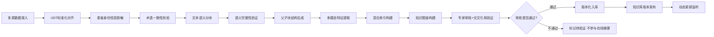

# 核心流程与知识库

## 1. 离线：知识库构建流程



> **患者身份信息脱敏步骤**：在 UDT 标准化对齐之后、术语一致性校验之前，增加患者身份信息脱敏子步骤。**必要性**：知识库包含典型病例报告作为重要数据源，可能含患者姓名、身份证号、手机号、住址等身份信息。若不脱敏，知识查询智能体检索到含身份信息的知识片段后，可能通过 RAG 链路传递至融合层并最终展示给医生，绕过标准化层、融合层、SafetyGateway 的在线脱敏防线。**脱敏范围**：参见[04-安全合规](04-安全合规.md) §2 脱敏规则表，对患者姓名（匿名令牌替换）、身份证号（仅保留后 4 位）、手机号（仅保留后 4 位）、住址（仅保留到市级）、出生日期（仅保留年份）执行脱敏处理。年龄（整数）为诊断必要信息不脱敏。**脱敏执行时机**：仅当入库数据来自典型病例报告时执行脱敏；来自权威指南专家共识的结构化条文（不含患者信息）直接跳过脱敏步骤。**与在线脱敏的关系**：知识库构建脱敏为离线批量处理，消除源头风险；标准化层前置脱敏为在线实时处理，防御用户输入中的身份信息；融合层/SafetyGateway 脱敏为最终防线。三道脱敏防线职责互补，覆盖数据全生命周期。

### 1.1 质控节点

| 质控节点 | 校验内容 | 不通过处理 |
|---|---|---|
| 术语一致性校准 | 标准化后的术语是否在 UDAF 词汇表中存在映射 | 未映射术语进入待审队列 |
| 语义完整性验证 | 分块后的文档片段是否保留完整诊疗语义 | 不完整片段合并至父块，标记"上下文依赖块" |
| 专家审核 + 交叉引用验证 | 关键关系是否准确；新知识与已有知识是否矛盾 | 不通过或矛盾的关系标记"待验证，不参与在线推理" |

**交叉引用验证方法**：

| 验证步骤 | 方法 | 自动化程度 |
|---|---|---|
| 路径一致性检查 | 一期：PGVector + PostgreSQL 递归 CTE（`WITH RECURSIVE`，≤ 10 层），检查逻辑矛盾路径与环路；二期 full Profile 引入 Neo4j 后升级为 Cypher 查询 | 全自动 |
| 语义矛盾检查 | 向量余弦相似度 > 0.85（初始值，须在 Gate 0 验证中根据实际嵌入模型的向量分布校准；Ultrasound-CLIP 768 维与 bge-m3-medical 1024 维的向量空间分布不同，主方案与强兜底切换时须使用对应的校准阈值，通过 `EMBEDDING_CONTRADICTION_THRESHOLD_{model}` 配置项区分——此处 `{model}` 指嵌入模型如 `ultrasound_clip`/`bge_m3_medical`，与 [06-开发环境与进度规划](06-开发环境与进度规划.md) §5 中 `CONTRADICTION_SIMILARITY_THRESHOLD_{LLM}` 按 LLM 模型维度的配置项为不同用途，后者用于 LLM 输出一致性校验）但结论相反，标记疑似矛盾 | 半自动 |
| 来源权威性交叉验证 | 不同指南对同一问题的不同推理 | 全自动，按发布时间取最新 |
| 人工审核触发 | 步骤 1-3 发现任何矛盾均触发人工审计 | 手动 |

> **一期/二期验证分层说明**：
> **一期（PGVector + PostgreSQL 递归 CTE）**：路径一致性检查、环路检测、逻辑冲突检查均使用 `WITH RECURSIVE` 实现。CTE 示例——检查甲状腺结节相关路径是否存在矛盾：
> ```sql
> WITH RECURSIVE path_chain AS (
>   SELECT target_id, relation_type, 1 AS depth
>   FROM knowledge_relations WHERE source_id = 'nodule_thyroid'
>   UNION ALL
>   SELECT r.target_id, r.relation_type, p.depth + 1
>   FROM knowledge_relations r JOIN path_chain p ON r.source_id = p.target_id
>   WHERE p.depth < 3
> )
> SELECT * FROM path_chain WHERE target_id IN (SELECT target_id FROM path_chain GROUP BY target_id HAVING COUNT(DISTINCT relation_type) > 1);
> ```
> 环路检测：CTE 遍历中若 `target_id` 与起始 `source_id` 相同，则存在环路，标记待验证。
> **二期（引入 Neo4j）**：切换为 Cypher 查询，提供更高性能的图遍历与复杂推理。Cypher 为二期增强项，非一期必须项。
> **统一验证输出接口**：CTE 与 Cypher 对外提供完全相同的验证结果格式（`ValidationResult`：`{check_type, entity_id, conflict_type, conflicting_relations, severity}`），确保业务层无感知、不重复开发。

### 1.2 知识库条目置信度衰减

一期仅实现**反馈驱动的衰减**：

| 衰减触发条件 | 衰减规则 | 处理方式 |
|---|---|---|
| 条目被 L2 反馈质疑 ≥ 3 次（去重：同一医生对同一条目仅计 1 次） | 置信度评分 × 0.8 | 自动进入专家复审队列 |
| 条目被 L3 反馈质疑 ≥ 2 次（去重：同一医生对同一条目仅计 1 次） | 置信度评分 × 0.7 | 自动进入专家复审队列。**compact Profile 差异化**：compact 模式下 L3 衰减触发条件为"≥ 2 次或 ≥ 50% 的活跃超声科医生质疑"（通过 `L3_DECAY_TRIGGER_COUNT` 和 `L3_DECAY_TRIGGER_RATIO` 配置项实现，compact 默认 count=2 / ratio=0.5，full 默认 count=2 / ratio=1.0），取两者先到者触发衰减。此设计确保 2 名医生场景下 2 次质疑即可触发衰减（避免基层医院仅 2 名超声科医生时永远无法达到 3 次阈值），同时避免 10 名医生中仅 2 名质疑就触发衰减的过于敏感问题（10 名中 2 名仅 20%，未达 50% 阈值） |
| 同一条目同时收到 L2 和 L3 反馈 | 取更严格衰减（L3 优先 × 0.7），不叠加惩罚（避免 ×0.8 × 0.7 = 0.56 过快降至阈值以下） | 自动进入专家复审队列 |
| 同一条目先后收到 L2 和 L3 反馈 | 同样取最严格衰减系数（min(0.8, 0.7) = 0.7），不按顺序叠加——无论 L2 和 L3 反馈是同时还是顺序到达，最终衰减系数均为 min(所有已触发衰减系数)，而非累乘。**实现提示**：衰减系数应存储为列表（如 `[0.8, 0.7]`），计算时取 min 后一次性乘以原始评分，而非顺序累乘。实现时须使用 `original_score * min(applied_multipliers)` 而非 `score *= multiplier` 的累乘模式，避免先执行 `score *= 0.8` 再执行 `score *= 0.7` 导致结果为 `score * 0.56` 而非设计意图的 `score * 0.7`。避免少数医生质疑导致条目过快被排除出推理 | 自动进入专家复审队列 |
| 条目置信度降至来源类型下限阈值以下 | — | 自动标记"待验证，不参与在线推理"。下限阈值按知识来源类型分级（与 [00-项目总览](00-项目总览与核心指标.md) §2.4 知识来源权威性评分一致）：权威指南：0.90、专家共识：0.75、典型病例：0.50 |
| 专家复审确认条目正确 | 恢复原始置信度 | 记录复审结论与审计日志 |

> 基于时间的衰减（90 天未引用 ×0.9）在知识库运行满 6 个月后再启用，详见[09-二期规划](09-二期规划与远期增强.md)。

**质疑来源区分说明**：L2/L3 反馈针对的是 AI 诊断结论，而非具体知识条目。衰减机制惩罚的是"被质疑的知识条目"，但质疑可能源于两类问题：（1）**知识库错误**：知识条目本身有误，正确的知识条目不会导致该结论；（2）**LLM 幻觉**：知识条目正确，但 LLM 错误理解或错误组合了知识条目导致错误结论。衰减机制对两类问题统一处理——均将被质疑条目送入复审队列。**复审结论须区分来源**：专家复审时须明确标注质疑来源（`challenge_source: "knowledge_error"` vs `challenge_source: "llm_hallucination"`），知识库错误触发知识库修正流程，LLM 幻觉触发模型/提示词优化流程。一期复审表单须包含"质疑来源"必填字段（单选：知识库错误 / LLM 幻觉 / 两者均有 / 无法判定），确保后续处理流程针对性处理根因。一期暂不实现自动来源判定（需 LLM 自行判断推理过程是否正确，技术难度高），人工复审时由专家判定。

**UDT 编码层级衰减传递规则**：当父类 UDT 编码被 L2/L3 反馈质疑时，衰减规则**不自动传递**至子类编码。原因：（1）子类编码可能更精确，即使父类编码有误，子类编码仍可能正确（如"甲状腺毒症"分类有争议，但"毒性弥漫性甲状腺肿"可能是明确定义的）；（2）子类编码的质疑情况可能与父类编码不同，须独立评估。**衰减传递处理**：父类编码衰减时，系统仅对被质疑的父类编码条目执行衰减操作，不自动触发子类编码衰减。子类编码若有独立被质疑记录，按自身质疑次数独立触发衰减。**复审关注层级关系**：专家复审时，复审表单须显示被质疑编码的完整层级路径（如 `thyroid_hyperthyroidism` → `thyroid_toxic_diffuse_goiter`），供专家判断父类编码质疑是否暗示子类编码存在共性问题。若专家确认子类编码存在同类问题，须手动对子类编码也执行衰减操作。

### 1.3 知识库版本管理

| 维度 | 方案 |
|---|---|
| 版本格式 | `kb_v{major}.{minor}.{patch}`（一期单租户），二期多租户扩展为 `kb_v{major}.{minor}.{patch}~{hospital_id}`（使用 `~` 作为版本号与租户 ID 的分隔符，避免 `+` 在 URL 编码中被解析为空格导致版本号解析错误）。**版本号解析函数**：一期须使用统一的 `parse_kb_version` 函数解析版本号。**解析规范**：先按 `~` 分割去除 hospital_id 后缀，再按 `.` 分割，第一段去除 `kb_v` 前缀后得到 major，第二段为 minor，第三段为 patch。示例：`"kb_v1.2.3~hospital_A"` → 按 `~` 分割得 `["kb_v1.2.3", "hospital_A"]`，取第一段按 `.` 分割得 `["kb_v1", "2", "3"]`，去除 `kb_v` 前缀得 major=1, minor=2, patch=3。一期单租户格式 `"kb_v1.2.3"` 同样兼容（按 `~` 分割仅得一段，后续逻辑不变）。**hospital_id 命名约束**：hospital_id 仅允许字母、数字、下划线（`[a-zA-Z0-9_]`），禁止 `~`、`.`、`-` 等可能在版本号解析中产生歧义的字符（由系统生成，非用户输入，约束可强制执行）。**Code Review 强制检查项**：代码中禁止直接比较 `knowledge_base_version` 字符串（如 `version > "kb_v1.0.0"`），必须通过 `parse_kb_version` 函数解析后比较 major/minor/patch 数值。此规则纳入 Code Review Checklist 强制检查项——Python AST 中字符串比较与变量赋值/参数传递难以精确区分，CI 静态检查误报率较高，Code Review 人工检查更可靠。`parse_kb_version` 函数在一期即须包含多租户后缀的单元测试用例（如输入 `"kb_v1.2.3~hospital_A"` 应返回 `{major: 1, minor: 2, patch: 3}`；输入 `"kb_v1.2.3~hospital_A_branch"` 应返回 `{major: 1, minor: 2, patch: 3, hospital_id: "hospital_A_branch"}`，验证 `~` 分隔符正确处理包含 `_` 的 hospital_id） |
| 版本策略 | 每次更新生成新版本，历史版本不可变 |
| 诊断关联 | 诊断结果记录所依赖的知识库版本号及具体使用的知识条目 ID 列表（`used_evidence_ids`），支持知识条目变更时精确匹配受影响的历史诊断并触发复审通知 |
| 重大更新触发 | 指南修订时，触发受影响历史诊断的复审通知 |
| 版本保留 | full 最新 10 个版本在线；compact 当前版本 + 上一版本 |
| minor/patch 回滚 | 切换版本指针，无需数据迁移，切换延迟 < 1s；回滚后通知所有活跃会话刷新缓存 |
| 版本切换粒度 | 以**单次诊断请求**为切换粒度：在途请求使用旧版本完成，同一会话中的新请求使用新版本。minor/patch 版本差异在同一会话内允许共存，诊断结果标注具体版本号；major 版本不一致时拒绝处理（E4004），须创建新会话 |
| 版本变更提醒 | 同一会话中首次使用新版本时，前端弹出提示"知识库已更新，建议重新评估之前的诊断" |
| 会话内版本锁定（可选） | 配置项 `SESSION_KB_VERSION_LOCK=true` 时，同一会话内锁定知识库版本，新版本仅对新会话生效；一期默认 `true`（同一会话内锁定 KB 版本，确保结论一致性；**safety_critical 更新时直接终止所有活跃会话**——包括多器官串行诊断中的会话，强制医生重新创建会话。已完成器官的诊断结果**保留但标记基于旧版 KB，建议复审**（不降级为仅观察描述），医生可选择是否重新诊断）。**优先级说明**：safety_critical 的"即时失效"优先级**绝对高于** `SESSION_KB_VERSION_LOCK`——无论会话版本锁定配置如何，safety_critical 更新都会立即终止所有活跃会话并使旧缓存失效。此优先级确保安全关键更新的及时性不受版本锁定配置影响。此简化策略理由：（1）safety_critical 更新（禁忌条件分级标准变更）本身为极低频事件（须双人复核），为此维护复杂的降级逻辑不值得；（2）直接终止会话的逻辑极其简单，测试覆盖容易；（3）医生重新创建会话的成本很低（几秒钟），但系统正确性的保障极高；（4）已完成器官结论保留（而非降级）尊重了已完成诊断的医学价值，医生可自行判断是否需要重新评估；（5）非 safety_critical 的 minor/patch 更新不中断当前会话，前端在新会话创建时提示"知识库已更新至 v{x.y.z}"）。**多器官部分完成会话数据结构定义**：会话状态结构明确定义如下： |

```json
{
  "session_id": "uuid",
  "status": "pending|active|partial|completed|needs_review|failed|terminated",
  "kb_version": "kb_v1.2.3",
  "created_at": "2026-05-06T10:00:00Z",
  "updated_at": "2026-05-06T10:30:00Z",
  "organs": [
    {
      "organ_code": "thyroid",
      "status": "pending|in_progress|completed|failed|skipped|needs_review",
      "diagnosis_result": {
        "ti_rads_level": "TI-RADS 3",
        "conclusion": "良性可能性大",
        "confidence": 0.85
      },
      "kb_version": "kb_v1.2.3",
      "needs_review": true,
      "completed_at": "2026-05-06T10:15:00Z"
    }
  ],
  "safety_critical_termination": false
}
```

**会话状态枚举定义**（与 [00a-术语表](00a-术语表.md) §13 统一）：

| 状态 | 说明 |
|------|------|
| `pending` | 会话已创建，等待开始 |
| `active` | 会话正在进行中（含部分器官诊断） |
| `partial` | 部分器官诊断完成 |
| `completed` | 所有器官诊断完成 |
| `needs_review` | 会话因 safety_critical 更新终止，已完成结论需复审 |
| `failed` | 会话失败，AI 不可用 |
| `terminated` | 会话因安全更新等原因被终止 |

**器官状态枚举定义**（与 [00a-术语表](00a-术语表.md) §14 统一）：

| 状态 | 说明 |
|------|------|
| `pending` | 器官尚未进行诊断 |
| `in_progress` | 器官诊断正在处理 |
| `completed` | 器官诊断已完成 |
| `failed` | 器官诊断失败，AI 不可用 |
| `skipped` | 跳过该器官诊断 |
| `needs_review` | 器官诊断已完成但基于旧版知识库 |

**字段说明**：
- `status`: 会话整体状态，与各器官 `status` 独立。会话 `status` 取决于最严重的器官状态（如任一器官 `failed` 则会话 `failed`；任一器官 `needs_review` 则会话 `needs_review`；部分器官 `completed` 且无 `failed`/`needs_review` 则会话 `partial`；所有器官 `completed` 且无 `needs_review` 则会话 `completed`）
- `safety_critical_termination`: 标记会话是否因 safety_critical 更新而终止。若为 `true`，`needs_review=true` 的器官结论保留但标注"建议复审"，医生可选择重新诊断
- `organs[].needs_review`: 仅在 `safety_critical_termination=true` 时生效，标记该器官是否需要复审

**safety_critical 终止会话的统计口径说明**：safety_critical 更新终止会话时，已完成器官的诊断结论标记为基于旧版 KB，建议复审。此结论在 AI 修正率统计中的处理规则：（1）**不计入分析**——safety_critical 终止会话产生的结论非正常诊断流程产生，不应纳入 AI 准确率或修正率统计；（2）**单独统计**——此类结论作为独立的"safety_critical 终止会话保留结论"统计，供安全和质量团队分析 safety_critical 更新的影响范围；（3）若医生基于"建议复审"标记重新诊断并修正结论，修正结论纳入正常统计流程（计入分母和新结论的修正率）；（4）若医生确认原结论无需修正，原结论保留但不纳入任何准确率统计（视为"医生确认正确"而非"AI 正确"）。此统计口径确保 AI 修正率统计反映正常诊断流程的能力，不受 safety_critical 更新等非预期中断影响。

**模型版本与知识库版本兼容性矩阵**：

| 模型 major | 知识库 major | 兼容性 |
|---|---|---|
| v1.x | kb_v1.x | ✅ 完全兼容 |
| v1.x | kb_v2.x | ⚠️ 降级兼容（新字段被忽略） |
| v2.x | kb_v2.x | ✅ 完全兼容 |
| v2.x | kb_v1.x | ❌ 不兼容（拒绝启动诊断） |

> 模型 major 版本升级时，须在测试环境中使用新模型 + 各版本知识库运行 ≥100 例诊断验证，根据验证结果更新兼容性矩阵。
> **升级部署顺序约束**：兼容性矩阵的非对称性（v1.x 模型 + kb_v2.x 降级兼容，v2.x 模型 + kb_v1.x 不兼容）隐含了强制部署顺序——升级时**必须先升级知识库至新 major 版本，再升级模型**；反向操作会导致系统拒绝启动诊断。**回滚顺序为升级顺序的逆序**——回滚时**必须先回滚模型（v2.x → v1.x），再回滚知识库（kb_v2.x → kb_v1.x）**；反向操作会导致系统处于 v2.x 模型 + kb_v1.x 的不兼容状态，拒绝启动诊断，系统完全不可用。运维流程须在升级/回滚检查清单中强制执行此顺序，详见 [05-可观测性与运维](05-可观测性与运维.md) §4 节。
> **升级方案（原子升级为唯一推荐方案）**：KB 和模型的 major 版本升级须设计为原子操作——通过 Docker Compose 同时重启所有服务（KB 升级 + 模型升级在同一部署批次中完成），将窗口期从 30 分钟缩短至服务重启时间（约 1-2 分钟）。原子升级消除了"先 KB 后模型"升级顺序的窗口期安全风险，简化运维流程。**原子升级失败时的回滚规则**：若原子升级失败须回滚，**回滚也须设计为原子操作**——同时回滚 KB 和模型至升级前版本（使用预存的上一版本 Docker 镜像快照），确保回滚过程中系统始终处于兼容状态。**回滚原子性保障**：原子升级前自动保存当前版本快照（KB + 模型 Docker 镜像标签），升级失败时自动从快照回滚，无需顺序判断。**一键式 KB+模型原子升级脚本**：将 KB+模型原子升级纳入"一键式运维操作"体系——提供单按钮触发的升级脚本（`scripts/atomic-kb-model-upgrade.sh`），自动执行"预检查（无活跃诊断请求）→ 原子升级（KB + 模型同时）→ 健康检查验证"全流程。升级脚本须包含自动回滚逻辑（任一步骤失败自动从快照回滚至升级前状态，回滚超时 5 分钟触发 Critical 告警）。脚本启动前自动检查当前无活跃诊断请求（查询 PostgreSQL `diagnosis_sessions` 表中 `status = 'active'` 的记录数 = 0），有活跃会话时拒绝执行并提示"请等待所有诊断会话结束后重试"。此脚本须在非检查时段执行（建议 0:00-6:00），基层医院 IT 人员仅需执行一条命令即可完成升级全流程。

### 1.4 知识库数据迁移

major 版本升级时须执行数据迁移：每个版本对应迁移脚本（纳入 Git），迁移前自动全量备份，独立事务执行支持断点续传，迁移后自动校验数据完整性，失败自动回滚，灰度环境验证 ≥100 例后方可切换生产流量。

## 2. 在线：诊疗推理流程

```mermaid
graph TD
    A[医生输入] --> B[标准化解析前置脱敏+输入合法性校验]
    B --> B1{请求类型?}
    B1 -->|实时导航| RT[快速路径]
    B1 -->|辅助评估| AT[标准路径]
    B1 -->|完整诊断| FT[全量路径]
    RT --> C1[端到端 P99 < 200ms]
    AT --> C2[延迟 < 2s]
    FT --> C[中央调度分配任务]
    C --> D[专科智能体请求依据]
    D --> D0{本地缓存命中?}
    D0 -->|命中| D0A[使用缓存知识, 标记缓存来源]
    D0 -->|未命中| E[知识查询智能体检索知识库]
    E --> E1{检索结果是否充分?}
    E1 -->|充分| F[返回结构化知识给专科智能体]
    E1 -->|不充分| E2[CRAG补充检索]
    E2 --> E3{补充后是否充分?}
    E3 -->|充分| F
    E3 -->|仍不充分| E4[标记"依据不足"]
    E4 --> F1[专科智能体仅输出描述性结论]
    D0A --> G[专科智能体生成诊断]
    F --> G
    G --> H[分层校验]
    H --> H1{校验是否通过?}
    H1 -->|通过| I[Self-RAG生成质检]
    H1 -->|不通过| H2[标记不通过原因, 尝试降级诊断]
    H2 --> I
    I --> I1{质检是否通过?}
    I1 -->|通过| J[结果融合]
    I1 -->|不通过| I2[重新生成 最多2次]
    I2 --> I3{2次后仍不通过?}
    I3 -->|否| I
    I3 -->|是| I4[仅输出原始观察描述 强制标记需人工复核]
    J --> J0[输出脱敏校验]
    J0 --> J1{融合一致性校验}
    J1 -->|一致| K[临床输出]
    J1 -->|部分一致| J3[按偏差容忍度与风险等级处理]
    J1 -->|矛盾| J2[标记矛盾+强制人工复核]
    J2 --> K
    J3 --> K
```

### 2.1 分层响应路径

| 响应路径 | 适用场景 | 安全校验 | 延迟目标 |
|---|---|---|---|
| 快速路径 | 检查中实时导航 | 实体校验 + 禁忌校验 + 安全置信度阈值（器官阈值 × 1.05） | 详见 [00-项目总览](00-项目总览与核心指标.md) §2.1 |
| 标准路径 | 辅助评估、分级确认 | 实体校验 + 禁忌校验 | 详见 [00-项目总览](00-项目总览与核心指标.md) §2.1 |
| 全量路径 | 完整诊断、报告生成 | 实体校验 + 逻辑校验 + 禁忌校验 + Self-RAG + 融合一致性 | 详见 [00-项目总览](00-项目总览与核心指标.md) §2.1 |

**标准路径跳过逻辑校验的理由**：标准路径推理链路较短（通常为单特征→分级映射），逻辑错误风险低。若检测到复杂推理需求，经医生确认后升级为全量路径（详见 [01-系统架构设计](01-系统架构设计.md) §5.3 Adaptive RAG 动态路由规则与 [08-前端交互](前端设计/08-前端交互与使用指南.md) §2）。**分层校验机制说明**：标准路径执行双重安全校验（实体 + 禁忌），全量路径执行三重安全校验（实体 + 逻辑 + 禁忌），统称为"分层校验机制"——安全校验层级随响应路径复杂度递增，而非所有路径统一三重校验。**安全校验与推理质检的区别**：安全校验（实体/逻辑/禁忌校验）验证诊断结论的医学安全性，推理质检（Self-RAG）验证生成内容的依据充分性。快速路径与标准路径共享相同的安全校验（实体+禁忌），差异在于推理链路深度——快速路径为边缘端导航推理（无 RAG 检索），标准路径为 RAG 检索生成但跳过逻辑校验和 Self-RAG 质检，全量路径为完整 RAG 检索生成 + 逻辑校验 + Self-RAG 质检。

**多器官路径升级独立判断**：多器官联合诊断时，每个器官**独立选择响应路径**，互不影响。

**Self-RAG 重试**：最多重试 2 次（即 3 次生成机会，从 3 次重试缩减，确保含重试 P99 < 8s 有足够余量），每次仅重新执行生成与质检，复用首次检索与校验结果。2 次重试均失败后仅输出原始观察描述，不输出任何诊断性结论，`ai_diagnosis_failed` 置为 `true`。

> **Self-RAG 重试检索策略**：若首次质检失败原因为"无依据/依据不足"，重试时应触发 CRAG 补充检索而非仅重新生成——因为生成失败可能源于检索质量不足，复用有问题的检索结果将导致重复生成类似错误结论。若质检失败原因为"逻辑错误"或"格式问题"，则复用首次检索结果仅重新生成。**CRAG 补充检索触发主体**：CRAG 补充检索的唯一触发主体为 Self-RAG 质检模块，唯一执行主体为知识查询智能体，中间路由由中央调度智能体统一管理。当 Self-RAG 质检失败原因为"无依据/依据不足"时，质检模块向中央调度智能体发送补充检索请求（携带原始查询 + 质检失败原因），由中央调度统一路由至知识查询智能体执行 CRAG 补充检索（基于查询扩展策略），保持检索逻辑的单一入口与一致性，同时确保中央调度具备全局视野可进行负载均衡和优先级调度。**⚠️ 二期 gRPC 通信场景下 CRAG 链路延迟评估**：一期中央调度路由为进程内函数调用，额外开销可忽略（< 1ms）。二期切换为 gRPC 独立进程通信后，CRAG 补充检索链路增加 2 次进程间通信（Self-RAG→中央调度、中央调度→知识查询智能体），每次 gRPC 调用增加约 2-5ms 延迟（序列化/反序列化 + 网络传输），合计增加 4-10ms。此增量在当前 0.5s 余量内可覆盖，但二期 Gate 1 须重新验证 CRAG 链路端到端延迟是否仍在时间预算内。**CRAG 补充检索优先级**：知识查询智能体实现请求优先级队列——CRAG 补充检索请求优先级高于普通检索请求（CRAG 处于诊断关键路径上，延迟直接影响诊断结果），`RequestCRAGRetrieval` 接口增加 `priority: "high"` 字段，知识查询智能体优先处理高优先级请求，确保 CRAG 补充检索排队延迟不超出时间预算。**CRAG 补充检索次数限制**：最多 2 次重试可触发 CRAG 补充检索。时间预算分两种场景：**最坏情况（每次重试均触发 CRAG）**：首次 3s + 第 1 次 CRAG 重试 2.5s + 第 2 次 CRAG 重试 2s = 7.5s，预留 0.5s 余量；**不含 CRAG 重试（质检失败原因为"逻辑错误"或"格式问题"）**：首次 3s + 第 1 次普通重试 2s + 第 2 次普通重试 1.5s = 6.5s。**知识查询智能体排队延迟余量**：一期知识查询智能体为单实例，compact 模式 2 并发诊断请求同时触发 CRAG 补充检索时，第二个请求需排队等待。上述时间预算中 0.5s 余量已覆盖知识查询智能体排队延迟（单次 CRAG 检索耗时约 1-2s，排队等 1 次约增加 1-2s 延迟，0.5s 余量在典型场景下可覆盖；极端排队场景超出余量时，Self-RAG 重试超时自动降级为观察描述输出，不影响系统安全性）。CRAG 优先级队列机制进一步降低排队延迟风险。Gate 0A 须验证 2 并发诊断 + 同时触发 CRAG 补充检索场景下的端到端延迟，确认时间预算充足。若 2 次 CRAG 补充检索后质检仍失败，则 2 次普通重试（无 CRAG）改进，**降级输出观察描述**而非无效重试，避免浪费时间预算。

> **CRAG 补充检索与 Self-RAG 重试交互规则**：CRAG 补充检索**不计入** Self-RAG 重试次数——CRAG 是检索增强（改善输入质量），不是生成重试（重新生成输出）。交互流程如下：（1）Self-RAG 质检失败原因"无依据/依据不足" → 触发 CRAG 补充检索 → 使用补充检索结果重新生成 → 质检通过/失败均消耗 1 次 Self-RAG 重试；（2）CRAG 补充检索本身失败 → 使用已有检索结果继续生成（降级为普通重试），仍消耗 1 次 Self-RAG 重试；（3）2 次 CRAG 补充检索后质检仍失败 → 后续重试不再触发 CRAG，改为普通重试或降级输出观察描述。
>
> 1. **同义词扩展**：使用医学术语同义词表扩展查询词（如"甲状腺结节"→"甲状腺占位性病变"）
> 2. **上位词扩展**：向上扩展至医学分类层级的父节点（如"肝细胞癌"→"肝脏恶性肿瘤"）
> 3. **相关特征扩展**：根据知识库中的关联规则扩展相关特征（如"微钙化"→"恶性特征"）
> 4. **病例相似性扩展**：检索相似病例的查询历史作为补充

> **CRAG 触发阈值优化**：Self-RAG 质检模块在以下条件下触发 CRAG 补充检索：
> | 质检失败原因 | 触发条件 | 扩展策略 |
> |---|---|---|
> | 无依据 | 检索结果为空 | 全量扩展（1+2+3+4） |
> | 依据不足 | 检索结果 < 3 条或置信度 < 0.7 | 同义词+上位词扩展（1+2） |
> | 依据冲突 | 检索结果存在矛盾 | 相关特征扩展（3） |

### 2.2 DICOM 流式接入策略

超声检查中 DICOM 图像逐帧流式到达，系统按以下策略处理：

| 维度 | 方案 |
|---|---|
| 帧缓存 | 边缘端维护最新 N 帧环形缓冲区（N 可配置，默认 90 帧，30fps 下覆盖约 3 秒窗口，详见[03-接口规范](03-接口规范.md) §1.2 DICOM 帧缓存容量对齐） |
| 诊断触发 | 快速路径：每帧自动触发导航标注；全量路径：由医生通过语音/点击手动触发 |
| 帧间关联 | 同一 session_id 下的帧按时间戳排序，诊断时取最新 N 帧作为输入 |
| 接口 | 新增 `POST /api/v1/imaging/dicom/stream` 流式接口，详见[03-接口规范](03-接口规范.md) |

### 2.3 异常分支处理

| 异常场景 | 处理策略 | 输出标记 |
|---|---|---|
| 检索无结果 | CRAG 补充检索仍无结果 | `evidence_insufficient`，仅输出描述 |
| 分层校验不通过 | 标记原因 + 降级诊断 | `validation_failed`，强制人工复审 |
| Self-RAG 质检失败（2 次） | 仅输出观察描述 | `generation_unreliable`，强制人工复审 |
| 专科结论与依据矛盾 | 诊断降级 + 强制人工复核 | `contradictory` |
| 专科结论与依据部分一致 | 按偏差容忍度与风险等级处理 | `partial_consistent` |
| 置信度低于阈值 | 拒绝输出诊断，仅输出观察描述 | `low_confidence` |

> **"观察描述"白名单定义**：降级输出中"观察描述"仅允许以下单属性字段——器官名称、解剖位置、回声特征（强/弱/混合）、边界特征（清晰/模糊/不规则）、形态特征（圆形/椭圆形/分叶状/不规则）、血流特征（无/周边/内部/混合）、钙化特征（无/微钙化/粗大钙化/环状钙化）、病灶大小测量值（cm，保留 1 位小数，测量方式标注为长径/短径/前后径，与 UDAF 词汇表 `measurement_type` 枚举对齐）。禁止输出任何分级词汇（如 TI-RADS、LI-RADS）。**降级输出禁止输出任何多特征组合**——无论组合是否"客观描述"，降级模式下仅输出白名单内的单属性列表，医生可自行组合单属性进行判断。此规则消除"纯客观描述"隐含诊断方向的语义判断模糊性，规则引擎可确定性地执行（逐字段过滤，无需语义理解）。白名单与 UDAF 属性词汇表对齐，确保降级输出保留临床关键单属性信息。

**降级输出 `observations` 白名单字段表**（安全审计可操作版本）：

| 字段名 | 字段类型 | UDAF 映射 | 安全审计状态 | 说明 |
|---|---|---|---|---|
| `organ_name` | enum | `organ` | ✅ 已审计 | 器官名称（thyroid/liver/heart），不含身份信息 |
| `anatomical_location` | enum | `anatomical_location` | ✅ 已审计 | 解剖位置（如"右叶下极""左外叶"），标准医学解剖术语 |
| `echogenicity` | enum | `echogenicity` | ✅ 已审计 | 回声特征（hyperechoic/hypoechoic/isoechoic/mixed/anechoic） |
| `boundary` | enum | `boundary` | ✅ 已审计 | 边界特征（clear/ill-defined/irregular/lobulated） |
| `morphology` | enum | `morphology` | ✅ 已审计 | 形态特征（round/oval/lobulated/irregular） |
| `vascularity` | enum | `vascularity` | ✅ 已审计 | 血流特征（absent/peripheral/internal/mixed） |
| `calcification` | enum | `calcification` | ✅ 已审计 | 钙化特征（none/micro/coarse/rim） |
| `measurement` | float + enum | `measurement_value` + `measurement_type` | ✅ 已审计 | 病灶大小测量值（cm，1 位小数）+ 测量方式（长径/短径/前后径） |

**白名单变更安全评审流程**：

| 步骤 | 负责人 | 产出 | 时效要求 |
|---|---|---|---|
| 1. 变更发起 | 开发者/临床专家 | 变更申请（含字段名、字段类型、UDAF 映射、安全影响评估） | — |
| 2. 安全评审 | 安全工程师（非变更发起人） | 安全评审结论（通过/驳回/需补充材料） | ≤ 2 个工作日 |
| 3. 临床确认 | 临床专家 | 临床确认结论（确认不含身份信息风险） | ≤ 1 个工作日 |
| 4. CI 检查 | CI 流水线 | 白名单与 UDAF 词汇表一致性检查结果 | 自动（合并时触发） |
| 5. 变更入库 | 开发者 | 白名单变更记录 + 审计日志 | 评审通过后 1 个工作日内 |

**CI 检查规则**：白名单中的每个字段必须在 UDAF 词汇表中存在（反向包含检查），UDAF 新增字段不会自动进入白名单，须人工安全评审确认不含身份信息后方可显式添加。**禁止进入白名单的字段类型**：`patient_notes`、`referring_physician`、`clinical_history`、`patient_id`、`patient_name`、`report_text` 等可能包含身份信息的字段类型，无论安全评审结果如何，均不可纳入白名单（硬编码禁止列表）。

**白名单维护一致性机制**：白名单作为 UDAF 词汇表的**衍生规则**，新建 UDAF 属性类别时强制触发白名单评估流程（在 L2 级反馈流程中增加"白名单影响评估"必填项），确保白名单与 UDAF 词汇表始终同步。白名单变更记录审计日志。**自动化校验**：CI 流水线中增加"白名单与 UDAF 词汇表一致性检查"步骤，自动检查 UDAF 词汇表中新增但未纳入白名单的属性类别，发现不一致时阻断合并。此检查在 UDAF 词汇表变更时自动触发，无需依赖人工流程。降级输出强制附加醒目警告："此为未经校验的原始观察，不可作为诊断依据"。

> **前端重试**：提示"重试 AI 诊断"按钮（限 1 次），重试策略根据首次失败原因区分——**检索相关失败**（E2001 检索无结果、E2006 检索超时）先尝试 CRAG 补充检索（查询扩展策略，由 Self-RAG 质检模块触发，复用现有 CRAG 链路），CRAG 仍无结果时再触发完整诊断流程（含重新检索，`retry_strategy=full_retrieval`）；**生成相关失败**（E3003 生成失败）仅执行 1 次生成质检（复用首次检索结果，`retry_strategy=generation_only`）；**质检相关失败**（Self-RAG 质检 2 次失败）仅执行 1 次生成质检（复用首次检索结果但重新生成，`retry_strategy=quality_check_only`）。**重试请求一律跳过 Self-RAG 重试**（仅执行 1 次生成质检），将前端重试延迟控制在 3s 以内（首次诊断含 Self-RAG 重试最多 8s + 重试 3s = 总延迟约 11s，避免最坏情况 16s 超出可接受范围）。重试失败后该会话标记 `ai_permanently_degraded`，后续请求不再调度 AI 诊断。

**一期融合层实现边界**：

| 功能 | 一期是否实现 | 说明 |
|---|---|---|
| `consistent` 状态处理 | ✅ | 一期主要场景 |
| `evidence_insufficient` 状态处理 | ✅ | 检索无结果降级 |
| `contradictory` 状态处理 | ✅ | 结论与依据矛盾，强制人工复核 |
| `partial_consistent` 状态处理 | ✅ | 分级偏差处理 |
| 跨器官关联校验 | ✅ | 一期三器官（甲状腺、肝脏、心脏）联合诊断时需校验跨器官关联 |
| 知识依据间自相矛盾仲裁 | ✅ | 一期简化为：同日发布的矛盾指南一律标记"指南冲突"需人工裁定，不做人群区分的自动判断（判断两个矛盾指南是否针对同一人群需要语义理解，可能超出规则引擎能力）；不同日发布的按发布时间优先取最新，标注"指南冲突"；若新旧指南针对不同人群则并存标记 |
| 脱敏校验 | ✅ | 三重防线 |

### 2.4 知识缓存软失效策略

知识库版本更新时，`KnowledgeUpdated` 事件通知所有智能体清除缓存（事件须 ACK 确认，未 ACK 则 30s 后重发，最多 3 次；Consumer Group 管理、Dead Letter Queue、Pending 消息监控与转移等关键事件可靠性保障机制详见[01-系统架构设计](01-系统架构设计.md) §5.3 关键事件可靠性保障）。同时智能体 5 分钟轮询检查知识库版本号作为兜底。清除与在途诊断请求存在竞态：

| 策略 | 说明 |
|---|---|
| 安全关键更新 | `KnowledgeUpdated` 事件携带 `safety_critical` 标记时（涉及禁忌条件/安全规则变更即 L3 级更新），按安全更新类型分级处理：**词条修复类安全更新**（术语错误修正、描述修正、脱敏规则补全）走热加载/热更新，不触发任何版本号变更，不结束会话，毫秒级生效；**逻辑规则类安全更新**（诊断逻辑变更、安全校验逻辑改动、禁忌条件新增/修改、分级标准变更）触发 minor 或 patch 版本变更。**词条修复类与逻辑规则类的分类判定规则**：当同一更新同时涉及词条和逻辑时（如术语定义变更影响推理逻辑，例如"微钙化"定义变更可能影响 TI-RADS 分级判断），按逻辑规则类处理（触发版本变更），确保逻辑影响不被遗漏。仅当更新纯粹涉及术语表述/描述修正且不影响任何推理逻辑时，方归类为词条修复类。分类判定由科室主任在审核时最终裁定，争议案例一律按逻辑规则类处理。逻辑规则类安全更新触发后，采用**终止活跃会话 + 保留已完成结果**策略——safety_critical 更新立即终止所有活跃会话（包括多器官串行诊断中的会话），已完成器官的诊断结果**保留并标记基于旧版 KB，建议复审**（不降级为仅观察描述），医生可自行判断是否需要重新评估。此策略替代了"器官级精确匹配 + 安全余量降级策略"（降级为仅观察描述），理由：（1）safety_critical 更新本身为极低频事件（须双人复核），为此维护复杂的器官级降级逻辑不值得；（2）直接终止会话的逻辑极其简单，测试覆盖容易；（3）已完成器官结论保留（而非降级）尊重了已完成诊断的医学价值，医生可自行判断是否需要重新评估。**`used_evidence_ids` 不完整问题的解决**：`used_evidence_ids` 可能不完整（缓存命中场景下仅包含缓存命中的条目 ID），因此不应用于决定是否降级，仅用于前端提示"以下知识条目已更新"。专科智能体须完整记录所有使用的知识条目 ID（包括缓存命中的条目），确保 `used_evidence_ids` 的完整性——此为专科智能体的强制输出要求，Gate 1 须验证 `used_evidence_ids` 完整性。**safety_critical 更新的会话间隙生效策略**：非 safety_critical 更新不强制结束活跃会话，新建立会话直接使用新版知识库，旧会话在新诊断请求时自动使用新版本。**safety_critical 逻辑规则类更新会话终止通知机制**：safety_critical 逻辑规则类更新生效时，后端通过导航通道 WebSocket 向所有活跃会话前端推送 `session_terminated` 事件 `{"type": "session_terminated", "reason": "safety_critical_update", "kb_version": "...", "affected_organs": [...], "summary": "安全关键知识更新，当前会话已终止"}`，前端收到后立即显示模态对话框"安全关键知识更新，当前会话已终止，请创建新会话使用最新知识库"，医生确认后可创建新会话。已完成器官的诊断结论保留并标记"基于旧版 KB，建议复审"。此通知机制与[01-系统架构设计](01-系统架构设计.md) §3.5 safety_critical 更新处理规则及 [08-前端交互](前端设计/08-前端交互与使用指南.md) §2.7 E4006 处理规范一致。**强制结束会话时的数据保留策略**：已生成但未签发的诊断结果自动保存为草稿状态（标记"会话因安全更新强制终止"），医生可在新会话中查看历史草稿但不可直接签发（须重新诊断），确保安全更新后无基于旧知识的报告被签发。**safety_critical 知识更新缓存失效机制**：`KnowledgeUpdated` 事件（`safety_critical: true`）触发时，采用**KB 版本号嵌入缓存键**方案替代主动缓存清除——诊断结果 Redis 缓存键包含 `knowledge_base_version` 字段（如 `diag:result:{session_id}:{organ_code}:v{kb_version}`），不同 KB 版本的诊断结果使用不同缓存键。safety_critical 更新触发 KB 版本变更后，新请求自然无法命中旧版本缓存（缓存键中的版本号不匹配），无需主动清除 Redis 缓存，消除缓存清除与查询之间的竞态条件。旧版本缓存由 TTL 过期后自动失效。此方案与[01-系统架构设计](01-系统架构设计.md) §4 诊断结果缓存策略及 [06-开发环境与进度规划](06-开发环境与进度规划.md) §5 配置项对齐。 |

**`safety_critical` 判定清单**：以下类型的知识更新须标记为 `safety_critical`，由 L3 反馈提交时科室主任标记：

| 判定条件 | 示例 |
|---|---|
| 禁忌条件新增或修复 | 新增"甲亢患者禁用含碘造影剂"禁忌 |
| 药物交互规则变更 | 修改"甲巯咪唑与肝损害"交互规则 |
| 分级标准变更 | TI-RADS 分级判定规则修改 |
| 高风险病种诊断规则变更 | 肝细胞癌诊断标准更新 |
| 脱敏/安全规则变更 | 涉及患者身份保护的规则修改 |

> **`safety_critical` 标记准入门槛**：非安全关键更新（如术语表述优化、参考文献更新、排版修正）**不得**标记为 `safety_critical`。`safety_critical` 标记须经**双人复核**（临床专家 + 安全工程师），并在审计日志中记录标记理由。过于宽松的 `safety_critical` 标记会导致频繁取消在途诊断，严重影响系统可用性。**`safety_critical` 标记复核流程**：（1）L3 反馈提交者标记 `potentially_safety_critical=true`；（2）科室主任审核时确认是否升级为 `safety_critical=true`；（3）安全工程师二次确认安全影响范围（评估取消在途诊断的影响面）；（4）双人确认后触发即时失效流程。安全工程师拒绝时，降级为常规 L3 处理。不在上述清单中的知识更新默认为非 `safety_critical`。判定争议由科室主任最终裁定。

| "使用"精确语义 | 在途诊断请求使用了某缓存条目"的判定标准：检索阶段返回的 Top-K 结果中包含该条目（即知识查询智能体返回的 `evidence_ids` 列表中包含该条目 ID）。专科智能体须在诊断上下文中记录所使用的缓存条目 ID 列表（`used_evidence_ids`），支持精确取消。未在 `used_evidence_ids` 中的在途诊断不受影响 |
|---|---|
| 非安全关键更新 | 旧缓存标记为 stale，仍可使用最多 2 分钟，但输出标记"缓存依据，基于旧版本知识"；前端 UI 须以黄色背景高亮显示此标记。**stale 缓存失效机制为读取时检查时间戳**（非依赖周期性清理），stale 标记 2 分钟内读取时自动拒绝返回该缓存条目，强制重新获取新版本知识。周期性清理任务（`STALE_CACHE_CLEANUP_SECONDS`，默认 300 秒）仅负责物理删除已过期的 stale 缓存条目释放内存，不影响缓存逻辑失效。**若会话启用了 KB 版本锁定（`SESSION_KB_VERSION_LOCK=true`），stale 缓存策略被覆盖——锁定会话不刷新知识也不标记 stale，持续使用锁定版本直至会话结束** |
| 过期清理 | stale 缓存 2 分钟后自动清理 |

**KB 版本锁定与时效性可见性**：当 `SESSION_KB_VERSION_LOCK=true` 时，锁定会话不刷新知识也不标记 stale，持续使用锁定版本直至会话结束。但即使会话启用了 KB 版本锁定，前端仍须**非阻断性提示**"当前使用锁定版本 kb_vX.Y.Z，知识库已更新至 kb_vX.Y.Z+1"——非阻断性提示指在诊断结果区域以黄色背景标签展示（非模态对话框，不阻断医生操作），确保医生在查看诊断结论时可同时看到版本差异信息。医生可在下次会话时主动选择是否升级。此设计在提供稳定性的同时不牺牲知识时效性可见性。**KB 版本锁定会话结束后的知识时效性通知**：锁定会话结束时，若期间发生了知识库版本更新（minor 或 patch），系统须在会话结束确认界面显示"本次会话使用了旧版本知识库（kb_vX.Y.Z），当前最新版本为 kb_vA.B.C，建议关注以下变更：[变更摘要列表]"。变更摘要由知识库版本更新日志自动生成，仅展示与本次会话诊断器官相关的变更条目。此通知确保医生知晓锁定会话期间的知识时效性差异，避免基于已过时知识做出后续临床决策。

**知识库版本控制优先级决策矩阵**（2 层决策机制 + 4 步缓存读取判定链）：

系统存在 **2 层版本控制决策机制**（定义版本控制策略的优先级）和 **4 步缓存读取判定链**（定义缓存读取的具体执行顺序），两者描述不同维度：

**2 层决策机制**（策略层）：

| 层级 | 机制 | 触发条件 | 处理动作 |
|---|---|---|---|
| 1（最高） | safety_critical 即时失效 | 知识更新标记 `safety_critical=true` | 立即失效相关缓存，终止所有活跃会话（包括多器官串行诊断中的会话），已完成结论保留并标记基于旧版 KB，建议复审。强制升级版本号 |
| 2（默认） | 会话级版本锁定 / 单次请求粒度切换 | 会话启用 `SESSION_KB_VERSION_LOCK=true`（手动配置）或处于串行多器官诊断（自动触发锁定）→ 会话级版本锁定；否则 → 单次诊断请求粒度切换（默认行为） | **会话级版本锁定**：会话期间不刷新知识也不标记 stale，持续使用锁定版本直至会话结束。串行多器官强制锁定为自动触发的会话级锁定变体，与手动 `SESSION_KB_VERSION_LOCK` 共享同一实现逻辑。**单次诊断请求粒度切换**（默认行为）：每次诊断请求使用当前最新 KB 版本，非安全关键更新触发 stale 标记（2 分钟容忍窗口）。此为不锁定时的默认行为，无需作为独立优先级层级实现 |

**4 步缓存读取判定链**（执行层，按顺序执行——与下方"缓存读取判定优先级链"及 2 层决策机制对齐，safety_critical 即时失效优先级最高）：

1. 检查 safety_critical 即时失效 → 失效则使用最新版本
2. 检查会话 KB 版本锁定 → 锁定则使用锁定版本
3. 检查 stale 标记 → stale 则标记版本为"可能过时"但仍可使用
4. 检查 TTL 过期 → 过期则刷新缓存

**交互规则**：
- 优先级 1 覆盖优先级 2：safety_critical 更新即使会话启用了 KB 版本锁定或处于串行多器官诊断中，仍立即生效（词条修复类热加载，逻辑规则类**终止所有活跃会话** + 已完成结论保留并标记"基于旧版 KB，建议复审" + 新诊断请求使用新版本）
- 会话级版本锁定期间（无论手动还是自动触发），非 safety_critical 更新不触发 stale
- safety_critical 逻辑规则类更新触发后：终止所有活跃会话，已完成结论保留并标记"基于旧版 KB，建议复审"，医生须创建新会话使用新版本知识库
- safety_critical 逻辑规则类更新触发 minor 版本变更时：新建立会话使用新版知识库，活跃会话被终止，已完成结论保留并标记
- safety_critical 逻辑规则类更新触发 patch 版本变更时：同上

> **safety_critical 更新语义澄清**："在途诊断" = 已提交但融合层尚未输出的诊断请求；"活跃会话" = 有医生正在使用的检查会话。safety_critical 逻辑规则类更新触发时**终止所有活跃会话**（包括多器官串行诊断中的会话），已完成结论保留并标记"基于旧版 KB，建议复审"，医生须创建新会话使用新版本知识库。词条修复类安全更新走热加载，不取消任何在途请求，毫秒级生效。

> **2 层优先级机制集成测试要求**：原 3 层优先级机制简化为 2 层——safety_critical 即时失效 + 会话级版本锁定（合并手动锁定和串行多器官自动锁定为同一实现；"单次诊断请求粒度切换"为不锁定时的默认行为而非独立层级）。此简化将组合状态空间从 3×2×2=12 种基本组合缩减为 2×2=4 种（safety_critical 是否触发 × 会话是否锁定），大幅降低实现和测试复杂度。测试矩阵须包含以下最小用例集：（1）safety_critical 更新 + 会话级版本锁定同时触发；（2）会话级版本锁定（手动）+ 会话级版本锁定（串行多器官自动触发）同时触发（验证两者共享同一实现逻辑）；（3）2 层优先级逐层覆盖验证。缓存读取判定优先级链须实现为独立的 `CacheReadPolicy` 类，集中管理判定逻辑，避免散落在各模块中。

> **safety_critical 更新与会话级版本锁定的交互测试覆盖**：safety_critical 即时失效 + 会话级版本锁定的交互逻辑涉及多种组合场景（safety_critical 更新时机 × 多器官诊断阶段 × KB 版本锁定状态）。一期集成测试须覆盖以下核心场景：（1）单器官诊断中 safety_critical 更新——终止活跃会话，已完成结论保留并标记"基于旧版 KB，建议复审"；（2）多器官串行诊断中 safety_critical 更新——器官 A 已完成、器官 B 在途，会话终止，器官 A 结论保留并标记，器官 B 诊断取消；（3）safety_critical 更新后新会话使用最新 KB 版本。其余组合场景标记为 P2 测试优先级，数据积累后补充。

**缓存读取判定优先级链**（实现者须严格按此顺序检查，与 §1.3 版本控制优先级决策矩阵及 2 层决策机制对齐——safety_critical 即时失效优先级高于会话级版本锁定）：

1. **safety_critical 即时失效检查**（优先级最高）：若缓存条目被 `safety_critical` 更新标记为失效，立即拒绝返回，强制重新获取新版本——即使当前会话启用了 KB 版本锁定，safety_critical 失效仍须立即生效（与 2 层决策机制"safety_critical 优先级高于会话级版本锁定"一致）
2. **会话 KB 版本锁定检查**：若当前会话启用 `SESSION_KB_VERSION_LOCK=true` 或处于串行多器官强制锁定，直接返回锁定版本缓存，跳过 stale 检查与 TTL 检查
3. **stale 标记检查**：若缓存条目被标记为 stale 且 2 分钟容忍窗口已过，拒绝返回，强制重新获取新版本
4. **TTL 过期检查**：若缓存条目 TTL 已过期，拒绝返回，强制重新获取新版本

## 3. 反馈闭环机制

### 3.1 三级反馈

| 级别 | 触发条件 | 处理流程 | 入库时效 |
|---|---|---|---|
| L1（自动） | 系统自动检测的格式问题（空白/标点/大小写/编码/空白行） | 自动校验 → 入库 | 实时 |
| L2（半自动） | 术语映射修正、新病例补充、检查参数更新 | 单专家审核 → 入库 | ≤ 24 小时 |
| L3（人工） | 知识纠错、指南冲突、禁忌更新、规则变更 | 多专家交叉审核 → 全量回归测试 → 入库 | ≤ 72 小时 |

> **L1 范围白名单**：L1 仅限纯格式修正（空白行删除、编码问题修复、大小写规范化）。**任何涉及术语内容的修正统一走 L2**。错别字修正（如"甲壮腺"→"甲状腺"）可能涉及语义变更（错别字恰好是另一个有效术语时），为避免自动修正意外改变语义，一律走 L2 人工审核。宁可多审核，不可误改进。

**反馈端到端时效定义**：

| 反馈级别 | 审批入库 SLA | 知识库版本发布 SLA | 端到端生成 SLA | 说明 |
|---|---|---|---|---|
| L1 | 实时 | ≤ 1 小时 | ≤ 1 小时 | 格式修正，自动入库 |
| L2 | ≤ 24 小时 | ≤ 48 小时 | ≤ 72 小时 | 入库后须等待下一个知识库版本发布周期 |
| L3 | ≤ 72 小时 | ≤ 96 小时 | full: ≤ 72 小时（3 天）/ compact: ≤ 96 小时（4 天） | 入库后须经全量回归测试 + 版本发布。原 168 小时（7 天）过长，禁忌条件错误在此期间可能持续影响诊断。**compact 模式差异化 SLA**：compact Profile 基层医院专家资源有限（通常仅 2-3 名超声科医生），常规 L3 反馈端到端 SLA 为 ≤ 96 小时（4 天），safety_critical L3 反馈维持 72 小时但走紧急通道（≤ 12 小时生效，详见下方"L3 安全关键反馈紧急通道"）。紧急通道下 safety_critical 更新可跳过全量回归测试，仅做针对性测试后入库，全量回归测试延后至下一个维护窗口执行 |

> "端到端生成"指从反馈提交到新知识库版本对诊断请求可见的全过程。L3 反馈因需全量回归测试，端到端时效较长。**禁忌条件与安全规则的 safety_critical 标记机制**：涉及禁忌条件纠错或安全规则变更的 L3 反馈，提交时标记为 `potentially_safety_critical=true`（疑似安全关键），而非直接标记 `safety_critical=true`。`potentially_safety_critical` 标记不阻断知识条目参与诊断推理，但在知识条目上附加警告标记"疑似安全关键更新，待科室主任确认"。科室主任审核确认后，方升级为 `safety_critical=true` 并触发即时失效流程（取消在途诊断、缓存失效等）。科室主任审核时可将误标记的 `potentially_safety_critical` 降级为常规 L3。**此机制避免误标记 `safety_critical` 导致关键知识条目在审核期间被阻断出推理**——若提交者误将非安全关键的 L3 反馈标记为 `safety_critical`，相关知识条目将立即被阻断（`pending_verification_blocked`），在科室主任审核降级前（≤ 72 小时）不可用于推理，影响范围远超预期。改进为 `potentially_safety_critical` 后，疑似标记不阻断推理但标注警告，科室主任确认后方触发阻断，确保阻断行为的准确性。

**L3 安全关键反馈紧急通道**：

涉及禁忌条件、药物交互、重大诊断规则变更的 L3 反馈，可申请走紧急通道：

| 维度 | 常规 L3 | 紧急 L3 |
|---|---|---|
| 审批入库 SLA | ≤ 72 小时 | ≤ 4 小时 |
| 版本发布 SLA | ≤ 96 小时 | ≤ 8 小时 |
| 测试范围 | 全量回归测试 | 仅受影响器官专项测试 + 受影响器官参与的跨器官关联规则验证（如甲状腺规则变更须验证"甲亢性心脏病"等关联规则）+ **受影响知识条目的引用器官清单**——通过历史诊断记录中的 `used_evidence_ids` 反查哪些器官的诊断曾引用该条目，将这些器官纳入测试范围，防止共享知识条目（如通用药物禁忌规则）变更影响未直接关联的器官。**一期初始阶段替代方案**：一期新上线系统在初始阶段无历史诊断记录，`used_evidence_ids` 反查将返回空结果。此时须补充**静态知识图谱分析**——通过知识条目在图谱中的关系链（特征→病种关联、特征→特征共现）推断可能引用该条目的器官，作为历史数据不足时的替代测试范围确定方法。静态知识图谱分析由知识库管理员在紧急 L3 测试范围评审时手动执行，待一期积累足够历史诊断数据后（预计 3 个月）切换为自动反查 |
| 触发条件 | — | 提交时标记 `safety_critical=true`，需科室主任确认 |
| 端到端生成 SLA | ≤ 72 小时（3 天） | ≤ 12 小时 |

**知识库条目并发修改冲突处理**：多个专家同时修改同一知识条目时，采用乐观锁机制：（1）每个知识条目维护版本号（`entry_version`），修改时须携带当前版本号；（2）提交修改时检查版本号是否变更，若版本号已变更则提示审核人"该条目已被其他人修改，请查看最新版本后重新提交"；（3）L3 反馈审核通过后、入库操作也须在数据库事务内检查 `entry_version`，版本号不一致时退回审核人确认（防止两个 L3 反馈同时审核通过并入库同一条目时，二次比对都基于审核时版本而非入库时版本）；（4）入库事务采用 `UPDATE ... WHERE entry_version = :expected_version RETURNING *` 模式，更新失败（0 行返回）即判定版本冲突。此机制防止并发修改导致知识条目逻辑不一致（如限定条件与禁忌条件矛盾）。

### 3.2 反馈审核部署适配

| 部署场景 | L2 审核 | L3 审核 |
|---|---|---|
| 三甲医院 | 本院副主任医师审核 | 本院多专家交叉审核 |
| 基层医院 | 本院主治医师审核；无符合资质审核人则暂挂 7 天后自动升级为远程审核；远程审核 SLA 为 48 小时，超时自动升级至区域医疗质控中心 | 远程提交至上级医院，上级医院拒绝或超时（48h）则升级至区域医疗质控中心 |

> **L2 反馈术语标记规则**：涉及术语映射修正的 L2 反馈，在提交后立即将相关术语标记为"待验证警告"（`pending_verification_warned`），待验证术语仍可参与诊断推理但输出中标记术语待验证。此规则与 L3 安全关键反馈的即时处理机制对齐，避免审核等待期间错误术语无标记地持续影响诊断。`pending_verification_warned` 与 L3 的 `pending_verification_blocked` 为不同状态标记，避免同名异义导致实现错误。

> 一期试点医院仅 1-3 家，统一采用上述流程。医联体双审流程（本院初审 + 上级医院终审）移至二期，详见 [09-二期规划](09-二期规划与远期增强.md)。

> **安全关键反馈即时处理**：涉及禁忌条件纠错或安全规则变更的 L3 级反馈，在提交后须立即将相关知识条目标记为"待验证阻断"（`pending_verification_blocked`），待验证条目不参与诊断推理，避免审核等待期间持续产生错误诊断结论。此规则优先于常规审核流程，确保安全优先。`pending_verification_blocked` 与 L2 的 `pending_verification_warned` 为不同状态标记——`blocked` 状态条目不参与推理，`warned` 状态条目仍可参与推理但标注警告。

### 3.3 AI 修正率检查

一期仅实现**器官-病种维度**的 AI 修正率统计：

| 检测维度 | 统计方法 | 告警阈值 | 触发动作 |
|---|---|---|---|
| 器官-病种维度 | 按器官病种统计 AI 结论被医生修改的比例 | 连续 4 周 AI 修正率 > 30% | 触发该器官病种的知识库专项审查 |

> 分级偏差方向、医生个体维度在数据积累充足后再引入，详见[09-二期规划](09-二期规划与远期增强.md)。

## 4. 多器官联合诊断编码

| 编排策略 | 说明 |
|---|---|
| 并行启动（full Profile）/ 串行执行（compact Profile） | full Profile 多器官智能体并行运行，互不阻塞；compact Profile 按优先级依次加载器官模型串行执行，详见 [01-系统架构设计](01-系统架构设计.md) §4 |
| 独立诊断 | 每个器官独立完成检索、推理、校验 |
| 交叉校验 | 融合层检查器官间是否存在临床关联（如肝心综合征、甲亢性心脏病） |
| 联合融合 | 有关联的器官结论联合输出，标注关联关系 |
| 资源优先 | GPU 资源受限时按临床紧急度优先处理 |

**多器官联合诊断资源估算**：

| 部署场景 | 多器官策略 | 显存估算 |
|---|---|---|
| 基层（RTX 3060 12GB） | 串行执行：按优先级依次加载器官模型 | **compact 模式默认 llama.cpp**（GGUF Q4_K_M 常驻 ~3GB + 按需分配推理显存，剩余 ~9GB 供检索模型使用）；**full 模式默认 vLLM**（预分配 `gpu_memory_utilization=0.90` 约 10.8GB；compact 模式若切换至 vLLM 则使用 0.80 约 9.6GB）；**导航模型运行于边缘端，不占用后端 GPU 显存**，与 [01-系统架构设计](01-系统架构设计.md) §4 统一；通过 `InferenceEngine` Protocol 接口统一业务逻辑，与 [01-系统架构设计](01-系统架构设计.md) §5.7 推理框架选型最终决策对齐 |
| 基层（RTX 4090 24GB） | 有限并行：可同时加载 2 个器官模型 | **full 模式默认 vLLM**（预分配 `gpu_memory_utilization=0.80` 约 19.2GB，含 7B GPTQ 模型权重 ~4GB × 2 + KV Cache + CUDA Graphs），两个器官模型共享预分配空间内的 KV Cache，剩余 ~4.8GB 给 FunASR ONNX Runtime + Ultrasound-CLIP TensorRT + Cross-Encoder TensorRT + bge-m3-medical 使用。**RTX 4090 场景 gpu_memory_utilization 调整说明**：RTX 4090 24GB 场景下 `gpu_memory_utilization` 从默认 0.90 降至 0.80，预留 ~4.8GB 给检索模型（vs 0.90 时仅剩 ~2.4GB），确保 CRAG 补充检索触发时检索模型有足够 GPU 显存。RTX 4090 对应 5-15 并发，vLLM PagedAttention 的内存效率足以在 19.2GB 内支撑此并发范围。vLLM `gpu_memory_utilization` 为全局预分配，不支持按模型分片，两个器官模型权重与 KV Cache 共享预分配空间 |
| 三甲（A100 80GB × 2+） | 全并发 | 约 14GB，单 GPU 即可 |

> 多器官联合诊断时，每个器官**独立应用自己的器官级/病种级阈值**。某器官置信度低于阈值仅影响该器官。

**多器官切换时导航校验器官上下文同步**：compact Profile 串行执行多器官诊断时，后端按优先级依次加载器官模型。导航校验的实体匹配依赖器官特异性知识条目（如甲状腺 TI-RADS 特征 vs 肝脏 BI-RADS 特征），器官模型切换时导航校验须同步更新器官上下文。具体规则：（1）器官模型切换期间，导航校验暂停实体匹配，新的导航标注暂停推送，但保留最后一帧已校验的导航标注（标记 `stale: true`）以灰色虚线框渲染；（2）新器官模型加载完成并预热推理成功后，导航校验同步加载该器官的实体匹配向量集和校验规则；（3）导航校验恢复前，前端显示"[旧器官]模型标注，切换中"提示。此规则避免器官切换窗口期内用旧器官的校验标准校验新器官图像，产生误判。**器官切换期间边缘端导航标注处理**：器官模型切换期间边缘端导航推理仍持续运行（15fps），使用旧器官模型产出导航标注——一期后端中转模式下，后端暂停实体匹配期间将最后一帧已校验的导航标注标记为 `stale: true` 继续推送前端，前端以灰色虚线框渲染并显示"[旧器官]模型标注，切换中"提示；二期直推模式下，边缘端导航标注附加 `organ_switching: true` 标记，前端以灰色虚线框渲染并显示"[旧器官]模型标注，切换中"提示，切换完成后自动清除，详见[01-系统架构设计](01-系统架构设计.md) §4 器官切换期间边缘端导航标注处理规则。

**串行多器官 KB 版本锁定**：compact Profile 串行执行多器官诊断时，同一诊断会话内所有器官须使用同一知识库版本。首个器官诊断开始时锁定当前 KB 版本号，后续器官诊断强制使用该锁定版本（即使期间发生了 KB 版本更新）。此规则优先于"以单次诊断请求为切换粒度"的默认行为——串行多器官诊断期间，新 KB 版本仅对新的单器官诊断请求或新的多器官诊断会话生效。若锁定版本与当前版本的 major 不一致（即锁定期间发生了 major 升级），后续器官诊断拒绝执行（E4004），须创建新会话重新开始。此规则与 `SESSION_KB_VERSION_LOCK` 配置项独立——串行多器官版本锁定为强制行为，不受该配置项影响。**串行多器官强制锁定期间，非 safety_critical 更新不触发 stale 标记，所有器官统一使用锁定版本知识**——stale 缓存策略（旧缓存标记为 stale、仍可使用最多 2 分钟）在串行多器官强制锁定场景下被覆盖，确保多器官诊断的知识一致性。**串行多器官诊断结束后的累积知识变更通知**：串行多器官诊断结束时（所有器官诊断完成），若锁定期间发生了 minor/patch 更新，前端须弹出非阻断提示"多器官诊断期间知识库已从 kb_vX.Y.Z 更新至 kb_vA.B.C，变更摘要：[仅展示与本次诊断器官相关的变更条目]"，与 `SESSION_KB_VERSION_LOCK` 会话结束后的通知机制对齐。

> **safety_critical 更新与串行多器官 KB 版本锁定的交互**：safety_critical 更新优先级**高于**串行多器官 KB 版本锁定，且**立即生效**（不等待当前器官诊断完成）。具体规则：（1）safety_critical 更新触发时，**立即终止所有活跃会话**（包括正在进行的器官诊断），前端提示"安全关键知识更新，当前会话已终止，请创建新会话使用最新知识库"；已完成器官的诊断结果**保留并标记基于旧版 KB，建议复审**（不降级为仅观察描述），医生可自行判断是否需要重新评估。**"在途诊断"的简化定义**：诊断请求提交后、结论推送前，即融合层尚未将诊断结论写入 WebSocket 发送缓冲区的请求。结论推送前须检查 safety_critical 状态——若 safety_critical 更新已触发，结论推送中止，会话终止。（2）safety_critical 更新生效后，锁定版本号升级至少 patch 版本，所有后续诊断使用新版本；（3）**"已完成器官"的判定节点为"融合层已将诊断结论写入 WebSocket 发送缓冲区"**——即诊断结论已通过融合层脱敏校验、SafetyGateway 安全校验，并已写入 WebSocket 发送缓冲区的状态。此判定可在后端本地完成，不依赖网络状态。**判定节点的安全价值**：在"写入发送缓冲区"的节点之前，safety_critical 更新可原子性地拦截输出，消除安全窗口——融合层在写入发送缓冲区前检查 safety_critical 状态，若已触发则直接中止输出，会话终止。写入发送缓冲区后，结论可能已到达前端，此时须通过后端主动推送 `session_terminated` 事件通知前端。**safety_critical 更新对已完成器官结论的处理策略**：safety_critical 更新触发时，**终止所有活跃会话**，已完成器官的诊断结果**保留并标记基于旧版 KB，建议复审**（不降级为仅观察描述），医生可自行判断是否需要重新评估。此策略替代了"保守降级策略"（降级所有使用旧版本知识库的器官结论为仅观察描述），理由：（1）safety_critical 更新本身为极低频事件（须双人复核），为此维护复杂的降级逻辑不值得；（2）直接终止会话的逻辑极其简单，测试覆盖容易；（3）已完成器官结论保留（而非降级）尊重了已完成诊断的医学价值，医生可自行判断是否需要重新评估。后端通过导航通道 WebSocket 向所有活跃会话前端推送 `session_terminated` 事件（含 `reason: "safety_critical_update"`、`affected_organs`、`kb_version`），前端收到后立即在诊断结论区域附加"基于旧版 KB，建议复审"标记。**NMPA 合规声明要求**：safety_critical 更新的会话终止机制须在 NMPA 注册材料和患者知情同意书中明确声明，描述为"系统在安全关键知识更新时将终止当前会话，已完成器官的诊断结论将标记为基于旧版知识库，建议复审"。此规则确保安全关键修正（如新增禁忌条件）不被任何机制延迟——多器官诊断的中断成本低于使用错误禁忌条件的诊断风险。

**跨器官关联规则**：

| 关联类型 | 示例 | 检测规则 |
|---|---|---|
| 综合征 | 肝心综合征 | 肝脏诊断含"肝硬化"且心脏诊断含"心功能不全"时触发 |
| 并发症 | 甲亢性心脏病 | 甲状腺诊断含"甲亢"且心脏诊断含"心律失常/心衰"时触发 |
| 禁忌关联 | 跨器官用药禁忌 | 跨器官禁忌校验时触发 |

跨器官关联规则由临床专家审定，纳入知识图谱管理，更新时走 L3 级反馈流程；其中禁忌关联规则变更走紧急 L3 通道（涉及跨器官用药禁忌，属安全关键更新）。**跨器官关联规则版本管理**：跨器官关联规则变更与知识条目变更共享同一版本号——每次发布（无论变更来源为知识条目变更还是关联规则变更）递增 patch 版本，变更日志中分别标注变更类型（`change_type: "knowledge_entry"` vs `change_type: "cross_organ_rule"`），但版本号不区分来源。禁忌关联规则变更标记 `potentially_safety_critical=true`（与 §3.1 safety_critical 标记机制对齐），走逻辑规则类安全更新流程（科室主任确认后升级为 `safety_critical=true`，新会话使用新版本，活跃会话继续使用旧版本至完成）。跨器官关联规则变更不触发 minor 版本变更（关联规则为独立规则层，不改变知识结构定义）。

**一期三器官跨器官关联规则初始集**：

| 规则名称 | 关联器官 | 触发条件（UDT 编码） | 关联结论 | 禁忌关联 |
|---|---|---|---|---|
| 肝心综合征 | 肝脏→心脏 | 肝脏诊断病种编码 `liver_cirrhosis` 或 `liver_congestion` | 建议心脏评估（右心功能） | 肝硬化患者慎用 β 受体阻滞剂（心输出量已降低） |
| 甲亢性心脏病 | 甲状腺→心脏 | 甲状腺诊断病种编码含 `thyroid_hyperthyroidism` | 建议心脏评估（心律、心功能） | 甲亢患者禁用含碘造影剂 |
| 甲亢肝损害 | 甲状腺→肝脏 | 甲状腺诊断病种编码含 `thyroid_hyperthyroidism` 且肝功能异常 | 建议肝脏评估 | 甲亢药物（甲巯咪唑）可能加重肝损害 |
| 心源性肝淤血 | 心脏→肝脏 | 心脏诊断病种编码 `cardiac_right_heart_failure` 或 `cardiac_tricuspid_regurgitation` | 建议肝脏评估（肝静脉扩张） | 抗凝治疗须评估肝功能 |
| 甲减心包积液 | 甲状腺→心脏 | 甲状腺诊断病种编码含 `thyroid_hypothyroidism` | 建议心脏评估（心包积液筛查） | 甲减患者慎用镇静剂（呼吸抑制风险） |
| 自身免疫性肝病合并甲状腺异常 | 肝脏→甲状腺 | 肝脏诊断病种编码 `liver_autoimmune_hepatitis` | 建议甲状腺评估（自身免疫性甲状腺炎筛查） | 免疫抑制剂治疗须监测甲状腺功能 |
| 胺碘酮致甲状腺功能异常 | 心脏→甲状腺 | 心脏诊断病种编码 `cardiac_arrhythmia` 且用药含胺碘酮 | 建议甲状腺评估（甲亢/甲减筛查） | 胺碘酮所致甲亢禁用含碘药物 |

> 跨器官关联规则触发条件使用 UDT 病种编码（非自然语言子串匹配），与 UDT 标准化底座设计理念一致。专科智能体输出的诊断结论须包含 `disease_code` 字段（UDT 病种编码），融合层据此匹配跨器官关联规则。自然语言描述（如"肝硬化"）仅用于前端展示，不参与规则匹配。**UDT 病种编码层级关系**：触发条件中的病种编码匹配包含其子类编码（如 `thyroid_hyperthyroidism` 包含 `thyroid_toxic_diffuse_goiter`、`thyroid_toxic_nodular_goiter` 等子类），子类关系由 UDT 词汇表维护。新增子类编码时须同步更新关联规则匹配范围。

> 以上初始集由临床专家审定，一期开发前须完成审定并录入知识图谱。初始集 7 条规则已覆盖三器官间双向主要关联路径（肝脏↔心脏、甲状腺↔心脏、甲状腺↔肝脏、肝脏→甲状腺、心脏→甲状腺），确保跨器官风险提示无遗漏。后续跨器官关联规则通过 L3 级反馈流程持续补充。**UDT 病种编码审定为 Gate 0B 硬性前置条件**：一期三器官跨器官关联规则涉及的 UDT 病种编码（如 `liver_cirrhosis`、`thyroid_hyperthyroidism`、`cardiac_arrhythmia` 等）须在 Gate 0B 前完成审定，包括编码层级关系（如 `thyroid_hyperthyroidism` 包含 `thyroid_toxic_diffuse_goiter` 等子类）的明确定义。UDT 编码层级关系直接影响跨器官关联规则的匹配范围——若层级设计不合理或审定延迟，可能导致关联规则误触发或漏触发。**UDT 审定不允许降级为硬编码匹配**：UDT 统一诊断分类体系是系统核心设计理念——所有输入数据经标准化层映射到 UHAT/UDAF 统一表示后进入诊断推理流程。硬编码字符串匹配绕过了 UDT 标准化层，在回退模式下跨器官关联规则走原始字符串而非 UDT 编码，与 UDT 编码匹配的设计理念直接矛盾，且不支持子类编码自动匹配可能导致关联规则漏触发。因此 UDT 审定为 Gate 0B 硬性前置条件，不允许降级。若 UDT 审定延迟导致 Gate 0B 无法按时通过，跨器官关联规则功能暂停（单器官诊断仍可正常进行），待 UDT 审定完成后方可启用。**UDT 审定允许优先审定子集**：以上 7 条跨器官关联规则中 6 条涉及两个器官（如"甲亢性心脏病"涉及甲状腺→心脏），若仅部分器官 UDT 审定完成，涉及已审定器官间的关联规则可先行启用，涉及未审定器官的关联规则暂不启用。此策略确保 UDT 审定不阻塞已就绪器官的跨器官关联功能，同时坚持"不降级为硬编码匹配"的底线。

## 5. 重点功能清单

### 5.1 标准化知识底座
- UDT 诊断分类体系，解决术语异构
- **UDT（统一诊断分类体系）框架定义**：

| 概念 | 全称 | 定义 |
|---|---|---|
| UDT | Unified Diagnosis Taxonomy | 统一诊断分类体系——将多源异构的超声诊断术语映射到统一的标准分类框架，解决不同医院/设备/医生之间的术语不一致问题 |
| UHAT | Unified Hierarchical Anatomical Taxonomy | 统一分层解剖分类——按人体系统→器官→解剖分区→病灶位置的四级层次结构组织解剖概念。一期覆盖 9 大系统（内分泌、消化、心血管、泌尿、生殖、呼吸、神经、运动、淋巴）52 器官 |
| UDAF | Unified Diagnostic Attribute Framework | 统一诊断属性框架——定义超声诊断的标准属性词汇表，包括回声特征（强/弱/混合）、边界特征（清晰/模糊/不规则）、形态特征（圆形/椭圆形/分叶状）、血流特征（无/周边/内部/混合）、钙化特征（无/微钙化/粗大钙化/环状钙化）等。词汇表由临床专家审定，新增术语须走 L2 级反馈流程 |

> **导航标签白名单维护规则**：边缘端导航标注 `label` 字段须在预定义的器官标签白名单内（与 [01-系统架构设计](01-系统架构设计.md) §1 边缘端资源管理规格对齐），白名单随器官模型加载时同步。白名单来源与维护规则：（1）白名单是 UDAF 词汇表的**子集**，仅包含当前器官的诊断属性标签（如甲状腺：`["nodule", "cyst", "calcification", "goiter", "adenoma"]`），与 UDAF 词汇表同步更新；（2）白名单维护与 UDAF 词汇表的 L2 级反馈流程集成——新建 UDAF 诊断属性术语时，须同时评估是否纳入对应器官的导航标签白名单，确保白名单与 UDAF 词汇表始终同步；（3）白名单过窄将导致合法标注被边缘端丢弃（标注校验不通过），白名单过宽将降低安全校验效果——白名单范围由临床专家审定，原则上仅纳入当前器官常见诊断属性的标准化术语，不纳入罕见变异或非标准化表述；（4）CI 流水线中增加"导航标签白名单与 UDAF 词汇表一致性检查"步骤，自动检查 UDAF 词汇表中新增但未纳入白名单的诊断属性术语，发现不一致时触发 Warning 告警（不阻断合并，因白名单范围需临床专家审定）。

> UDT 框架解决多源数据异构问题的核心机制：所有输入数据（DICOM 元数据、HIS 患者信息、医生语音指令）经标准化层映射到 UHAT/UDAF 统一表示后，再进入诊断推理流程。未映射的术语进入待审队列，由临床专家审核后纳入 UDAF 词汇表。

- 混合知识图谱构建（自顶向下 + 自底向上）
- **知识条目结构化字段**：知识条目须包含 `applicable_population` 字段（枚举值：`adult | pediatric | geriatric`，支持多选），用于冲突仲裁时判断两个矛盾指南是否针对不同人群。人群不重叠的矛盾指南可并存标注，人群重叠的矛盾指南按时间优先。此字段由临床专家在知识入库时审定，与 UDT 病种编码同步维护。详见[01-系统架构设计](01-系统架构设计.md) §3.2 冲突仲裁策略
- 多源实时知识库更新机制
- 知识库构建全流程质控
- 反馈驱动的条目置信度衰减
- 知识库条目间逻辑一致性自动检查
- 知识库版本管理，诊断结果可追溯至知识版本
- 知识库版本切换在途会话策略
- 检索结果可信度评分

### 5.2 多模态诊疗检查
- Ultrasound-CLIP 内置 DTCWT 双树复小波变换预处理模块（无需额外独立去噪组件）
- 多模态检索：一期主方案 Ultrasound-CLIP（超声专属多模态对齐模型，内置 DTCWT 预处理、UDAF 语义框架、异质图 GNN 编码器，详见 [01-系统架构设计](01-系统架构设计.md) §5.4）；强兜底 bge-m3-medical 纯文本检索（跨模态降级为纯文本）；终极兜底 BM25 关键词检索（医疗术语词典增强）；M³Bind 为二期增强项（详见[01-系统架构设计](01-系统架构设计.md) §5.4）
- 向量 + 图谱混合检索
- PGVector 性能基准压测
- 边缘-后端协同架构

### 5.3 1+N 智能体临床协调
- 中央调度 + 备用调度（full Profile）
- 专科智能体可插拔扩展，含上线阶梯
- 流程监控智能体质控
- 知识查询智能体统一输出
- 知识预取与缓存机制

### 5.4 医疗级抗幻觉保障
- 分层校验机制（标准路径：实体 + 禁忌双重校验；全量路径：实体 + 逻辑 + 禁忌三重校验）
- 二级置信度熔断机制
- 三层源头防幻觉 + 知识库入库校验
- Self-RAG 失败安全底线
- 严重幻觉 + 整体幻觉二维监控
- 融合层冲突检测与仲裁
- 快速路径最小安全校验
- 输入合法性校验

### 5.5 全流程临床闭环
- 检查前：检查方案推荐、患者准备提醒（**一期简化实现**：基于目标器官的静态检查方案模板 + 患者准备清单，从知识库检索生成；动态个性化推荐移至二期）
- 检查中：实时导航（P99 < 200ms）、漏项提示
- 检查后：AI 报告草稿 ≤ 2 分钟，医生完成报告 ≤ 8 分钟
- 随访管理：随访计划自动生成、到期提醒、前后对比分析、失访预警（**一期简化实现**：基于诊断结论的静态随访方案模板 + 到期提醒；前后对比分析与失访预警移至二期）
- 反馈闭环：三级反馈处理，AI 修正率检查

### 5.6 报告生成模块

| 报告段落 | 内容来源 |
|---|---|
| 患者信息 | HIS 系统（经脱敏-还原） |
| 检查信息 | 检查会话元数据 |
| 超声所见 | 专科智能体观察描述 |
| 超声提示 | 专科智能体诊断结果 + 分级 |
| 建议 | 知识库推荐随访方案 |
| AI 辅助标识 | 系统自动添加，附知识库版本号 |

**报告版本管理**：`report_v{major}.{minor}.{patch}`，每次修改记录完整历史，未签发草稿不可被其他系统引用，签发后修改走报告修正流程。

**报告修正流程**：

| 步骤 | 规范 | 说明 |
|---|---|---|
| 触发条件 | 签发后医生主动发起修正 | 不自动触发重新诊断 |
| 审批流程 | 修正须由报告签发医生或上级医生审核 | 审批人不可与修正人为同一人。**基层单人值班降级方案**：仅 1 名医生值班时（如夜班、急诊），报告修正须附加"单人值班修正"标记，修正后补审 SLA 区分工作日和节假日——**工作日 24 小时**内须由另一医生补审；**节假日 72 小时**（或下一个工作日内）须由另一医生补审。补审 SLA 超时未补审时自动通知科室主任。未补审的报告标记"待补审"。**允许归档**（标记"补审待完成"，与"未签发草稿不可引用"的规则区分——待补审报告已签发，内容经修正医生确认，允许归档但须在归档后完成补审），避免节假日产生的报告长期处于"待补审"状态影响临床工作流。补审医生须为报告签发医生或上级医生，补审不通过时报告回退至修正前版本。**报告回退与 HIS/PACS 数据一致性**：补审不通过导致报告回退至修正前版本时，若修正后的报告已被推送至 HIS/PACS，须同步向 HIS 推送修正撤销通知（与 [04-安全合规](04-安全合规.md) §6 检查后撤回/回滚 HIS 同步机制一致），使用 FHIR Communication 资源或 HL7 v2 ORU 消息通知 HIS 端更新。PACS 中已存储的 DICOM SR 报告无法远程修改，但撤销通知须包含报告唯一标识（`report_id`）与撤销时间戳，HIS 端据此标记该报告为"已撤销"并提示临床医生。**撤销通知可靠性保障**：撤销通知发送失败时，记录至 `report_rollback_notifications` 表（PostgreSQL）并异步重试（最多 5 次，指数退避），确保 HIS 端最终收到撤销信息 |
| 版本号规则 | 修正后 patch 版本递增（如 v1.0.0 → v1.0.1） | 重大修正（如诊断结论变更）minor 版本递增（如 v1.0.1 → v1.1.0） |
| 知识库版本关联 | 修正后的报告保留原始诊断时的知识库版本号 | 修正不触发知识库版本更新 |
| 重新诊断 | 修正仅修改报告文本，不自动触发重新 AI 诊断 | 医生可手动发起新诊断请求，新请求使用当前知识库版本 |
| 审计日志 | 修正操作须记录至审计日志（操作人、操作时间、修改内容 diff、审批人） | 满足 IEC 62304 变更可追溯要求 |
| HIS/PACS 同步 | 修正后的报告自动推送至 HIS/PACS（与原始报告推送方式一致） | 推送失败处理与原始报告相同 |

**报告推送**：签发后自动推送至 HIS（HL7 FHIR DiagnosticReport）和 PACS（DICOM Structured Report）。

**Compact Profile 报告推送替代方案**：基层 HIS 不支持 FHIR 时，按以下优先级选择推送方式：

| 优先级 | 推送方案 | 适用条件 | 说明 |
|---|---|---|---|
| 1 | HL7 FHIR DiagnosticReport | HIS 支持 FHIR | 与 full Profile 一致 |
| 2 | HL7 v2 ORU 消息 | HIS 支持 HL7 v2 | 通过 pynetdicom/HL7 库发布 ORU^R01 消息，含报告文本与影像引用。**中文编码适配**：HL7 v2 消息须根据目标 HIS 系统的编码要求（通过 `HIS_ENCODING` 配置项，默认 UTF-8）自动转换字符编码。中文医疗 HIS 系统可能使用 GBK/GB2312 编码，MSH-18 字段（字符集）须正确设置。推送前须验证目标 HIS 系统的编码兼容性（含中文超声术语的端到端测试），确保报告内容不乱码。**编码自检机制与降级策略**：推送前使用目标编码对报告文本做编码-解码往返校验（encode → decode → 比对），若往返结果不一致，按以下降级策略处理：（a）**优先切换推送方案**：尝试切换为文件交换方式（优先级 4，PDF 格式不受编码限制），确保报告信息完整性；（b）**文件交换不可用时的处理**：标记"推送待人工处理"并触发 Critical 告警，运维可选择"强制推送（接受乱码风险）"或等待文件交换恢复；（c）**禁止自动替换降级编码**：医疗报告中任何信息丢失都是不可接受的——自动替换为 `?` 或拼音可能导致药物名称或病种描述不可辨识，直接影响临床安全。**编码自检失败日志**：所有编码自检失败的推送须记录详细日志（含失败字符、Unicode 码点），用于后续编码兼容性改进。此策略确保编码兼容性问题不阻断报告交付，同时不因信息丢失而危及临床安全 |
| 3 | 数据库直写 | HIS 提供数据库写入接口 | 写入 HIS 指定报告表，字段映射由部署时配置 |
| 4 | 文件交换 | HIS 仅支持文件导入 | 导出为 PDF/RTF 格式至 HIS 监控目录，文件名含患者 ID + 检查时间 |

> 推送方式通过 `REPORT_PUSH_METHOD` 配置项选择（值：`fhir` / `hl7v2` / `db_direct` / `file_exchange`），**默认值根据 `DEPLOYMENT_PROFILE` 自动调整**：compact 默认 `hl7v2`（基层 HIS 通常不支持 FHIR），full 默认 `fhir`（三甲 HIS 通常支持 FHIR），与 `RATE_LIMIT_EMERGENCY_MULTIPLIER` 的自动调整逻辑一致。推送失败时重试 5 次（指数退避间隔：30s → 60s → 120s → 240s → 480s，总重试窗口约 15 分钟），仍失败则标记"推送待人工处理"并触发 Warning 告警。**报告推送幂等性保障**：每次推送请求携带 `report_id` + `push_sequence`（报告逻辑版本号：初次推送 1，修正推送 2，以此类推；**重试使用相同 `push_sequence`**，不递增），HIS 端据此去重——同一 `report_id` + `push_sequence` 的重复推送仅处理一次。推送请求体中包含 `idempotency_key`（格式：`{report_id}_{push_sequence}`），HIS 端在幂等窗口（10 分钟）内对相同 `idempotency_key` 的请求返回已有结果而不重复处理。**重试与幂等**：网络超时或 HIS 返回 5xx 时自动重试（使用相同 `idempotency_key`），HIS 端根据 `idempotency_key` 去重确保同一逻辑推送不重复处理；报告内容修正后推送时 `push_sequence` 递增（新 `idempotency_key`），HIS 端识别为新版本并更新。**"推送待人工处理"工作流**：（1）运维人员在管理界面的"待处理推送队列"中查看失败报告；（2）运维人员可使用一键重推功能（`POST /api/v1/admin/report/{report_id}/retry-push`）重新推送；（3）待人工处理 SLA 为 24 小时，超时自动升级为 Critical 告警并通知科室主任；（4）管理界面显示待处理推送数量角标，确保运维人员及时发现。

> **报告推送与 HSM 降级时间线交互**：报告签发需 HSM 参与数字签名，签发后推送至 HIS/PACS。若签发时 HSM 不可用（5 分钟后进入受限模式，报告签发暂停，E4011），已签发报告的推送不受影响（推送不依赖 HSM）。未签发报告待 HSM 恢复后自动恢复签发流程。**HSM 受限模式下无新报告需要推送**——受限模式暂停报告签发，因此不会产生新的待推送报告；已签发报告的推送正常执行。**应急签发方案**：HSM 不可用超 5 分钟时，管理员可启用应急签发模式（详见 [04-安全合规](04-安全合规.md) §2.1.1），应急签发的报告推送与正常签发一致。

**报告内知识库版本一致性**：一份报告可能由多次诊断结果组成（如先导航后完整诊断，或多器官联合诊断）。报告生成时校验同一 session 内所有诊断的知识库版本一致性——若存在不同版本，在报告"AI 辅助标识"段标记"本次报告包含不同知识库版本的诊断结论，详见各诊断条目版本号"。**每条诊断结论独立标注所使用的知识库版本号**（非仅报告级别标注），满足 IEC 62304 可追溯性要求。

**多器官部分诊断报告处理**：基层串行执行多器官诊断超时时，已完成器官正常输出结果，未完成器官统一标记"未完整处理"。报告模板处理规则简化为两种状态：（a）**已完整**——正常输出，无特殊标记；（b）**未完整**（含超时未完成和未开始）——该器官不纳入报告主体，报告末尾统一标注"本次检查未包含 [器官名称] 的 AI 辅助评估，建议择期单独评估"。此规则消除了"未完成"与"未开始"的模糊边界，降低实现复杂度。报告中醒目标注"本次检查部分器官 AI 辅助评估未完成，相关结论请结合人工判断"。

**患者信息脱敏还原审计**：报告生成时"患者信息"段需访问脱敏映射表执行还原操作，此为高敏感操作，须满足以下安全要求：（1）每次还原操作记录审计日志（操作人、时间、患者 ID、请求来源）；（2）还原操作仅限报告签发流程触发，诊断推理流程不得调用还原接口；（3）还原服务访问频率监控：单小时内还原请求超过告警阈值触发安全告警，记录至审计日志，通知数据安全官。告警阈值按部署规模分档——compact Profile（日检查量 ≤ 50 例）：100 次/小时；full Profile（日检查量 > 50 例）：200 次/小时。阈值通过 `DESENSITIZATION_RESTORE_RATE_LIMIT` 配置项设置（详见[04-安全合规](04-安全合规.md) §2.1 脱敏映射表访问频率监控统一为分档阈值）；（4）**还原操作并发控制**：同一患者的还原操作串行执行（通过 `patient_id` 粒度的分布式锁实现，Redis 可用时使用 Redis 锁，Redis 不可用时降级为 PostgreSQL `SELECT ... FOR UPDATE`），避免同一患者两份报告同时签发时还原操作的审计日志交叉或脱敏映射表加密密钥并发访问冲突。**⚠️ PostgreSQL `SELECT ... FOR UPDATE` 锁粒度说明**：脱敏映射表采用 `patient_id` 聚合存储的表结构（一行一患者，映射数据存为 JSONB 字段），行级锁自然等价于 `patient_id` 粒度的锁，消除锁粒度不确定性。JSONB 字段的查询性能通过 GIN 索引保障。

> **脱敏映射表密钥本地缓存**：脱敏映射表加密密钥由 HSM 管理，报告签发时需通过 HSM 解密。HSM 短暂不可用时（≤ 5 分钟），允许使用本地缓存的解密密钥完成报告签发（与 HSM 会话密钥缓存策略一致，TTL 5 分钟），同时触发 Critical 告警。超时 5 分钟 HSM 仍未恢复，报告签发暂停，避免密钥缓存过期后安全风险。此策略确保 HSM 短暂故障不阻断临床报告签发流程。
