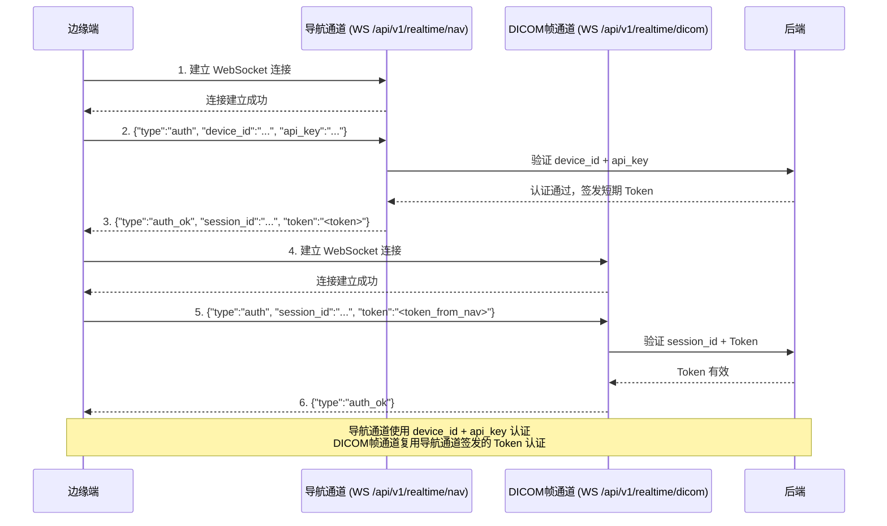

<!--
合并说明（2026-09-28）

本文件 = **原始规格内容**（自 ac87400 恢复，未删除任何章节）+ **代码实证层**（文末附录 A）。

合并原因：本轮重写曾把"去伪存真"误做成"压缩删减"，丢失了大量**没有代码对应物**的领域规格
（分级标准、阈值表、交互规范、术语、环境规格、实施细节、验收标准）。经量化对比，
11 份文档合计从 5928 行压到 2032 行（-66%），其中 06 丢 116 个标题、13 丢 85 个、01 丢 29 个。

修正原则：
1. 原始规格**一字不删**（含已被代码超越的段落——它们记录的是当时的决策与需求，属项目资产）；
2. 代码核验结论作为**附录 A** 追加，不覆盖原文；
3. 冲突处以「⚠️ 现状」就地标注（后续逐节合并），**不以删除代替纠正**。
-->

# 接口规范

## 1. 外部接口

### 1.1 DICOM 影像接入

```
POST /api/v1/imaging/dicom/upload
Content-Type: multipart/form-data

Request:
  - file: DICOM 文件（二进制，≤ 500MB）
  - session_id: 检查会话 ID
  - priority: 0=急诊 | 1=常规 | 2=教学

Response:
{
  "image_id": "img_20260501_001",
  "session_id": "sess_20260501_001",
  "metadata": {
    "patient_id": "P******",
    "modality": "US",
    "body_part": "THYROID",
    "acquisition_date": "2026-05-01T10:30:00Z"
  },
  "status": "accepted"
}
```

**DICOM 一致性声明（Conformance Statement）**：

| 维度 | 规格 | 说明 |
|---|---|---|
| 角色 | Storage SCP（存储服务方）+ Storage SCU（存储请求方） | 边缘端作为 DICOM SCP 接收超声设备推送的影像；后端作为 DICOM SCU 向 PACS 发送影像与结构化报告 |
| SOP Class（SCP） | 1.2.840.10008.5.1.4.1.1.6.1（Ultrasound Multiframe Image Storage） | 边缘端 SCP 接收超声多帧图像 |
| SOP Class（SCP） | 1.2.840.10008.5.1.4.1.1.6（Ultrasound Image Storage） | 边缘端 SCP 接收超声单帧图像 |
| SOP Class（SCP） | 1.2.840.10008.5.1.4.1.1.2（CT Image Storage，仅 Verification） | 边缘端 SCP 支持 Verification SOP Class 验证连接 |
| SOP Class（SCU） | 1.2.840.10008.5.1.4.1.1.6.1（Ultrasound Multiframe Image Storage） | 后端 SCU 向 PACS 发送超声多帧图像 |
| SOP Class（SCU） | 1.2.840.10008.5.1.4.1.1.6（Ultrasound Image Storage） | 后端 SCU 向 PACS 发送超声单帧图像 |
| SOP Class（SCU） | 1.2.840.10008.5.1.4.1.2.1（Patient Root QR Find） | 患者根级查询 |
| SOP Class（SCU） | 1.2.840.10008.5.1.4.1.2.2（Patient Root QR Move） | 患者根级移动 |
| Transfer Syntax | 1.2.840.10008.1.2（Implicit VR Little Endian） | 默认传输语法 |
| Transfer Syntax | 1.2.840.10008.1.2.1（Explicit VR Little Endian） | 显式 VR 传输语法 |
| Transfer Syntax | 1.2.840.10008.1.2.4.70（JPEG Lossless） | 无损压缩传输语法 |
| 必需 DICOM Tag | PatientID, PatientName, StudyInstanceUID, SeriesInstanceUID, SOPInstanceUID, Modality(=US), Rows, Columns, BitsAllocated, PixelData | 影像接入最低必需标签集 |
| 拒绝条件 | Modality ≠ US；缺少 PatientID/StudyInstanceUID/SOPInstanceUID；BitsAllocated > 16 | 非超声影像或标签缺失时拒绝 |

> 此一致性声明须在 NMPA 注册和 IEC 62304 合规文档中引用。完整 Conformance Statement 文档须在开发阶段由质量团队审核确认。

### 1.2 边缘端实时 WebSocket 接口（双连接方案）

边缘端与后端之间建立**双 WebSocket 长连接**，分别传输导航 JSON 消息与 DICOM 二进制帧，彻底消除 HOL（Head-of-Line）阻塞风险：

```
=== 连接 1：导航通道 ===
WS /api/v1/realtime/nav?session_id={session_id}&device_id={device_id}

JSON 文本消息（导航/心跳，opcode=0x01）：

边缘端 → 后端（帧到达通知）：
{
  "type": "frame",
  "frame_id": "frame_20260501_042",
  "frame_index": 42,
  "timestamp": 1714543800
}

后端 → 前端（导航标注结果，经后端安全校验后中转）：
{
  "type": "navigation",
  "frame_id": "frame_20260501_042",
  "annotations": [
    {
      "label": "nodule",
      "confidence": 0.88,
      "threshold": 0.765,
      "bbox": [120, 80, 200, 160]
    }
  ],
  "desensitization_status": "full",
  "timestamp": 1714543800
}

后端 → 边缘端/前端（心跳）：
{
  "type": "ping",
  "timestamp": 1714543800
}

边缘端/前端 → 后端（心跳响应）：
{
  "type": "pong",
  "timestamp": 1714543800
}

=== 连接 2：DICOM 帧通道 ===
WS /api/v1/realtime/dicom?session_id={session_id}&device_id={device_id}

二进制帧消息（DICOM 帧，opcode=0x02）：
[4B frame_index（小端序，little-endian）][1B flags (bit0: is_key_frame, bit1: priority)][4B dicom_data_length（小端序）][N bytes DICOM binary data][4B CRC32（小端序）]

> **字节序约定**：所有二进制帧中的多字节整数字段统一使用**小端序（little-endian）**，与 x86/ARM 架构原生字节序一致，避免跨平台字节序转换开销。边缘端（ARM Jetson）与后端（x86 服务器）均原生支持小端序，无需转换。

**DICOM 帧通道认证机制**：DICOM 帧通道复用导航通道的认证结果——导航通道认证成功后，后端签发短期会话 Token（有效期与导航通道认证一致），DICOM 帧通道使用该 Token 在首条消息中认证。认证流程：连接建立后 5 秒内发送 `{"type": "auth", "session_id": "<session_id>", "token": "<token_from_nav_channel>"}`，后端验证 Token 有效性后返回 `{"type": "auth_ok"}`；失败关闭连接（关闭码 4001）；超时关闭连接（关闭码 4002）。**禁止通过 URL query 参数传递 Token**。此设计避免用户在两个连接上分别输入凭证，同时确保 DICOM 帧通道的认证安全性。

**双 WebSocket 连接认证流程**：


```

帧索引编号规则：frame_index 从 0 开始（编程惯例），与 DICOM 标准（帧编号从 1 开始）不同。
边缘端上报时须将 DICOM 帧编号减 1 转换为 0-based 索引。**防误校验**：后端接口层须校验 frame_index ≥ 0，负值拒绝并返回 E1001（参数错误）。导航标注结果中须同时包含 `frame_index`（0-based 整数）与 `frame_id`（字符串，格式 `frame_{timestamp}_{index}`），避免纯数字索引的偏移歧义。前端展示时使用 `frame_id` 关联，不依赖 `frame_index` 数值。

**WebSocket 扩展消息类型定义**（导航通道推送）：

除上述基础消息类型（frame、navigation、ping/pong、auth/auth_ok）外，导航通道还承载以下扩展推送消息：

| 消息类型 | 方向 | 触发场景 | JSON 结构 |
|---|---|---|---|
| `diagnosis_result` | 后端→前端 | 诊断完成时推送通知 | `{"type":"diagnosis_result", "request_id":"req_...", "timestamp":...}` |
| `session_terminated` | 后端→前端 | 会话被终止（知识库更新/管理员操作） | `{"type":"session_terminated", "reason":"...", "affected_organs":[...], "kb_version":"...", "timestamp":...}` |
| `navigation_revocation` | 后端→前端 | 安全校验未通过，撤销已推送的导航标注 | `{"type":"navigation_revocation", "frame_id":"...", "reason":"...", "timestamp":...}` |
| `reconnect_ack` | 后端→前端 | 客户端重连后确认会话状态 | `{"type":"reconnect_ack", "session_id":"...", "session_ttl_remaining_ms":..., "timestamp":...}` |
| `error` | 后端→前端 | 通道级错误通知 | `{"type":"error", "error_code":"E1xxx", "error_message":"...", "timestamp":...}` |

| 维度 | 规格 |
|---|---|
| 传输方式 | 导航通道：WebSocket 文本帧（opcode=0x01，导航/心跳 JSON）；DICOM 通道：WebSocket 二进制帧（opcode=0x02，DICOM 数据）。双连接彻底消除 HOL 阻塞 |
| DICOM 编解码开销 | 无 base64 编解码，体积无膨胀（base64 膨胀约 33%，编码延迟约 3-5ms/帧） |
| **zstd 无损压缩** | **可选**：边缘端与后端在 WebSocket 握手阶段协商是否启用 zstd 压缩（握手参数 `X-Compression: zstd`）。启用后，DICOM 二进制帧在传输前经 zstd 无损压缩（压缩级别 3，平衡压缩率与 CPU 开销），后端接收后解压。针对 512×512 超声大帧，zstd 可降低 20-30% 传输体积，压缩/解压延迟 < 1ms/帧（远小于节省的传输时间）。**无损压缩完全不影响诊断精度**。老旧边缘端不支持 zstd 时回退至无压缩模式（不发送 `X-Compression` 参数） |
| 帧大小分级策略 | 小帧（≤ 64KB）：可兼容 base64+HTTP 传输；大帧（> 64KB）：强制使用 WebSocket 二进制传输 |
| 位深动态适配 | 边缘端根据网络带宽自动调整 DICOM 帧位深（8bit/16bit），带宽充足时传输 16bit 原始数据，带宽受限时降级为 8bit（前端标注"图像精度降级"） |
| DICOM 帧缓存 | 边缘端缓存最近 90 帧已上传的 DICOM 数据（约 45-90MB，在边缘端 8GB RAM 中仅占约 1%），后端请求重传时直接从缓存读取，避免重复编码上传。**重传范围限制**：后端重传请求的帧索引范围不超过最近 90 帧（DICOM 帧缓存容量限制，30fps 下覆盖约 3 秒窗口，与导航帧缓冲区容量对齐），超出范围的帧索引返回 E1001（参数错误）。**容量设计理由**：90 帧覆盖约 3 秒窗口，可覆盖后端短暂不可达后重传丢失帧、医生回看操作、网络抖动导致多帧丢失等场景，与 [01-系统架构设计](01-系统架构设计.md) §1 帧缓冲存储规格一致 |
| CRC32 校验 | 二进制帧末尾包含 4B CRC32 校验和，后端接收后校验帧数据完整性。校验失败丢弃该帧并请求重传（从 30 帧 DICOM 帧缓存中读取），确保医疗影像传输中位翻转导致的图像伪影可被检测 |
| 连接认证 | 首条消息认证：连接建立后 5 秒内发送 `{"type": "auth", "device_id": "<device_id>", "api_key": "<api_key>"}`，后端验证通过返回 `{"type": "auth_ok"}`；失败关闭连接（关闭码 4001）；超时关闭连接（关闭码 4002）。**禁止通过 URL query 参数传递 API Key** |
| 心跳间隔 | 5s，连续 3 次无 pong 响应判定连接断开 |
| 重连策略 | 指数退避（1s → 2s → 4s → 8s → 最大 30s），重连后自动恢复导航 |
| 低置信度处理 | `confidence < threshold` 时 `annotations` 为空数组，前端提示"建议启动标准评估" |

> **双连接设计理由**：导航 JSON 消息与 DICOM 二进制帧使用独立 WebSocket 连接，彻底消除 HOL（Head-of-Line）阻塞——大帧传输不会阻塞导航标注推送，导航心跳也不会被帧数据干扰。两个连接共享同一 `session_id`，后端通过 `frame_id` / `frame_index` 关联导航标注与 DICOM 帧。**Gate 0 双方案并行压测**：作为强制准入指标，同时验证 base64+HTTP 与 WebSocket 双连接方案的端到端延迟——若 base64+HTTP 无法稳定 ≤ 5ms 编解码延迟，则一期直接启用 WebSocket 双连接为主方案，不延期至二期。

> **超声设备↔边缘端通信**：本节定义边缘端↔后端通信规范。超声设备↔边缘端通过 DICOM 3.0 协议通信（边缘端作为 DICOM SCP 接收超声设备推送），详见 [01-系统架构设计](01-系统架构设计.md) §1 超声设备↔边缘端通信规范。

**兼容方案：base64 + HTTP**（仅用于不支持 WebSocket 二进制帧的旧设备或调试场景）：

```
POST /api/v1/imaging/dicom/stream
Content-Type: application/json

Request:
{
  "session_id": "sess_20260501_001",
  "frame_data": "<base64 encoded DICOM frame>",
  "frame_index": 42,
  "is_key_frame": true,
  "priority": 1
}

Response:
{
  "session_id": "sess_20260501_001",
  "frame_id": "frame_20260501_042",
  "navigation_hint": {
    "available": true,
    "confidence": 0.88,
    "threshold": 0.765
  },
  "status": "accepted"
}
```

> 流式接口用于实时导航场景，边缘端逐帧推送。导航结果通过统一 WebSocket 连接实时返回，不走此 HTTP 响应。

### 1.3 诊断请求接口

```
POST /api/v1/diagnosis/request
Content-Type: application/json
X-Priority: 0 | 1 | 2

Request:
{
  "session_id": "sess_20260501_001",
  "image_ids": ["img_20260501_001"],
  "clinical_text": "甲状腺右叶低回声结节",
  "voice_text": null,
  "target_organ": "thyroid",
  "response_tier": "full",
  "patient_context": {
    "age": 45,
    "gender": "F",
    "relevant_history": "甲状腺结节随访"
  },
  "retry": false,
  "idempotency_key": "idem_20260501_001_thyroid_1"
}

Response:
{
  "request_id": "req_20260501_001",
  "session_id": "sess_20260501_001",
  "status": "processing",
  "estimated_time_ms": 3000,
  "response_tier": "full"
}
```

> `patient_context.age`：整数年龄（由前端从 HIS 获取出生日期后计算），属于诊断必需的临床信息（如 TI-RADS 分级考虑年龄因素），不属于直接标识符，无需脱敏。完整出生日期不通过此字段传递（出生日期脱敏规则详见 [04-安全合规](04-安全合规.md) §2）。

> `response_tier`：`realtime`（快速路径）、`standard`（标准路径）、`full`（全量路径），默认 `full`。`retry=true` 时仅执行 1 次生成+质检，不执行 Self-RAG 重试（Self-RAG 最多 2 次重试，即总共 3 次生成；retry 模式跳过重试仅做 1 次生成+质检，与 [02-核心流程与知识库](02-核心流程与知识库.md) §2.1 Self-RAG 重试定义一致）。**幂等性**：`idempotency_key` 为客户端生成的唯一标识（建议格式：`idem_{timestamp}_{organ}_{sequence}`），服务端在诊断结果缓存有效期内（10 分钟）对相同 `idempotency_key` 的请求返回已有结果而不创建新任务，防止医生误操作（双击、语音指令重复触发等）产生重复诊断任务浪费 GPU 资源。幂等窗口与诊断结果缓存时间一致，确保多器官联合诊断（端到端可达 3 分钟）期间重复请求不会创建新任务。`idempotency_key` 为可选字段，不提供时每次请求均创建新任务。

### 1.4 诊断结果获取接口

```
GET /api/v1/diagnosis/result/{request_id}

Response:
{
  "request_id": "req_20260501_001",
  "status": "completed",
  "consistency_flag": "consistent",
  "desensitization_status": "full",
  "consent_status_at_output": "granted",
  "fusion_status": "normal",
  "diagnosis": { ... },
  "evidence": { ... },
  "quality_control": { ... },
  "requires_manual_review": false,
  "review_reason": null,
  "ai_diagnosis_failed": false,
  "hallucination_severity": null,
  "version_compatibility": "compatible",
  "processing_time_ms": 2800,
  "model_version": "thyroid_v2.1.0",
  "knowledge_base_version": "kb_v3.2.1"
}
```

> `hallucination_severity`：取值枚举为 `null | "severe" | "moderate" | "mild"`。一期固定为 `null`，二期幻觉率二维监控矩阵启用后赋值。字段定义与 [01-系统架构设计](01-系统架构设计.md) §3.5 融合输出结构一致。

> `desensitization_status`：`full`（完整脱敏）/ `degraded`（降级脱敏），前端据此决定是否展示安全警告。`consent_status_at_output`：SafetyGateway 输出前直查 PostgreSQL 获取的同意状态快照（`granted` / `withdrawn`），前端据此决定是否展示诊断结论区域，无需额外调用 `GET /api/v1/consent/{patient_id}`（详见 [01-系统架构设计](01-系统架构设计.md) §3.4 输出前同步同意状态校验）。`fusion_status`：`normal`（正常融合）/ `bypassed`（融合层跳过），`bypassed` 时前端须显示"融合校验缺失，请人工核验"。字段定义与 [01-系统架构设计](01-系统架构设计.md) 3.5 节融合输出结构一致。

**诊断结果通知机制**：

| 维度 | 方案 |
|---|---|
| 轮询策略 | 首次 1s 后轮询，后续每 2s 轮询一次，最大等待 30s |
| 超时处理 | 超时后返回 `status: timeout`，建议前端显示"诊断超时，请稍后重试" |
| 结果缓存 | 诊断结果在服务端缓存 10 分钟，超时后可继续轮询获取 |

> **推送与轮询优先级**：诊断结果通知通过后端实时通信通道 WebSocket 连接（`/api/v1/realtime/nav`）推送至前端（消息类型 `diagnosis_result`），前端收到推送后调用诊断结果获取接口拉取完整结果。**该通道承载所有后端→前端的实时推送消息**（导航标注、校验结果、诊断结果通知、安全事件通知、监控告警），命名为"实时通信通道"以明确其多业务域职责（与 [01-系统架构设计](01-系统架构设计.md) §1 WebSocket 连接设计对齐）。HTTP 轮询为降级方案——仅当 WebSocket 连接断开或浏览器不支持 WebSocket 时使用。前端须同时实现两种机制，WebSocket 连接正常时以推送为主，轮询为辅（作为推送丢失的兜底检测，每 **2s** 轮询一次检查是否有未接收的结果，与诊断结果获取接口的轮询策略一致）。轮询间隔从 10s 缩短至 2s，确保诊断已完成但医生因 WebSocket 断开而不知情的等待时间最小化。

### 1.5 反馈提交接口

```
POST /api/v1/feedback
Content-Type: application/json

Request:
{
  "request_id": "req_20260501_001",
  "session_id": "sess_20260501_001",
  "feedback_type": "correction | supplement | new_knowledge | rule_change",
  "feedback_level": "L2 | L3",
  "content": {
    "field": "分级",
    "original_value": "TI-RADS 4b",
    "corrected_value": "TI-RADS 4a",
    "reason": "边界尚清，不符合4b标准"
  },
  "reviewer_id": "dr_zhang_001"
}
```

> `rule_change` 强制走 L3。术语映射修正走 L2。

## 2. HL7 FHIR 标准化接口

| FHIR 资源 | 对应接口 | 用途 |
|---|---|---|
| Patient | `GET /fhir/Patient/{id}` | 患者基本信息查询 |
| ImagingStudy | `POST /fhir/ImagingStudy` | 影像检查数据交换 |
| DiagnosticReport | `GET /fhir/DiagnosticReport/{id}` | 诊断报告查询与交换 |
| Observation | `GET /fhir/Observation?based-on={request_id}` | 诊断观察结果查询 |

> FHIR Adapter 一期实现为 FastAPI 子模块（router），与主服务同进程部署。compact Profile 下可选（基层 HIS 不支持 FHIR 时不部署，报告推送替代方案详见 [02-核心流程与知识库](02-核心流程与知识库.md) §5.6）。

## 3. 内部接口

> **一期实现方式**：以下接口定义的是逻辑协议与数据契约。一期三器官在单进程内运行，通过进程内 Protocol/ABC 函数调用实现，接口签名与 gRPC stub 保持一致。二期拆分独立进程时，仅替换通信层（进程内调用 → gRPC stub），接口定义与业务逻辑无需变更。详见 [01-系统架构设计](01-系统架构设计.md) 5.3 节。

| 接口 | 通信模式 | 调用方 | 被调用方 | 说明 |
|---|---|---|---|---|
| `DispatchTask` | gRPC | 中央调度 | 专科智能体 | 分配诊断任务 |
| `RequestEvidence` | gRPC | 专科智能体 | 知识查询智能体 | 请求知识依据 |
| `RequestCRAGRetrieval` | gRPC | 中央调度智能体 | 知识查询智能体 | CRAG 补充检索请求——Self-RAG 质检失败原因为"无依据"或"依据不足"时，质检模块向中央调度智能体发送补充检索请求，中央调度统一路由至知识查询智能体执行 CRAG 补充检索（与 02-核心流程 §2.1 一致，中间路由由中央调度智能体统一管理，保持检索逻辑的单一入口与一致性，同时确保中央调度具备全局视野可进行负载均衡和优先级调度）。请求中携带原始查询、已有依据列表、失败原因、补充检索方向。知识查询智能体根据补充检索方向执行定向检索，返回补充依据列表 |
| `SubmitDiagnosis` | gRPC | 专科智能体 | 融合层 | 提交诊断结果 |
| `SubmitEvidence` | gRPC | 知识查询智能体 | 融合层 | 提交原始依据 |
| `HealthCheck` | gRPC | 备用调度 | 主调度 | 心跳检测 |
| `ReportProgress` | Redis Streams | 专科智能体 | 流程监控智能体 | 异步上报进度 |
| `AlertMissing` | Redis Streams | 流程监控智能体 | 中央调度 | 异步通知漏项 |
| `KnowledgeUpdated` | Redis Streams | 知识库管理 | 所有智能体 | 异步广播知识库更新 |

## 4. 统一错误响应格式

```json
{
  "error_code": "E2001",
  "error_message": "知识库检索超时",
  "detail": "CRAG 补充检索后仍无充分依据",
  "request_id": "req_20260501_001",
  "suggestion": "建议人工评估",
  "retryable": false,
  "retry_strategy": "no_retry"
}
```

**错误码体系**：

| 错误码范围 | 类别 | 示例 |
|---|---|---|
| E1xxx | 客户端错误 | E1001：缺少必填参数；E1004：DICOM 文件格式错误；E1006：对抗性输入；E1007：请求限流；E1008：患者未签署知情同意书；E1009：重试次数超限；E1010：患者已撤回 AI 辅助诊断知情同意；E1011：检查类型不支持（Modality 非 US）；E1012：必需 DICOM Tag 缺失 |
| E2xxx | 服务端错误 | E2001：知识库检索超时；E2002：模型推理失败；E2003：融合层不可用；E2004：诊断请求队列已满；E2004A：系统排队已满（排队深度已达并发上限的 2 倍，拒绝创建新会话）；E2004B：用户排队配额超限（单用户同时排队等待的诊断请求数超过 `MAX_QUEUED_REQUESTS_PER_USER`，默认 2 个）；E2006：检索无结果/依据不足；E2007：模型热重载维护中（compact 模式 GPU 热重载期间新请求排队等待） |
| E3xxx | 医疗安全错误 | E3001：置信度低于阈值；E3002：三重校验不通过；E3003：Self-RAG 质检失败；E3004：专科结论与依据矛盾；E3005：专科结论与依据部分一致 |
| E4xxx | 基础设施/边缘端错误 | E4001：边缘端调度不可达；E4002：边缘端导航模型加载失败；E4003：脱敏校验服务超时；E4004：知识库 major 版本不兼容；E4005：安全校验服务不可用（SafetyGateway 不可用或 PostgreSQL 不可用导致 SafetyGateway 无法获取同意状态）；E4005A：SafetyGateway 不可用（健康检查连续失败）；E4005B：PostgreSQL 不可用（SafetyGateway 无法获取同意状态且 Redis 只读缓存未命中）；E4005C：SafetyGateway + 融合层同时不可用（组合故障）；E4006：知识库安全更新，在途诊断已取消；E4008：Redis 不可用导致新会话创建延迟增加（PostgreSQL 替代 Redis 写入）；E4009：PostgreSQL 写超时，系统只读模式；E4010：设备已隔离（API Key 已吊销，设备须通过恢复流程重新获取 API Key，详见 [01-系统架构设计](01-系统架构设计.md) §2.2）；E4012：检索服务降级超过 4 小时，AI 诊断暂停（详见 [01-系统架构设计](01-系统架构设计.md) §5.5 BM25 终极兜底最大持续时间 SLA） |

**重试策略字段**：

| `retryable` | `retry_strategy` | 适用场景 |
|---|---|---|
| true | `retry_after_5s` | 临时性服务端错误（如推理超时） |
| true | `retry_with_fallback` | 降级后可重试（如融合层不可用，重试走轻量脱敏路径） |
| false | `no_retry` | 客户端错误、医疗安全错误、不兼容错误 |

**异常场景与错误码映射**：

| 异常场景 | 输出标记 | 错误码 | HTTP 状态码 | 前端处理 |
|---|---|---|---|---|
| 检索无结果 | `evidence_insufficient` | E2001 | 200 | 仅展示描述性结论 |
| 三重校验不通过 | `validation_failed` | E3002 | 200 | 降级诊断 + 强制人工复核 |
| Self-RAG 质检失败 | `generation_unreliable` | E3003 | 200 | 禁用诊断 UI，显示警告横幅 |
| 置信度低于阈值 | `low_confidence` | E3001 | 200 | 拒绝输出诊断 |
| 专科结论与依据矛盾 | `contradictory` | E3004 | 200 | 诊断降级 + 强制人工复核 |
| 专科结论与依据部分一致 | `partial_consistent` | E3005 | 200 | 按偏差容忍度处理，建议人工复核 |
| 融合层不可用 | `fusion_bypassed` | E2003 | 200 | 标记"融合校验缺失" |
| 知识库版本不兼容 | — | E4004 | 503 | 前端拒绝展示 |
| PostgreSQL 写超时 | — | E4009 | 503 | 提示"系统暂时只读，请稍后重试" |
| 患者未签署知情同意 | — | E1008 | 403 | 隐藏 AI 诊断入口 |

> 降级场景返回 HTTP 200 是因为系统在降级后仍成功输出了诊断结果（只是缺少部分校验），客户端通过响应体字段感知降级状态。

## 5. 管理与设备接口

### 5.1 患者知情同意接口

```
GET /api/v1/consent/{patient_id}

Response:
{
  "patient_id": "P******",
  "consent_status": "granted | denied | withdrawn | pending",
  "consented_at": "2026-05-01T10:00:00Z",
  "withdrawn_at": null,
  "consent_version": "1.0"
}
```

```
POST /api/v1/consent
Content-Type: application/json

Request:
{
  "patient_id": "P******",
  "action": "grant | withdraw",
  "consent_version": "1.0",
  "operator_id": "dr_zhang_001"
}

Response:
{
  "patient_id": "P******",
  "consent_status": "granted | withdrawn",
  "updated_at": "2026-05-01T10:00:00Z"
}
```

> 同意状态以 PostgreSQL 为主存储（仅写 PostgreSQL，**取消 Redis 双写**），查询直走 PostgreSQL（P99 < 50ms），详见 [01-系统架构设计](01-系统架构设计.md) §4。`consent_status` 扩展状态定义：`granted`（已签署同意）、`denied`（无同意记录或明确拒绝）、`withdrawn`（已撤回同意）、`pending`（同意书已提交但尚未完成审批，为规范扩展状态，用于审批流程场景）。

### 5.2 语音指令确认接口

```
POST /api/v1/voice/confirm
Content-Type: application/json

Request:
{
  "session_id": "sess_20260501_001",
  "transcript": "评估右叶结节",
  "command_type": "diagnosis_trigger | grade_change | navigation_control",
  "confirmed": true,
  "timestamp": 1714543800
}

Response:
{
  "session_id": "sess_20260501_001",
  "executed": true,
  "action_taken": "diagnosis_request_submitted",
  "request_id": "req_20260501_001"
}
```

> 仅诊断触发（`diagnosis_trigger`）和分级变更（`grade_change`）类指令需确认，导航控制类指令无需确认直接执行。详见 [08-前端交互](08-前端交互与使用指南.md) §2.1。

### 5.3 设备管理接口

```
POST /api/v1/admin/device/register
Content-Type: application/json

Request:
{
  "device_name": "edge-gpu-01",
  "device_type": "jetson_orin_nx",
  "location": "超声科1号检查室",
  "jetpack_version": "6.0"
}

Response:
{
  "device_id": "dev_20260501_001",
  "api_key": "ak_xxxxxxxxxxxxxxxx",
  "status": "active"
}
```

```
POST /api/v1/admin/device/{device_id}/deregister

Response:
{
  "device_id": "dev_20260501_001",
  "status": "deregistered",
  "api_key_revoked": true
}
```

```
POST /api/v1/admin/device/{device_id}/recovery
Content-Type: application/json

Request:
{
  "recovery_method": "on_site | remote",
  "operator_id": "admin_001"
}

Response:
{
  "device_id": "dev_20260501_001",
  "recovery_token": "rt_xxxxxxxxxxxxxxxx",
  "expires_at": "2026-05-01T12:00:00Z"
}
```

```
POST /api/v1/admin/device/{device_id}/remote-recovery
Content-Type: application/json

Request:
{
  "operator_id": "admin_001"
}

Response:
{
  "device_id": "dev_20260501_001",
  "new_api_key": "ak_yyyyyyyyyyyyyyyy",
  "expires_at": "2026-05-02T10:00:00Z"
}
```

> 设备注销后设备 ID 永久不可重用，API Key 立即吊销。隔离设备恢复流程详见 [01-系统架构设计](01-系统架构设计.md) §2.2。

**边缘端本地管理界面**（仅限 `https://localhost:8443/admin/`，安全规范详见 [01-系统架构设计](01-系统架构设计.md) §2.2）：

```
POST /admin/key-update
Content-Type: application/json
（仅限 https://localhost:8443，须设备级管理员凭证认证）

Request:
{
  "new_api_key": "ak_yyyyyyyyyyyyyyyy",
  "admin_credentials": "<TPM-stored credential>"
}

Response:
{
  "updated": true,
  "valid_at": "2026-05-01T12:00:00Z"
}
```

> 此接口仅限边缘端本地访问（localhost 绑定），不暴露至局域网。所有访问与操作记录至边缘端审计日志。

### 5.4 报告推送管理接口

```
POST /api/v1/admin/report/{report_id}/retry-push

Response:
{
  "report_id": "rpt_20260501_001",
  "push_status": "pushed | failed",
  "push_method": "fhir | hl7v2 | db_direct | file_exchange",
  "pushed_at": "2026-05-01T11:00:00Z"
}
```

### 5.5 告警联系人管理接口

```
PUT /api/v1/admin/alert-contacts
Content-Type: application/json

Request:
{
  "contacts": [
    {
      "name": "张工",
      "role": "基层IT",
      "phone": "138xxxx1234",
      "email": "zhang@hospital.cn"
    },
    {
      "name": "李工",
      "role": "上级医院运维",
      "phone": "139xxxx5678",
      "email": "li@upper-hospital.cn"
    }
  ],
  "quality_control_center": {
    "name": "区域医疗质控中心",
    "phone": "010-xxxxxxxx",
    "email": "qc@region.cn"
  }
}

Response:
{
  "updated": true,
  "verification_sent": true,
  "verification_status": "pending"
}
```

> 更新后自动发送测试告警验证推送可达性，验证失败回滚至旧配置并触发 Warning 告警。详见 [05-可观测性与运维](05-可观测性与运维.md) §2。

## 6. API 版本管理

| 规则 | 说明 |
|---|---|
| 版本格式 | `/api/v{major}/` |
| 兼容承诺 | 同一 major 版本内向后兼容，至少支持 2 个 major 版本 |
| 废弃流程 | 废弃前 90 天通知，废弃后 180 天仍可用但标记 deprecated |
| HIS 对接 | 与医院信息科协商锁定 API 版本 |

## 7. API 限流

| 维度 | 方案 |
|---|---|
| 限流算法 | 令牌桶算法，按客户端 IP + 用户 ID 组合限流 |
| 限流规则 | 诊断请求：10 次/分钟/用户（多器官联合诊断计为 1 次，不按器官数累加；重试请求 `retry=true` 不计入限流）；影像上传：30 次/分钟/用户；反馈提交：20 次/分钟/用户；FHIR 接口：60 次/分钟/用户 |
| 超限响应 | HTTP 429，错误码 E1007，响应头含 `Retry-After` |
| 豁免机制 | 急诊优先级（`X-Priority: 0`）限流阈值提高至 5 倍（诊断请求 50 次/分钟/用户）。**Profile 关联约束**：compact 模式下 GPU 仅支持 2 并发推理，急诊豁免倍数自动降至 2 倍（诊断请求 20 次/分钟/用户），避免大量排队请求挤占 GPU 资源导致其他患者诊断阻塞。full 模式下维持 5 倍豁免。豁免倍数通过配置项 `RATE_LIMIT_EMERGENCY_MULTIPLIER` 控制（compact 默认 2，full 默认 5） |

## 8. 统一枚举定义

### 8.1 会话状态枚举

以下枚举为全系统唯一权威定义，与 [00a-术语表](00a-术语表.md) §13 及 [02-核心流程与知识库](02-核心流程与知识库.md) §1.3 统一。

| 状态值 | 说明 |
|--------|------|
| `pending` | 会话已创建，等待开始 |
| `active` | 会话正在进行中（含部分器官诊断） |
| `partial` | 部分器官诊断完成 |
| `completed` | 所有器官诊断完成 |
| `needs_review` | 会话因 safety_critical 更新终止，已完成结论需复审 |
| `failed` | 会话失败，AI 不可用 |
| `terminated` | 会话因安全更新等原因被终止 |

### 8.2 器官状态枚举

以下枚举为全系统唯一权威定义，与 [00a-术语表](00a-术语表.md) §14 及 [02-核心流程与知识库](02-核心流程与知识库.md) §1.3 统一。

| 状态值 | 说明 |
|--------|------|
| `pending` | 器官尚未进行诊断 |
| `in_progress` | 器官诊断正在处理 |
| `completed` | 器官诊断已完成 |
| `failed` | 器官诊断失败，AI 不可用 |
| `skipped` | 跳过该器官诊断 |
| `needs_review` | 器官诊断已完成但基于旧版知识库 |

### 8.3 WebSocket 路径统一定义

以下路径为全系统唯一权威定义，与 [00b-统一配置参考手册](00b-统一配置参考手册.md) §12 统一。

| 通道 | 路径 | 说明 |
|------|------|------|
| 后端实时通信通道 | `/api/v1/realtime/nav` | 接收导航标注、诊断结果、告警通知 |
| 后端 DICOM 帧通道 | `/api/v1/realtime/dicom` | 传输 DICOM 图像帧 |
| 边缘端导航通道（二期） | `/ws/v1/nav` | 边缘端直推导航标注 |

### 8.4 核心数据库表结构定义

以下表结构为全系统唯一权威定义，与 [01-系统架构设计](01-系统架构设计.md) §4 数据存储策略统一。

**sessions 表**（会话状态主存储）：

| 字段名 | 类型 | 约束 | 说明 |
|---|---|---|---|
| `session_id` | VARCHAR(64) | PK | 会话唯一标识，格式 `sess_{YYYYMMDD}_{seq}` |
| `patient_id` | VARCHAR(64) | NOT NULL | 患者标识（脱敏后） |
| `device_id` | VARCHAR(64) | NOT NULL | 边缘端设备标识 |
| `status` | VARCHAR(32) | NOT NULL | 会话状态枚举（见 §8.1） |
| `target_organs` | JSONB | NOT NULL | 目标器官列表，如 `["thyroid","liver"]` |
| `organ_statuses` | JSONB | NOT NULL | 各器官状态，如 `{"thyroid":"completed","liver":"processing"}` |
| `knowledge_base_version` | VARCHAR(32) | NOT NULL | 会话锁定的知识库版本号 |
| `created_at` | TIMESTAMPTZ | NOT NULL, DEFAULT NOW() | 创建时间 |
| `updated_at` | TIMESTAMPTZ | NOT NULL | 最后更新时间 |
| `expired_at` | TIMESTAMPTZ | | 过期时间（TTL 续期更新） |
| `consent_status_at_creation` | VARCHAR(16) | NOT NULL | 创建时同意状态快照 |

**consent_records 表**（知情同意状态权威源）：

| 字段名 | 类型 | 约束 | 说明 |
|---|---|---|---|
| `record_id` | BIGSERIAL | PK | 记录唯一标识 |
| `patient_id` | VARCHAR(64) | NOT NULL, IDX | 患者标识 |
| `status` | VARCHAR(16) | NOT NULL | 同意状态：`granted` / `withdrawn` |
| `granted_at` | TIMESTAMPTZ | | 签署时间 |
| `withdrawn_at` | TIMESTAMPTZ | | 撤回时间 |
| `consent_version` | VARCHAR(16) | NOT NULL | 知情同意书版本号 |
| `created_at` | TIMESTAMPTZ | NOT NULL, DEFAULT NOW() | 记录创建时间 |

**safety_events 表**（安全关键事件权威源）：

| 字段名 | 类型 | 约束 | 说明 |
|---|---|---|---|
| `event_id` | BIGSERIAL | PK | 事件唯一标识 |
| `event_type` | VARCHAR(64) | NOT NULL, IDX | 事件类型：`KnowledgeUpdated` / `ConsentWithdrawn` / `DeviceIsolated` 等 |
| `severity` | VARCHAR(16) | NOT NULL | 严重程度：`safety_critical` / `important` / `routine` |
| `kb_version` | VARCHAR(32) | | 关联知识库版本号（KnowledgeUpdated 事件） |
| `device_id` | VARCHAR(64) | | 关联设备标识（DeviceIsolated 事件） |
| `patient_id` | VARCHAR(64) | | 关联患者标识（ConsentWithdrawn 事件） |
| `payload` | JSONB | | 事件详情 |
| `created_at` | TIMESTAMPTZ | NOT NULL, DEFAULT NOW() | 事件创建时间 |
| `acknowledged` | BOOLEAN | DEFAULT FALSE | 是否已 ACK |

**audit_logs 表**（审计日志）：

| 字段名 | 类型 | 约束 | 说明 |
|---|---|---|---|
| `log_id` | BIGSERIAL | PK | 日志唯一标识 |
| `session_id` | VARCHAR(64) | IDX | 关联会话标识 |
| `action` | VARCHAR(64) | NOT NULL, IDX | 操作类型 |
| `actor` | VARCHAR(64) | NOT NULL | 操作者（system / doctor_id / device_id） |
| `target_type` | VARCHAR(32) | | 操作对象类型 |
| `target_id` | VARCHAR(64) | | 操作对象标识 |
| `detail` | JSONB | | 操作详情 |
| `hash_prev` | VARCHAR(64) | | 前一条日志哈希（哈希链防篡改） |
| `hash_self` | VARCHAR(64) | NOT NULL | 本条日志哈希 |
| `created_at` | TIMESTAMPTZ | NOT NULL, DEFAULT NOW() | 操作时间 |

> **索引策略**：`sessions` 表按 `session_id` 主键查询；`consent_records` 表按 `patient_id` + `status` 组合索引；`safety_events` 表按 `event_type` + `created_at` 组合索引；`audit_logs` 表按 `session_id` + `created_at` 组合索引。**数据保留策略**：诊断日志门诊 15 年 / 住院 30 年，修改日志 30 年，操作/访问日志 5 年，审计日志门诊 15 年 / 住院 30 年，与 [04-安全合规](04-安全合规.md) §3 数据保留策略统一。**存储位置差异**：`audit_logs` 表 full 模式使用 Elasticsearch，compact 模式使用 PostgreSQL，冷归档使用对象存储，与 [04-安全合规](04-安全合规.md) §3 一致。

**sessions_archive 表**（合规归档存储）：

| 字段名 | 类型 | 约束 | 说明 |
|---|---|---|---|
| `session_id` | VARCHAR(64) | PK | 原会话唯一标识 |
| `patient_id` | VARCHAR(64) | NOT NULL | 患者标识（脱敏后） |
| `device_id` | VARCHAR(64) | NOT NULL | 边缘端设备标识 |
| `status` | VARCHAR(32) | NOT NULL | 会话最终状态 |
| `target_organs` | JSONB | NOT NULL | 目标器官列表 |
| `organ_statuses` | JSONB | NOT NULL | 各器官最终状态 |
| `knowledge_base_version` | VARCHAR(32) | NOT NULL | 会话锁定的知识库版本号 |
| `consent_status_at_creation` | VARCHAR(16) | NOT NULL | 创建时同意状态快照 |
| `archive_timestamp` | TIMESTAMPTZ | NOT NULL | 归档时间（温存储转合规归档的标记） |
| `created_at` | TIMESTAMPTZ | NOT NULL | 原创建时间 |
| `archived_at` | TIMESTAMPTZ | NOT NULL, DEFAULT NOW() | 归档操作时间 |

> **归档策略**：`sessions` 表中超过 7 天的会话记录迁移至 `sessions_archive` 表（温存储转合规归档），与 [01-系统架构设计](01-系统架构设计.md) §4 会话状态三阶段模型一致。归档后 `sessions` 表仅保留 7 天内活跃会话，确保热查询性能。

---

## 附录 A：代码实证层（2026-09-28 核验）

> 本附录由 2026-09-28 的代码逐条核对产出，与上文原始规格**并存**。
> 凡与上文冲突处，**以本附录为准**，但上文内容保留（记录原始需求与决策）。

## 接口规范

> **最后核对：2026-09-28｜核对方式：代码逐条核对（路由定义、Pydantic 模型、错误码注册表、限流配置）**
>
> **本文档是接口契约的唯一来源。** 旧版为计划态清单，本版全部替换为**代码中真实存在的接口**；
> 凡代码中无法验证的一律标注"未确认"。接口变更必须同步更新本文档与 §6 的契约守卫。

## 1. 通用约定

| 项 | 约定 | 出处 |
|---|---|---|
| 前缀 | `/api/v1/*` 为主；FHIR 独立在 `/fhir/*` | `app/main.py:534-550` |
| 认证 | `Authorization: Bearer <JWT>`；**除标注"公开"外一律 JWT 必需** | `app/security/auth.py:108` |
| 算法 | **强制 RS256**（`field_validator` 拒绝 HS256），默认 `jwt_expire_minutes=480` | `config/settings.py:58-70` |
| 统一错误体 | `ErrorResponse{error_code, error_message, detail?, request_id?, suggestion?, retryable=False, retry_strategy="no_retry"}` | `app/models/schemas.py:167` |
| 异常处理器 | `AppBaseException` / `StarletteHTTPException` / `Exception` 三条 | `app/main.py:552-554` |
| CORS | `allowed_origins`（逗号分隔）+ `allow_credentials=True`；方法 GET/POST/PUT/DELETE/OPTIONS；头 `Content-Type/Authorization/X-Requested-With/X-Priority` | `app/main.py:514-522` |
| 安全响应头 | `SecurityHeadersMiddleware`（CSP `csp_policy`、HSTS `hsts_*` 默认关） | `app/main.py:527-532` |
| 幂等 | `diagnosis/request` 与 `feedback` 支持幂等键（命中返回 `X-Idempotent-Replay: true`） | `api/v1/diagnosis.py:168-192`、`feedback.py:24,37-45` |
| 分页 | **无统一约定**（仅个别端点有局部 `limit`，见下） | 全仓检索确认 |
| 上传上限 | DICOM 文件 `dicom_storage_max_file_size=524288000`；WS 单帧 `MAX_DICOM_FRAME_PAYLOAD_BYTES=500MB` | `settings.py:172`、`websocket/dicom.py:25` |

### 1.1 HTTP 状态码 ↔ 错误码映射（兜底）

| HTTP | 默认错误码 | 出处 |
|---|---|---|
| 400 | E1001 | `errors.py:786-797` |
| 401 | E1003 | 同上 |
| 403 | E1008 | 同上 |
| 404 | E1002 | 同上 |
| 405 | E1005 | 同上 |
| 422 | E1006 | 同上 |
| 500 / 502 | E2000 | 同上 |
| 503 | E4005 | 同上 |
| 其它 | E2000 | 同上 |

## 2. HTTP 接口清单

> 标注 `RM✗` = 该端点**未声明 `response_model`**（返回结构与本文档无机器约束，属待收敛项）。
> 认证列写 `JWT` 表示需登录；写角色名表示额外角色校验。

### 2.1 健康与根

| 方法 | 路径 | 认证 | 用途 | 出处 |
|---|---|---|---|---|
| GET | `/` | 公开 | 根信息 `RM✗` | `main.py:561` |
| GET | `/api/v1/health` | 公开 | Redis/PG/HSM 汇总 `RM✗` | `health.py:30` |
| GET | `/api/v1/health/hsm` | 公开 | HSM 健康 `RM✗` | `health.py:66` |
| GET | `/api/v1/health/cache` | 公开 | 检索缓存健康 `RM✗` | `health.py:71` |

### 2.2 认证与令牌

| 方法 | 路径 | 认证 | 请求 → 响应 | 出处 |
|---|---|---|---|---|
| POST | `/api/v1/auth/token` | 公开 | `OAuth2PasswordRequestForm` → `Token` | `auth.py:106` |
| POST | `/api/v1/auth/login` | 公开 | `LoginRequest` → `Token` | `auth.py:143` |
| GET | `/api/v1/auth/verify-token` | JWT | — `RM✗` | `auth.py:180` |
| POST | `/api/v1/auth/refresh-token` | 公开 | `RefreshTokenRequest` → `Token`（**轮换**） | `auth.py:191` |
| POST | `/api/v1/auth/revoke-refresh-token` | JWT | `RefreshTokenRequest` `RM✗` | `auth.py:230` |
| POST | `/api/v1/auth/revoke-all-tokens` | JWT | — `RM✗` | `auth.py:259` |
| GET | `/api/v1/auth/token-stats` | JWT + `SYSTEM_ADMIN` | — `RM✗` | `auth.py:272` |
| GET | `/api/v1/auth/users/me` | JWT | → `UserResponse` | `auth.py:288` |
| GET | `/api/v1/auth/roles` | JWT | — `RM✗` | `auth.py:299` |
| GET | `/api/v1/auth/permissions` | JWT | — `RM✗` | `auth.py:304` |
| GET | `/api/v1/auth/protected/test` | JWT + `ULTRASOUND_DOCTOR`/`DEPARTMENT_HEAD` | — `RM✗` | `auth.py:314` |

> **无独立 `/logout`**：登出 = `revoke-all-tokens`。

### 2.3 诊断与多器官

| 方法 | 路径 | 认证 | 请求 → 响应 | 出处 |
|---|---|---|---|---|
| POST | `/api/v1/diagnosis/request` | JWT | `DiagnosisRequest`（可选头 `X-Priority`）→ `DiagnosisRequestResponse` | `diagnosis.py:140` |
| POST | `/api/v1/diagnosis/{request_id}/confirm-upgrade` | JWT | `RoutingConfirmationRequest` → `RoutingConfirmationResponse` | `diagnosis.py:288` |
| POST | `/api/v1/diagnosis/multi-organ` | JWT | `MultiOrganDiagnosisRequest` → `MultiOrganDiagnosisResponse` | `diagnosis.py:404` |
| GET | `/api/v1/diagnosis/result/{request_id}` | JWT | → `DiagnosisResult` | `diagnosis.py:473` |

### 2.4 会话 / 同意 / 设备 / 反馈

| 方法 | 路径 | 认证 | 请求 → 响应 | 出处 |
|---|---|---|---|---|
| POST | `/api/v1/sessions` | JWT | `SessionCreateRequest` → `SessionResponse` | `session.py:48` |
| GET | `/api/v1/sessions/{session_id}` | JWT | → `SessionResponse` | `session.py:83` |
| PATCH | `/api/v1/sessions/{session_id}` | JWT | `SessionUpdateRequest` → `SessionResponse` | `session.py:96` |
| GET | `/api/v1/consent/{patient_id}` | JWT + `SYSTEM_ADMIN`/`QUALITY_CONTROL`/`DEPARTMENT_HEAD` | → `ConsentQueryResponse` | `consent.py:26` |
| POST | `/api/v1/consent` | 同上角色 | `ConsentUpdateRequest` → `ConsentUpdateResponse` | `consent.py:55` |
| POST | `/api/v1/admin/device/register` | `SYSTEM_ADMIN` | `DeviceRegisterRequest` → `DeviceRegisterResponse` | `device.py:27` |
| POST | `/api/v1/admin/device/{device_id}/deregister` | `SYSTEM_ADMIN` | → `DeviceDeregisterResponse` | `device.py:75` |
| POST | `/api/v1/admin/device/{device_id}/recovery` | `SYSTEM_ADMIN` | → `DeviceRecoveryResponse` | `device.py:109` |
| POST | `/api/v1/admin/device/{device_id}/remote-recovery` | `SYSTEM_ADMIN` | → `DeviceRemoteRecoveryResponse` | `device.py:159` |
| POST | `/api/v1/feedback` | JWT | `FeedbackSubmission` → `FeedbackSubmitResponse` | `feedback.py:27` |

### 2.5 影像 / 语音

| 方法 | 路径 | 认证 | 请求 → 响应 | 出处 |
|---|---|---|---|---|
| POST | `/api/v1/imaging/dicom/upload` | JWT | multipart `file`+`session_id`+`priority` → `DICOMUploadResponse` | `imaging.py:128` |
| POST | `/api/v1/imaging/dicom/stream` | JWT | `DICOMStreamRequest` → `DICOMStreamResponse` | `imaging.py:214` |
| POST | `/api/v1/speech/recognize` | **公开** | `SpeechRecognitionRequest` → `SpeechRecognitionResponse` | `speech.py:88` |
| GET | `/api/v1/speech/health` | 公开 | → `HealthResponse` | `speech.py:146` |
| GET | `/api/v1/speech/info` | 公开 | → `SpeechEngineInfoResponse` | `speech.py:169` |
| POST | `/api/v1/voice/confirm` | JWT | `VoiceConfirmRequest` → `VoiceConfirmResponse` | `voice.py:18` |

### 2.6 安全与脱敏管理

| 方法 | 路径 | 认证 | 出处 |
|---|---|---|---|
| GET | `/api/v1/security/desensitization/status` | JWT | `security.py:17` |
| GET | `/api/v1/security/desensitization/rules` | JWT | `security.py:22` |
| POST | `/api/v1/security/desensitization/rules/reload` | `SYSTEM_ADMIN` | `security.py:28` |
| POST | `/api/v1/security/desensitization/rules/check` | `SYSTEM_ADMIN`/`DEPARTMENT_HEAD` | `security.py:37` |
| POST | `/api/v1/security/desensitization/rules` | `SYSTEM_ADMIN` | `security.py:46` |
| PUT | `/api/v1/security/desensitization/rules/{rule_name}` | `SYSTEM_ADMIN` | `security.py:56` |
| DELETE | `/api/v1/security/desensitization/rules/{rule_name}` | `SYSTEM_ADMIN` | `security.py:66` |
| POST | `/api/v1/security/desensitization/test` | `SYSTEM_ADMIN`/`DEPARTMENT_HEAD` | `security.py:76` |
| GET / PUT | `/api/v1/security/logging/level` | JWT / `SYSTEM_ADMIN` | `security.py:87,92` |

### 2.7 告警运维（`/api/v1/admin/alert/*`，均 `SYSTEM_ADMIN`）

| 方法 | 路径 | 用途 | 出处 |
|---|---|---|---|
| GET / PUT | `/api/v1/admin/alert/contacts` | 告警联系人读/写 | `alert_admin.py:13,19` |
| GET | `/api/v1/admin/alert/active-alerts` | 活跃告警 | `alert_admin.py:37` |
| POST | `/api/v1/admin/alert/cusum/calibrate` | CUSUM 校准（query 3 项） | `alert_admin.py:43` |
| GET | `/api/v1/admin/alert/cusum/calibration-report` | 校准报告 | `alert_admin.py:63` |

### 2.8 内部可观测（`/api/v1/internal/obs/*`）

| 方法 | 路径 | 认证 | 用途 | 出处 |
|---|---|---|---|---|
| GET | `/api/v1/internal/obs/dashboard` | ⚠️ **无认证（公开）** | 可观测面板数据 | `obs_dashboard.py:18` |
| GET | `/api/v1/internal/obs/cold-archive` | ⚠️ **无认证** | 冷归档状态（`limit` 1–500） | `obs_dashboard.py:48` |
| GET | `/api/v1/internal/obs/restore-rate` | ⚠️ **无认证** | 还原频监控状态 | `obs_dashboard.py:85` |
| POST | `/api/v1/internal/obs/cold-archive/run` | ⚠️ **无认证** | **触发归档（写操作）** | `obs_dashboard.py:93` |

> **风险项（已记录）**：`internal/obs` 四个端点**无认证**，其中 `cold-archive/run` 是**触发写操作**的入口。
> 若该路径对外可达，任何人可触发冷归档。建议纳入 `04-安全合规.md` 的待修清单（本文档只陈述事实）。

### 2.9 报告

| 方法 | 路径 | 认证 | 请求 → 响应 | 出处 |
|---|---|---|---|---|
| POST | `/api/v1/report` | JWT | `ReportDraftRequest` → `ReportResponse` | `report.py:87` |
| GET | `/api/v1/report/by-request/{request_id}` | JWT | → `ReportResponse` | `report.py:168` |
| GET | `/api/v1/report/{report_id}` | JWT | （query `verify`）→ `ReportResponse` | `report.py:182` |
| POST | `/api/v1/report/{report_id}/sign` | JWT | `ReportSignRequest` → `ReportResponse`（HSM 签名） | `report.py:195` |
| POST | `/api/v1/report/{report_id}/push` | JWT | `ReportPushRequest` → `ReportResponse` | `report.py:231` |
| POST | `/api/v1/report/{report_id}/verify` | JWT | → `dict` `RM✗` | `report.py:273` |

### 2.10 FHIR（`/fhir/*`，前缀无 `/api/v1`）

| 资源 | 方法 | 路径 | 认证 | 出处 |
|---|---|---|---|---|
| Patient | GET/POST/PUT/DELETE | `/fhir/Patient`、`/fhir/Patient/{id}` | JWT | `fhir.py:126,154,190,212` |
| ImagingStudy | POST/GET | `/fhir/ImagingStudy`、`/fhir/ImagingStudy/{id}` | JWT | `fhir.py:237,259,278` |
| DiagnosticReport | GET | `/fhir/DiagnosticReport`、`/{id}` | JWT | `fhir.py:310,341` |
| Observation | GET | `/fhir/Observation`、`/{id}` | JWT | `fhir.py:391,414` |

字段约束示例：`FHIRPatientCreate.patient_id` `min_length=1,max_length=64`（`fhir.py:86`）；`gender` 正则 `^(male|female|other|unknown)$`（`:89`）；`ImagingStudy.status`/`DiagnosticReport.status` 有正则约束（`:50,:59`）。FHIR 检索固定 `.limit(50)/(100)`（`:292,366`），**不符合 FHIR 分页规范**。

## 3. WebSocket 契约

### 3.1 `/api/v1/realtime/nav`（导航通道）

| 项 | 约定 | 出处 |
|---|---|---|
| 握手参数 | `session_id`（必填）、`device_id`（必填），均为 `Query(...)` | `nav.py:636` |
| 鉴权 | accept 后 **5s 内**首条 JSON 必须为 `AuthMessage`；二选一：`device_id`+`api_key`（设备认证）或 `token`+`session_id` | `nav.py:650-690` |
| 令牌 TTL | `navigation_ws_auth_token_ttl_seconds=300` | `settings.py` |
| 客户端 → 服务端 | `ping`、`frame`(FrameMessage)、`nav_result`(EdgeNavResultMessage，边缘端上行) | `nav.py:759-826` |
| 服务端 → 客户端 | `auth_ok`、`reconnect_ack`、`ping`/`pong`、`navigation`、`diagnosis_result`、`session_terminated`、`navigation_revocation` | `nav.py:530` 等 |
| 心跳 | 间隔 `navigation_ws_heartbeat_interval_seconds=5`；**连续 3 次未收 pong → 关闭 `WS_1001_GOING_AWAY`** | `nav.py:741` |
| 关闭码 | `WS_CLOSE_AUTH_FAILED=4001`、`WS_CLOSE_AUTH_TIMEOUT=4002` | `nav.py:45-46` |

### 3.2 `/api/v1/realtime/dicom`（DICOM 帧通道）

| 项 | 约定 | 出处 |
|---|---|---|
| 握手参数 | 同上（`session_id`/`device_id` 必填）；可选请求头 `x-compression: zstd` | `dicom.py:68` |
| 鉴权 | 首条 JSON `AuthMessage` **必须带 `token`**，`session_id` 若提供须匹配；5s 超时 | `dicom.py:100` |
| 二进制帧头 | `<i frame_index><B flags><i dicom_length>` + payload + `<I crc32>`；flags bit0=key_frame、bit1=priority、bit2=compressed | `dicom.py:25` |
| 服务端 → 客户端 | `auth_ok`、`ping`、`error`(E1001/E1004)、`retransmit_request`（CRC 失败时） | `dicom.py:173` |
| 心跳 | 3 次未 pong → `WS_1001_GOING_AWAY` | `dicom.py:173` |
| 转发 | 每帧经 `send_personal_message` 推 `dicom_frame_received` 到同 session | `dicom.py:340` |

### 3.3 ⚠️ 前后端契约不一致（待确认）

`frontend/src/websocket/DualWebSocketManager.ts:24-31` 的 `buildWsUrl` 只取 `navChannelUrl`/`dicomChannelUrl`，
**未附加 `session_id`/`device_id` query 参数**，其 auth 消息仅含 `{type:'auth', session_id, token}`（`:169-173,215-219`）；
而后端两个 WS 端点的 `session_id`/`device_id` 均为 `Query(...)` **必填**。
是否存在其它拼接点未确认——**在确认为误判前应视为潜在缺陷**。

## 4. 错误码表（`app/api/v1/errors.py`）

> 结构：`AppBaseException`（`:32`）以 `__init_subclass__`（`:40`）自动登记到 `_SPEC_REGISTRY`。

| 码 | HTTP | 含义 | 行号 |
|---|---|---|---|
| E1001 | 400 | 请求无效 | 75 |
| E1002 | 404 | 资源不存在 | 87 |
| E1003 | 401 | 认证失败 | 892 |
| E1004 | 400 | DICOM 格式错误 | 479 |
| E1005 | 405 | 方法不允许 | 893 |
| E1006 | 400 | 对抗性输入 | 165 |
| E1007 | 429 | 限流 | 128 |
| E1008 | 403 | 患者未同意 | 96 |
| E1009 | 429 | 重试次数超限 | 179 |
| E1010 | 403 | 同意已撤回 | 112 |
| E1011 | 400 | 不支持的检查类型 | 198 |
| E1012 | 400 | DICOM 标签缺失 | 149 |
| E1013 | 400 | 幂等键无效 | 212 |
| E2000 | 500 | 内部错误 | 226 |
| E2001 | **200** | 知识检索超时 | 238 |
| E2002 | 500 | 模型推理失败 | 256 |
| E2003 | 503 | 融合层不可用 | 292 |
| E2004 | 503 | 诊断队列已满 | 274 |
| E2004A | 503 | 系统队列已满 | 310 |
| E2004B | 503 | 用户配额已满 | 328 |
| E2006 | **200** | 检索无结果 | 346 |
| E2007 | 503 | 模型热重载中 | 362 |
| E3001–E3006 | **200** | 置信度不足 / 三重校验未过 / Self-RAG 未过 / 矛盾 / 部分一致 / 输出阻断 | 385-476 |
| E4001 | 503 | 边缘调度不可用 | 654 |
| E4002 | 503 | 边缘导航模型不可用 | 672 |
| E4003 | 503 | 脱敏超时 | 686 |
| E4004 | 503 | 知识库版本不兼容 | 532 |
| E4005 | 503 | 安全网关不可用 | 500 |
| E4005A | 503 | 安全网关宕机 | 562 |
| E4005B | 503 | PostgreSQL 不可用 | 580 |
| E4005C | 503 | 双服务不可用 | 598 |
| E4006 | 503 | 知识库安全更新 | 546 |
| E4007 | 503 | Redis 不可用 | 704 |
| E4008 | 503 | Redis 新会话延迟 | 634 |
| E4009 | 503 | PG 写超时 | 722 |
| E4010 | 403 | 设备已隔离 | 518 |
| E4011 | 503 | GPU 过热 | 740 |
| E4012 | 503 | 检索降级 | 754 |
| E4013 | 503 | HSM 不可用 | 616 |
| E2999 | — | 未登记错误的兜底码 | 880 |

> **注意**：E1001–E3006 之外的 **E2001/E2006/E3001–E3006 使用 HTTP 200**——这是"业务性拒绝仍返回 200 + 错误码"的设计，
> 客户端**必须解析 `error_code` 而不能只看 HTTP 状态**。

## 5. 请求/响应模型要点

| 模型 | 关键字段（必填加 `*`） | 行号 |
|---|---|---|
| `DiagnosisRequest` | `session_id*`、`image_ids*`、`target_organ*`、`response_tier=FULL`、`retry=False`、`idempotency_key` | `schemas.py:178` |
| `DiagnosisResult` | `request_id`、`status`、`consistency_flag`、`desensitization_status`、`consent_status_at_output`、`fusion_status`、`diagnosis`、`evidence`、`quality_control`、`requires_manual_review=False`、`review_reason`、`ai_diagnosis_failed=False`、`hallucination_severity`、`version_compatibility="compatible"`、`processing_time_ms`、`model_version`、`knowledge_base_version` + M1~M12 可选字段 | `schemas.py:360` |
| `SessionCreateRequest` | `patient_id*`、`device_id*`、`target_organs*` | `schemas.py:594` |
| `SessionResponse` | `session_id`、`patient_id`、`device_id`、`status`、`target_organs`、`organ_statuses`、`knowledge_base_version`、`consent_status_at_creation`、`ttl_remaining_seconds` | `schemas.py:600` |
| `ConsentQueryResponse` | `patient_id`、`consent_status`、`consented_at`、`withdrawn_at`、`consent_version` | `schemas.py:566` |
| `ConsentUpdateRequest` | `patient_id*`、`action*`、`operator_id*`、`consent_version="1.0"` | `schemas.py:580` |
| 带范围约束的字段 | `PatientContext.age ∈[0,150]`；`DifferentialDiagnosis.rank ≥1`、`confidence ∈[0,1]`；`MalignancyRisk.probability ∈[0,1]`；`PlaneAssessment.plane_score ∈[0,1]`；`ImageQuality.overall_score ∈[0,1]` | `schemas.py:156,265-267,288,220,229` |

**契约变更规则（必须遵守）**：新增字段必须**带默认值的可选字段**（保证向后兼容），
并由 `tests/unit/api/test_contract_extension.py` 锁定（`AgentResponse`/`DiagnosisResult`/`NavigationAnnotation` 三处）。

## 6. 限流

| 路径 | 容量 | 说明 | 出处 |
|---|---|---|---|
| `/api/v1/diagnosis/request` | 10 | `endpoint_managed=True`，由端点内自管 | `rate_limit.py:44-53`、`diagnosis.py:157` |
| `/api/v1/imaging/dicom/upload` | 30 | | 同上 |
| `/api/v1/imaging/dicom/stream` | 30 | | 同上 |
| `/api/v1/feedback` | 20 | | 同上 |
| `/api/v1/auth/token` / `login` | 5 | | 同上 |
| `/api/v1/consent` | 10 | | 同上 |
| `/fhir` | 60 | ⚠️ **精确路径匹配，实际路由为 `/fhir/Patient` 等子路径 → 该条目不会命中** | `rate_limit.py:305-307` |

- 急诊（`X-Priority: 0`）容量倍数：compact ×2 / full ×5（`rate_limit.py:55-56,127-130`）；
- 开关 `rate_limit_redis_enabled`（`:144`），Redis 不可用时回退本地容量 60/refill 1.0（`:103,249`）；
- 超限抛 `RateLimitExceededException` → 429 + `Retry-After: 5`。

## 7. 契约守卫

| 守卫 | 保护的不变量 |
|---|---|
| `tests/unit/api/test_contract_extension.py` | ① 新字段必须是带默认值可选（向后兼容）；② M1~M12 字段可随 `model_dump()` 正确序列化；③ 旧版边缘端消息可反序列化（向后兼容） |

## 8. 已知缺口与待修项

| 项 | 说明 | 出处 |
|---|---|---|
| `internal/obs/*` 无认证 | 含**触发写操作**的 `cold-archive/run` | `obs_dashboard.py:18,48,85,93` |
| `/fhir` 限流不生效 | 精确路径匹配 vs 子路径路由 | `rate_limit.py:305-307` |
| WS 前后端参数不一致 | 前端未带 `session_id`/`device_id` query | `DualWebSocketManager.ts:24-31` |
| 大量端点无 `response_model` | 返回结构无机器约束（见各节 `RM✗`） | 各路由文件 |
| FHIR 无标准分页 | 固定 `limit` | `fhir.py:292,366` |
| 无统一分页约定 | 无 `page/page_size` | 全仓确认 |
| 语音识别端点公开 | `/api/v1/speech/*` 无认证 | `speech.py:88,146,169` |
