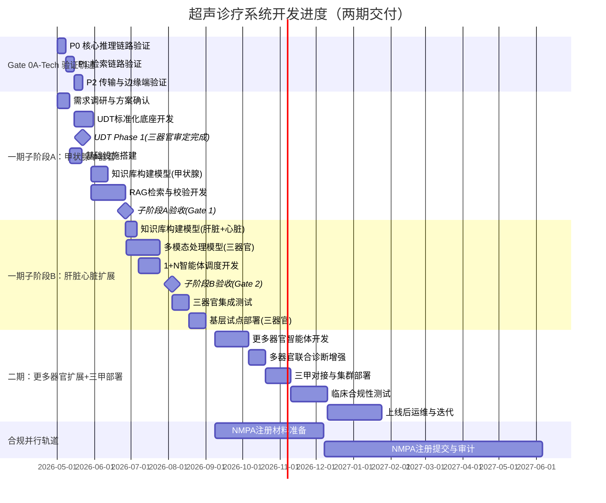

# 开发环境与进度规划

## 1. 硬件要求

| 环境 | 最低配置 | 推荐配置 |
|---|---|---|
| 开发机 | 32GB RAM, 8 核 CPU, RTX 3060 12GB | 32GB RAM, 8 核 CPU, RTX 3090 24GB |
| 测试环境 | 32GB RAM, 8 核 CPU, RTX 3080 | 64GB RAM, 16 核 CPU, A100 40GB |
| 基层生产 | **64GB RAM（标准配置，支持一期核心功能多器官联合诊断）**, 8 核 CPU, RTX 3060 12GB（后端 LLM 推理） + **Jetson Orin NX 16GB（边缘端导航推理，独立必需硬件）** | **64GB RAM**, 16 核 CPU, RTX 4090 24GB | **⚠️ SSD 为推荐存储要求**：PostgreSQL 降级模式 P99 < 50ms 基准在 SSD 下可达成，机械硬盘环境下须放宽至 100ms（详见 [01-系统架构设计](01-系统架构设计.md) §4 PostgreSQL 降级模式性能基准）。建议基层生产环境使用 SSD 作为系统盘 |
| 三甲生产 | 128GB RAM, 32 核 CPU, A100 80GB × 2, HSM 密钥管理设备 | 256GB RAM, 64 核 CPU, A100 80GB × 4, HSM 密钥管理设备 |
| 边缘端 | 8GB RAM, 4 核 CPU, Jetson Orin NX 16GB | 16GB RAM, 8 核 CPU, Jetson AGX Orin 32GB |

> **compact 模式硬件总成本估算**：
> | 适用场景 | 内存 | 硬件组成 | 总成本 |
> |---|---|---|---|
> | 基层多器官联合诊断（标准配置） | 64GB | 后端 RTX 3060 12GB（¥2,000-3,000） + 边缘端 Jetson Orin NX 16GB（¥3,000-5,000） + 64GB 服务器整机（¥8,000-15,000） + 网络基础设施（千兆交换机 ¥500-1,500 + 六类网线 ¥200-500 + UPS ¥1,000-2,000） | ¥14,700-27,000 |
>
> **网络基础设施说明**：基层医院现有网络基础设施可能不满足"≥100Mbps 稳定带宽"的要求（详见 [01-系统架构设计](01-系统架构设计.md) §1 边缘端资源管理规格对齐），网络改造费用可能显著增加总成本。千兆以太网交换机须支持 VLAN 隔离（AI 系统流量与医院内网流量隔离），UPS 须支持至少 15 分钟运行时间（与 §5 灾难恢复策略对齐），确保断电时安全关机与数据持久化。若医院现有网络基础设施已满足要求（千兆以太网 + UPS），网络基础设施成本可降至 ¥0-500（仅补充网线）。
> **重要提示**：一期核心功能包含三器官（甲状腺、肝脏、心脏）联合诊断，**64GB 为基层生产唯一配置**（支持一期核心功能多器官联合诊断），**不提供 32GB 配置选项**——32GB 内存下多器官联合诊断不可用（内存预算 12-22GB，±10GB 不确定性，32GB 下离线快照生成空间不足，且实际占用 22GB 时剩余仅 10GB 不足以支撑多器官串行推理），与一期核心功能定位矛盾。基层医院采购时须按 64GB 配置，避免因内存不足无法使用多器官诊断。**极简 compact Profile 选项**：若基层预算受限，可选用无边缘端 GPU 盒子的极简配置——导航推理在后端 RTX 3060 上串行执行（牺牲导航实时性，P99 延迟从 < 200ms 增至 < 500ms），通过 `EDGE_GPU_ENABLED=false` 配置项启用，硬件成本降低约 ¥3,000-5,000。

## 2. 容量规划

| 日检查量 | 并发峰值 | 推荐 GPU | 部署方案 |
|---|---|---|---|
| ≤50 例/天 | 2 并发（默认安全值；3 并发需 Gate 0 实测验证） | RTX 3060 12GB × 1 | Docker Compose 单机 |
| ≤50 例/天（2-3 台设备共享边缘端） | 2 并发 | RTX 3060 12GB × 1 | Docker Compose 单机，`DICOM_MAX_CONNECTIONS` 调整为设备数量，导航延迟可能增加 10-20%（多设备帧交替推送） |
| 50-200 例/天 | 5 并发 | RTX 4090 24GB × 1 | Docker Compose 单机 |
| 200-500 例/天 | 15 并发 | A100 80GB × 1 | Kubernetes 集群 |
| > 500 例/天 | 20 并发 | A100 80GB × 2+ | Kubernetes 集群 + 弹性伸缩 |

> **基层并发上限说明**：RTX 3060 12GB 显存下，**compact 模式默认 llama.cpp**（GGUF Q4_K_M 量化模型常驻 ~3GB + 按需分配推理显存，剩余 ~9GB 供 FunASR ONNX Runtime + Ultrasound-CLIP TensorRT + Cross-Encoder TensorRT + bge-m3-medical 使用，所有检索模型可 GPU 推理），**full 模式默认 vLLM**（预分配 `gpu_memory_utilization=0.90` 约 10.8GB，PagedAttention + Continuous Batching 高并发优势；compact 模式若切换至 vLLM 则使用 0.80 约 9.6GB）。compact 模式并发 ≤2 时 llama.cpp 与 vLLM 性能相当，但显存利用率高 3 倍。通过 `InferenceEngine` Protocol 接口统一业务逻辑，与 [01-系统架构设计](01-系统架构设计.md) §5.7 推理框架选型最终决策对齐。**导航模型运行于边缘端 Jetson Orin NX，不占用后端 RTX 3060 显存**；基准值须在开发阶段实测校准。

> **模型文件存储预算**：**compact 模式默认 llama.cpp**（GGUF Q4_K_M 格式），**full 模式默认 vLLM**（HuggingFace GPTQ 格式），详见 [01-系统架构设计](01-系统架构设计.md) §5.7 推理框架选型最终决策对齐。**各 Profile 仅存储对应格式的模型文件**——compact 模式仅存储 GGUF 格式（~4GB/器官，三器官约 ~12GB），full 模式仅存储 GPTQ 格式（~4GB/器官，三器官约 ~12GB）。加上视觉模型（Ultrasound-CLIP ~1GB）、嵌入模型（bge-m3-medical ~2GB）、语音模型（FunASR Paraformer ~0.5GB），**compact 模式总模型文件存储约 ~16GB**，**full 模式总模型文件存储约 ~16GB**。推理框架切换为极低频事件（一期内不更改选型），切换时通过离线转换脚本（约 30 分钟）生成所需格式，配合维护窗口执行。**SSD 存储须预留 ≥25GB 模型文件空间**（含未来模型更新冗余）。

> **compact 模式系统内存预算（64GB 标准配置）**：PostgreSQL 4GB（PGVector 仅用于实体近似匹配，向量数量 ≤1 万条，内存占用可忽略；**compact 模式不部署 Qdrant**，知识库向量检索降级为纯 PGVector 近似匹配 + BM25 关键词检索，详见 [01-系统架构设计](01-系统架构设计.md) §5.4） + Redis（单实例模式：1 进程约 50MB；双实例模式下核心组 + 通用组共 2 进程，总占用约 100MB） + LLM 推理（**compact 模式默认 llama.cpp**：GGUF Q4_K_M 量化模型常驻 3GB GPU 显存 + 按需分配推理显存，系统 RAM 占用约 1-2GB；**full 模式默认 vLLM**：vLLM 预分配 80% GPU 显存（~9.6GB），系统 RAM 占用约 1-2GB；通过 `InferenceEngine` Protocol 接口统一业务逻辑，与 [01-系统架构设计](01-系统架构设计.md) §5.7 对齐） + 主服务 Python 进程 2-4GB + SafetyGateway 独立进程约 0.5GB（含规则增强 NER + 脱敏规则缓存 + Redis 连接池 + HTTP 连接池） + VictoriaMetrics + 仪表盘约 0.2GB + FunASR 0.5GB（compact 模式默认 CPU 推理，不占用 GPU 显存） + Docker + OS 底座 3-4GB = 12-22GB。**64GB 标准配置下剩余内存约 ~40GB，充裕支持离线快照生成（约 5GB 磁盘空间）和多器官串行推理**。**64GB 配置下 `OFFLINE_SNAPSHOT_ENABLED` 默认为 `auto`**——磁盘可用空间 ≥10GB 时自动生成离线快照，消除模型替换时的索引重建窗口。**OOM 保护配置（Docker Compose 强制设置）**：PostgreSQL `oom_score_adj = -900`（核心数据库防杀死） + SafetyGateway `oom_score_adj = -1000`（禁止杀死） + VictoriaMetrics `oom_score_adj = -500` + Redis `oom_score_adj = -500`。PostgreSQL 设置 -900 而非 -1000 的原因：PostgreSQL 是核心依赖但极端内存压力下仍可能被 OOM Killer 终止（终止后 SafetyGateway 无法查询同意状态，系统拒绝所有诊断输出直至 PostgreSQL 恢复），SafetyGateway 是安全关键且无降级方案须禁止杀死；SafetyGateway 设为 -1000 禁止任何情况下被杀死，PostgreSQL 设为 -900 确保比 VictoriaMetrics/Redis 更难被杀死但允许在极端场景下被 OOM Killer 终止（PostgreSQL 被杀死后由 Docker `restart: always` 自动重启，预计 5-10s 含 WAL 恢复；重启期间 SafetyGateway 排队等待 PostgreSQL 恢复，排队超时 `SAFETY_GATEWAY_QUEUE_TIMEOUT_SECONDS`（默认 10s）后拒绝所有诊断输出 E4005B，详见 [01-系统架构设计](01-系统架构设计.md) §3.4 OOM 保护规范及 PostgreSQL 被杀死后恢复策略）。此 OOM 保护优先级与 [01-系统架构设计](01-系统架构设计.md) §3.4 OOM 保护规范一致。**Gate 0A 必须通过项**：compact 模式实际内存占用的基准测量为 Gate 0A-Tech **P0 子门控项**（与核心推理链路验证同优先级，非可选验证），须在 Gate 0A 第 1 周内完成——启动所有服务后测量各组件实际内存占用（`ps aux` / Docker stats），用实测值替代估算值，将预算范围从 ±10GB 缩窄至 ±2GB，确保双索引预建等功能的可行性判断基于可靠数据。**Gate 0A 补充验证项**：（1）**Redis 单实例进程存活验证**——模拟系统内存使用 > 90% 时，验证 Redis 单实例进程的存活情况（为 Redis 进程设置 `oom_score_adj` 为 -500 降低被 OOM Killer 优先杀死的概率），详见 [01-系统架构设计](01-系统架构设计.md) §4 Redis 单实例故障处理规范对齐；（2）**FunASR CPU 推理延迟验证**——在模拟生产负载下（PostgreSQL + Redis + 主服务 + LLM 推理全部运行，CPU 占用 > 60%），测量 Paraformer-zh 模型 CPU 推理 P99 延迟，若超过 2s 须在 Gate 0A 通过前完成优化（如切换至 Paraformer-zh-small 模型或增加 CPU 核数），详见 [01-系统架构设计](01-系统架构设计.md) §5.9 GPU 调度策略对齐；（3）**PostgreSQL 综合负载测试**——同时执行向量检索（PGVector HNSW Top10）、递归 CTE 图谱查询、审计日志写入，测量 P99 延迟与资源占用。

## 3. 软件依赖

### 3.1 后端依赖

| 组件 | 版本 | 用途 | 适用范围 |
|---|---|---|---|
| Python | 3.11+ | 主开发语言 | 全部 |
| PostgreSQL | 16+ | 关系数据 + PGVector | 全部 |
| PGVector | 0.7+ | 向量检索（实体近似匹配） | 全部 |
| Qdrant | 1.7+ | 知识库向量检索（Docker 单机版，详见 [01-系统架构设计](01-系统架构设计.md) §5.4 对齐） | full（一期）；compact 不部署 Qdrant，知识库检索降级为纯 PGVector 近似匹配 + BM25 关键词检索 |
| Neo4j | 5.x | 图存储 | full Profile 二期（一期不部署，使用纯 PGVector + 递归 CTE；本地开发环境不启动 Neo4j 服务） |
| Redis | 7.x | 缓存 + 消息队列 + 状态同步 | 全部 |
| Docker | 24+ | 容器运行 | 全部 |
| Kubernetes | 1.28+ | 容器编排 | full Profile |
| CUDA | 12.x | GPU 推理 | 全部 |
| PyTorch | 2.x | 模型训练 | 全部 |
| vLLM | 0.4+ | LLM 推理框架（**full 模式默认**，PagedAttention + Continuous Batching 高并发优势，详见 [01-系统架构设计](01-系统架构设计.md) §5.7 推理框架选型对齐） | full（默认） |
| TensorRT | 8.6+ | 推理优化（导航模型 + 边缘端） | compact + 边缘端 |
| llama.cpp | 0.2.80+ | LLM 推理框架（**compact 模式默认**，GGUF 量化 + 按需分配显存，常驻 ~3GB，检索模型可全部 GPU 推理；以 HTTP server 独立进程运行绕过 Python GIL；通过 `InferenceEngine` Protocol 接口与 vLLM 统一业务逻辑） | compact（默认） |
| FastAPI | 0.110+ | API 服务 | 全部 |
| gRPC | 1.60+ | 智能体通信（二期独立进程） | 全部 |
| OpenTelemetry | 1.20+ | 链路追踪 | 全部 |
| Elasticsearch | 8.x | 审计日志热存储 | full Profile |
| structlog | 23.x | 结构化日志 | 全部 |
| Alembic | 1.12+ | 关系数据库迁移 | 全部 |
| Graph DB Migration | 自研脚本 | 图数据库 schema 版本管理与迁移，纳入 Git 版本控制 | full Profile |
| Label Studio | 1.8+ | 数据标注 | 全部 |
| FunASR | 1.0+ | 语音转写（一期统一使用） | 全部 |
| Whisper | 20231117+ | 语音转写备选（FunASR 不达标时启用） | 备选 |
| pydicom | 2.4+ | DICOM 文件解析 | 全部 |
| pynetdicom | 2.0+ | DICOM 网络协议（边缘端 SCP 接收超声设备帧 + 后端 SCU 推送报告至 PACS；与 [03-接口规范](03-接口规范.md) §1.1 DICOM 一致性声明对齐） | 全部 |
| python-gdcm | 3.0+ | DICOM 像素数据解码（与 pynetdicom 组合使用，支持 JPEG/JPEG2000/JPEG-LS/RLE 等压缩格式；与 [01-系统架构设计](01-系统架构设计.md) §1 DICOM 组合方案对齐） | 全部 |
| DCMTK | 3.6+ | DICOM SCP 进程监控工具（仅用于边缘端 pynetdicom DICOM SCP 服务的进程存活监控与日志记录，不替代 pynetdicom 的 DICOM 协议实现；pynetdicom 负责所有 DICOM 协议交互，DCMTK 作为可选的进程监控辅助工具，通过 `DCMTK_SCP_WRAPPER_ENABLED=true` 配置项控制，默认关闭） | 边缘端（可选） |
| jieba | 0.42+ | 中文分词备选方案（通用场景 + 大数据批处理；医疗场景下精度不足，详见 [01-系统架构设计](01-系统架构设计.md) §5.5） | 全部 |
| pkuseg-medicine | 1.0+ | 中文分词一期主方案（医疗领域预训练模型，F1 约 96.88%。**最终决策**：pkuseg-medicine 为一期中文分词主方案，不设选型降级路径——即不存在因精度不达标而降级至 jieba 的场景。但须实现运行时故障恢复降级路径——pkuseg-medicine 加载失败时自动切换至 jieba + UDAF，确保系统可用性。Gate 0A 须验证 Python 3.11+ 兼容性，不通过则 fork 维护；详见 [01-系统架构设计](01-系统架构设计.md) §5.5） | 全部 |
| ONNX Runtime | 1.17+ | FunASR 语音模型推理（视觉模型使用 TensorRT Engine 推理，与 [01-系统架构设计](01-系统架构设计.md) §5.7 及 [07-数据标注与模型评估](07-数据标注与模型评判.md) §4 模型导出流水线一致） | 全部 |
| VictoriaMetrics | 1.93+ | compact Profile 监控（单机版，兼容 Prometheus API；与 [01-系统架构设计](01-系统架构设计.md) §5.8 及 [05-可观测性与运维](05-可观测性与运维.md) §2 一致） | compact |
| highdicom | 0.23+ | DICOM Structured Report 生成（报告推送至 PACS 所需；与 [02-核心流程与知识库](02-核心流程与知识库.md) §5.6 报告推送一致） | 全部 |
| Pydantic | 2.x | 数据校验与规则模型 | 全部 |
| HSM SDK | 由 HSM 厂商提供 | 密钥管理（**仅 full Profile**，详见 [04-安全合规](04-安全合规.md) §2.1.1；compact 模式使用设备 TPM/SE 本地密钥方案，不依赖 HSM SDK）；一期开发测试环境使用软件模拟（PKCS#11 SoftHSM，**仅限开发测试环境**） | full Profile 生产环境 |
| Safety | 2.x+ | 依赖漏洞扫描 | 全部 |
| Trivy | 0.45+ | 镜像漏洞扫描 | 全部 |

### 3.2 前端依赖

| 组件 | 版本 | 用途 |
|---|---|---|
| React | 18+ | UI 框架 |
| Ant Design | 5.x | 组件库 |
| cornerstone.js | 3.x | DICOM 影像渲染 |
| Zustand | 4.x | 状态管理 |
| ECharts | 5.x | 数据可视化 |
| reconnecting-websocket | 4.x+ | WebSocket 自动重连封装（原始 WebSocket API 不支持指数退避重连、消息优先级排序、发送缓冲区管理等，需封装层实现，详见 [03-接口规范](03-接口规范.md) §1.2） |

## 4. 本地开发启用

> **开发环境推理**：本地开发推荐使用**WSL2 + Docker**（Windows）或原生 Linux 环境，确保与生产环境（Linux Docker）一致。CUDA、TensorRT、llama.cpp 在 Windows 上的行为与 Linux 差异显著（GPU 显存管理、多进程调度、性能表现），Windows 原生环境下验证的延迟指标不可直接推算 Linux 生产环境。**Gate 0 验证项须在 Linux 环境（WSL2 或 Docker Linux 容器）内执行**，CI 流水线须在 Linux Docker 容器内运行。

```bash
git clone <repo_url>
cd ultrasound-diagnosis-system
python -m venv .venv
# Linux/macOS:
source .venv/bin/activate
# Windows:
.venv\Scripts\activate
pip install -r requirements.txt
pip install -r requirements-dev.txt
docker compose -f docker-compose.dev.yml up -d
alembic upgrade head
python scripts/init_knowledge_base.py --seed
uvicorn app.main:app --reload --port 8000
pytest tests/ -v
```

> **SafetyGateway 启动说明**：SafetyGateway 为独立操作系统进程（独立 uvicorn 实例，通过 HTTP localhost 通信，详见 [01-系统架构设计](01-系统架构设计.md) §3.4），Docker Compose 配置中须定义 `depends_on` + 健康检查（HTTP `/health` 端点），确保 SafetyGateway 先于主服务就绪。SafetyGateway 为安全关键组件，启动顺序保障不区分一期二期。
> ```yaml
> safety-gateway:
>   ...
>   healthcheck:
>     test: ["CMD", "curl", "-f", "http://localhost:9001/health"]
>     interval: 5s
>     retries: 3
> main-service:
>   depends_on:
>     safety-gateway:
>       condition: service_healthy
> ```

> **开发生产一致性保障**：本地开发环境须使用 Docker Compose 启动所有依赖服务（PostgreSQL、Redis、Neo4j 等），确保与生产环境一致。`requirements.txt` 须锁定精确版本号（`==`），禁止使用模糊版本（`>=`）。CI 流水线须在 Docker 容器内执行测试，与生产运行环境一致。

## 5. 配置管理

**一期必需配置项**：
```env
APP_ENV=development
APP_PORT=8000
LOG_LEVEL=INFO

POSTGRES_HOST=localhost
POSTGRES_PORT=5432
POSTGRES_DB=ultrasound_diagnosis
POSTGRES_USER=postgres
POSTGRES_PASSWORD=<secret>

GRAPH_DB_ENGINE=pgvector
PGVECTOR_GRAPH_QUERY_ENABLED=true

EMBEDDING_DIM=768
# Ultrasound-CLIP 输出维度（768 维，基于 ViT-L-14 编码器）
# 维度变更意味着全量向量索引重建（100 万向量约 2 小时），Gate 0 须一次性确定最终维度，避免开发中途变更
# 此值须与 [01-系统架构设计](01-系统架构设计.md) §5.4 多模态检索方案对齐
VECTOR_TOP_K=10
VECTOR_SIMILARITY_THRESHOLD=0.7

MODEL_PATH=./models/
THYROID_CONFIDENCE_THRESHOLD=0.85
LIVER_CONFIDENCE_THRESHOLD=0.88
CARDIAC_CONFIDENCE_THRESHOLD=0.92

DISEASE_LEVEL_THRESHOLD_STORAGE=database
DISEASE_LEVEL_THRESHOLD_TABLE=organ_disease_thresholds

INFERENCE_ENGINE=llama_cpp
# compact 模式默认 llama.cpp（常驻 ~3GB，按需分配显存，检索模型可全部 GPU 推理）
# full 模式默认 vLLM（PagedAttention + Continuous Batching 高并发优势）
# 通过 InferenceEngine Protocol 接口统一业务逻辑，与 01-系统架构设计 §5.7 推理框架选型对齐
# compact 模式切换为 INFERENCE_ENGINE=vllm 时须确认显存预算充足（vLLM 预分配 80% 约 9.6GB）
LLAMA_CPP_PORT=8001
# llama.cpp HTTP server 端口（独立进程，OpenAI 兼容 API）
VLLM_PORT=8002
# vLLM HTTP server 端口（独立进程，OpenAI 兼容 API，full 模式使用）
SAFETY_GATEWAY_PORT=9001
# SafetyGateway 独立进程端口（健康检查http://localhost:9001/health），与 llama.cpp(8001)、vLLM(8002) 端口区分
EDGE_NAV_WS_PORT=9100
# 边缘端导航 WebSocket 端口（二期启用直推模式时使用，一期后端中转模式不启用）
VLLM_GPU_MEMORY_UTILIZATION=0.90
# vLLM GPU 显存预分配比例（full 模式推荐 0.90；compact 模式若切换至 vLLM 则使用 0.80，预留 ~2.4GB 供检索模型使用，详见 01-系统架构设计 §1）
VLLM_ENFORCE_EAGER=false
# 是否禁用 CUDA Graphs（true=禁用，节省 ~0.5-1GB 显存但降低解码速度）
# compact 模式下若显存不足可设为 true（enforce_eager），牺牲 ~10% 解码速度换取显存空间
ASR_ENGINE=funasr
MESSAGE_BROKER=redis
REDIS_URL=redis://localhost:6379
# compact 模式默认单实例（REDIS_SINGLE_INSTANCE=true），与 01-系统架构设计 §4 对齐
# compact 核心组：单 Redis 实例 + AOF everysec + RDB 5分钟 + Docker 自动重启
# 废除同机主从 + Sentinel（同机伪高可用实际价值有限，详见 01-系统架构设计 §4）
REDIS_SINGLE_INSTANCE=true
# 单实例模式下所有功能共享 REDIS_URL（redis://localhost:6379），无需 REDIS_GENERAL_URL
# 双实例模式下取消 REDIS_SINGLE_INSTANCE 并配置
REDIS_GENERAL_URL=redis://localhost:6381
# 通用组 Redis 单实例端口 6381（业务缓存、非安全关键事件消息队列等非核心功能；同意状态已取消 Redis 双写，直查 PostgreSQL，不占用通用组 Redis 资源）
# 注：脱敏规则同步（desensitization_rules_update channel）已归入核心高可用组，因其为安全关键事件
# 注：安全关键事件 Redis Streams（KnowledgeUpdated safety_critical 类、ConsentWithdrawn 等）已归入核心高可用组，因其实时传播延迟直接影响医疗安全（与 01-系统架构设计 §4 Redis 分组策略对齐）
JWT_PRIVATE_KEY_PATH=/etc/hsm/jwt_private_key
JWT_ALGORITHM=RS256
JWT_EXPIRE_HOURS=8
JWT_REFRESH_EXPIRE_DAYS=7
JWT_KEY_ROTATION_DAYS=120
TLS_ENABLED=false  # 仅开发环境可关闭；生产环境强制启用 TLS 1.3（含 compact 内网场景），详见 04-安全合规 §1

SESSION_RENEWAL_TTL_SECONDS=1800
SESSION_AUTO_RENEW=true
SESSION_MAX_TTL_SECONDS=14400

EDGE_MODE=false
EDGE_MODEL_PATH=./models/edge/
EDGE_FAST_PATH_THRESHOLD_MULTIPLIER=1.05
EDGE_DIRECT_WS_ENABLED=false
# 边缘端 WebSocket 直连模式（true=前端直连边缘端 WS，false=后端中转模式）
# 医院网络拓扑阻止前端直连边缘端 IP 时设为 false（VLAN 隔离、防火墙规则等）
# 前端启动时自动检测：直连超时 3 秒后自动切换为后端中转模式
EDGE_WS_ALLOWED_CIDRS=10.0.0.0/8,172.16.0.0/12,192.168.0.0/16
# 边缘端 WebSocket 允许的来源 IP CIDR 白名单（医院内网段）
EDGE_MGMT_HTTPS_REQUIRED=true
# 边缘端管理界面是否强制 HTTPS（true=强制 HTTPS，false=仅允许 localhost HTTP）
# 设为 false 时仅允许 localhost 绑定，不暴露至局域网

DEPLOYMENT_PROFILE=compact

> **`DEPLOYMENT_PROFILE` 运行时配置校验**：`DEPLOYMENT_PROFILE` 为影响系统行为的全局配置，启动时须自动校验与其他配置项的兼容性。校验规则在 FastAPI `lifespan` 事件中执行，不一致的配置组合拒绝启动并输出明确错误信息。校验规则如下：（1）compact 模式下 `NEO4J_ENABLED` 须为 false（或未配置）；（2）compact 模式下 `AB_TEST_ENABLED` 须为 false（或未配置）；（3）compact 模式下 `ELASTICSEARCH_ENABLED` 须为 false（或未配置）；（4）`DEPLOYMENT_PROFILE` 值仅允许 `compact` 和 `full`，其他值拒绝启动；（5）full 模式下 `KUBERNETES_ENABLED` 须为 true；（6）full 模式下 `ELASTICSEARCH_ENABLED` 须为 true；（7）full 模式下 `OFFLINE_SNAPSHOT_ENABLED` 默认为 true（可显式设为 false，但须输出 Warning 提示"full 模式下关闭离线快照可能影响模型替换时的索引恢复速度"）。违反以上任一规则时，服务启动失败并输出错误信息（如 "Configuration conflict: DEPLOYMENT_PROFILE=compact but NEO4J_ENABLED=true, Neo4j is not available in compact mode"）。

**配置校验工具说明**：
| 工具名称 | 用途 | 执行时机 |
|---|---|---|
| `config-validator.py` | 静态配置文件校验，检查配置项格式、值范围、必填项完整性 | 部署前手动执行 |
| `config-check` CLI 命令 | 动态运行时配置校验，模拟启动时的配置兼容性检查 | CI 流水线、部署脚本 |
| 启动时自动校验 | FastAPI lifespan 事件中执行配置兼容性检查 | 服务启动时 |

**配置校验规则清单**：
| 配置项 | 校验规则 | 失败处理 |
|---|---|---|
| `DEPLOYMENT_PROFILE` | 仅允许 `compact` 和 `full` | 拒绝启动 |
| `INFERENCE_ENGINE` | 仅允许 `llama_cpp` 和 `vllm` | 拒绝启动 |
| `JWT_ALGORITHM` | 仅允许 `RS256` | 拒绝启动 |
| `TLS_ENABLED` | 生产环境必须为 `true` | 生产环境拒绝启动 |
| `EDGE_DIRECT_WS_ENABLED` | 一期必须为 `false` | 警告提示 |
| 端口配置 | 端口号范围 1024-65535，无冲突 | 拒绝启动 |
| 数据库连接 | PostgreSQL/Redis 连接字符串格式正确 | 拒绝启动 |

**DICOM 组合方案（pynetdicom + python-gdcm）性能预评估要求**：
| 评估项 | 目标值 | 评估方法 | 不达标处理 |
|---|---|---|---|
| DICOM SCP 并发连接数 | ≥3（单边缘端支持 3 台设备同时连接） | 模拟多设备同时连接 | 优化线程池配置或使用 DCMTK 包装 |
| DICOM 帧接收延迟 P99 | < 50ms | 连续接收 1000 帧测试（pynetdicom 网络层） | 优化网络配置或降低帧速率 |
| DICOM 像素解码耗时 | < 10ms/帧 | 批量解析测试（python-gdcm 解码层） | 优化解码逻辑或使用异步解码 |
| 端到端处理延迟 | < 60ms（网络接收 + 像素解码） | 端到端链路测试 | 优化流水线或增加边缘端算力 |
| 内存占用（100 帧缓冲） | < 500MB | 内存监控 | 增加边缘端内存或减少缓冲 |

**pynetdicom 配置建议**：
| 配置项 | 默认值 | 说明 |
|---|---|---|
| `DICOM_MAX_CONNECTIONS` | 1 | 同时接入的超声设备数量上限 |
| `DICOM_SCP_PORT` | 10400 | DICOM SCP 监听端口（≥ 1024） |
| `DICOM_FRAME_BUFFER_SIZE` | 90 | 帧缓冲区大小（30fps × 3 秒） |
| `DICOM_WORKER_THREADS` | 4 | DICOM 处理线程数 |

KNOWLEDGE_BASE_VERSION=kb_v1.0.0

> **模型版本兼容性检查**：为安全关键功能，始终启用，不可通过配置关闭。代码中硬编码 `MODEL_VERSION_COMPATIBILITY_CHECK=True`，不提供环境变量覆盖。

CACHE_LOCAL_TTL_SECONDS=3600
CACHE_REDIS_TTL_SECONDS=86400
CACHE_HIT_RATE_TARGET=0.70
CACHE_HIT_RATE_WARNING_THRESHOLD=0.60
CACHE_HIT_RATE_CRITICAL_THRESHOLD=0.40
CACHE_PENETRATION_ENABLED=true
CACHE_NULL_TTL_MINUTES=5
CACHE_BREAKDOWN_PROTECTION_ENABLED=true
CACHE_AVALANCHE_PROTECTION_ENABLED=true
CACHE_TTL_RANDOMIZATION_PERCENT=10
CACHE_WARMUP_TOP_N=100

FEEDBACK_REVIEW_MODE=local

RATE_LIMIT_DIAGNOSIS=10/minute
RATE_LIMIT_IMAGING=30/minute
RATE_LIMIT_FEEDBACK=20/minute

HALLUCINATION_MONITORING_MODE=simple
HOSPITAL_ID=default
FHIR_WORKER_LIMIT=10

EDGE_HEALTH_PROBE_INTERVAL_SECONDS=1
EDGE_DEVICE_HEARTBEAT_INTERVAL_SECONDS=5
# 无导航会话时的心跳间隔（默认 5s）
EDGE_DEVICE_HEARTBEAT_ACTIVE_INTERVAL_SECONDS=15
# 导航活跃期间的心跳间隔（动态调整：导航会话激活时自动切换为 15s，减少冗余心跳开销；详见 [01-系统架构设计](01-系统架构设计.md) §2.2）
STALE_CACHE_CLEANUP_SECONDS=300
CACHE_STALE_TTL_SECONDS=120
NAVIGATION_WS_HEARTBEAT_SECONDS=5
# WebSocket 心跳间隔（无导航会话 5s，导航活跃期间自动切换为 15s，与 [01-系统架构设计](01-系统架构设计.md) §2.2 及 [03-接口规范](03-接口规范.md) §1.2 一致）
DIAGNOSIS_RESULT_POLL_INTERVAL_MS=2000
DIAGNOSIS_RESULT_MAX_WAIT_SECONDS=30
DIAGNOSIS_RESULT_CACHE_SECONDS=600

GRACEFUL_SHUTDOWN_TIMEOUT_SECONDS=30
CIRCUIT_BREAKER_NEO4J_TIMEOUT_SECONDS=2
CIRCUIT_BREAKER_NEO4J_FAILURE_THRESHOLD=5
CIRCUIT_BREAKER_NEO4J_RESET_SECONDS=30
CIRCUIT_BREAKER_REDIS_TIMEOUT_SECONDS=1
CIRCUIT_BREAKER_REDIS_FAILURE_THRESHOLD=5
CIRCUIT_BREAKER_REDIS_RESET_SECONDS=30
CIRCUIT_BREAKER_HSM_TIMEOUT_SECONDS=1
CIRCUIT_BREAKER_HSM_FAILURE_THRESHOLD=3
CIRCUIT_BREAKER_HSM_RESET_SECONDS=60

OFFLINE_SNAPSHOT_ENABLED=auto
# compact Profile 默认 auto（磁盘可用空间 ≥10GB 时自动生成离线快照）
# full Profile 默认启用（OFFLINE_SNAPSHOT_ENABLED=true）
# 关闭时接受降级切换至 bge-m3-medical + 2 小时索引重建窗口（期间仅 BM25 终极兜底）
# 详见 [01-系统架构设计](01-系统架构设计.md) §5.4 降级切换向量维度兼容方案对齐
DUAL_INDEX_MIN_AVAILABLE_MEMORY_GB=15

DICOM_SCP_PORT=10400
# 边缘端 DICOM SCP 监听端口（建议 ≥1024 以避免 root 权限要求，与 [01-系统架构设计](01-系统架构设计.md) §1 端口权限规范对齐）
# 若超声设备仅支持标准 DICOM 端口 104，须通过 Linux capabilities 授权（`setcap 'cap_net_bind_service=+ep'`），禁止以 root 用户运行 DICOM SCP 服务
DICOM_MAX_CONNECTIONS=1
# 同时接入的超声设备数量上限。默认 1 适用于单设备场景；多设备共享边缘端时须调整为 ≥设备数量
# 此值影响 pynetdicom SCP 的并发连接上限，详见 [01-系统架构设计](01-系统架构设计.md) §2.2
DICOM_SCP_AETITLE=EDGE_AI_SCP

OTA_DOWNLOAD_RATE_LIMIT=1048576
# OTA 下载限速（bytes/s），1048576 = 1MB/s = 8Mbps。4GB 模型文件约需 34 分钟下载完成
# 导航活跃期间动态限速至 OTA_DOWNLOAD_RATE_LIMIT_NAVIGATION（默认 524288 = 512KB/s）
# 维护窗口 OTA 优先模式：OTA_PRIORITY_MODE=true 时，导航活跃时限速恢复至 1MB/s，无导航时提升至 2MB/s
# 须在非检查时段（如夜间维护窗口）执行 OTA 推送，或启用维护窗口 OTA 优先模式
# 详见 [01-系统架构设计](01-系统架构设计.md) §2.2 OTA 推送量化规则
MAX_QUEUED_REQUESTS_PER_USER=2

SESSION_KB_VERSION_LOCK=true
# 会话内知识库版本锁定，与 [02-核心流程与知识库](02-核心流程与知识库.md) §1.3 版本控制优先级决策矩阵统一
# 一期默认 true（同一会话内锁定 KB 版本，确保结论一致性；safety_critical 更新时强制终止会话，医生须基于新 KB 创建新会话；非 safety_critical 更新不中断当前会话，但前端在新会话创建时提示'知识库已更新至 v{x.y.z}'）
DESENSITIZATION_RESTORE_RATE_LIMIT=100/hour
# 脱敏还原频率限制，与 [02-核心流程与知识库](02-核心流程与知识库.md) §5.6 及[04-安全合规](04-安全合规.md) §2.1 对齐
# compact Profile：100/小时；full Profile：200/小时
# 此配置项由 DEPLOYMENT_PROFILE 自动调整，无需手动配置
# 运行时值由 FastAPI lifespan 事件中根据 DEPLOYMENT_PROFILE 覆盖，配置文件中的值为 compact 默认值
# 同类自动调整配置项：RATE_LIMIT_EMERGENCY_MULTIPLIER（compact=2, full=5）
REPORT_PUSH_METHOD=hl7v2
# 默认值根据 DEPLOYMENT_PROFILE 自动调整：compact=hl7v2（基层 HIS 通常不支持 FHIR），full=fhir（与 02-核心流程与知识库 §5.6 对齐）
# 同类自动调整配置项：RATE_LIMIT_EMERGENCY_MULTIPLIER（compact=2, full=5）
RATE_LIMIT_EMERGENCY_MULTIPLIER=2
# 急诊速率限制乘数，此值随 DEPLOYMENT_PROFILE 自动调整，无需手动配置
# compact Profile：2 倍（诊断请求 20 次/分钟/用户，与 GPU 2 并发推理能力匹配）；full Profile：5 倍（诊断请求 50 次/分钟/用户）
# compact 模式急诊限流 = 并发数 × 60 / 平均推理时间 × 安全系数 = 2 × 60 / 5 × 0.8 ≈ 19 次/分钟（系统总上限）
# 详见 [01-系统架构设计](01-系统架构设计.md) §5.8 及 [03-接口规范](03-接口规范.md) §7 对齐

CONTRADICTION_SIMILARITY_THRESHOLD_QWEN=0.85
CONTRADICTION_SIMILARITY_THRESHOLD_CHATGLM=0.85
CONTRADICTION_SIMILARITY_THRESHOLD_INTERNLM=0.85
# 矛盾检测相似度阈值（按 LLM 模型维度配置，用于 LLM 输出一致性校验）
# 不同模型输出分布与置信度校准特性不同，统一阈值可能导致误判
# Gate 0A LLM 选型验证中增加矛盾检测阈值校准项——基准 200 例测试数据绘制各模型 ROC 曲线
# 以 Youden 指数确定各模型最优阈值，若差异 < 0.03 则统一为 0.85，否则按模型分别设定

EMBEDDING_CONTRADICTION_THRESHOLD_ULTRASOUND_CLIP=0.85
EMBEDDING_CONTRADICTION_THRESHOLD_BGE_M3_MEDICAL=0.85
# 嵌入模型语义矛盾检测阈值（按嵌入模型维度配置，用于知识库语义矛盾检查）
# Ultrasound-CLIP 768 维与 bge-m3-medical 1024 维的向量空间分布不同，须分别校准
# 与 [02-核心流程与知识库](02-核心流程与知识库.md) §1.1 语义矛盾检查对齐

EMBEDDING_DIM_FALLBACK=1024

PG_POOL_MAX_SIZE=20
PG_POOL_TIMEOUT_SECONDS=5
REDIS_POOL_SIZE=10
# compact 模式默认 10，full 模式默认 20，通过 DEPLOYMENT_PROFILE 自动调整

CROSS_ORGAN_CONFIDENCE_OFFSET=0.10
# 跨器官关联校验置信度加法偏移量（标准路径结论触发跨器官关联规则时须达到更高阈值）
# 初始值 0.08-0.12，加法偏移量（非乘数），有效阈值 = min(器官级阈值 + 偏移量, 0.95)
# 采用加法机制而非乘法机制的原因：置信度取值范围 [0, 1]，乘数 ×1.15-1.20 会导致有效阈值 > 1.0（数学不可达）
# Gate 0B 临床验证中基于实际病例数据校准，详见 [01-系统架构设计](01-系统架构设计.md) §3.5 定义对齐

EDGE_AUTONOMY_MULTIPLIER=1.15
# 边缘端自治模式置信度乘数（跳过所有后端校验时须达到更高阈值）
# 初始值 1.15-1.25，Gate 0B 临床验证中基于实际病例数据校准
# 与 [00b-统一配置参考手册](00b-统一配置参考手册.md) §3.1 默认值对齐
# 与 CROSS_ORGAN_CONFIDENCE_OFFSET 分开定义和校准，详见 [01-系统架构设计](01-系统架构设计.md) §3.5

ALPHA_FUSION_THYROID=0.35
ALPHA_FUSION_LIVER=0.35
ALPHA_FUSION_CARDIAC=0.35
# Ultrasound-CLIP GNN + 规则融合 α 值（按器官维度配置）
# 最终置信度 = α × GNN 置信度 + (1-α) × 规则置信度
# 高风险病种 α 上限 ≤ 0.4（确保规则权威性 ≥60%）
# Gate 0A 须基于超声术语测试集（≥ 500 条）进行 α 值校准——按器官独立校准，若三器官最新 α 值差异 < 0.05 则统一，否则保留差异
# 甲状腺：TI-RADS 分级体系成熟，规则覆盖度高，α 初始值 0.35 合理
# 肝脏：占位鉴别诊断复杂度高，GNN 推理价值可能更大，校准后 α 可能偏高
# 心脏：测量标准化程度高但功能评估更依赖动态观察，校准后 α 可能偏低
# 详见 [01-系统架构设计](01-系统架构设计.md) §5.4 特征组合推理混合架构对齐

HALLUCINATION_SEVERITY_ENABLED=false
# 一期关闭幻觉严重度分级（仅实现 null/"severe" 二值赋值，详见 [01-系统架构设计](01-系统架构设计.md) §3.5 对齐）
# 二期启用后支持 null/severe/moderate/mild 四级赋值
BM25_MAX_DURATION_HOURS=4
# BM25 终极兜底最大持续时效 SLA，超时自动降级为仅输出观察描述模式（与 AI 诊断失败降级一致）
# 超时后不直接暂停 AI 诊断，而是降级为仅输出 observations（保留基础 AI 辅助能力）
# 详见 [01-系统架构设计](01-系统架构设计.md) §5.4 降级链路对齐
```

> **`OFFLINE_SNAPSHOT_ENABLED` 说明**：离线快照开关，详见 [01-系统架构设计](01-系统架构设计.md) §5.4 一致。compact 模式默认 `auto`（磁盘可用空间 ≥10GB 时自动生成离线快照，消除模型替换时的索引重建窗口）；full 模式默认 `true`（磁盘充裕，生成离线快照消除恢复窗口）；`auto` 在系统启动时检测当前磁盘可用空间，可用空间 ≥10GB 时自动生成离线快照，可用空间不足时关闭。**离线快照更新策略**：知识库更新时，离线快照须异步重新生成（后台任务，不影响在线查询性能），确保快照与当前知识库版本一致。快照重新生成期间使用旧快照，生成完成后原子替换。

> **Neo4j 熔断器说明**：当 `GRAPH_DB_ENGINE=pgvector`，Neo4j 熔断器配置项预定义但一期不生效（Neo4j 不部署）。二期引入 Neo4j 时将 `GRAPH_DB_ENGINE` 切换为 `neo4j` 后自动激活。

> **关键说明**：`EDGE_FAST_PATH_THRESHOLD_MULTIPLIER=1.05`（快速路径乘数），与 [00-项目总览](00-项目总览与核心指标.md) §2.5 保持一致。快速路径乘数 1.05 的设计理由：导航场景下后端仅执行最小安全校验（实体校验 + 禁忌校验），跳过逻辑校验和 Self-RAG 质检，安全防线少于标准全量路径，阈值乘数 1.05 补偿跳过校验带来的安全防线削弱（与 [09-二期规划](09-二期规划与远期增强.md) §3 边缘端自治模式乘数 `EDGE_AUTONOMY_MULTIPLIER` 1.15-1.25 的安全逻辑一致——安全校验越少，阈值门槛越高）。远期自治模式乘数为 1.15-1.25（提高阈值门槛以补偿安全防线缺失），详见 [09-二期规划](09-二期规划与远期增强.md) §3 及 [01-系统架构设计](01-系统架构设计.md) §3.5。

> **病种级置信度阈值存储**：器官级阈值通过环境变量配置（如 `THYROID_CONFIDENCE_THRESHOLD`），病种级阈值存储于数据库表 `organ_disease_thresholds`（字段：organ_code, disease_code, threshold, updated_by, updated_at），由科室主任通过管理界面配置，调整需记录审计日志。一期初始值由临床专家审定，写入数据库迁移脚本。

> **优雅停机规范**：收到 SIGTERM 后停止接受新请求，等待在途诊断请求完成（最多 `GRACEFUL_SHUTDOWN_TIMEOUT_SECONDS`，默认 30s）。30s 后仍有未完成请求，保存中间状态至 Redis，重启后可恢复。边缘端检测到后端断连后自动降级为仅显示原始图像，后端恢复后自动恢复。

## 5.1 一期代码边界清理

以下清单明确各模块一期必须实现的最小功能集，超出范围的功能仅预留接口定义（Protocol/ABC），不实现具体逻辑。

> **一期接口预留原则**：仅对确定二期需要的核心接口预留定义，避免一期代码膨胀。预留标准：（1）二期架构明确需要且接口签名稳定的（如 gRPC 通信 Protocol、备用调度热备切换接口）；（2）预留接口须有明确的二期需求文档引用。以下功能**不预留接口**，二期启动时再定义：联邦学习（`FederatedLearningService`）、A/B 测试框架、漂移监控统计方法（KL 散度）、Mamba 架构探索。这些功能二期需求可能变化，一期预留接口的维护成本高于二期重新定义的成本。

| 模块 | 一期必须实现 | 一期仅预留接口 | 说明 |
|---|---|---|---|
| 中央调度 | 任务分配、会话管理、器官路由表 | 备用调度热备切换、水平分析 | 一期用进程内调用，二期用 gRPC |
| 专科智能体 | 甲状腺智能体（完整）、肝脏智能体（完整）、心脏智能体（完整） | 其他器官智能体 | 一期三器官均须实现（分 A/B 子阶段交付：子阶段 A 甲状腺，子阶段 B 肝脏+心脏） |
| 知识查询智能体 | 单实例查询、Redis 缓存；一期两个 Profile 均为单实例（读副本接口定义与配置项已预留，但不部署独立实例，详见 [01-系统架构设计](01-系统架构设计.md) §2.3） | 多读副本 ≥1 | 一期两个 Profile 均为单实例 + 进程自动重启；二期 full Profile 部署主实例 + 1 读副本 |
| 流程监控智能体 | 检查流程质控、漏项提示 | - | - |
| 融合 | consistent/evidence_insufficient/contradictory/partial_consistent 四种状态处理、脱敏校验、跨器官关联校验 | - | 一期三器官需跨器官关联校准 |
| SafetyGateway | 独立操作系统进程（独立 Python package `safety_gateway/`，独立 uvicorn 实例，通过 HTTP localhost 通信，延迟基准 P99 < 5ms；与 [01-系统架构设计](01-系统架构设计.md) §3.4 SafetyGateway 代码组织与依赖隔离表一致），NER 扫描（规则增强 NER，与融合 NER 异构冗余）、禁忌校验、同意状态拦截、声明式规则校验 | 独立 sidecar 进程（一期即独立进程部署，二期扩展为集群部署） | 一期必须实现，为融合层降级的关键安全组件。**一期独立设计工程量预估**：独立 Python package 代码量约 1500-2000 行（含 NER 扫描、禁忌校验、同意状态拦截、声明式规则校验、降级核心模块），测试用例约 80-120 个（含降级路径专项测试），CI 增量时间约 2-3 分钟（NER 模型加载 + 规则校验测试）。此工程量已计入一期开发工期，详见甘特图"安全模块"轨道 |
| 知识库版本兼容性 | major 版本校验（v1.x vs v2.x 互斥） | 完整兼容性矩阵查询 | 一期仅 v1.x |
| 通信层 | 进程内函数调度 + Redis Streams 事件 | gRPC 独立进程通信 | 二期多器官时引入 |
| 诊断结果持久化 | 诊断结果生成后立即写入 PostgreSQL（持久化），10 分钟 Redis 缓存仅用于高频查询加速 | - | 缓存与持久化双写，10 分钟缓存过期后查询走 PostgreSQL |
| 边缘端 | 实时导航、降级为仅显示原始图像 | 自治导航模式 | - |
| 反馈审核 | 本院审核流程 | 医联体双审流程 | - |
| A/B 测试 | 不实现 | 分流框架、统计方案 | 二期引入，一期用灰度发布 |
| 联邦学习 | 不实现，不预留接口 | - | 二期启动时再定义，避免一期代码膨胀 |
| 漂移监控 | 固定测试集定期评判 | - | KL 散度等统计方法二期启动时再定义 |
| FHIR Adapter | FastAPI 子模块（router） | 独立微服务 | - |

## 6. 开发进度规则

### 6.1 整体时间线

**数据采集与标注独立前置轨道**：数据采集和标注工作作为独立轨道，与开发并行启动，不包含在各开发模块工期内。**数据轨道里程碑与灰度发布对齐**：灰度发布要求每器官 ≥667 例总样本（验证集 ≥100 例），一期三器官共需 ≥2001 例。按标注流程（双标注 + 审核 + 抽检），每例标注耗时约 30-60 分钟，2001 例需约 1000-2000 人时。数据轨道关键里程碑：（1）Gate 0B 前：甲状腺 ≥200 例标注数据就绪（与 Gate 0B 验证要求对齐）；（2）子阶段 A 开发中期：甲状腺 ≥667 例（满足灰度发布要求），肝脏 ≥200 例；（3）子阶段 B 开发中期：肝脏 ≥667 例，心脏 ≥667 例。若数据积累进度落后于开发进度，灰度发布启动时间相应推迟，但不阻塞技术框架开发。**建议评估多中心数据采集**：若单中心数据积累速度不满足灰度发布时间线，应并行启动多中心数据采集（需额外伦理审批），确保数据轨道不成为项目关键路径。

| 数据里程碑 | 时间要求 | 说明 |
|---|---|---|
| 开发验证数据 | Gate 1 前 | 每器官 ≥200 例标注数据，用于模型训练与基础验证 |
| 灰度发布数据 | 灰度发布前 | 每器官 ≥667 例总样本（验证集 ≥100 例），满足上线阶梯要求 |
| 全量发布数据 | 全量发布前 | 每器官 ≥667 例 + 灰度验证期间新增病例 |

> **一期交付策略**：一期拆为两个子阶段交付，降低首期交付风险——子阶段 A 交付甲状腺单器官完整验证（含知识库、RAG 检索、智能体调度、边缘端导航、安全合规全链路），子阶段 B 扩展至肝脏+心脏三器官。子阶段 A 的完整验证为子阶段 B 提供可复用的基础设施和验证方法论，避免三器官并行开发导致质量风险叠加。**工期调整说明**：子阶段 A 名义工期 46 天（含 10 天缓冲），UDT 前置轨道（约 16 天）与数据采集并行启动不占用核心开发工期，甘特图中子阶段 A 从 2026-05-01 至 2026-06-26 共 56 天（46 天名义工期 + 10 天子阶段 A→B 缓冲 = 56 天日历天数）。**UDT 标准化底座分阶段审定**：UDT 完成为 Gate 0B 的前置条件，但全部 52 器官的审定可能阻塞关键路径。UDT 审定拆分为两阶段——**Phase 1（Gate 0B 前）**：完成一期三器官（甲状腺、肝脏、心脏）的 UDT 审定（约 5-8 天，含临床专家审定），一期仅需三器官的 UDT 词汇表即可启动依赖临床数据的功能开发；**Phase 2（Gate 1 前）**：完成其余器官的审定。UDT 前置轨道工期约 16 天（含全部 52 器官临床专家审定），Phase 1 约 5-8 天，建议在 Gate 0A 通过后立即启用 Phase 1，与 Gate 0B 临床验证并行。**UDT 审定部分完成降级方案**：若三器官中仅部分器官 UDT 审定完成（如甲状腺完成但肝脏/心脏未完成），可先启动已审定器官的相关功能开发，未审定器官的跨器官关联规则暂不启用（仅启用已审定器官间的关联规则），待 UDT 审定完成后再启用。此降级方案确保 UDT 审定不阻塞已就绪器官的开发进度，与 [02-核心流程与知识库](02-核心流程与知识库.md) §4 UDT 审定降级方案一致。



### 6.2 里程碑验收标记

| 里程碑 | 验收标准 |
|---|---|
| UDT 标准化底座完整 | UDAF 词汇量 ≥2000 条；9 大系统 52 器官分类完整；术语映射准确率 ≥95%；SRS 初稿完成 |
| 知识库构建模块完整 | 入库文档 ≥500 份（每器官 ≥150 份，确保覆盖均衡）；检索准确率 ≥85%（Top 10）；专家抽检通过率 ≥95% |
| 多模态处理模块完整 | Ultrasound-CLIP 超声跨模态检索 I2T@10 ≥37%（开箱即用），院内数据微调后 I2T@10 ≥45%；强兜底 bge-m3-medical 纯文本检索召回率 ≥88%（Top 10）；终极兜底 BM25 关键词检索可用性验证通过；单图处理 < 200ms；M³Bind 对齐准确率 ≥80%（技术验证观察项，非 Go/No-Go 门控条件） |
| 1+N 智能体调度完整 | 任务分配正确率 100%；备用切换 < 5s；知识查询恢复 ≤30s；缓存命中率 ≥40%；SAD 初稿完成 |
| RAG 检索与校验完成 | 混合检索召回率 ≥90%；分层校验拦截率 ≥98%；PGVector 压测达标 |
| 一期集成测试通过 | 端到端无阻断 + **降级路径专项测试**（故障注入，覆盖以下场景：① Redis 不可用→PostgreSQL 轮询降级（compact 模式调度租约直接使用 PostgreSQL Advisory Lock，无需降级切换；full 模式调度租约为 Redis SET NX EX 降级至 PostgreSQL Advisory Lock，P99 延迟约 5ms，详见 [01-系统架构设计](01-系统架构设计.md) §4 compact 模式调度租约简化决策）；② 融合层不可用→SafetyGateway 降级输出仅观察描述；③ SafetyGateway 不可用→所有诊断输出拒绝（E4005，**须区分两种场景**：（a）SafetyGateway 模块级故障（主服务进程存活）→后端返回 E4005 错误码；（b）主服务进程崩溃 + SafetyGateway 独立进程存活，可独立返回 E4005 错误码，前端收到 E4005 后提示"系统安全校验不可用，请转为人工诊断"，详见 [01-系统架构设计](01-系统架构设计.md) §3.4 SafetyGateway 独立进程部署说明），系统进入纯人工模式（详见 [01-系统架构设计](01-系统架构设计.md) §3.4 安全底线原则对齐：SafetyGateway 不可用时拒绝所有诊断输出，不允许专科智能体直接输出）；④ 边缘端后端断连→本地降级模式；⑤ Redis+融合层同时不可用→组合故障降级；⑥ 融合层不可用 + SafetyGateway 短暂不可用（≤15s）→排队等待恢复或超时拒绝；⑦ Redis 主从切换→从节点秒级接管，功能不中断。测试方法：Docker 容器网络隔离模拟不可达，验证降级路径的正确性与恢复能力） + 异常分支全覆盖；导航 P99 < 200ms（极简 compact Profile 下 P99 < 500ms）；诊断 < 5s；脱敏校验通过；跨器官关联校验通过；降级路径测试未通过不进入下一阶段 |
| 一期基层试点通过 | 单机部署成功；三器官准确率 ≥89%（基层）；FunASR 术语准确率 ≥90%；医生满意度 ≥80%；知情同意流程验证通过 |
| 二期更多器官扩展完成 | 新增器官准确率 ≥89%（基层）/ ≥92%（三甲）；跨器官关联验证通过 |
| 临床合规性测试通过 | 多中心 ≥3 家；≥100 例/器官；准确率 ≥89%/92%；严重幻觉率 ≤0.5%；IEC 62304 追溯性矩阵 100% |

### 6.3 Gate 判定标准汇总

#### Gate 0：技术可行性验证
| 验证项 | 通过标准 | 不达标处理 |
|---|---|---|
| 核心推理链路 | 甲状腺单器官诊断端到端延迟 < 5s | 优化推理引擎配置 |
| 检索链路 | 混合检索召回率 ≥90%（Top 10） | 调整检索参数或模型 |
| 传输与边缘端 | 导航 P99 < 200ms | 优化网络传输或边缘端推理 |
| SafetyGateway 隔离 | 主服务崩溃时独立返回 E4005 | 检查进程隔离配置 |
| PostgreSQL 直查 | 同意状态检查 P99 < 10ms | 优化查询索引 |

#### Gate 0A：技术选型验证

| 验证项 | 通过标准 | 不达标处理 |
|---|---|---|
| LLM 选型 | 推理延迟 < 3s，矛盾检测阈值校准完整 | 切换备选模型 |
| pkuseg-medicine | Python 3.11+ 兼容性验证通过 | fork 维护或切换 jieba |
| α 值校准 | 三器官最新 α 值差异 < 0.05 或分别设定 | 重新校准 |
| 导航校验 P99 | 诊断推理满载下 < 20ms | 增加独立线程数 |

#### Gate 0B：临床验证
| 验证项 | 通过标准 | 不达标处理 |
|---|---|---|
| UDT Phase 1 | 甲状腺、肝脏、心脏审定完整 | 启用降级方案 |
| 跨器官关联阈值 | 基于病例数据校准完成 | 调整偏移量 |
| 边缘端自治乘数 | 1.15-1.25 范围内校准完整 | 重新评估安全容忍度 |
| 标注数据就绪 | 甲状腺 ≥200 例 | 加速数据采集 |

#### Gate 1：子阶段 A 验收

| 验证项 | 通过标准 | 不达标处理 |
|---|---|---|
| 甲状腺完整验证 | 端到端无阻断，所有功能正常 | 修复阻塞问题 |
| 降级路径测试 | 7 种故障场景全部通过 | 完善降级逻辑 |
| 知识库构建 | 甲状腺 ≥150 份文档，检索准确率 ≥85% | 补充知识库 |
| RAG 检索与校验 | 混合检索召回率 ≥90%，分层校验拦截率 ≥98% | 优化检索或校验逻辑 |

#### Gate 2：子阶段 B 验收

| 验证项 | 通过标准 | 不达标处理 |
|---|---|---|
| 三器官集成 | 端到端无阻断，跨器官关联校验通过 | 修复集成问题 |
| 知识库扩展 | 肝脏、心脏各 ≥150 份文档 | 补充知识库 |
| 智能体调度 | 任务分配正确率 100%，备用切换 < 5s | 优化调度逻辑 |

> **Gate 判定规则**：所有验证项必须全部通过方可进入下一阶段。单个验证项不达标时，优先修复；无法在合理时间内修复的，评估降级方案或调整里程碑时间线。

> 基线准确率 78%（基层医生无 AI 辅助时的诊断准确率）引用自文献综述与临床专家评估，尚未实测验证。**基线准确率验证须作为 Gate 0B 的核心验证项**——Gate 0B 基线准确率验证结果为依赖临床数据的功能开发的前置条件。**基线验证应提前至项目开发启动前完成**：Gate 0A-Tech 通过后可启动技术框架开发（不依赖基线数据），但依赖临床数据的功能开发须等待 Gate 0B 结果。若 Gate 0B 基线偏差 > ±5% 触发 No-Go，已启动的技术框架开发须暂停并评估。为降低 No-Go 后的开发资源浪费风险，伦理审批须在**项目立项前 4 周即提交**，确保基线验证可在开发启动前完成。验证方案：在试点医院收集 ≥200 例无 AI 辅助诊断结果。**区分两个指标**：（1）**基层医生实际诊断准确率**——由基层医生的诊断结果与金标准（病理/随访）对比得出，此为项目目标值的参照基线；（2）**高年资医生评判的参考准确率**——由两位高年资超声科医生独立评判，用于校准金标准。项目目标值（≥89% 基层 / ≥92% 三甲）应基于指标（1）而非指标（2），避免高年资医生评判标准与基层实际水平偏差导致基线失真。**伦理审批时间线关键路径**：伦理审批通常需要 2-4 周，须在**项目立项前 4 周即提交伦理审批申请**（而非项目立项时才提交），确保基线验证可在 Gate 0A 之前完成。伦理审批提交作为项目甘特图的关键里程碑，标记为独立前置轨道。试点医院须在项目立项前确定。样本量说明：二项分布下 50 例的 95% 置信区间宽度约 ±12%（p=0.78 时），远大于 ±3% 的容忍度，不足以可靠验证基线准确率；200 例的 95% 置信区间宽度约 ±6%，可满足 ±3% 偏差判定的基本需求。若实测基线准确率与 78% 偏差超过 ±3%，需由架构师 + 临床专家联合重新校准目标值，偏差超过 ±5% 则触发 No-Go 决策评估。

**基线准确率偏差预定义校准方案**：
| 实测基线偏差 | 校准动作 | 目标值调整 | 工期影响 |
|---|---|---|---|
| 偏差 ≤ ±3% | 无需校准 | 维持原目标 | 无 |
| 基线 75-78%（偏低） | 目标值不变，但提升空间更新 | 维持 ≥89%/92% | 无 |
| 基线 78-81%（偏高） | 目标值上调 | ≥89% → ≥92%（基层），≥92% → ≥95%（三甲） | 可能需延长训练周期 |
| 基线 > 81% | 重新评估项目价值与目标 | 由架构师 + 临床专家联合审定 | 可能需调整功能范围 |

> **基线验证 No-Go 退出机制**：若实测基线准确率偏差 > ±5%（如基线 < 73% 或 > 83%），触发 No-Go 决策评估——由项目决策方（架构师 + 临床专家 + 项目经理）联合评审，决定是否：（1）调整项目目标值后继续；（2）缩减项目范围（如仅保留高价值器官）；（3）终止项目。No-Go 决策须在 Gate 0B 结果出来后 1 周内完成，避免已启动的开发资源持续消耗。

### 6.3 技术验证里程碑

| 验证项 | 验证时间 | 通过标准 | 不通过处理 |
|---|---|---|---|
| PGVector 性能压测 | 检索模块第 1 周 | 1 万/5 万/10 万向量 P99 < 50ms（PGVector 仅用于实体近似匹配，向量数量 ≤1 万条；知识库向量检索已剥离至 Qdrant，Qdrant 压测见下行） | 优化 HNSW 索引参数或评估 PGVector 扩展方案 |
| Qdrant 性能压测 | 检索模块第 1 周 | 100 万向量 P99 < 100ms（知识库向量检索实际承载者，详见 [01-系统架构设计](01-系统架构设计.md) §5.4 对齐） | 优化 Qdrant 索引配置或评估 Milvus 替代方案 |
| Neo4j 图查询性能 | 检索模块第 1 周（技术验证观察项） | 复杂路径查询 P99 < 100ms | 优化查询或调整图模型；不达标不阻塞 Gate 1，统一用纯 PGVector + 递归 CTE |
| PGVector 递归 CTE 图谱查询性能 | 检索模块第 1 周 | 纯 PGVector + 递归 CTE 模拟图谱查询 P99 < 200ms（复杂路径查询）。**可扩展性基准**：须同时验证 1 万/5 万/10 万关系三种规模的 CTE 性能，建立性能-规模曲线，预测二期扩展后性能是否可接受。若曲线显示非线性劣化（20 万关系 P99 > 500ms），须在 Gate 0A 报告中明确 Neo4j 引入时间点 | 优化 CTE 查询或引入 Neo4j（full Profile 二期） |
| 边缘端导航延迟 | 边缘端模块第 1 周 | 端到端 P99 < 200ms（极简 compact Profile `EDGE_GPU_ENABLED=false` 下 P99 < 500ms） | 优化模型或调整目标 |
| 知识预取缓存命中率 | 智能体模块第 2 周 | ≥40%（初始） | 调整预取策略 |

**Go/No-Go Gate**：
| Gate | 触发时间 | Go 条件 | No-Go 处理 |
|---|---|---|---|
| Gate 0A（技术验证） | 开发启动前 2 周内 | **⚠️ pkuseg-medicine 超声专科分词验证（最高优先级，须在第 1 天完成：验证 Python 3.11+ 兼容性 + 在超声术语测试集 ≥500 条上验证 F1 ≥95%，不通过则 fork 维护；pkuseg-medicine 为一期最终决定的分词主方案，详见 [01-系统架构设计](01-系统架构设计.md) §5.5）** + **llama.cpp 推理验证通过**（compact 模式默认推理引擎，GGUF Q4_K_M 常驻 ~3GB，2 并发推理 P99 延迟验证 < 8s） + **vLLM 推理验证通过**（full 模式默认推理引擎，见 [01-系统架构设计](01-系统架构设计.md) §5.7 full 模式验证项） + **vLLM 与 llama.cpp 输出一致性验证**（同一模型、同一输入、同一采样参数下 **分级一致率 ≥95%** + **完整文本一致率 ≥90%** + **临床决策边界差异率 ≤1%**（95% 置信区间上界 ≤2%，边界病例最小样本量 ≥300 例：TI-RADS 3类、LI-RADS 3类、BI-RADS 3类各 ≥100 例，**使用公开超声数据集或合成测试数据**——Gate 0A 阶段尚无院内标注数据，公开数据集如 OpenI、MIMIC-CXR（虽为胸部 X 光但可验证推理框架一致性）或自建合成测试数据均可；完整验证（≥100 例边界）推迟至 Gate 1 使用院内标注数据执行），⚠️ Gate 0A 技术验证条件性门控项（分级一致率 < 90% 或边界差异率 > 2% 则 Gate 0A 不通过，须统一使用单一推理框架），不通过时按条件性门控规则处理：分级一致率 90%-95% 前端标注推理框架类型 + 一致性偏差率，NMPA 注册材料声明；分级一致率 < 90% 或边界差异率 > 2% 统一使用单一推理框架） + **LLM 基座模型选型对比验证**（Qwen2.5-7B-Instruct / ChatGLM4-9B / InternLM2.5-7B-Chat 三选一，验证标准见 [01-系统架构设计](01-系统架构设计.md) §5.7 候选列表） + FunASR 术语准确率评估完整 + **compact 模式显存实测验证**（llama.cpp GGUF Q4_K_M 常驻 ~3GB，剩余 ~9GB 供 FunASR ONNX Runtime + Ultrasound-CLIP TensorRT + Cross-Encoder TensorRT + bge-m3-medical 使用；**导航模型运行于边缘端 Jetson Orin NX 16GB，不占用后端显存**；Gate 0A 须实测 llama.cpp 实际显存占用与剩余可用显存，确认所有 GPU 模型可在剩余空间内正常运行） + **full 模式显存实测验证**（vLLM `gpu_memory_utilization=0.90` 预分配 ~10.8GB，Gate 0A 须实测 vLLM 实际显存占用与剩余可用显存） + **Ultrasound-CLIP 超声跨模态检索验证**（开箱即用 I2T@10 ≥37%，单帧推理 ≤8ms **须在 RTX 3060 上实测**；纯 Ultrasound-CLIP Dense 检索（无 Sparse 补充）召回率 ≥80% Top10 作为 Go/No-Go 门控条件验证；不达标则 Gate 0A 不通过，须在 Gate 0A 阶段确定替代方案） + **bge-m3-medical 纯文本检索兜底验证**（Top10 ≥88%，无需训练数据） + **DICOM 帧传输双方案并行压测**（WebSocket 双连接 vs base64+HTTP，base64 编解码延迟 > 5ms 则一期强制启用 WebSocket 双连接主方案） + **PGVector 递归 CTE 图谱查询性能验证**（基准数据规模与性能目标见 [01-系统架构设计](01-系统架构设计.md) §5.5） + **PGVector 100 万向量降级性能基准**（Qdrant 不可用时降级至 PGVector 全量向量检索，10 万 × 768 维向量 HNSW 索引查询 P99 < 500ms，详见 [01-系统架构设计](01-系统架构设计.md) §5.5） + **FunASR + llama.cpp + TensorRT 混合运行显存碎片化验证**（compact 模式显存碎片化率 < 30%，与 [07-数据标注与模型评估](07-数据标注与模型评判.md) §4 步骤 4a 对齐） + **知识库关系深度分布验证**（统计知识库中实体关系的深度分布，确保 ≤10 层深度覆盖 ≥95% 的关系，与 PGVector 递归 CTE 10 层深度性能基准对齐） | Gate 0A 不通过则技术选型需调整或项目方向性变更 |
| Gate 0B（临床验证） | 开发启动前 4 周内（可与 Gate 0A 并行，**但基线准确率验证须在 Gate 0A 前完成**——与 [00-项目总览](00-项目总览与核心指标.md) §1 基线验证时机一致，偏差 > ±5% 触发 No-Go，Gate 0A 不通过则） | **基线准确率实测验证**（≥200 例，偏差 ≤ ±3%，**须在 Gate 0A 前完成**） + **Ultrasound-CLIP 院内数据微调验证**（微调后 I2T@10 ≥45%，使用院内超声图文对微调） + **甲状腺 ≥200 例标注数据就绪** | 基线准确率偏差 > ±5% 触发 No-Go 决策评估；微调后检索不达标评估增加微调数据量或降级为纯文本检索；数据不足延长采集期 |
| Gate 1 | 子阶段 A 结束 | PGVector 达标 + 知识库模块验证 + SRS 评审通过 + 肝脏/心脏各 ≥200 例标注数据就绪 + **gRPC 迁移路径验证（技术验证观察项）**——流程监控智能体以独立 gRPC server 进程运行，验证 gRPC 通信的异常处理、超时控制、序列化开销（P99 增量 < 1ms）、故障检测与恢复，详见 [01-系统架构设计](01-系统架构设计.md) §1 "一期→二期迁移路径验证" | PGVector 不达标切 Milvus；Neo4j 为技术验证观察项（非 Go/No-Go 门控条件），不达标统一用纯 PGVector + 递归 CTE（详见 [01-系统架构设计](01-系统架构设计.md) §5.5）；gRPC 验证不通过不阻塞 Gate 1，但须在二期规划中评估迁移方案调整；数据不足延长采集期 |
| Gate 2 | 子阶段 B 结束 | Ultrasound-CLIP 超声跨模态检索 I2T@10 ≥45%（微调后）或降级方案 bge-m3-medical 纯文本检索 Top10 ≥88% + 智能体调度验证 + 边缘端延迟达标 + SAD 评审通过 | 多模态检索不达标降级为纯文本检索；M³Bind 精度为技术验证观察项，不达标不影响 Gate 2 通过 |

> **Gate 0 拆分理由**：Gate 0A（技术验证）与 Gate 0B（临床验证）可并行执行，避免串行等待。技术验证聚焦模型框架能力验证（1 周内完成），临床验证聚焦数据准备与准确率基线（2 周内完成，含数据标注与收集）。**分阶段启动规则**：Gate 0A 通过后可立即启动不依赖临床数据的技术框架开发（如基础设施、通信层、安全模块、边缘端导航框架）；Gate 0B 通过后方可启用依赖临床数据的功能开发（如知识库构建、模型训练、RAG 检索端到端验证）。此规则确保临床数据未就绪时技术框架开发不阻塞，同时避免在临床数据未验证的情况下启动依赖数据的功能开发。**Gate 0A 内部优先级排序与时间分配**：验证项按优先级串行执行——（1）**Day 1**：pkuseg-medicine 超声专科分词验证（最高优先级，验证 Python 3.11+ 兼容性 + F1 ≥95%，不通过则 fork 维护；pkuseg-medicine 为一期最终决定的主方案）；（2）**第 1 周（Day 2-7）**：核心推理链路验证（llama.cpp + LLM 选型），核心推理链路不通过则项目方向性调整；**LLM 选型对比验证拆为两阶段**：Gate 0A-1（Day 2-4）快速筛选，3 个候选模型各跑 50 例基础测试（推理延迟、基础幻觉率、术语准确率），淘汰最差者；Gate 0A-2（Day 5-7）深度验证，对 Top-2 模型跑 200 例完整测试（含超声术语理解、跨器官推理、量化后幻觉率增量），选定最终基座模型；（3）**第 1-2 周**：检索链路验证（Ultrasound-CLIP + PGVector + bge-m3-medical），检索链路不通过则降级为纯文本检索；（4）**第 2 周**：传输链路验证（DICOM + 边缘端），传输链路不通过则延期至二期。**非关键验证项可延迟**：DICOM 双方案压测、PGVector 递归 CTE 性能验证等非关键路径验证项，若 2 周内未完成可延期。Gate 0A 须 1 周内完成，不阻塞核心开发启动。若第 1 周核心推理链路验证未完成，检索链路验证可延期至第 3 周，但项目整体 Gate 0A 通过时间相应推迟。

> **Gate 0A 拆分为两个独立门控**：Gate 0A 包含多项技术验证（分词、LLM 选型、检索链路等），其中部分验证不依赖基线临床数据，强制等待基线验证结果会浪费技术验证时间。因此将 Gate 0A 拆分为：
>
> | 门控 | 内容 | 前置条件 | 可启动时间 |
> |---|---|---|---|
> | Gate 0A-Tech（技术验证） | 分词验证、LLM 选型验证、检索链路技术验证、嵌入模型许可确认、FunASR CPU 推理验证、vLLM 显存预算实测 | 无临床数据依赖 | 项目立项后立即启用 |
> | Gate 0B（临床验证，合并原 Gate 0A-Clinical） | 基线准确率实测验证（≥200 例，偏差 ≤ ±3%） + Ultrasound-CLIP 院内数据微调验证 + 甲状腺 ≥200 例标注数据就绪 | 伦理审批通过 + 试点医院确定 + Gate 0A-Tech 通过 | 伦理审批通过后启用 |
>
> Gate 0A-Tech 通过后可启动技术框架开发，Gate 0B 通过后方可启动依赖临床数据的功能开发。**合并理由**：原 Gate 0A-Clinical 与 Gate 0B 的验证项高度重叠（均含基线准确率验证 + Ultrasound-CLIP 微调验证），合并后基线准确率验证只执行一次，避免重复验证和时间浪费。Gate 0B 的额外要求（标注数据就绪）与基线验证可并行推进。

> **Gate 0A-Tech 子门控优先级**：Gate 0A-Tech 内部按优先级拆分为 3 个子门控，每个子门控有独立的通过/不通过判定，P0 通过即可启动技术框架开发：
>
> | 子门控 | 优先级 | 验证项 | 时间窗口 | 通过后可启动 |
> |---|---|---|---|---|
> | Gate 0A-Tech-P0 | P0（核心推理链路） | pkuseg-medicine 分词验证（Python 3.11+ 兼容性 + F1 ≥95%，不通过则 fork 维护；pkuseg-medicine 为一期最终决定的主方案） + vLLM 推理验证 + vLLM 显存预算实测（RTX 3060 `gpu_memory_utilization=0.80` 实际占用与剩余可用显存） + vLLM 与 llama.cpp 一致性验证 + LLM 选型对比验证 + 模型常驻显存实测 + **compact 模式内存实测验证**（启动所有服务后测量各组件实际内存占用，将预算范围从 ±10GB 缩窄至 ±2GB） | Day 1-7 | 技术框架开发（基础设施、通信层、安全模块） |
> | Gate 0A-Tech-P1 | P1（检索链路） | Ultrasound-CLIP 跨模态检索验证 + bge-m3-medical 纯文本检索验证 + BM25 独立分词检索召回率验证（≥85% Top 10，使用 UDAFMaxMatchTokenizer，与 [01-系统架构设计](01-系统架构设计.md) §5.5 对齐） + PGVector 递归 CTE 性能验证（10 层深度，详见[01-系统架构设计](01-系统架构设计.md) §5.5 对齐） | Day 7-14 | RAG 检索基础框架开发、知识库构建 |
> | Gate 0A-Tech-P2 | P2（传输与边缘端） | DICOM 帧传输双方案压测 + FunASR + vLLM + TensorRT 混合运行显存碎片化验证 + FunASR CPU 推理延迟验证 + 边缘端 WebSocket 直连/中转双模式验证 | Day 14-21 | 边缘端导航框架、DICOM 传输模块 |
>
> P1 不通过可降级为纯文本检索继续开发，P2 不通过可延期。Gate 0A 须 1 周内完成，不阻塞核心开发启动。**Gate 0A-Tech 整体时间窗口从 2 周延长至 3 周**——验证项数量较多（含 vLLM 显存预算实测、一致性验证、10 万 CTE 性能验证等新增项），2 周完成不现实。P0 为关键路径，须在第 1 周内完成；P1/P2 可根据实际进度灵活调整。

> **依赖关系**：多模态处理模块的"特征提取输出"是检索模块端到端验证的前置依赖。检索模块第 1 周的 PGVector 压测可使用合成向量数据，端到端验证需等待多模态模块特征提取输出就绪。**RAG 检索开发拆为两阶段**：基础框架开发（PGVector 集成、查询接口、缓存机制，可与知识库构建并行）和端到端验证（依赖知识库模块产出真实索引数据），甘特图中 RAG 检索启动时间对应基础框架开发，端到端验证时间点对齐知识库构建模块完成节点。**甘特图并行关系与依赖说明**：甘特图中"多模态处理模型(三器官)"起始日期为 2026-06-27（子阶段 A Gate 1 验收后第 1 天），确保子阶段 A 的完整验证为子阶段 B 提供可复用的基础设施和验证方法论。多模态模块的输出依赖检索模块中转（特征提取 → 向量索引 → 知识查询智能体调用），智能体调度依赖检索模块而非直接依赖多模态模块。甘特图中的并行关系反映的是"多模态模块基础框架可与智能体调度框架并行开发，端到端集成须在检索模块就绪后执行"。**⚠️ 关键里程碑依赖**：智能体调度端到端验证依赖检索模块就绪（检索模块完成节点为智能体调度端到端验证的前置条件），甘特图中应标注此依赖关系——智能体调度开发第 3 周起须与检索模块端到端验证对齐。**⚠️ 前提条件**：多模态处理模型(三器官) 开发启动的前提条件为子阶段 A Gate 0B 通过，若子阶段 A 验证发现架构问题需要调整，子阶段 B 中已开发的三器官代码可能需要返工。

### 6.4 风险评估

| 风险项 | 概率 | 影响 | 应对策略 |
|---|---|---|---|
| 多中心数据获取受限 | 中 | 高 | 先用公开数据 + 单中心验证；数据不足时降级策略：延长灰度验证期、限制辅助级别为基础辅助（通用模型 + 规则引擎），直至数据积累达标 |
| NMPA 注册周期超预期 | 中 | 中 | 开发阶段同步准备注册材料 |
| 基层硬件性能不足 | 低 | 高 | 准备 3-5B 更轻量模型版本 |
| 临床医生接受度低 | 中 | 中 | 增加培训，优化交互，渐进式功能开发 |
| 语音转写术语准确率不达标 | 中 | 中 | 切换至 Whisper + 超声科语音数据集微调（一期主方案为 FunASR + 热词增强，不达标时切换至备选方案） |
| IEC 62304 合规工作量大 | 中高 | 高 | 从需求阶段即建立可追溯性矩阵 |
| 边缘端硬件选型变更 | 低 | 中 | 导航模型支持多平台导出 |
| pkuseg-medicine 分词兼容性或精度不达标 | 中高 | 高 | Gate 0A Day 1 验证 pkuseg-medicine（Python 3.11+ 兼容性 + F1 ≥95%），**同时验证 jieba + UDAF 医疗词典增强方案**（同一超声术语测试集 ≥500 条，F1 ≥93% 即视为可接受替代方案）；pkuseg-medicine 不通过则 fork 维护。**fork 维护后仍不达标的退出方案**：fork 维护 2 周后 F1 仍 < 95%，若 jieba + UDAF 验证达 F1 ≥93% 则直接切换为 jieba + UDAF 主方案（避免长期 fork 维护成本），同时将检索召回率目标值从 ≥90% 下调至 ≥85%，并在 NMPA 注册材料中声明分词精度限制；若 jieba + UDAF F1 < 93%，则继续 fork 维护 pkuseg-medicine |
| Ultrasound-CLIP 模型不可用或性能不达标 | 中 | 高 | 降级至 bge-m3-medical 纯文本检索（一期丧失多模态检索能力，纯文本检索作为同等重要方案并行开发，而非仅作为兜底） |

### 6.5 缓冲时间

| 阶段 | 名义工期 | 缓冲 | 实际工期 |
|---|---|---|---|
| 一期：基础搭建 | 28 天 | 6 天 | 34 天 |
| 一期：知识+检查 | 28 天 | 6 天 | 34 天 |
| 一期：多模型智能体 | 46 天 | 10 天 | 56 天 |
| 一期：子阶段 A→B 缓冲 | - | 14 天 | 14 天 |
| 一期：集成测试+试点 | 28 天 | 6 天 | 34 天 |
| 二期：多器官扩展 | 42 天 | 8 天 | 50 天 |
| 二期：三甲部署合规 | 51 天 | 10 天 | 61 天 |
| 二期：运维迭代 | 45 天 | 9 天 | 54 天 |

## 7. 技术选型验证计划

### 7.1 验证计划总览

| 技术组件 | 验证方法 | 验证指标 | 验收标准 | 验证时间 | 负责人 |
|----------|----------|----------|----------|----------|--------|
| pkuseg-medicine 分词 | 超声术语测试集（≥ 500 条） | F1 值 | F1 ≥ 95% | Gate 0A Day 1 | NLP 工程师 |
| LLM 基座模型（Qwen2.5-7B / ChatGLM4-9B / InternLM2.5-7B） | 200 例超声诊断测试 | 推理延迟、幻觉率、术语准确率 | 延迟 < 3s，幻觉率 < 5%，术语准确率 ≥ 90% | Gate 0A Week 1 | 算法工程师 |
| llama.cpp 推理引擎 | compact 模式端到端测试 | 推理延迟、显存占用 | GGUF Q4_K_M 常驻 ~3GB，2 并发 P99 < 8s | Gate 0A Week 1 | 算法工程师 |
| vLLM 推理引擎 | full 模式端到端测试 | 推理延迟、吞吐量 | `gpu_memory_utilization=0.90` 预分配 ~10.8GB | Gate 0A Week 1 | 算法工程师 |
| vLLM 与 llama.cpp 输出一致性 | 同模型同输入对比测试 | 分级一致率、完整文本一致率 | 分级一致率 ≥ 95%，文本一致率 ≥ 90%，临床决策边界差异 ≤ 1% | Gate 0A Week 1 | 算法工程师 |
| Ultrasound-CLIP 跨模态检索 | I2T@10 基准测试 | 检索召回率 | 开箱 I2T@10 ≥ 37%，微调后 ≥ 45% | Gate 0A Week 2 | 多模态工程师 |
| bge-m3-medical 纯文本检索 | Top-10 召回率测试 | 检索召回率 | Top-10 ≥ 88% | Gate 0A Week 2 | 检索工程师 |
| PGVector + 递归 CTE | 性能压测 | 查询延迟 | 10 层深度 P99 < 200ms | Gate 0A Week 2 | 后端工程师 |
| Qdrant 向量检索 | 100 万向量压测 | 查询延迟 | P99 < 100ms | Gate 0A Week 2 | 后端工程师 |
| DICOM 帧传输双方案 | WebSocket vs base64+HTTP 对比 | 编解码延迟 | base64 编解码 > 5ms 则一期强制 WebSocket | Gate 0A Week 3 | 边缘端工程师 |
| FunASR 语音转写 | 术语准确率测试 | 术语准确率 | 术语准确率 ≥ 90% | Gate 0A Week 2 | 语音工程师 |
| TensorRT 导航模型 | 边缘端端到端延迟测试 | P99 延迟 | P99 < 200ms | Gate 0A Week 3 | 边缘端工程师 |
| SafetyGateway 进程隔离 | 主服务崩溃测试 | 独立存活能力 | 主服务崩溃时独立返回 E4005 | Gate 0 | 安全工程师 |
| PostgreSQL 直查同意状态 | P99 延迟测试 | 查询延迟 | P99 < 10ms | Gate 0 | 后端工程师 |
| compact 模式内存实测 | 全服务启动后内存测量 | 实际内存占用 | 64GB 配置下剩余 ≥ 40GB | Gate 0A Week 1 | 运维工程师 |

### 7.2 验证时间线

| 时间窗口 | 验证项 | 里程碑 |
|----------|--------|--------|
| Gate 0A Day 1 | pkuseg-medicine 分词验证（最高优先级） | P0 子门控 |
| Gate 0A Day 2-7 | LLM 选型对比验证、llama.cpp/vLLM 推理验证、一致性验证、compact 内存实测 | P0 子门控 |
| Gate 0A Day 7-14 | Ultrasound-CLIP 检索验证、bge-m3-medical 验证、PGVector/Qdrant 性能验证、FunASR 验证 | P1 子门控 |
| Gate 0A Day 14-21 | DICOM 双方案压测、边缘端延迟验证、TensorRT 碎片化验证 | P2 子门控 |
| Gate 0B | 基线准确率验证（≥ 200 例）、Ultrasound-CLIP 院内微调验证 | 临床验证门控 |

### 7.3 不达标处理流程

| 验证结果 | 处理策略 |
|----------|----------|
| 核心指标达标，非核心指标轻微偏差 | 记录偏差，继续推进，后续迭代优化 |
| 核心指标偏差 ≤ 10% | 优化参数/配置后重新验证（1 周内） |
| 核心指标偏差 > 10% | 启动降级方案（如 Ultrasound-CLIP 不达标降级为 bge-m3-medical 纯文本检索） |
| 降级方案也不达标 | 触发 No-Go 决策评估，由项目决策方联合评审 |
