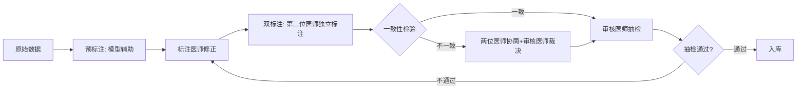

# 数据标注与模型评估

## 1. 评估指标

| 指标 | 定义 | 目标值 |
|---|---|---|
| 准确率 | AI 模型独立诊断结论与金标准一致的比例 | ≥ 89%（基层）/ ≥ 92%（三甲） |
| 敏感性 | 真阳性 /（真阳性 + 假阴性）= 1 - 模型漏诊率 | ≥ 95% |
| 特异性 | 真阴性 /（真阴性 + 假阳性）= 1 - 误诊率 | ≥ 85% |
| 阳性预测值（PPV） | 真阳性 /（真阳性 + 假阳性）= AI 提示阳性结果中与金标准一致的比例 | ≥ 85%（基层）/ ≥ 90%（三甲） |
| AUC-ROC | ROC 曲线下面积 | ≥ 0.90 |
| 严重幻觉率 | 改变诊断方向的幻觉占比 | ≤ 0.5% |
| 整体幻觉率 | 与知识库不符或无依据的诊断占比 | ≤ 5% |
| 高风险病种幻觉率 | 高风险病种中幻觉占比 | ≤ 1% |
| 量化后幻觉率增量 | 量化（GPTQ/AWQ）后幻觉率相比全精度模型的增量 | ≤ 0.5% |

> **指标边界**：本节所有指标均为 **AI 模型独立级别**指标。[00-项目总览](00-项目总览与核心指标.md) 中的"漏诊率 15%→5%"为**人机协同级别**指标，两者不可简单等同。模型级别敏感性 ≥ 95% 是人机协同漏诊率 ≤ 5% 的必要条件但非充分条件。**PPV 的临床价值**：PPV 比准确率更能反映 AI 辅助的临床价值——高 PPV 意味着 AI 提示的阳性结果更可靠，医生更愿意参考；低 PPV 导致频繁误诊，医生可能降低对 AI 的信任度反而增加漏诊风险。在超声筛查场景下，PPV 与 [00-项目总览](00-项目总览与核心指标.md) §2.2 的 PPV 指标对齐。

## 2. 评估数据集

| 要求 | 说明 |
|---|---|
| 各器官最低样本量 | ≥ 200 例/器官（训练+验证+测试合计） |
| 灰度验证最低样本量 | 验证集 ≥ 100 例（独立于训练/测试集），因此总样本量需 ≥ 667 例/器官（100 ÷ 15% ≈ 667）。**置信区间要求**：验证集 100 例的准确率 95% 置信区间下限须 ≥ 85%（即实测准确率须 ≥ 91% 方能以 95% 置信度确认真实准确率 ≥ 85%），而非简单的大于等于目标值。二项分布下 100 例验证集的 95% 置信区间宽度约 ±6%（p=0.89 时），此区间内须不包含 85% 以下值，确保验证结果可靠区分 89% 与 85% 的差异。**灰度发布阶段贝叶斯补充评估**：灰度期间新增数据可结合先验分布（基于开发验证数据）进行贝叶斯后验估计，在较少样本量下获得更窄的置信区间，加速灰度验证决策 |
| 病种分布 | 覆盖常见病、少见病、边界案例，按发病率加权。**边界案例定义**（与 [01-系统架构设计](01-系统架构设计.md) §5.7 一致性验证规范对齐）：TI-RADS 3/4a/4b、LI-RADS 3/4、BI-RADS 3/4a 的病例，以及专科智能体置信度在器官级阈值 ±0.05 范围内的病例。灰度验证集（≥ 100 例）中边界案例须 ≥ 30 例，确保一致性验证的统计效力 |
| 金标准 | 病理结果 / 手术结果 / 专家共识诊断 |
| 数据集划分 | 训练 70%、验证 15%、测试 15%，按器官分层抽样 |
| 更新频率 | 每季度补充新病例，年度全量重评 |

> **样本量说明**：200 例为模型训练的最低门槛（验证集约 30 例），仅适用于早期开发验证。灰度发布上线要求验证集 ≥ 100 例（见 [01-系统架构设计](01-系统架构设计.md) 2.4 节），因此正式上线前须积累 ≥ 667 例总样本。一期三器官（甲状腺、肝脏、心脏）均须独立满足此样本量要求。**渐进式灰度策略**：若一期时间线内无法达到 ≥ 667 例/器官，可采用渐进式灰度——以验证集 ≥ 50 例启动灰度发布（辅助级别限制为基础辅助），灰度期间持续积累数据至验证集 ≥ 100 例后升级为标准辅助。采用主动学习策略优先标注高信息量样本（模型置信度低但临床重要的病例），可减少约 30% 标注量达到同等验证效果。

**最低可行数据量里程碑**（与 [06-开发环境与进度规划](06-开发环境与进度规划.md) 6.1 节数据轨道对齐）：

| 里程碑 | 每器官最低样本量 | 对应开发阶段 | 数据不足降级策略 |
|---|---|---|---|
| 开发验证 | ≥ 200 例 | Gate 1 前 | 使用公开数据集补充，限制为基础辅助级别 |
| 灰度发布 | ≥ 667 例（验证集 ≥ 100 例） | 灰度发布前 | 延长灰度验证期，限制辅助级别为基础辅助。**部分完成的多器官诊断结果不计入灰度发布核心指标**（避免样本偏差——部分完成结果的准确率不能代表完整诊断能力），仅完整完成所有器官的诊断结果计入灰度发布核心指标，与 [01-系统架构设计](01-系统架构设计.md) §4 多器官部分完成输出策略对齐。**灰度发布判定规则**：（1）部分完成率 ≤ 20% 时，灰度发布判定以完整诊断准确率为准；（2）部分完成率 > 20% 时，灰度发布判定须以"完整诊断 + 部分完成诊断"的加权准确率为准（权重：完整诊断 70%，部分完成诊断 30%）。**部分完成结果须纳入独立质量监控**——标记 `incomplete: true` 单独统计准确率，若与完整诊断准确率差异 > 5% 触发专项审查 |
| 全量发布 | ≥ 667 例 + 灰度期间新增 | 全量发布前 | 继续灰度验证，不升级为全量 |

## 3. 评估触发时机

| 触发事件 | 评估范围 |
|---|---|
| 模型更新 | 全量评估 |
| 知识库重大更新 | 受影响器官专项评估 |
| 灰度发布期间 | 实时监控 + 24h 后全量评估 |
| 定期评估 | 每季度全量 |
| 漂移告警触发 | 专项评估 |

## 4. 数据-训练-评估-上线闭环

```mermaid
graph TD
    A[原始临床数据] --> B[数据标注]
    B --> C{标注质量达标?}
    C -->|否| B
    C -->|是| D[标注数据入库 UDT标准化]
    D --> E[模型训练]
    E --> F{验证集指标达标?}
    F -->|否| E1[调整策略或补充数据]
    E1 --> E
    F -->|是| G[模型评估 测试集+金标准]
    G --> H{评估指标达标?}
    H -->|否| G1[分析原因 补充数据]
    G1 --> E
    H -->|是| I[模型导出 PyTorch→HuggingFace(vLLM full默认)/GGUF(llama.cpp compact默认)]
    I --> J[灰度发布 5%流量+24h监控]
    J --> K{灰度指标达标?}
    K -->|否| L[回退至旧模型]
    K -->|是| M[全量发布]
    M --> N[模型漂移监控]
    N --> O{漂移超阈值?}
    O -->|是| G
    O -->|否| N
```

**模型导出流水线规范**：

| 步骤 | 转换路径 | 验证标准 | 回退策略 |
|---|---|---|---|
| 1. PyTorch → ONNX | 视觉模型导出为 ONNX 格式 | 数值一致性：ONNX 推理输出与 PyTorch 输出最大绝对误差 < 1e-5 | 修复导出参数，重试 |
| 2. ONNX → TensorRT | 视觉模型编译为 TensorRT Engine | 推理延迟达标（导航 ≤ 50ms），数值一致性：最大绝对误差 < 1e-4，**分类结果一致率 ≥ 99.9%**（同一输入在 PyTorch FP32 和 TensorRT FP16 下的分类结果一致比例，分类结果不一致时强制回退至 FP32） | FP16→FP32 回退条件：① FP16 数值一致性最大绝对误差 ≥ 1e-4 且 < 5e-4 时回退至 FP32；② FP16 推理出现 NaN/Inf 输出时立即回退至 FP32；③ 分类结果一致率 < 99.9% 时强制回退至 FP32；④ FP32 回退后推理延迟须仍 ≤ 80ms（导航），否则须降低输入分辨率或模型复杂度 |
| 3. PyTorch → HuggingFace → GGUF | LLM 模型量化为 GGUF 格式（Q4_K_M/Q5_K_M） | 量化后幻觉率增量 < 0.5%，推理延迟 < 3s（RTX 3060） | 切换至更高精度量化（Q5_K_M→Q8_0） |
| 4. FunASR Paraformer-zh ONNX Runtime 部署 | 语音模型使用 ONNX Runtime 推理（视觉模型使用 TensorRT Engine 推理，两者为不同推理框架，但均非 PyTorch 原生推理），消除 PyTorch 与 vLLM 混合运行的显存碎片化风险 | 术语识别准确率 ≥ 90%（ONNX 导出后 WER 增量 < 0.5%），推理延迟 < 500ms（RTX 3060），常驻显存 ≤ 0.5GB | FunASR ONNX 导出后精度劣化（WER 增量 ≥ 0.5%）时评估 PyTorch 原生推理作为降级方案 |
| 4a. FunASR + vLLM + TensorRT 混合运行显存碎片化验证 | FunASR ONNX Runtime 推理 + LLM vLLM 推理 + 视觉模型 TensorRT 推理混合运行时的显存碎片化率测量 | 显存碎片化率 < 30%（Warning 阈值），< 40%（热重载触发阈值） | 碎片化率超阈值时评估增加预防性热重载频率或优化 ONNX Runtime 显存分配策略 |

> **显存碎片化长期运行验证**：Gate 0A 的碎片化率测量须在**持续运行 ≥ 4 小时**后测量（非短时间压测），模拟实际临床使用场景（上午门诊 4 小时连续运行）。短时间压测可能无法暴露长时间运行后的碎片化累积效应。验证方法：启动 FunASR + vLLM + TensorRT 全部模型后，以 10 例/小时频率模拟诊断请求，4 小时后测量显存碎片化率。若 4 小时后碎片化率 > 30%，须在 Gate 0A 阶段评估 FunASR 切换至 ONNX Runtime 部署。**预防性热重载策略**：每 2 小时无诊断请求时自动执行预防性热重载（与 [01-系统架构设计](01-系统架构设计.md) §5.8 一致），避免碎片累积至 40% 才被动触发。

> **步骤 4a 为 Gate 0A 必须验证项**：混合运行显存碎片化验证是 compact 模式能否稳定运行的前提条件，须在 Gate 0A 阶段完成（与 [06-开发环境与进度规划](06-开发环境与进度规划.md) §6.3 Gate 0A 验证项对齐），不可推迟至模型导出流水线后期。
| 5. PyTorch → vLLM / llama.cpp | LLM 模型部署：**compact 模式默认 llama.cpp**（常驻显存 ~3GB，按需分配，检索模型可全部 GPU 推理），**full 模式默认 vLLM**（PagedAttention + Continuous Batching 高并发优势）。通过 `InferenceEngine` Protocol 接口统一业务逻辑，与 [01-系统架构设计](01-系统架构设计.md) §5.7 推理框架选型对齐 | 推理延迟 < 2s，并发能力达标；**vLLM 与 llama.cpp 输出一致性验证（分阶段方案）**：**一期阶段一**（Gate 0A）：验证集 ≥ 100 例/器官（TI-RADS 3↔4、LI-RADS 3↔4、BI-RADS 3↔4a 各 ≥ 30 例），临床决策边界差异率点估计 ≤ 3%，作为技术可行性初步判断，不作为部署依据；**一期阶段二**（Gate 0B/灰度发布前）：验证集扩充至 ≥ 300 例（TI-RADS 3↔4、LI-RADS 3↔4、BI-RADS 3↔4a 各 ≥ 100 例），边界差异率 95% 置信区间上界 ≤ 2%，作为临床部署的正式要求。**阶段一必要性**：一期初期临床数据积累有限，300 例边界病例要求（按边界率 15-20% 计算约需 1500-2000 例总病例）远超一期可收集规模。阶段一以 100 例验证集提供初步一致性判断，避免因数据不足导致一致性验证完全无法开展。阶段一通过后可继续推进部署；阶段一未通过则暂停部署，继续数据积累。阶段二须在灰度发布前完成，300 例边界差异率验收通过方可进入临床使用，详见 [01-系统架构设计](01-系统架构设计.md) §5.7 一致性验证规范 | 调整 vLLM / llama.cpp 配置或回退至另一方案 |

**llama.cpp 与 vLLM 一致性验证详细要求**：

| 验证指标 | 一期标准 | 说明 |
|---|---|---|
| 分级一致率 | ≥ 95% | 同一输入在两个框架下的分级结论一致比例 |
| 临床决策边界差异率 | ≤ 1% | 跨越临床决策边界（如 TI-RADS 3→4）的差异比例 |
| 幻觉率差异 | ≤ 0.5% | 两个框架幻觉率的差值 |
| 推理延迟差异 | ≤ 20% | 两个框架延迟的相对差异 |

**一致性验证测试集要求**：

| 测试集类型 | 样本量要求 | 说明 |
|---|---|---|
| 常规病例 | ≥ 200 例 | 覆盖各器官常见病种 |
| 边界病例 | ≥ 300 例 | TI-RADS 3/4a/4b、LI-RADS 3/4、BI-RADS 3/4a，每类 ≥ 100 例 |
| 高风险病种 | ≥ 100 例 | 覆盖高风险病种 |

**降级方案验证要求（bge-m3-medical 纯文本检索）**：

| 验证项 | 目标值 | 说明 |
|---|---|---|
| 纯文本检索 Top10 | ≥ 88% | 知识库检索召回率 |
| 混合检索召回率 | ≥ 85% | 降级模式下的综合召回率 |
| 端到端诊断准确率 | ≥ 89%（基层）/ ≥ 92%（三甲） | 与原目标一致 |

**基线准确率样本量要求**：

| 统计目标 | 样本量 | 说明 |
|---|---|---|
| 基线准确率验证 | ≥ 200 例 | 二项分布下 95% 置信区间宽度约 ±6% |
| 目标值验证（89% vs 85%） | ≥ 100 例验证集 | 95% 置信区间下限须 ≥ 85% |
| 灰度发布验证 | ≥ 667 例总样本（验证集 ≥ 100 例） | 满足统计效力要求 |

> **基线验证统计效力说明**：二项分布下，50 例样本的 95% 置信区间宽度约 ±12%（p=0.78），不足以可靠区分 89% 与 85%；200 例样本的置信区间宽度约 ±6%，可满足基本验证需求。若实测基线准确率与 78% 偏差超过 ±3%，需重新校准目标值；偏差超过 ±5% 则触发 No-Go 决策评估。

> **LLM 架构兼容性硬性要求**：步骤 3 的 HuggingFace → GGUF 转换路径仅适用于标准 Transformer 架构模型（如 Qwen2、ChatGLM4、InternLM2）。LLM 基座模型选型时须确保模型架构支持此转换路径，不支持 GGUF 量化的架构（如 Mamba 混合架构、RWKV 等）一期不纳入候选。此要求与 [01-系统架构设计](01-系统架构设计.md) §5.7 LLM 候选列表的选型硬性要求一致。

> 每步转换后须在标准测试集上运行精度验证，不达标不得进入下一步。量化在步骤 3（GGUF 量化）中执行，不在 ONNX 阶段量化。

> **端到端精度验证**：除单步精度验证外，须增加端到端精度验证步骤——PyTorch 原始模型输出与最终部署模型（TensorRT Engine / GGUF 量化模型）输出的端到端对比，最大允许绝对误差 < 2e-4（视觉模型）或量化后幻觉率增量 < 0.5%（LLM 模型）。端到端验证不达标时须回溯定位精度损失来源并优化。

| 环节 | 触发条件 | 责任人 | 验收标准 |
|---|---|---|---|
| 数据标注 | 新增数据 ≥ 50 例 | 标注医师 + 审核医师 | 双标注一致率 ≥ 85%，抽检通过率 ≥ 95% |
| 模型训练 | 标注数据 ≥ 200 例/器官 | AI 工程师 | 验证集准确率 ≥ 目标值 - 2% |
| 量化影响评估 | 模型训练完成后 | AI 工程师 | 量化后幻觉率增量 ≤ 0.5%，准确率保留 ≥ 98%；不达标则切换至 8-bit 量化或更换推理框架 |
| 模型评估 | 训练完成 | AI 工程师 + 临床专家 | 全部指标达标 |
| 灰度发布 | 评估通过 | AI 工程师 + 运维 | 24h 无严重幻觉，不劣于旧模型 |
| 全量发布 | 灰度通过 | 运维 | 全量指标稳定 |
| 漂移监控 | 上线后持续 | AI 工程师 | 无漂移告警 |

## 5. 标注规范

### 5.1 标注人员资质

| 角色 | 要求 | 职责 |
|---|---|---|
| 标注医师 | 执业医师 + 超声科 ≥ 3 年 | 执行标注 |
| 审核医师 | 副主任医师 + 超声科 ≥ 5 年 | 审核标注质量 |
| 标注管理员 | 熟悉标注工具与流程 | 管理任务、统计质量 |

### 5.2 标注流程



### 5.3 标注质量控制

| 指标 | 目标值 | 统计方法 |
|---|---|---|
| 双标注一致率 | ≥ 85%（Cohen's Kappa ≥ 0.80） | 每 100 例统计 |
| 审核抽检通过率 | ≥ 95% | 每批次统计 |
| 标注完成率 | ≥ 98% | 每周统计 |

### 5.4 标注工具

| 工具 | 用途 |
|---|---|
| Label Studio | 图像标注（病灶框选、分割） |
| 自定义 UDAF 标注插件 | 术语标准化标注，自动映射至 UDAF 词汇表 |

### 5.5 嵌入模型微调规范

> **多模态嵌入模型选型说明**：一期主方案为 Ultrasound-CLIP（超声专属多模态对齐模型，基于 UDAF 框架 9 个诊断维度定制，36.4 万超声图文对 US-365K 预训练，原生超声图像↔文本对齐，详见 [01-系统架构设计](01-系统架构设计.md) §5.4）。**生产就绪度风险提示**：Ultrasound-CLIP 论文报告的 I2T@10 开箱即用 ≥ 37%、微调后 ≥ 45% 指标基于公开数据集，院内实际表现须 Gate 0A 实测验证。若院内 I2T@10 < 37%，须立即降级为 bge-m3-medical 纯文本检索（Top10 ≥ 88%），降级切换涉及向量索引重建（768维→1024维，约2小时），离线快照方案可将恢复时间缩短至约 10 分钟（详见 [01-系统架构设计](01-系统架构设计.md) §5.4 离线快照方案）。**Ultrasound-CLIP 许可协议与维护风险评估**：Ultrasound-CLIP 已确认为非商业许可，一期学术研究场景可合法使用；商业过渡路径（协商商业授权或切换 bge-m3-medical）详见 [01-系统架构设计](01-系统架构设计.md) §5.5。**NMPA 注册与商业许可的潜在冲突**：NMPA 二类医疗器械注册审查要求软件所有组件的知识产权清晰且可商业使用，非商业许可模型嵌入医疗器械软件在注册审查时可能构成障碍。**⚠️ 此问题已标记为 Gate 0 前置处理——一期学术研究验证阶段可合法使用 Ultrasound-CLIP，但项目立项前即须启动商业授权谈判，Gate 0 启动后 30 个自然日内须获得商业授权意向书面确认（谈判应提前至立项阶段启动，而非等待 Gate 0 后），逾期未确认则自动切换为 bge-m3-medical 主方案。** 商业过渡路径详见 [01-系统架构设计](01-系统架构设计.md) §5.5。**若授权谈判失败**：bge-m3-medical 纯文本检索方案须作为 NMPA 注册的备选路径——bge-m3-medical 为 MIT 许可，无商业使用限制，但检索能力仅限文本模态（无图像↔文本对齐），检索召回率可能低于 Ultrasound-CLIP 多模态方案。Gate 0A 须同时验证 bge-m3-medical 纯文本检索的召回率基准与端到端诊断准确率，确保授权谈判失败时有可立即切换的已验证备选方案、避免项目延期（验证提前至 Gate 0A 而非 Gate 1）。**授权谈判失败时的项目范围调整预案**：若商业授权谈判失败，项目核心指标须相应调整——（1）多模态检索 I2T@10 指标取消，替换为纯文本检索 Top10 ≥ 88%；（2）混合检索召回率目标从 ≥ 90% 下调至 ≥ 85%；（3）端到端诊断准确率目标维持不变（≥ 89% 基层 / ≥ 92% 三甲），但须基于纯文本检索路径重新验证；（4）NMPA 注册材料中须声明检索模式为纯文本检索，并说明对诊断准确率的影响评估。此预案须在 Gate 0A 商业授权意向确认阶段同步评估，确保授权谈判失败后项目可立即切换至纯文本检索路径继续推进。**模型持续维护风险**——若 Ultrasound-CLIP 原作者停止维护，模型兼容性（与新版本 PyTorch/CUDA/Python）将无人保障，须在项目内明确长期维护责任方（建议由项目团队 fork 并建立内部维护分支）；（3）**生产就绪度验证时长**——Gate 0A 中的 Ultrasound-CLIP 验证从"2 并发持续 1 小时无性能劣化"延长至**8 小时连续运行验证**（模拟一个完整工作日），暴露内存泄漏、GPU 显存碎片化等长时间运行问题。以下微调规范适用于主方案的院内数据微调，以及降级备选方案（bge-m3-medical 纯文本检索）。

**主方案：Ultrasound-CLIP 院内数据微调**

| 维度 | 规格 |
|---|---|
| 基座模型 | Ultrasound-CLIP（超声专属多模态对齐模型，双编码器 + UDAF 引导异质图 GNN 编码器 + 语义软标签，768 维输出） |
| 微调方式 | 院内超声图文对微调（Ultrasound-CLIP 已在 US-365K 上预训练，院内数据微调用于适配本地超声设备特征与诊断习惯） |
| 微调数据 | 院内超声图文对（数量视本地数据量而定，Ultrasound-CLIP 已具备超声跨模态对齐能力，微调数据量需求远低于通用模型 LoRA 微调） |
| 微调时间 | ≤ 1 天（单 GPU） |
| 评估基准 | 超声跨模态检索测试集（≥ 500 查询），开箱即用 I2T@10 ≥ 37%，微调后 I2T@10 ≥ 45% |
| 微调产出 | 微调后模型权重，用于 Qdrant 向量索引构建与在线推理（与 [01-系统架构设计](01-系统架构设计.md) §5.4 知识库向量检索已剥离至 Qdrant 对齐） |
| 版本管理 | `embed_v{major}.{minor}.{patch}`，与知识库版本兼容性矩阵关联 |

**降级备选：bge-m3-medical 纯文本检索**

> **bge-m3-medical 定位说明**：bge-m3-medical 在一期主方案中为 Ultrasound-CLIP 的 **Sparse 检索组件**（非独立兜底层），两者协同工作——Ultrasound-CLIP 负责 Dense 检索（多模态向量），bge-m3-medical 负责 Sparse 检索（文本精确匹配），检索结果融合后供精排使用。仅当 Ultrasound-CLIP 完全不可用时，bge-m3-medical 方独立承担检索职责（纯文本 Dense + Sparse 检索模式），详见 [01-系统架构设计](01-系统架构设计.md) §5.4 检索降级链路。以下描述为 bge-m3-medical 独立承担检索职责时的降级备选方案规格。

| 维度 | 规格 |
|---|---|
| 基座模型 | bge-m3-medical（BAAI bge-m3 医疗领域微调版，1024 维，支持 Dense + Sparse 检索模式）。注意：bge-m3-medical 输出维度为 1024，与一期主方案 Ultrasound-CLIP（768 维，`EMBEDDING_DIM=768`）不同。采用**离线快照方案**（详见 [01-系统架构设计](01-系统架构设计.md) §5.4）——预生成 1024 维索引的离线快照文件（不加载到 Qdrant 内存），模型替换时直接加载快照（约 10 分钟），无需全量重建索引 |
| 微调方式 | 无需微调，上线即用 |
| 评估基准 | MTEB 中文医疗子集 + 自建超声检索测试集（≥ 500 查询），检索召回率 ≥ 88%（Top 10） |
| 微调产出 | 无（直接使用预训练权重），降级独立检索模式下用于 Qdrant 向量索引构建（与 [01-系统架构设计](01-系统架构设计.md) §5.4 知识库向量检索已剥离至 Qdrant 对齐） |
| 版本管理 | `embed_v{major}.{minor}.{patch}`，与知识库版本兼容性矩阵关联 |

**二期增强：M³Bind 超声专属多模态嵌入模型**（⚠️ 以下为二期规划内容，一期不实施，详见 [09-二期规划](09-二期规划与远期增强.md)）

| 维度 | 规格 |
|---|---|
| 微调数据 | ≥ 10 万条超声领域文本-图像对（二期积累后满足） |
| 评估基准 | 检索召回率 ≥ 92%（Top 10），优于一期主方案 ≥ 2% |
| 微调产出 | 超声专属多模态嵌入模型权重文件，用于 Qdrant 向量索引重建（与 [01-系统架构设计](01-系统架构设计.md) §5.4 知识库向量检索已剥离至 Qdrant 对齐） |
