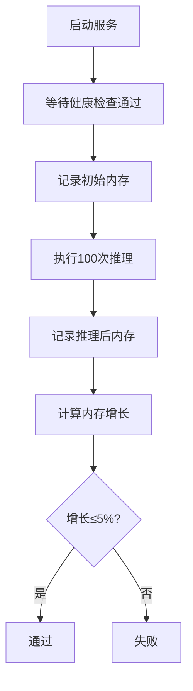

# CI内存测试集成技术说明

## 一、概述

本文档阐述将内存实测集成到CI流水线的技术决策和实施方案。

## 二、核心原因

### 2.1 回归检测

内存泄漏是AI系统中常见的隐患，尤其是在GPU资源管理和模型推理场景中。通过CI集成内存测试，可以：

- **及时发现泄漏**：每次代码提交自动检测内存变化
- **定位问题代码**：通过git diff关联内存变化与代码变更
- **防止泄漏累积**：在问题扩大前及时修复

### 2.2 环境一致性

开发环境与生产环境存在差异，CI流水线提供标准化测试环境：

| 维度 | 开发环境 | CI环境 |
| :--- | :--- | :--- |
| GPU型号 | 可能不同 | 固定型号 |
| 内存容量 | 可能更大 | 标准化配置 |
| 系统负载 | 波动 | 可控 |
| 依赖版本 | 可能不一致 | 锁定版本 |

### 2.3 性能基线建立

通过长期数据积累，建立内存使用基准：

- **启动内存基线**：服务启动后的初始内存占用
- **运行时波动**：正常推理过程中的内存变化
- **碎片化趋势**：长期运行后的显存碎片化程度

### 2.4 部署保障

**compact模式硬性要求**：64GB配置下内存占用≤22GB

```
内存预算分配（64GB配置）：
├── llama.cpp: 3GB
├── 检索模型: 9GB
├── vLLM (compact): 8GB
├── 系统及其他: 2GB
└── 预留: 40GB
    └── 合计: 22GB (上限)
```

### 2.5 GPU资源规划

验证显存分配策略的正确性：

| 配置模式 | vLLM显存利用率 | 目的 |
| :--- | :--- | :--- |
| compact | ≤80% | 与llama.cpp共享GPU |
| full | ≤95% | 最大化vLLM性能 |

## 三、集成价值

### 3.1 自动化验证

- 每次代码提交自动运行内存测试
- 无需人工干预，减少人为错误
- 测试结果自动记录和归档

### 3.2 快速反馈

```
代码提交 → CI触发 → 内存测试 → 结果反馈
     ↓              ↓             ↓
   分钟级        10-15分钟      即时通知
```

### 3.3 质量门禁

内存测试可作为CI流水线的阻断条件：

```yaml
if: memory_usage > 22GB
then: 阻断部署
      发送告警通知
```

### 3.4 数据积累

收集历史数据用于：
- 容量规划
- 性能优化
- 资源预测

## 四、测试内容

### 4.1 测试矩阵

| 测试项 | 测试目标 | 通过标准 | 测试时长 |
| :--- | :--- | :--- | :--- |
| 启动内存 | 验证服务启动后的初始内存占用 | ≤22GB（compact）/ ≤48GB（full） | 2分钟 |
| 推理内存 | 连续推理100次后的内存变化 | 增长≤5% | 5分钟 |
| 碎片化率 | 4小时连续运行后的显存碎片化 | ≤30%（warning）/ ≤40%（critical） | 4小时 |
| 恢复测试 | 连续推理后释放资源的能力 | 内存回归到基线的95%以内 | 3分钟 |

### 4.2 测试步骤



## 五、实施方案

### 5.1 CI流水线配置

```yaml
name: Memory Testing

on:
  push:
    branches: [main]
  pull_request:
    branches: [main]

jobs:
  memory-test:
    runs-on: ultrasound-gpu-runner
    steps:
      - name: Checkout code
        uses: actions/checkout@v4

      - name: Setup Python
        uses: actions/setup-python@v5
        with:
          python-version: "3.11"

      - name: Install dependencies
        run: pip install -r requirements.txt

      - name: Start services
        run: docker-compose up -d

      - name: Wait for readiness
        run: python scripts/wait_for_health.py

      - name: Run memory tests
        run: python tests/memory/test_memory_usage.py

      - name: Report results
        run: python scripts/report_memory_results.py
```

### 5.2 测试脚本结构

```
tests/memory/
├── test_memory_usage.py    # 主测试脚本
├── gpu_monitor.py          # GPU监控工具
├── memory_analyzer.py      # 内存分析工具
└── config.py               # 测试配置
```

## 六、指标监控

### 6.1 监控指标

| 指标 | 单位 | 采集频率 | 存储位置 |
| :--- | :--- | :--- | :--- |
| 内存使用量 | GB | 每秒 | InfluxDB |
| 显存使用量 | GB | 每秒 | InfluxDB |
| 碎片化率 | % | 每分钟 | InfluxDB |
| 推理延迟 | ms | 每次请求 | InfluxDB |

### 6.2 告警规则

| 告警级别 | 条件 | 通知方式 |
| :--- | :--- | :--- |
| Warning | 碎片化率≥30% | Slack通知 |
| Critical | 碎片化率≥40% | Slack+邮件 |
| Fatal | 内存占用超过预算 | 阻断部署+紧急通知 |

## 七、代码示例

```python
# 内存测试核心逻辑
async def test_memory_usage():
    """测试服务内存使用情况"""
    # 记录基线
    baseline = await get_memory_usage()
    
    # 执行推理
    for _ in range(100):
        await inference_engine.generate(request)
    
    # 记录推理后内存
    post_inference = await get_memory_usage()
    
    # 计算增长
    growth = (post_inference - baseline) / baseline
    
    # 断言
    assert growth <= 0.05, f"内存增长超过5%: {growth:.2%}"
```

## 八、注意事项

### 8.1 资源隔离

确保测试环境与其他任务隔离：

- 使用专用Runner
- 预留足够资源
- 避免资源竞争

### 8.2 测试时间

碎片化测试需要较长时间（4小时），建议：

- 在夜间或低峰时段运行
- 设置超时保护
- 并行运行快速测试和慢速测试

### 8.3 结果解读

内存波动是正常现象，关注趋势而非单次数据点：

- 使用滑动窗口平均
- 建立置信区间
- 对比历史基线

## 九、总结

将内存实测集成到CI流水线是保障系统稳定性的重要措施：

| 维度 | 价值 |
| :--- | :--- |
| **可靠性** | 防止内存泄漏和资源耗尽 |
| **可预测性** | 确保部署符合资源预算 |
| **可观测性** | 建立性能基线和趋势监控 |
| **自动化** | 减少人工干预，提升效率 |

---

**文档版本**: 1.0  
**创建时间**: 2026-05-09  
**适用范围**: LLM推理轨道内存测试